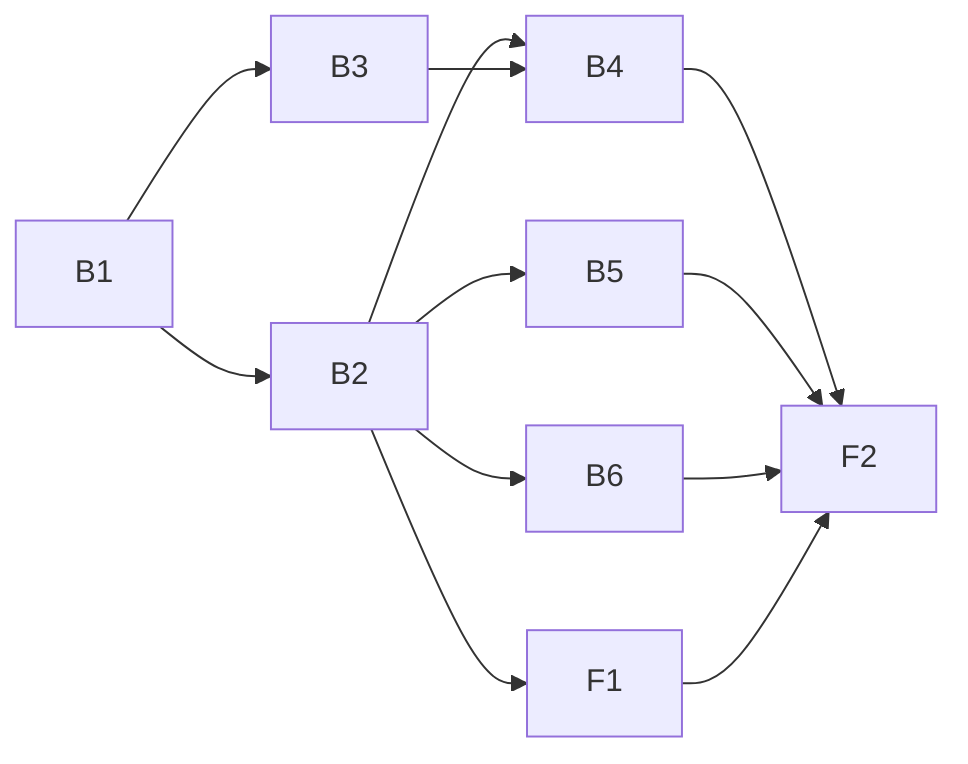

# Plan: Inter Agent Communication

Eight units, one pull request: six back end (`plan-backend.md`), two front end (`plan-frontend.md`). Phase A (D1) is already built and has no unit. D6 (the PostToolUse hook) is out.

## Assumptions taken from the spec's open questions

The spec offers a default for each; this plan builds on that default. A human who disagrees should say so before B3 and B5 start.

1. D8 option (c): units merge into `plan.md`; signing stays on the locked `state sign`. Hand edits to `plan.md` checkboxes remain unlocked, recorded in `contract.md` as the known gap.
1. Redis key layout follows the code and W26 (`openlanes:<repo>:<node>:<checkout>:mail`), the plan carried in the message.
1. Redis is an optional faster path beside the always-written `state.json`.
1. `mail ack` takes one message number.
1. Existing folders keep `plan-backend.md` / `implementation-plan.md`; no `resync dirs` migration. Routing still reads a legacy `plan-frontend.md`.
1. `read` and `last-known-state` are field additions; no schema `version` bump; both optional so old `state.json` files validate.
1. `openlanes` everywhere, never `agentilda`.

Open question 4 (does a harness thread already drain Redis each second) is not assumed: B4 starts by tracing it.

## Units

| Id | Unit | Discipline | Depends on |
| :-- | :-- | :-- | :-- |
| B1 | Read receipt, `mail ack`, `mail render`, unacked count | back end | nothing |
| B2 | `last-known-state` in `state.json`, schema, `state resume` | back end | B1 |
| B3 | Optional Redis transport for mail (`Live::Mail`) | back end | B1 |
| B4 | Dispatcher thread drains mail; harness fallback resume record | back end | B2, B3 |
| B5 | Units into `plan.md`, `contract.md` rename, ack and resume prompts | back end | B1, B2 |
| B6 | Optional `openapi.yaml`, `openlanes api docs` | back end | B1, B2 |
| F1 | Unacked count, `last-known-state`, file list on board and web page | front end | B1, B2 |
| F2 | **Integration check**: mail round trip, CLI to board and page | front end | all of the above |

## Order

1. B1 alone.
1. B2 alone (shares `plan_state.rb`, the schema and `cli.rb` with B1).
1. Then in parallel: B3, B5, F1. B6 follows B2 too, but shares `cli.rb` with nothing else at this point, so it may join this wave.
1. B4 once B2 and B3 are in.
1. F2 last.

## Dependency graph

## Shared files and how they are sequenced

| File | Units | Why it is safe |
| :-- | :-- | :-- |
| `lib/openlanes/plans/plan_state.rb`, `schemas/plan-state.schema.json` | B1, B2 | B2 depends on B1 |
| `lib/openlanes/cli.rb` | B1, B2, B6 | B1 → B2 → B6 |
| `lib/openlanes/engine/dispatcher.rb` | B4 only | B5 is told not to touch it |
| `lib/openlanes/web.rb` | F1 only | B5's rename stops at it; F1 finishes it |

## HTTP surface

None. This gem has no HTTP API of its own for this plan (the web page is the interface, not a contract), so no `openapi.yaml` is written for 003.00. B6 builds the collector for plans that do.

## Integration check

F2, `spec/integration/mail_round_trip_spec.rb`: a real plan folder, the real CLI, the real board and web app. `mail send` → `state.json` (with and without Redis) → board and page show one unacked → `mail ack` → zero → `mail render` leaves the folder unchanged → a round assigns the same agents either way → an agent killed without a resume record shows a harness entry on the page. Full detail in `plan-frontend.md`.

## Size

Eight units is the ceiling. B5 is the widest (about fifteen files) but mechanical; a reviewer checks it with the `rg` in its done-when. If review finds it too big, split by phase as the spec allows: B1, B2, B5, F1 as one PR; B3, B4 second; B6 third.

## Done when

- [x] Every unit's done-when spec passes.
- [x] `bundle exec rspec` 0 failures, `just lint` zero offenses, coverage at or above 98.63%.
- [ ] `rg implementation-plan lib agents` is empty. Not met on purpose: the agent prompts name the legacy files for folders planned before this change (decision D3).
