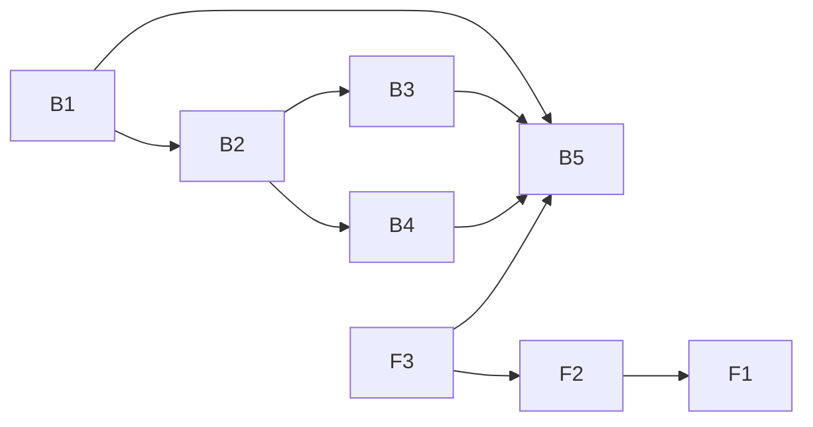

# Plan 004.00: Web Control Room (close-out)

The control room is built. This plan repairs naming drift, makes the `web/dist` build order impossible to get wrong, and adds the automated evidence the spec says is owed: restart, two checkouts on one Redis, keyboard-only use, and coverage of changed code. One pull request, eight units.

Details per unit: `plan-backend.md` (`luke-backend`), `plan-frontend.md` (`rey-frontend`).

## Units

| Id | Unit | Discipline | Depends on | Done when |
| --- | --- | --- | --- | --- |
| B1 | Naming and `web/dist` build order | back end | nothing | `spec/openlanes/packaging_spec.rb` |
| B2 | Process harness and **integration check** | back end | B1 | `spec/integration/control_room_spec.rb` |
| B3 | Restart evidence | back end | B2 | `spec/integration/restart_spec.rb` |
| B4 | Two-checkout evidence | back end | B2 | `spec/integration/two_checkouts_spec.rb` |
| B5 | CI: build order, drift check, changed-code coverage | back end | B1, B2, B3, B4, F3 | `spec/openlanes/coverage_changed_spec.rb`, `circleci config validate` |
| F3 | Vitest coverage of changed files | front end | nothing | `web/scripts/coverage-changed.test.ts` |
| F2 | Reconnect banner and read-only peer tab | front end | F3 | `Header.test.tsx`, `Board.test.tsx`, `App.test.tsx` |
| F1 | Keyboard-only Cypress flow | front end | F2 | `web/cypress/e2e/keyboard.cy.ts` |

## Dependency graph

## Order

1. In parallel: B1 (back end) and F3 (front end).
2. B2, beside F2.
3. B3 and B4 in parallel; they own disjoint `lib/` files. F1 beside them.
4. B5 last: it wires every new spec and script into CI.

## Sequential by shared file

- `.circleci/config.yml`: B5 only. B1 leaves CI alone so the two never collide.
- `spec/support/control_room_process.rb`: B2 only. B3 and B4 request harness changes through mail rather than editing it.
- `web/src/shell/Header.tsx`: F2, then F1.
- `web/package.json`, `web/vite.config.ts`: F3 only.

## Integration check

B2's `spec/integration/control_room_spec.rb`, against a real Redis and the real `exe/openlanes` processes, nothing stubbed. It must show: `GET /` serves the built `web/dist/index.html`; the SSE stream delivers the fixture's plans; an engine-side state change reaches the stream within one second, measured; and a `hold` command sent twice with one id is applied once, with its reply on the stream.

## Spec done-when, mapped

| Spec item | Unit |
| --- | --- |
| `openlanes run` starts both, `--no-web` headless | kept green; B2 exercises it |
| Board updates within a second over SSE | B2 |
| Command applied once, reply on page | B2 (exists in `commands_spec.rb`) |
| Kill either process, lose nothing | B3 |
| Two checkouts, read-only peers, no shared claim | B4, F2 |
| Axe, keyboard, reduced motion | F1 (axe and reduced motion exist) |
| Ruby lint, test, changed-code coverage ≥ 95% | B5 |
| Front-end lint, typecheck, Vitest, Cypress flows | F3, F1 |
| CircleCI builds front end; gem has `web/dist`, gitignored | B1, B5 |
| Spec, contract, README agree on names | B1, B5 drift check |

## Risks carried from the spec

- Process-kill specs flake: deadlines, not sleeps; each spec on its own Redis database.
- Cypress and `npm run build` have not been run in this checkout yet: budget one fix cycle in F1 and B2.
- A keyboard pass may expose Radix focus-trap bugs, widening F1.

> [!NOTE]
>
> [2026-10-15 09:10:16 AM PDT] [ agent: luke-backend   status: **Interrupted, round 1 (harness died)** ]
