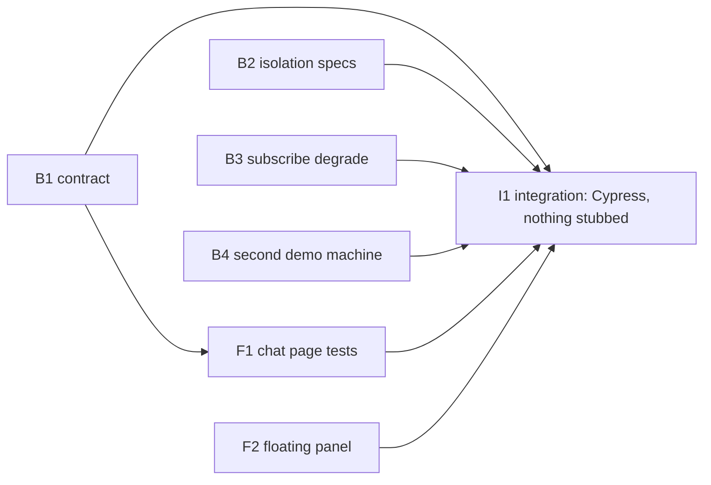

# Plan 006.00: Chat Between Machines

## Starting point

The spec's Risks put it first: the chat is already built on this branch (Research, finding 1). Hub, routes, relay, page components, the shared floating panel and a Cypress spec all exist, and the Ruby suite is green. So these units close gaps and prove the in-scope list. They do not build from scratch. Each unit runs its named test against the code as it stands, and changes code only where that test fails or is missing.

Gaps found against the spec's in-scope checks:

- no written contract between the two halves (spec, "Back end / front end");
- no hub spec for two repositories on one store (item 7), or for db 1 against db 10 (item 8);
- no degrade path specified for a refused `PSUBSCRIBE` (Open question 2);
- `just web-test` never run, and coverage of `web/src/chat/` unmeasured (Research, finding 6);
- the Cypress chat spec has not been checked as an unstubbed end-to-end run.

## Units

| Id | Unit | Discipline | Owns | Depends on | Done when |
| :-- | :-- | :-- | :-- | :-- | :-- |
| B1 | The chat contract | back end | `contract.md`, one example in `spec/openlanes/web/app_spec.rb` | nothing | `spec/openlanes/web/app_spec.rb` |
| B2 | Repo and db isolation, timing specs | back end | `spec/openlanes/live/chat_spec.rb`, `lib/openlanes/live/chat.rb` | nothing | `spec/openlanes/live/chat_spec.rb` |
| B3 | Degrade on a refused subscription | back end | `lib/openlanes/live/subscriber.rb`, `spec/openlanes/live/subscriber_spec.rb` | nothing | `spec/openlanes/live/subscriber_spec.rb` |
| F1 | Web suite green, chat held to the spec | front end | `web/src/chat/**` | B1 | `web/src/chat/Chat.test.tsx`, `just web-test` |
| F2 | One floating panel for both | front end | `web/src/floating/**`, `web/src/copilot/Copilot.tsx` | nothing | `web/src/floating/FloatingPanel.test.tsx` |
| B4 | A second demo machine | back end | `lib/openlanes/live/node.rb`, `lib/openlanes/cli/web/web.rb`, `lib/openlanes/web/demo*.rb`, `justfile`, their specs | nothing | `spec/openlanes/live/node_spec.rb`, `spec/openlanes/web/demo_spec.rb`, `spec/openlanes/cli/web_spec.rb` |
| I1 | **Integration check**, two participants through the real server | front end | `web/cypress/e2e/chat.cy.ts`, `web/cypress.config.ts` | B1, B2, B3, B4, F1, F2 | `web/cypress/e2e/chat.cy.ts`, `just web-e2e` |

The full shape of each unit (owns, must not touch, depends on, done when) is in `plan-backend.md` (B1–B3) and `plan-frontend.md` (F1, F2, I1).

## Order

1. **First, together:** B1, B2, B3 and F2. None of them shares a file with another.
1. **After B1:** F1. It tests the page against the contract B1 writes.
1. **After B4's question was answered:** B4.
1. **Last:** I1, after every other unit.

Sequential because of shared files or shared ground:

- B2 and B3 both border `lib/openlanes/live/chat.rb`. B2 owns it. If B3 needs a change there, it waits for B2.
- F1 and F2 meet where `ChatPanel.tsx` uses `FloatingPanel`. F1 owns the caller and F2 the panel. A change to the panel's props goes in F2 first.
- I1 reads everything and writes only its Cypress file, so it runs last.

## Dependency graph

## Integration check

I1 owns it. Cypress drives a real page on the demo server: real `Web::App`, real `Live::Chat`, real SSE, and no `cy.intercept` on chat or events. The second participant is a page on a second demo process: `just web-e2e` starts a second `openlanes web --demo` on another port, sharing the same Redis and repository, which declares its own `username@hostname` (for example `demo@second-machine`) so it registers as a distinct machine. Every process that joins Redis declares its name as `username@hostname`; the demo flag that fakes it is B4's. Cypress drives that participant through `cy.request` against the second port: it accepts the invite, sends a message, and leaves (steps 2 to 4).

Decided 2026-10-14 by the owner: a second `openlanes web --demo` process with its own declared identity hosts the second participant, rather than the demo answering for its pretend machine or narrowing I1.

The run must show these steps:

- start from the ▾ menu;
- the Name dialog;
- the panel docked bottom left;
- the second page joining, and both names in the header;
- a message each way, with a URL linked;
- "<name> left";
- 403 on a POST without the CSRF token.

## Size

Six units, one pull request. Each unit adds or extends one spec file and a reviewer can check it in one sitting.

## Not in this plan

These are the spec's Out of scope list, and none is built here:

- updating the 004 contract's `agentilda:` prefix (B1 only notes it);
- load-testing Puma's SSE threads;
- Redis ACL provisioning;
- message history;
- avatars;
- any change to the copilot's behaviour or colours.

> [!NOTE]
>
> [2026-10-15 09:02:18 AM PDT] [ agent: luke-backend   status: **Interrupted, round 1 (harness died)** ]
