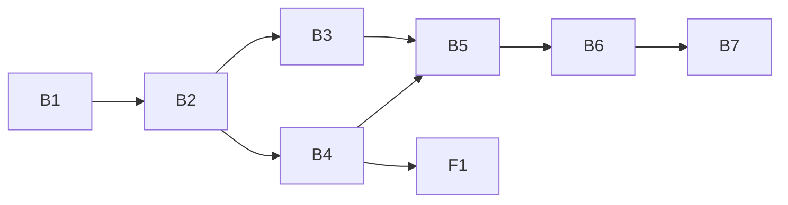

# 007.00 Plan Folder Naming — plan

Spec: `spec.md` (layers, migration last). Decisions: N1–N5 in `docs/decisions/decisions-on-plan-folder-naming.md`. One pull request, eight units.

## Units

| Id | Unit | Discipline | Depends on | Done when (spec file) |
| --- | --- | --- | --- | --- |
| B1 | Parser reads every form, old and new emoji | back end | nothing | `plans/feature_spec.rb`, `plans/ordinal_spec.rb`, `plans/status_spec.rb` |
| B2 | Writers emit `NNN.MM━━<emoji>━━❯<slug>`; N2 emoji; `UI.display_width` | back end | B1 | `plans/status_spec.rb`, `plans/feature_spec.rb`, `support/ui_spec.rb`, `plans/index_spec.rb` |
| B3 | `Tree` walks subfolders; numbers span them; `list-plans --all`; `created:` | back end | B2 | `plans/tree_spec.rb`, `lifecycle/creator_spec.rb`, `cli/list_plans_spec.rb` |
| B4 | `locked-by.pid`, git-ignored; 🔑 in `list-plans`; `locked` in the snapshot | back end | B2 | `plans/lock_spec.rb`, `engine/dispatcher_spec.rb`, `presentation/reporter_spec.rb` |
| B5 | `resync dirs` renames, moves into dated subfolders, revives, clears dead local locks | back end | B3, B4 | `lifecycle/resync/dirs_spec.rb`, `vcs/rename_date_spec.rb` |
| B6 | M10: `how-to-verify:` → `## How to tell it's working?` | back end | B5 | `plans/spec_spec.rb`, `lifecycle/resync/dirs_spec.rb` |
| B7 | Docs, README, **integration check** | back end | B6 | `spec/integration/plan_folder_migration_spec.rb` |
| F1 | Control room: new block emoji, 🔑 | front end | B4 | `web/src/board/model.test.ts`, `web/src/panels/support.test.ts` |

Details, owned files and must-not-touch lists: `plan-backend.md` (B1–B7), `plan-frontend.md` (F1).

## Order

- **Sequential because they share files:** B1 → B2 (`feature.rb`, `status.rb`), B2 → B3 (`bin/plan-number`), B5 → B6 (`resync.rb`, `dirs_spec.rb`).
- **Parallel:** B3 ∥ B4 (disjoint files), and F1 alongside B5–B7 once B4 is in.
- **Migration last** (spec Risks): nothing renames a folder on disk until B5, after the parser (B1), writers (B2), tree (B3) and lock (B4) agree on the layout.

## Integration check

B7 owns it: a temp git repository with old-form folders, driven through the real `exe/openlanes` (`resync dirs -n`, `resync dirs`, `list-plans`, `list-plans --all`, `create`) plus `Live::Snapshot`, nothing stubbed. It must show every rename and move previewed then performed with history kept, only open plans at the top level with no spaces, archived plans dated and listed under `--all`, a new number above the archived one, 🔑 and `locked` for a locked plan with an unchanged folder name, and a second `resync dirs` doing nothing.

## Open questions from the spec, settled for this plan

1. **Archive date:** git rename date first, then `state.json` `updated_at`, then today (B5 `RenameDate`). Covers shallow clones without verifying them.
1. **`list-plans --all` order:** open plans first, then `archive/`, `deferred/`, `abandoned/`; number order within each.
1. **Cross-host locks:** reported, never cleared.
1. **`🅱️` vs `🅱`:** both map to Product Block (B1).
1. **Reviving:** the state machine still renames in place; `resync dirs` moves a no-longer-inactive plan out of its subfolder and drops the date (B5). No new command.
1. **Linear `mapping.rb`:** keyed by status key; unaffected. B7's full-suite run is the check.
1. **M10 placement:** append to an existing `## How to tell it's working?`, else add it at the end of the spec (B6).
1. **`created:`:** in scope, written by `Creator` and `Brief` (B3).
