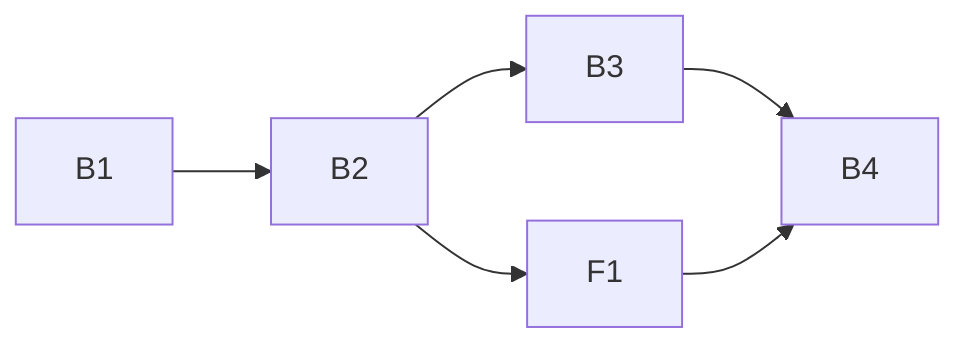

# Plan 008.00: Plan Dependencies, step 1 of 3

Scope: spec items 1–5 and 12, plus cycle detection (Settled decisions). Items 6–11 and 13 belong to 008.01 and 008.02 and are not built here.

## Units

| Id | Unit | Discipline | Depends on |
| --- | --- | --- | --- |
| B1 | `Spec#depends_on` and its validation | back end | nothing |
| B2 | `Plans::Dependencies`: reverse index, open dependencies, unknown ordinals, cycles | back end | B1 |
| B3 | Dispatcher gate, blocker-first order, deadlock reason in the run report | back end | B2 |
| F1 | `list-plans` shows `blocks NNN.MM`, unknown dependencies and cycles | front end | B2 |
| B4 | Integration check: real tree through `list-plans` and `run --dry-run` | back end | B3, F1 |

Details per unit: `plan-backend.md` (B1–B4) and `plan-frontend.md` (F1).

## Order and graph

- B1, then B2: B2 reads what B1 parses.
- B3 and F1 run at the same time. They share no file: B3 owns `engine/`, F1 owns `presentation/reporter.rb` and the `list-plans` command.
- B4 last. It owns only its own spec file and is the integration check.

## Shared-file rule

No file is owned by two units. `dispatcher.rb` and `runner.rb` belong to B3 alone, which is why items 4 and 5 are one unit, not two.

## Decisions this plan takes from the spec's recommendations

The spec lists these as open with a recommendation. The plan builds the recommendation; a reviewer who disagrees changes one method in B2.

1. A `depends_on` entry naming an ordinal that has no folder is a problem, reported by `list-plans` (F1) and treated as not done by the gate (B3).
1. An entry naming a ✅ plan is ignored by the gate, and `list-plans` warns about it.
1. A dependency in ⭕️, 🅱️ or 💤 counts as not done; the dependent waits.
1. A plan whose `depends_on` key is absent (`nil`) is not gated in 008.00. Filling the key is ewoki's job in 008.01.

## Integration check (B4) must show

Against a real `.plans` tree in a temp directory, with `050.00` declaring `depends_on: ["034.00"]` and `034.00` open, nothing stubbed:

- `list-plans` output (with `NO_COLOR=1`) has the 034 row reading `blocks 050.00`, and `034.00/spec.md` is byte-identical before and after.
- `run --dry-run` assigns an agent to 034 and none to 050, and the report names 050 as waiting on `034.00`.
- With 034 and 050 depending on each other, `run --dry-run` assigns neither and the report gives a cycle as the reason for both.
