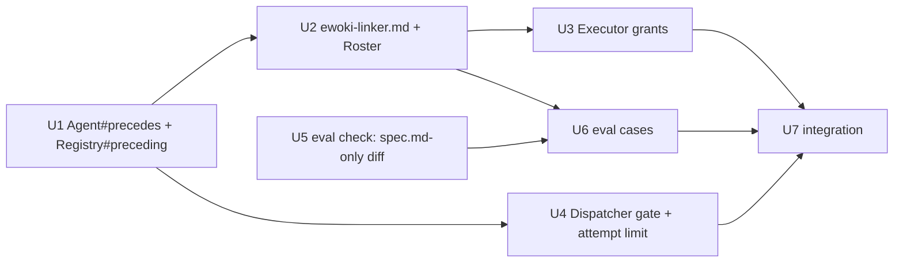

# Plan 008.01: Ewoki Linker

Spec items 6–9 of the 008.00 delivery. Seven back-end units, no front end, no HTTP surface. One pull request.

## Precondition

This worktree's branch (`kig/008.01-spec-ewoki-linker`) predates 008.00's merge: `lib/openlanes/plans/dependencies.rb`, `Spec#depends_on` and the dispatcher's dependency gate are on `origin/main` but not on `HEAD`. Rebase onto `origin/main` before U1 starts. Every unit below reads those 008.00 pieces and edits none of them.

## Order and dependency graph

| Wave | Units           | Why together                                  |
| :--- | :-------------- | :-------------------------------------------- |
| 1    | U1, U5          | no dependencies, disjoint files               |
| 2    | U2, U4          | both need only U1; disjoint files             |
| 3    | U3, U6          | U3 needs U2; U6 needs U2 and U5; disjoint     |
| 4    | U7              | the integration check, after everything       |

No file is owned by two units, so nothing inside a wave is forced sequential.

## Backend

### U1 `precedes:` on Agent, read only by `Registry#preceding`

- **Discipline:** back end.
- **Owns:** `lib/openlanes/agents/agent.rb` (a `precedes` attribute, an array of status keys, empty by default; a `precedes?(status)` predicate), `lib/openlanes/agents/registry.rb` (`Registry#preceding(status) -> Array<Agent>`), `spec/openlanes/agents/registry_spec.rb`.
- **Must not touch:** `agents/*.md`, `roster.rb`, `executor.rb`, `dispatcher.rb`, `routing.rb`.
- **Depends on:** nothing.
- **Done when:** `spec/openlanes/agents/registry_spec.rb` shows an agent with `precedes: [ready_for_planning, planned]` and `handles: []` is returned by `#preceding(:planned)` and `#preceding(:ready_for_planning)`, not by `#preceding(:building)`, and never by `#for_status` or `#team_for`. `rg -n "precedes" lib` finds the key parsed only in `agent.rb` and read only through `Registry#preceding`.

### U2 `agents/ewoki-linker.md` and its Roster line

- **Discipline:** back end.
- **Owns:** `agents/ewoki-linker.md` (frontmatter: `precedes: [ready_for_planning, planned]`, `handles: []`, no `advances_to`, Haiku, low effort; body: the output contract of spec item 8 and the N7 rule that shared files are a merge risk, not a dependency), `lib/openlanes/agents/roster.rb` (a `precedes …` line or column, fed by `Registry#preceding`), `spec/openlanes/agents/roster_spec.rb`.
- **Must not touch:** `agent.rb`, `registry.rb`, `executor.rb`, any `evals/` file.
- **Depends on:** U1.
- **Done when:** `spec/openlanes/agents/roster_spec.rb` renders `ewoki-linker` with `precedes ready_for_planning, planned`, and `./exe/openlanes agents list` shows the same.

### U3 Executor tool grants for a preceding agent

- **Discipline:** back end.
- **Owns:** `lib/openlanes/execution/executor.rb` (an agent that `Registry#preceding` returns for the plan's state may edit `spec.md` in the plan folder and nothing else; `FORBIDDEN_COMMANDS` and `UNGRANTABLE` unchanged), `spec/openlanes/execution/executor_spec.rb`.
- **Must not touch:** `agents/*.md`, `registry.rb`, `dispatcher.rb`.
- **Depends on:** U2 (reads the real agent file).
- **Done when:** `spec/openlanes/execution/executor_spec.rb` asserts the argv built for `ewoki-linker` grants edits to the plan's `spec.md` only, withholds `WebFetch`/`WebSearch`, and still carries every `Bash(<cmd>:*)` specifier for `FORBIDDEN_COMMANDS`.

### U4 Dispatcher ewoki gate and the three-attempt limit

- **Discipline:** back end.
- **Owns:** `lib/openlanes/agents/routing.rb` (one predicate, `Routing.preceding_for(registry, subject, state) -> Agent | nil`: a preceding agent when the state is `ready_for_planning` or `planned`, the spec has no `depends_on` key — `Spec#depends_on` is `nil`, not `[]` — and the attempt limit is not reached; lane-independent), `lib/openlanes/engine/dispatcher.rb` (its own method, called before candidates are built at line ~720, that assigns the preceding agent instead of `for_status` candidates for that round, leaves the folder name unchanged, and after `LINK_ATTEMPTS = 3` failed attempts writes a ⭕️ `blocked.md` with one `## B1` question: write `depends_on:` by hand, or retry), `lib/openlanes/cli/run/run.rb` (the dry-run takers preview at line ~475 asks the same `Routing.preceding_for`), `spec/openlanes/agents/routing_spec.rb`, `spec/openlanes/engine/dispatcher_linker_spec.rb` (new).
- **Must not touch:** `registry.rb`, `executor.rb`, `plans/spec.rb`, `plans/dependencies.rb`, `runner.rb`.
- **Depends on:** U1.
- **Done when:** `spec/openlanes/engine/dispatcher_linker_spec.rb`, one example group per lane (`full`, `plan`, `quick`), shows the gate picks ewoki for a keyless plan at 📋 and at ⭐️, skips a plan with `depends_on: []` and one with `depends_on: ["034.00"]`, skips 🟡 Building and later, counts failed attempts from `state.json` signatures, and writes `blocked.md` in the B1 shape on the third failure. `spec/openlanes/agents/routing_spec.rb` covers the predicate.

### U5 Deterministic eval check: the diff touches only the key and the NOTE block

- **Discipline:** back end.
- **Owns:** `lib/openlanes/evals/check.rb` (a new check, e.g. `spec_only(evidence)`: in the plan folder only `spec.md` and the harness's `state.json` changed, and the `spec.md` diff is confined to the `depends_on:` frontmatter line and the `> [!NOTE]` ledger block that `Plans::Ledger` reads; values are quoted canonical `"NNN.MM"` strings or `[]`), `lib/openlanes/evals/changes.rb` if the check needs a per-file diff it does not yet expose, `spec/openlanes/evals/check_spec.rb`, `spec/openlanes/evals/changes_spec.rb`.
- **Must not touch:** `evals/cases/**`, `agents/*.md`.
- **Depends on:** nothing.
- **Done when:** `spec/openlanes/evals/check_spec.rb` passes a diff that adds `depends_on: ["034.00"]` plus a Completed NOTE entry with a reason line, and fails a diff that edits the spec body, adds an unquoted `34`, or touches `plan.md`.

### U6 Eval cases for ewoki-linker

- **Discipline:** back end.
- **Owns:** `evals/cases/ewoki-linker/*.yml` and their fixture directories, at least: `link-one` (050 mentions 034's parser → `["034.00"]`, reason names the parser), `none` (no real dependency → `[]`), `shared-files-only` (plans share a file but need nothing from each other → `[]`, the over-linking guard), each using U5's check.
- **Must not touch:** `lib/openlanes/evals/**`, `agents/*.md`.
- **Depends on:** U2, U5.
- **Done when:** `./exe/openlanes evals ewoki-linker` (offline scoring) passes every case, and `spec/openlanes/evals/corpus_spec.rb` loads the new cases without error.

### U7 Integration check: a real run through the CLI

- **Discipline:** back end.
- **Owns:** `spec/openlanes/engine/runner_linker_spec.rb` (new), `spec/openlanes/cli/run_linker_spec.rb` (new).
- **Must not touch:** any `lib/` file. A failure here goes back to the unit that owns the file.
- **Depends on:** U3, U4, U6.
- **Done when:** both specs pass. Must show, with nothing stubbed but the agent process itself in the runner spec:
  - `run_linker_spec.rb`: a `PlansFixture` tree with two plans at 📋, 050 mentioning 034's parser with no `depends_on:` key and another with `depends_on: []`; `./exe/openlanes run --dry-run --isolation shared` through the real `Runner`, `Dispatcher`, `Registry` and `Executor` reports `would invoke ewoki-linker` for 050 and not for the other.
  - `runner_linker_spec.rb`: ewoki runs once for a keyless plan, the folder name is unchanged after its round, and the next round hands the plan to `palpatine-planner` (`full`, `plan` lanes) or `r2d2-mechanic` (`quick`); a hand-written key, even `[]`, means ewoki never runs.

## Frontend

No front-end work in this plan.

## HTTP surface

No. The plan adds no HTTP API and changes none.

## Task completed when

- `bundle exec rspec` and `just lint` stay green.
- `./exe/openlanes agents list` shows `ewoki-linker` with `precedes ready_for_planning, planned`.
- In a temp project with two plans at 📋, where 050's spec mentions 034's parser and has no `depends_on:` key, `./exe/openlanes run --dry-run --isolation shared` reports `would invoke ewoki-linker` for 050 and not for a plan whose spec already has `depends_on: []`.
- `./exe/openlanes evals ewoki-linker` (offline scoring) passes every case.

## How to test

- `bundle exec rspec` and `just lint` stay green.
- `./exe/openlanes agents list` shows `ewoki-linker` with `precedes ready_for_planning, planned`.
- In a temp project with two plans at 📋, where 050's spec mentions 034's parser and has no `depends_on:` key, `./exe/openlanes run --dry-run --isolation shared` reports `would invoke ewoki-linker` for 050 and not for a plan whose spec already has `depends_on: []`.
- `./exe/openlanes evals ewoki-linker` (offline scoring) passes every case.

## Decisions taken from the spec's open questions

1. Plans at 🟡 Building or later are not linked (grandfathered; 008.02 decides the invariant). U4 tests the skip.
1. A failed or killed ewoki is retried at most once per round; after `LINK_ATTEMPTS = 3`, defined once in `dispatcher.rb`, the harness writes the ⭕️ `blocked.md` question instead.
