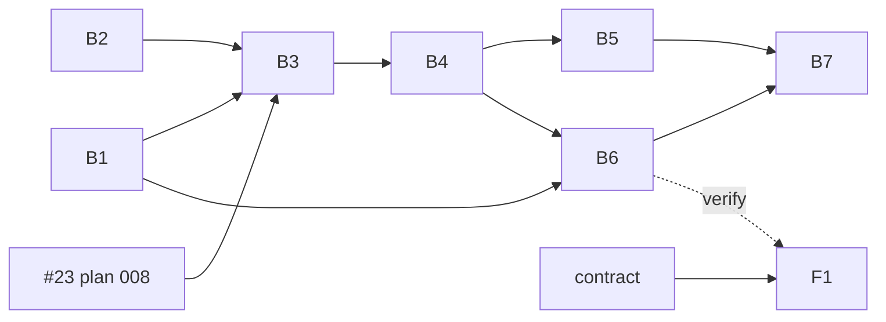

# Plan 009.00 — Plan aging and bombs

Eight units, one pull request. Back end in `plan-backend.md` (B1–B7), front end in `plan-frontend.md` (F1).

## Prerequisite

009 is built stacked on pull request #23 (plan 008, branch `kig/008.00-plan-dependencies`), and its own pull request targets that branch until #23 merges. B3 reads the dependents through 008's `Plans::Dependencies` (`Tree#blocks_of`); nothing in 009 parses `depends_on` itself. `spec.md` names the dependency in 008's canonical form, `depends_on: ["008.00"]`.

Decided 2026-10-15 by the owner (Konstantin): stack 009 on #23 rather than wait for it to merge, build a private reader, or split B3 to B7 into a follow-up plan.

## Units

| Id | Unit | Discipline | Depends on | Done when |
| --- | --- | --- | --- | --- |
| B1 | 💣 state, `bomb` event, Linear mapping, unblock out of 💣 | back end | nothing | `state_machine_spec.rb`, `status_spec.rb`, `mapping_spec.rb`, `unblocker_spec.rb` |
| B2 | `plans.aging_since` config key | back end | nothing | `config_spec.rb` |
| B3 | Aging sweep: clock, `bomb`, auto-`defer` with `delayed.md` | back end | B1, B2, #23 (plan 008) | `lifecycle/aging_spec.rb` |
| B4 | Engine halt, `resume_until` in `state.json` | back end | B3 | `runner_spec.rb`, `dispatcher_spec.rb`, `plan_state_spec.rb` |
| B5 | `run` exit 1, `--ignore-bombs`, `start` idles | back end | B4 | CLI specs for `run` and `start` |
| B6 | `respond`, `pause_discuss`, `resume_anyway` commands; snapshot `bombs` | back end | B1, B4 | `commands_spec.rb`, `snapshot_spec.rb` |
| B7 | **Integration check** | back end | B5, B6 | `web/bombs_integration_spec.rb` |
| F1 | Bomb notice, Respond, Pause and Discuss, Resume anyway | front end | contract below; B6 to verify | `BombNotice.test.tsx` |

## Order

1. B1 and B2 in parallel. F1 may start against the contract.
2. B3.
3. B4, then B5 and B6 (both read B4's API; they own disjoint files and may run in parallel).
4. B7 last.



## File ownership, sequential edits

No file is owned by two units. Points of contact, kept sequential by the graph:

- `state_machine.rb` and `status.rb`: B1 only. B3 fires events, it does not edit them.
- `plan_state.rb` and its schema: B4 only. B6 calls `PlanState#resume_anyway!`, it does not edit it.
- `runner.rb` and `dispatcher.rb`: B4 only. B5 reads `Runner#bombs` and passes `ignore_bombs:`.

## Contract between the pair

Command payloads, all sent through the existing command channel:

```json
{ "kind": "respond",        "plan": "009.00", "text": "..." }
{ "kind": "pause_discuss",  "plan": "009.00" }
{ "kind": "resume_anyway",  "plan": "009.00" }
```

Snapshot field:

```json
"bombs": [
  { "plan": "009.00", "slug": "plan-aging-and-bombs",
    "blocked_md": "## B1 ...", "blocked_since": "2026-10-01T12:00:00Z",
    "resume_until": null }
]
```

## Integration check (B7)

A real `.plans` tree, a real web server, nothing stubbed but the agent process and the `GitHub` seam. It must show: `run` exits 1 naming the 💣; the snapshot lists it with its `blocked.md`; a `respond` POST writes into `blocked.md`; the next round folds it and clears the halt; a `resume_anyway` POST lifts the halt for a second 💣 with no config edit.

## Decisions taken in planning

The spec's open questions, settled by its recommended or assumed option. Reopen any of them only through a human.

1. **Leaving 💣 (spec Q2).** Amended: the unblocker is unchanged. It gates on `blocked.md`, not the emoji, so a 💣 drains exactly like ⭕️. A fully drained 💣 leaves straight to the state its documents justify (every event a block leaves by also leaves 💣); a partly drained one stays 💣. `block` and `block_on_product` also accept 💣, so a human can step it back to ⭕️ or 🅱️ by hand. In the run loop the dispatcher drains an answered 💣 the way it drains an answered ⭕️, and `lando-broker` handles 💣 for that.
1. **Clock restart (Q3).** The clock starts at the latest `Blocked` signature in `state.json`, so a re-block restarts it. No signature: `blocked.md`'s mtime, as the snapshot already does. `plans.aging_since` is a floor at local midnight of that date.
1. **Pause and Discuss (Q4).** Holds every agent running on this machine (N10), with the existing `HOLD` word, and changes no file.
1. **Auto-defer marker (Q5).** The sweep's `delayed.md` names the trigger ("revisit after the block is answered") and says it was deferred by aging, with the age.
1. **Exit code under `--ignore-bombs` (Q6).** A 💣 left standing does not change the exit code.
1. **Limits (Q7).** `BOMB_AFTER` and `DEFER_AFTER` are 24 h multiples, in `Lifecycle::Aging` and nowhere else.
1. **`deferred/` (N8).** Moving folders into `deferred/` is plan 007's archive layout, not built here. Auto-defer fires the ordinary `defer` event, so the folder becomes ☢️ Deferred in place; 007 moves it when it lands.
1. **Halt scope.** The halt counts 💣 plans in the run's scope, and the sweep ages only those. A run scoped with `--plan` is not stopped by a bomb it was never asked about.
1. **Dependents.** "Other plans depend on it" is `Tree#blocks_of` from #23, counting only dependents still open: not ✅ or 😎 (008's `Dependencies::DONE`) and not ❌. A plan whose only dependents have shipped or been dropped holds nobody up, so it ages toward ☢️, not 💣.
1. **Dry runs.** The sweep fires nothing under `--dry-run`; it reports what it would bomb or defer, and the dry run halts on the would-be bombs as a real run would.
1. **Respond.** `respond` answers the first open question that has no answer yet, in the same `## A<n>` form the existing `answer` command writes, so the unblocker folds it unchanged.
