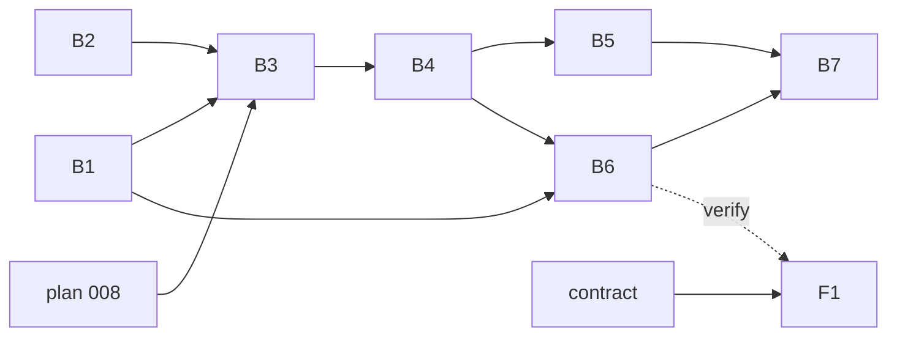

# Plan 009.00 — Plan aging and bombs

Eight units, one pull request. Back end in `plan-backend.md` (B1–B7), front end in `plan-frontend.md` (F1).

## Prerequisite

Plan 008 (dependents index) must be merged before B3 starts. B1, B2 and F1 do not need it. When 008 lands, fix `depends_on: ["008"]` in `spec.md` to the canonical `"008.00"`.

## Units

| Id | Unit | Discipline | Depends on | Done when |
| --- | --- | --- | --- | --- |
| B1 | 💣 state, `bomb` event, Linear mapping, unblock out of 💣 | back end | nothing | `state_machine_spec.rb`, `status_spec.rb`, `mapping_spec.rb`, `unblocker_spec.rb` |
| B2 | `plans.aging_since` config key | back end | nothing | `config_spec.rb` |
| B3 | Aging sweep: clock, `bomb`, auto-`defer` with `delayed.md` | back end | B1, B2, plan 008 | `lifecycle/aging_spec.rb` |
| B4 | Engine halt, `resume_until` in `state.json` | back end | B3 | `runner_spec.rb`, `dispatcher_spec.rb`, `plan_state_spec.rb` |
| B5 | `run` exit 1, `--ignore-bombs`, `start` idles | back end | B4 | CLI specs for `run` and `start` |
| B6 | `respond`, `pause_discuss`, `resume_anyway` commands; snapshot `bombs` | back end | B1, B4 | `commands_spec.rb`, `snapshot_spec.rb` |
| B7 | **Integration check** | back end | B5, B6 | `web/bombs_integration_spec.rb` |
| F1 | Bomb notice, Respond, Pause and Discuss, Resume anyway | front end | contract below; B6 to verify | `BombNotice.test.tsx` |

## Order

1. B1 and B2 in parallel. F1 may start against the contract.
2. B3.
3. B4, then B5 and B6 (both read B4's API; they own disjoint files and may run in parallel).
4. B7 last.



## File ownership, sequential edits

No file is owned by two units. Points of contact, kept sequential by the graph:

- `state_machine.rb` and `status.rb`: B1 only. B3 fires events, it does not edit them.
- `plan_state.rb` and its schema: B4 only. B6 calls `PlanState#resume_anyway!`, it does not edit it.
- `runner.rb` and `dispatcher.rb`: B4 only. B5 reads `Runner#bombs` and passes `ignore_bombs:`.

## Contract between the pair

Command payloads, all sent through the existing command channel:

```json
{ "kind": "respond",        "plan": "009.00", "text": "..." }
{ "kind": "pause_discuss",  "plan": "009.00" }
{ "kind": "resume_anyway",  "plan": "009.00" }
```

Snapshot field:

```json
"bombs": [
  { "plan": "009.00", "slug": "plan-aging-and-bombs",
    "blocked_md": "## B1 ...", "blocked_since": "2026-10-01T12:00:00Z",
    "resume_until": null }
]
```

## Integration check (B7)

A real `.plans` tree, a real web server, nothing stubbed but the agent process and the `GitHub` seam. It must show: `run` exits 1 naming the 💣; the snapshot lists it with its `blocked.md`; a `respond` POST writes into `blocked.md`; the next round folds it and clears the halt; a `resume_anyway` POST lifts the halt for a second 💣 with no config edit.

## Assumptions adopted from the spec's open questions

- Q2: the unblocker returns 💣 to ⭕️ or 🅱️ by `blocked.md` content, then the normal path resumes.
- Q3: a re-block writes a new `blocked` signature and restarts the clock.
- Q4: Pause and Discuss holds every running agent.
- Q5: auto-deferred `delayed.md` carries a line marking it as deferred by aging.
- Q6: with `--ignore-bombs`, a remaining 💣 does not change the exit code.
- Q7: limits are 24 h multiples, not calendar days.
