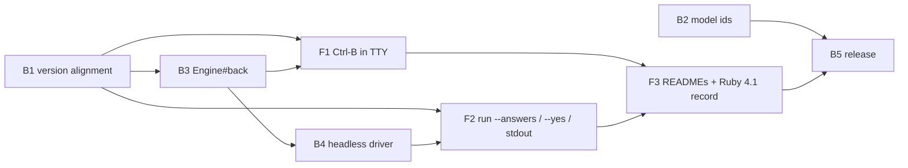

# Plan 010.00: Inquirex Fixes

All work is in `/Users/kig/github/inquirex`, which holds three separate git repositories: `inquirex/`, `inquirex-llm/`, `inquirex-tty/`. Each unit works on a branch `kig/010.00-inquirex-fixes` in every repository it touches, and claims its files with `alock` run inside that repository. The branch lives in a git worktree per repository, `<repo>.worktrees/010.00-inquirex-fixes`, branched from that repository's `main`; the existing checkouts hold the owner's unpushed Ruby 4.1 migration and are not touched (blocked.md B1, answered A1 by the owner on 2026-10-14). Nothing in openlanes changes (spec, Non-Goals).

"Back end" is the `inquirex` engine and the `inquirex-llm` library. "Front end" is the terminal UI and CLI of `inquirex-tty`. Units are detailed in `plan-backend.md` (luke-backend) and `plan-frontend.md` (rey-frontend).

## Assumptions carried from the spec's open questions

These are the spec's stated assumptions. Build to them; do not reopen them.

- Back key: **Ctrl-B** (`:ctrl_b` from `tty-reader`), named in the tip line (OQ1).
- Answers file: JSON or YAML by extension, shaped `{step_id: value}` (OQ3).
- Copyright lines stay; only sample data changes (OQ4).
- `--yes` on an LLM step: skip it with its default, never call the adapter (OQ5).
- `Engine#back` at the first collecting step returns `false` and changes nothing (OQ7).
- New version for all three gems: **0.12.0**. The spec assumed 0.11.0 (OQ9), but core 0.11.0 shipped without B3/B4, and the owner set 0.12.0 on 2026-10-14.
- How a prompt is interrupted by the back key (OQ2): F1 decides, and records it in its spec file's top comment.

## Units

| Id | Unit | Discipline | Repository | Depends on |
| :- | :--- | :--------- | :--------- | :--------- |
| B1 | Version alignment at 0.11.0 | back end | all three | nothing |
| B2 | Current Claude model ids | back end | inquirex-llm | nothing |
| B3 | `Engine#back` snapshot stack | back end | inquirex | B1 |
| B4 | Headless answer driver in core | back end | inquirex | B3 |
| F1 | Ctrl-B back in the TTY renderer | front end | inquirex-tty | B1, B3 |
| F2 | `run --answers`, `--yes`, results on stdout; **integration check** | front end | inquirex-tty | B1, B4 |
| F3 | READMEs: fictional samples, results channel, back key; Ruby 4.1 record | front end | all three | F1, F2 |
| B5 | Release: CHANGELOGs, constraint check, scratch bundle | back end | all three | B2, F3 |

Eight units, one pull request per repository, reviewed as one change.

## Order

1. **B1** and **B2** in parallel. B1 goes first because until `inquirex-tty` resolves `inquirex` from the local path at 0.11.0, no front-end unit can see `Engine#back`.
1. **B3** (after B1). `engine.rb` is shared with B4, so B3 and B4 are sequential.
1. **B4** and **F1** in parallel (both after B3). F1 owns `renderer.rb`; B4 owns new files in core. No overlap.
1. **F2** (after B4). F1 and F2 both live in `inquirex-tty` but own disjoint files (`renderer.rb` vs `commands/run.rb`), so they may overlap in time.
1. **F3** (after F1 and F2). It is the only unit that edits any README, so the three README changes the spec asks for happen in one place.
1. **B5** last. It edits `version.rb`, the gemspec and `Gemfile`s that B1 also edited, so B1 and B5 are sequential by construction.

## Dependency graph

## Files shared between units (sequential by rule)

| File | Units | Why it is safe |
| :--- | :---- | :------------- |
| `inquirex/lib/inquirex/engine.rb` | B3, B4 | B4 depends on B3 |
| version files, `inquirex-tty/inquirex-tty.gemspec`, `inquirex-tty/Gemfile`, `inquirex-tty/Gemfile.lock` | B1, B5 | B5 depends on B1 through F3 |
| `inquirex-tty/README.md` | F3 only | F1 and F2 leave their README text to F3 |

## Integration check

**F2** owns it: `inquirex-tty/spec/integration/headless_run_spec.rb`. It spawns the real `exe/inquirex-tty run` as a child process (no stubs, no fake prompt, the real `inquirex` engine resolved from the local path) against a fixture flow with a multi-select, a step with a default, and a `skip_if` keyed on the multi-select. STDIN is closed. It must show:

- `--answers fixture.yml` exits 0; stdout parses as JSON and holds every answer; stderr holds no JSON.
- `-o FILE` writes the same JSON to FILE and nothing to stdout; `-o -` writes it to stdout.
- `--yes` against a flow whose required step has no default exits non-zero and names that step on stderr.

## Done when (whole plan)

- [ ] Every unit's done-when spec passes, and `bundle exec rspec` is green in all three gems on Ruby 4.0.x.
- [ ] `rg 'claude-sonnet-4-20250514'` across the three gems finds nothing.
- [ ] A scratch Gemfile with all three at 0.11.0 installs (B5).
- [ ] The Ruby 4.1.0-preview1 result is written down (F3, `verification.md` in this folder).

Out of scope, per spec: publishing to rubygems.org, live-API model checks, the Bundler 4.0.10 `Pathname::SEPARATOR_PAT` failure.
