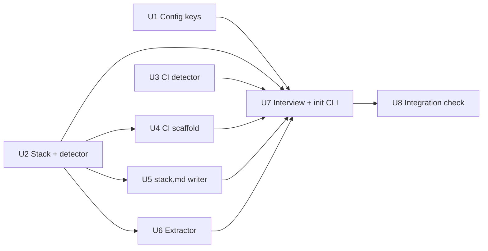

# Plan 011.00 — Init Interview

## Planning decisions

These settle the spec's open questions where the code already answers them. Each is a planning call, cheap to reverse in review.

- **`merge.by` already exists** (plan 010): `Config::MERGERS = %i[human auto]`, parsed by `Config.merge_by`, read by `Config#merger`. The spec's `human|agent` predates it. This plan keeps `human|auto` and does not rename; `--merge-by` takes `human` or `auto`. `-y` default: `human` (`MERGERS.first`, already the code's default).
- **inquirex pin is moot for this plan.** `inquirex-llm ~> 0.12` (0.12.1) is already in the gemspec and lockfile and used by `Live::ChoiceJudge`. `inquirex-tty` is not a dependency and is not added. The flow stays on `tty-prompt` (open question 1, option "keep tty-prompt, inquirex-llm for extraction"). Questions an extraction answered are skipped by the flow itself.
- **Extraction model** comes from `OPENLANES_EXTRACTION_MODEL`, defaulting to one constant in `Setup::Extractor`. No new `Config` key.
- **`-y` defaults:** `build_quality: high`, `ci.provider: none`, `stack` = detected, or absent when unknown or mixed. `-y` makes no network call, even with a key set.
- **Mixed stack:** no default answer; asked interactively, left unset under `-y`.
- **Third CI provider:** Jenkins, as the spec recommends.
- **`docs/decisions/stack.md`** is overwritten on `--reconfigure`; its change is part of the printed diff.
- **Stack vocabulary:** free text, validated as non-empty strings (lists of them for `frameworks`).
- **New code lives in `lib/openlanes/setup/`**, namespace `OpenLanes::Setup`. The facade `setup.rb` is written last (U7); until then Zeitwerk's implicit namespace serves U2–U6, whose specs construct their own class directly.

## Order and dependency graph

- Wave 1, in parallel: U1, U2, U3.
- Wave 2, in parallel: U4, U5, U6 (each needs `Setup::Stack` from U2).
- Wave 3: U7. It is the only unit that edits `lib/openlanes/cli/init/init.rb` and `spec/openlanes/cli/init_spec.rb`.
- Wave 4: U8.

No two units in the same wave own the same file.

## Backend

### U1 Config keys: `ci`, `build_quality`, `stack`

- **Discipline:** back end.
- **Owns:** `lib/openlanes/support/config.rb`, `spec/openlanes/config_spec.rb`, `spec/openlanes/config_merge_spec.rb` (only if `merge` round-trip cases need extending).
- **Must not touch:** `lib/openlanes/setup/**`, `lib/openlanes/cli/init/init.rb`.
- **Depends on:** nothing.
- **Shape:** `KEYS` gains `ci build_quality stack`. `Config` gains members `ci` (`{provider:, config:}`, provider one of `CI_PROVIDERS = %i[github_actions circleci jenkins external none]`), `build_quality` (one of `BUILD_QUALITIES = %i[top_notch high medium mvp]`) and `stack` (a Hash of the ten `STACK_FIELDS`: `language frameworks front_end persistence caching logins deployment domain from to`). `parse` rejects unknown values and unknown stack fields; `to_yaml` writes them back. `SHORTHANDS` is unchanged (the new keys are not command options); confirm `Base.default_params` ignores nested keys it has no flag for.
- **Done when:** `spec/openlanes/config_spec.rb` covers accept, reject and round-trip for each new key, and an older file without them still loads.

### U2 Stack value and stack detector

- **Discipline:** back end.
- **Owns:** `lib/openlanes/setup/stack.rb`, `lib/openlanes/setup/stack_detector.rb`, `spec/openlanes/setup/stack_detector_spec.rb`.
- **Must not touch:** `lib/openlanes/support/config.rb`, other `setup/` files.
- **Depends on:** nothing.
- **Shape:** `Setup::Stack = Data.define(*STACK_FIELDS)` with `to_h` (the `.openlanes.yml` shape), `.from_h`, `#empty?`. `StackDetector.new(root).call` → `Detection` value: `languages` (Array), `stack` (a `Stack`, or nil when none or mixed), `mixed?`, `hints` (Dockerfile, `.tool-versions`). Marker table as in the spec's `## Research`: Gemfile (+ rails/sinatra in Gemfile.lock), package.json (+ react/astro/vite/next deps), astro/vite configs, go.mod, Cargo.toml, mix.exs, pyproject.toml / requirements.txt (+ fastapi/django).
- **Done when:** `spec/openlanes/setup/stack_detector_spec.rb` passes on real temp folders: one per language, each refinement, an empty folder, and a two-language folder reported as mixed with no stack.

### U3 CI detector

- **Discipline:** back end.
- **Owns:** `lib/openlanes/setup/ci_detector.rb`, `spec/openlanes/setup/ci_detector_spec.rb`.
- **Must not touch:** other `setup/` files, `config.rb`.
- **Depends on:** nothing.
- **Shape:** `CiDetector.new(root).call` → Array of `Found = Data.define(:provider, :path)`, providers `github_actions circleci jenkins gitlab buildkite`, from `.github/workflows/*.yml|yaml`, `.circleci/config.yml`, `Jenkinsfile`, `.gitlab-ci.yml`, `.buildkite/`. Empty when none.
- **Done when:** `spec/openlanes/setup/ci_detector_spec.rb` passes on real temp folders: each provider alone, several at once as a list, none.

### U4 CI scaffold

- **Discipline:** back end.
- **Owns:** `lib/openlanes/setup/ci_scaffold.rb`, `lib/openlanes/setup/templates/github_actions.yml.erb`, `lib/openlanes/setup/templates/circleci.yml.erb`, `lib/openlanes/setup/templates/Jenkinsfile.erb`, `spec/openlanes/setup/ci_scaffold_spec.rb`. Zeitwerk must ignore `setup/templates/`; U4 adds that ignore in `lib/openlanes.rb` (the only edit to that file in this plan).
- **Must not touch:** `stack.rb`, `stack_detector.rb`, `config.rb`.
- **Depends on:** U2.
- **Shape:** `CiScaffold.new(root, provider:, stack:).call(dry_run: false)` → `Result(path:, written:)`. Paths: `.github/workflows/ci.yml`, `.circleci/config.yml`, `Jenkinsfile`. Commands: `just lint` / `just test` when the justfile defines those recipes, else the stack's conventional pair (Ruby: `bundle exec rubocop` / `bundle exec rspec`; Node: `npm run lint` / `npm test`; Go, Rust, Elixir, Python likewise). Never overwrites: an existing file yields `written: false`.
- **Done when:** `spec/openlanes/setup/ci_scaffold_spec.rb` has one example per provider asserting the path and that the file names the stack's commands, one for the justfile path, and one proving an existing file is left byte-identical.

### U5 `docs/decisions/stack.md` writer

- **Discipline:** back end.
- **Owns:** `lib/openlanes/setup/stack_document.rb`, `spec/openlanes/setup/stack_document_spec.rb`.
- **Must not touch:** other `setup/` files.
- **Depends on:** U2.
- **Shape:** `StackDocument.new(stack).render` → String (markdown, one line per field, blank fields omitted, a port section when `from`/`to` set); `#write(root)` writes `docs/decisions/stack.md`, creating the directory. Never called with an empty stack.
- **Done when:** `spec/openlanes/setup/stack_document_spec.rb` asserts rendering of a full stack, a sparse one, a port, and that `write` lands at the path in a temp folder.

### U6 Extractor

- **Discipline:** back end.
- **Owns:** `lib/openlanes/setup/extractor.rb`, `spec/openlanes/setup/extractor_spec.rb`.
- **Must not touch:** other `setup/` files, `lib/openlanes/live/**`.
- **Depends on:** U2 (field names).
- **Shape:** a seam like `Live::ChoiceJudge`. `Extractor.from_env(env = ENV)` → an extractor on `ANTHROPIC_API_KEY` (preferred) or `OPENAI_API_KEY` through the matching `inquirex-llm` adapter, or nil with neither (the caller prints the one message). If `inquirex-llm` 0.12 has no OpenAI adapter, `from_env` treats `OPENAI_API_KEY` alone as no key and says so. `#call(description)` → Hash of only the answered keys among `merge_by build_quality` and the stack fields; blanks, nils and anything outside the closed vocabularies are dropped, so no placeholder answer can reach the config. Adapter injectable via `adapter:`; `inquirex` loaded lazily. Model: `OPENLANES_EXTRACTION_MODEL` or `DEFAULT_MODEL`.
- **Done when:** `spec/openlanes/setup/extractor_spec.rb`, with an adapter double, covers key selection, no key → nil, filtering of blanks and out-of-vocabulary values, and an adapter error → empty Hash. The suite makes no network call.

### U7 Interview flow and `init` CLI

- **Discipline:** back end.
- **Owns:** `lib/openlanes/setup.rb` (facade: `Setup.interview`, `Setup.detect_stack`, `Setup.detect_ci`, `Setup.extractor`), `lib/openlanes/setup/interview.rb`, `lib/openlanes/cli/init/init.rb`, `spec/openlanes/setup/interview_spec.rb`, `spec/openlanes/cli/init_spec.rb`, `README.md` (the `init` section and a release note that older openlanes refuses the new keys).
- **Must not touch:** files owned by U1–U6.
- **Depends on:** U1, U2, U3, U4, U5, U6.
- **Shape:** `Interview.new(root:, prompt:, extractor:, defaults: Config).call` → a `Config`. Order: CI (detected → named, nothing asked; none → the three answers, then provider choice), merge, build quality, the description + extraction (skipping answered questions), stack (detected values as defaults; mixed → asked), port-or-fresh when a stack was detected and the user is open to alternatives (port writes `stack.from`/`stack.to`), then the existing four values. New flags: `--ci PROVIDER|none`, `--merge-by`, `--build-quality`, `--reconfigure`. `-y`: flags and defaults only, no prompt, no extractor built. `--reconfigure`: current file as defaults, prints a diff of `.openlanes.yml` and `stack.md`, writes after confirmation (`-y` skips, `-n` previews and writes nothing). Writes `.openlanes.yml`, `docs/decisions/stack.md` (not when the stack is unknown under `-y`), and the CI file through U4.
- **Done when:** `spec/openlanes/setup/interview_spec.rb` (with `TTY::Prompt::Test` and an extractor double) covers the order, skip-on-extraction, the no-key message, the CI branches and the port question; `spec/openlanes/cli/init_spec.rb` covers `-y` defaults and flags, invalid flag values refused, `--reconfigure` diff with `-y` and with `-n`, and the existing four-value examples still pass. `just lint` and `just test` green.

### U8 Integration check (owns the end-to-end proof)

- **Discipline:** back end.
- **Owns:** `spec/openlanes/cli/init_integration_spec.rb`.
- **Must not touch:** everything else.
- **Depends on:** U7.
- **Must show:** `exe/openlanes init -y --ci github_actions --merge-by auto --build-quality mvp`, run as a real subprocess in a temp folder holding a `Gemfile` and a `Gemfile.lock` naming rails, with both API keys removed from its environment, nothing stubbed: exits 0; `.openlanes.yml` loads through `Config.load` with `ci.provider: github_actions`, `ci.config: .github/workflows/ci.yml`, `merge.by: auto`, `build_quality: mvp`, `stack.language: ruby`, `rails` in `frameworks`; `docs/decisions/stack.md` exists and names Ruby and Rails; `.github/workflows/ci.yml` names `bundle exec rspec`. A second run, `init --reconfigure -y --build-quality high`, prints a diff containing `mvp` → `high` and leaves the CI file untouched. A third folder holding `Gemfile` and `go.mod`, under `-y`, writes no `stack:` and no `stack.md`.
- **Done when:** `spec/openlanes/cli/init_integration_spec.rb` passes.

## Frontend

No front-end work: `init` is a terminal command, and the web Settings dialog is v2.0 (M19).

## HTTP surface

No. The plan adds no HTTP API and changes none; extraction is an outbound client call, not a served route. No `openapi.yaml`.

> [!NOTE]
>
> [2026-10-15 09:27:29 AM PDT] [ agent: luke-backend   status: **Interrupted, round 1 (harness died)** ]

> [!NOTE]
>
> [2026-10-15 09:34:10 AM PDT] [ agent: luke-backend   status: **Interrupted, round 1 (harness died)** ]
