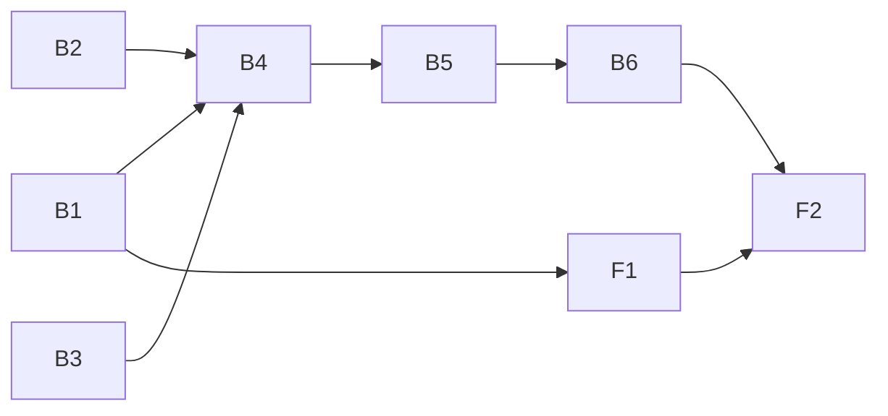

> [!NOTE]
>
> [2026-10-13 07:27:18 PM PDT] [ agent: palpatine-planner   status: **Interrupted, round 1 (interrupted, killed 60s after q)** ]
> [2026-10-14 11:48:25 AM PDT] [ agent: palpatine-planner   status: Started, round 2 ]
> [2026-10-14 11:50:01 AM PDT] [ agent: palpatine-planner   status: Completed, round 2 ]
> [2026-10-14 11:50:01 AM PDT] [ next: luke-backend ]

# Plan 012.00: App Runner and Preview

Eight units, one pull request: six back end (`plan-backend.md`, B1 to B6), two front end (`plan-frontend.md`, F1 and F2). Every spec item from 1 to 13 has a unit; screenshot mirroring and the browser stay with plan 014 (`chewie-verifier`), as the spec's Out of scope says.

## Units

| Id | Unit | Discipline | Depends on | Spec items |
| --- | --- | --- | --- | --- |
| B1 | Contract: `app:` in `Config`, `Apps::Definition`, `Apps::Status`, the `apps` / `app` events | back end | nothing | 1, 2, 9 |
| B2 | `Apps::Ports`: the machine-wide port registry | back end | nothing | 3, 4 |
| B3 | `Apps::Probe` (readiness) and `Apps::Framing` (headers to frame or window) | back end | nothing | 5, 11 |
| B4 | `Apps::Supervisor`: ordered start, readiness failure, port honoured, stop | back end | B1, B2, B3 | 5, 6, 7, 9, 11, 12 |
| B5 | `Apps::Watcher` and `Supervisor#restart` | back end | B4 | 8, 11 |
| B6 | Wiring: `openlanes app start / status / stop`, `Apps::Board` (Redis), `POST /api/apps/commands` | back end | B4, B5 | 10 (server side), 12, 13 |
| F1 | Preview tab and toolbar in `web/src/preview/` | front end | B1 | 10, 11, 13 |
| F2 | Integration check: Cypress `preview.cy.ts` against a real `openlanes web` and `openlanes app start` | front end | B6, F1 | the three "How to tell it's working?" checks |

## Order and graph

- B1, B2 and B3 run at the same time: they share no file.
- B4 then B5, sequentially: both write `lib/openlanes/apps/supervisor.rb`.
- F1 starts as soon as B1 has fixed the wire shape, and runs beside B2 to B6.
- F2 last: it is the integration check and needs both halves.

## Shared-file rule

No file is owned by two units that can run at the same time. `supervisor.rb` is written by B4, then B5. `lib/openlanes/apps.rb` (the facade) is created by B1 and each later back-end unit adds its one method to it, in build order. `web/src/api/types.ts` and `web/src/api/events.ts` belong to F1 alone.

## Decisions this plan takes

The spec leaves these open and recommends an answer for most; the plan builds the recommendation, and a reviewer who disagrees changes one unit.

1. **Readiness** is a TCP connect to `127.0.0.1:<port>`, then, when `ready:` names a path, a GET answering 2xx or 3xx. The timeout is 30 s per process, a `Supervisor` argument and not a config key.
1. **Registry location**: `${XDG_STATE_HOME:-~/.local/state}/openlanes/ports.json`, `flock`ed for every read-modify-write, overridden by `OPENLANES_PORTS_FILE` (specs and the Cypress run point it at a temp file). An entry whose owner pid is dead is free again, which is what reclaims ports after a `kill -9`.
1. **App ignores its port**: the start fails. Readiness is only ever checked on the allocated port, so an app that moved never becomes ready, and the reason reads `<name> was given port N and nothing answered there`.
1. **Framing check** runs once when the preview process is ready and again after each of its restarts, on the preview path, never per reload.
1. **File watcher**: polling, no new gem. Once a second, `mtime` and size of every file matching a process's `restart_on` globs. Glob dialect is Ruby's `Dir.glob` relative to the checkout, with `**/` and `{a,b}`.
1. **Restart backend** restarts every non-preview process, in declared order.
1. **Port range** 11100 to 11999, not configurable (non-goal).
1. **Trigger**: `openlanes app start [NNN]`, in the foreground like `openlanes web`, run in the plan's worktree when one exists, else the project root. Starting the app automatically on a state change belongs to plan 014.
1. **Where the page learns about apps**: a Redis hash per machine, `openlanes:<repo>:apps:<node id>`, field `<plan>`, value the plan's process statuses plus a heartbeat. Keyed by machine and not by checkout, because the control room runs in the main checkout and the app in a worktree. An entry whose heartbeat is older than 30 s is pruned by whoever reads it, as `Live.board` prunes dead nodes.
1. **Buttons**: the page posts `POST /api/apps/commands`, onto a stream the app runner reads; not the engine's command stream, because the runner is its own process and the engine never sees these commands.
1. **Opt-in**: with no `app:` in `.openlanes.yml`, `app start` refuses in one line, nothing is written to Redis, and the page renders no Preview tab.

## Interfaces plan 014 (`chewie-verifier`) builds on

Plan 014 starts the app, drives it with a headless browser, and commits PNG screenshots (M14). These are the seams it gets from this plan, and B4 to B6 must keep them stable:

| Seam | Shape | Use in 014 |
| --- | --- | --- |
| `OpenLanes::Apps.definition(config)` | `Apps::Definition` or `nil` | Whether there is an app to verify at all; `Definition#kind` is M11's kind. |
| `OpenLanes::Apps.supervisor(definition:, root:, plan:, branch:, publisher: nil)` | `Apps::Supervisor` | Start the PR's code in chewie's clean checkout. |
| `Supervisor#start` | `self`; raises `Apps::Supervisor::StartFailed` (message is the reason) after stopping what it started | A failed start is a verification failure with that reason. |
| `Supervisor#preview` | `Apps::Status` or `nil`: `url`, `port`, `framing` | The URL the browser drives. |
| `Supervisor#statuses` | `Array<Apps::Status>` | What to report in the PR comment. |
| `Supervisor#stop` | every group gone, every port released | Always in an `ensure`. |
| `Apps::Status#to_h` | the `<app>` wire shape in `plan-backend.md` B1 | Unchanged by 014. |
| SSE `event: app` / `event: apps` | B1 wire shape | 014 adds its own `app_frame` event for the 2 s screenshot mirror (M13); this plan leaves the tab's image area to it. |
| Preview tab | `web/src/preview/PreviewTab.tsx` renders the iframe or the window button | 014 adds the mirror image beside them. |

This plan writes no screenshots and no `verification/` directory. M14 (PNG, `.plans/<plan>/verification/<round>/step-NN.png`, failing step and final state only) is 014's.

## Integration check (F2) must show

Against a real `openlanes web` on a port other than 11000 and a real `openlanes app start` on a fixture project, nothing intercepted:

1. `api` reaches ready before `web` starts; the Preview tab shows the web process labelled with plan, branch and port, and the iframe renders the fixture page.
1. Touching a file in `api`'s `restart_on` takes the toolbar through restarting back to ● running, and the web process's pid (printed by the fixture page) is unchanged.
1. With the `deny` fixture, whose web process sends `X-Frame-Options: DENY`, no iframe renders and the tab offers Open in new window on the app's URL.

## How to test

- `bundle exec rspec spec/openlanes/apps spec/openlanes/config_spec.rb spec/openlanes/web/events_spec.rb spec/openlanes/cli/app_spec.rb`
- `cd web && npx vitest run src/preview`
- `just preview-e2e` (F2): `openlanes web` on 11050 and the fixture app, then `cypress run --spec cypress/e2e/preview.cy.ts`.
- By hand: add the `app:` block from `plan-backend.md` B1 to a project, run `openlanes app start`, open the control room, and see the Preview tab.
