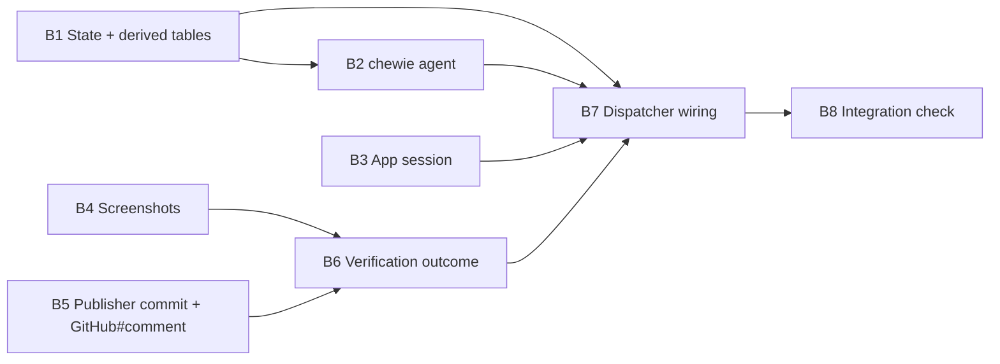

# Plan 014.00: Chewie Verifier

Scope: spec items 1–7 and 11–14, one pull request. Items 8–10 (per-agent MCP, browser, mirroring) are 014.01, and items 15–18 (merge, rejection cap, control room) are 014.02 (kig, 2026-10-15). Without a browser, chewie verifies through the shell (M11).

## Before any unit starts

This worktree's branch sits at `f94646a`, which is behind `origin/main`. Plans 005 (#26), 012 (#38) and 013 have all merged since then. Merge `origin/main` first. Every interface this plan calls lives there: `Vcs.review`, `Vcs::CiGate`, `Engine::PrOutcomes`, `Apps::Supervisor`, `Engine::CoverageGate`, and the fake `gh` in `spec/support/fake_gh/`.

## Order and dependency graph

- **Can start at once and run in parallel:** B1, B3, B4 and B5.
- **Must run in order:** B2 after B1, because the registry checks `handles:` against `STATUSES`. B6 after B4 and B5. B7 after B1, B2, B3 and B6. B8 comes last.
- **Shared file:** only B7 edits `lib/openlanes/engine/dispatcher.rb`. The hand-off (item 3), the verdicts (item 5) and the calls into B3 and B6 all land there, so they form one unit.

## Backend

### B1 State and derived tables (items 1, 2)

- **Discipline:** back end.
- **Owns:** `lib/openlanes/plans/status.rb` (`verifying`, 🧪 Verifying, requires `spec.md plan.md pull-requests.md`, invariant `open_pull_request("Verifying")`). `lib/openlanes/plans/state_machine.rb` (event `verify`: `in_review` → `verifying`. `request_changes` and `approve` also accept `from: verifying`. `verifying` joins `in_review`'s `FAMILIES` group). `lib/openlanes/linear/mapping.rb` (`PLACEMENTS`: started, "In Review"). `lib/openlanes/live/stations.rb` (the Review station). Also the docs that `openlanes docs` and `openlanes states` regenerate, and their specs: `spec/openlanes/plans/status_spec.rb`, `spec/openlanes/plans/state_machine_spec.rb`, `spec/openlanes/linear/mapping_spec.rb`, `spec/openlanes/live/stations_spec.rb`.
- **Must not touch:** `dispatcher.rb`, `agents/*.md`.
- **Depends on:** nothing.
- **Done when:** `state_machine_spec.rb` asserts the three edges and the `FAMILIES` membership. `mapping_spec.rb` passes. `openlanes docs` and `openlanes states` show 🧪 without any hand edits.

### B2 chewie-verifier agent (item 4, hansolo's hand-off text from item 3)

- **Discipline:** back end.
- **Owns:** `agents/chewie-verifier.md`. Its frontmatter: `handles: [verifying]`, `advances_to: approved`, `phase: verification`, `adapter: claude`, `allowed_tools` of Read, Grep, Glob, Bash and Write, no `may:`, `writes: [verification/**]`. Its prompt follows `## How to test` step by step through the shell, writes `<plan folder>/verification/<round>/step-NN.png` (or a text capture when the shell is all there is), `final.png` and `report.md`, then signs `Completed (verified)` or `Completed (rejected)`. Also owns `agents/hansolo-reviewer.md` (the Next table: `approved` goes to 🧪 and chewie), `evals/cases/chewie-verifier/*.yml` with its fixtures, and the agent's registry and prompt-content specs.
- **Must not touch:** `dispatcher.rb`, `lib/openlanes/agents/registry.rb`. The `mcp:` key is 014.01's.
- **Depends on:** B1.
- **Done when:** `spec/openlanes/agents/registry_spec.rb` loads chewie. The prompt-content spec asserts both signature notes. `spec/openlanes/evals/corpus_spec.rb` passes with the new case.

### B3 App session for verification (items 6, 7)

- **Discipline:** back end.
- **Owns:** `lib/openlanes/engine/verification/app_session.rb`. `AppSession.new(definition:, checkout:, plan:, branch:, supervisor_factory:)` provides `#around { |ports| ... }`, which starts the app through `Apps.supervisor`, yields, and stops it in `ensure`. When there is no `app:` block it yields with nothing started. It turns `Supervisor::StartFailed` into a `Result` that reads "the app does not start", gives the reason and the last 20 lines of output, and never calls the agent. Also owns `Supervisor#log_tail(name, lines)` in `lib/openlanes/apps/supervisor.rb`: it reads `Running#tail` and raises `TAIL` to at least 20, because `reason` keeps only 5 today. Specs: `spec/openlanes/engine/verification/app_session_spec.rb` and `spec/openlanes/apps/supervisor_spec.rb`.
- **Must not touch:** `dispatcher.rb`, `publisher.rb`.
- **Depends on:** nothing.
- **Done when:** `app_session_spec.rb` runs the 012 fixture (`spec/fixtures/apps/servers/server.rb`). It asserts the app is running inside the block, and that afterwards no child is alive and no port is still reserved. It also runs a fixture that never listens and asserts the failure `Result` text holds 20 tail lines.

### B4 Screenshots (item 11)

- **Discipline:** back end.
- **Owns:** `lib/openlanes/engine/verification/screenshots.rb`. `Screenshots.new(dir:, optimiser: nil)` provides `#prepare(failing_step: nil)`, which returns the kept paths. It optimises with `vips`, falls back to `magick`, and if neither exists it skips with one warning. It refuses any non-PNG image under `verification/<round>/` and keeps only the failing `step-NN.png` and `final.png`. Spec `spec/openlanes/engine/verification/screenshots_spec.rb` with a fixture PNG under `spec/fixtures/verification/`.
- **Must not touch:** anything outside the files above.
- **Depends on:** nothing.
- **Done when:** `screenshots_spec.rb` asserts the optimised file does not grow, an `.avif` is refused, only the failing step and `final.png` survive, and the run without either tool warns.

### B5 Publisher commit and GitHub comment (item 12, and `GitHub#comment` from item 13)

- **Discipline:** back end.
- **Owns:** `lib/openlanes/vcs/publisher.rb`. `#commit_plan(checkout:, plan:, message:)` returns a SHA. It carries the plan folder through the existing `carry_plan`, commits that folder only, and pushes, after declaring the push through `Boundary.sanction`. It refuses when the checkout has changes outside the plan folder, and it never calls `label_for_review`. Also owns `lib/openlanes/vcs/github.rb`: `#comment(number:, body:, repo: nil)` via `gh pr comment`. And `spec/support/fake_gh/gh`, which records `pr comment`. Specs: `spec/openlanes/vcs/publisher_spec.rb` and `spec/openlanes/vcs/github_spec.rb`.
- **Must not touch:** `dispatcher.rb`, `lib/openlanes/vcs/review.rb`.
- **Depends on:** nothing.
- **Done when:** `publisher_spec.rb` refuses a stray code edit, returns the SHA on a clean run, and shows no `label_for_review` call. `github_spec.rb` asserts the `gh pr comment` argv.

### B6 Verification outcome (items 13, 14)

- **Discipline:** back end.
- **Owns:** `lib/openlanes/engine/verification.rb`, the namespace facade. `Verification.outcome(...)` returns an `Outcome` instance. `#reject(plan:, pr:, step:, expected:, seen:, png:)` commits through B5, then posts one comment that links the PNG as `https://github.com/<repo>/blob/<sha>/<url-encoded path>?raw=true`, encoding every byte of emoji, spaces and `→`. It then applies `review-rejected` through `Vcs.review`, sends the plan to 🔴, and mails the comment to the 🔴 handlers through `PrOutcomes`. `#pass(plan:, pr:)` commits `final.png` and returns `:waiting` until `CiGate` reads green. It then runs `Engine::CoverageGate#call(checkout:)`, applies `ok-to-merge` through `Vcs.review` when the gate passes, and rejects with the gate's message when it withholds. The facade also parses `verification/<round>/report.md` (failing step, expected, seen). Spec `spec/openlanes/engine/verification_spec.rb`.
- **Must not touch:** `dispatcher.rb`, `publisher.rb`, `github.rb`, `review.rb`, `pr_outcomes.rb`. It calls these files and never edits them.
- **Depends on:** B4 and B5.
- **Done when:** `verification_spec.rb`, run against the fake `gh`, records the comment before the label. It also covers a byte-exact encoded link for an emoji folder name, the folder at 🔴 with mailbox entries for luke and rey, CI going pending → green with the gate stubbed to pass (`ok-to-merge`) and to fail (rejected with the gate's message), and an app-start failure `Result` from B3 rejected with no agent call.

### B7 Dispatcher wiring (items 3, 5, and the calls for 6, 7, 13, 14)

- **Discipline:** back end.
- **Owns:** `lib/openlanes/engine/dispatcher.rb`. Hansolo's `approved` verdict promotes 👀 → 🧪 through `verify`, instead of adding the plan to `@finished_plans`. `verdict_of` and `target_for` learn the verification phase: "verified" is a pass and "reject" is a fail. chewie's run is wrapped in `AppSession#around`. A 🧪 plan whose CI is still pending stays assigned to the engine, not to an agent, and the board says "🧪 waiting on CI". `Verification` is called on the signed verdict. Also owns `spec/openlanes/engine/dispatcher_spec.rb`.
- **Must not touch:** files owned by B1 through B6.
- **Depends on:** B1, B2, B3 and B6.
- **Done when:** in `dispatcher_spec.rb`, an approved verdict renames the folder to 🧪 and `@finished_plans` excludes it. There is one example each for "verified" and "rejected". An app-start failure rejects with no agent call. Afterwards no supervisor child is alive.

### B8 Integration check: verification end to end (owns the integration check)

- **Discipline:** back end.
- **Owns:** `spec/integration/verification_spec.rb`, and a stand-in agent script under `spec/fixtures/verification/` that writes the PNGs and `report.md` and signs. It stands in for `claude` only. Everything else is real: git, a bare origin, the `.plans` tree, `exe/openlanes`, the 012 two-process fixture app, and the fake `gh` first on `PATH`, built the same way as `spec/integration/review_labels_spec.rb`.
- **Must not touch:** any `lib/` file.
- **Depends on:** B7.
- **Done when** the spec shows three things. First, a passing PR: hansolo `approved`, the folder goes 👀 → 🧪, the app is up during the agent run, chewie signs `Completed (verified)`, exactly one engine commit adds `verification/1/final.png`, and once the fake `gh` turns CI green the PR carries exactly one review label, `ok-to-merge`. Second, a failing PR: `review-rejected`, one comment naming the failing step and linking `verification/1/step-NN.png` by SHA, the PNG present on the PR branch, the folder at 🔴, and the comment mailed to luke and rey. Third, an app that never becomes ready: the same rejection, saying "the app does not start", with 20 lines of that process's output.

## Frontend

No front-end units in this plan. The Preview-tab mirroring and the "rejected N of M" card belong to 014.01 and 014.02.

## HTTP surface

No. This plan adds and changes no HTTP API. The `app.frame` SSE event is 014.01's.

## Task completed when

- [ ] Every unit's done-when spec passes.
- [ ] `bundle exec rspec` and `just lint` stay green, and `bin/coverage-changed` passes on the changed `lib/` files.

## How to test

Copied verbatim from the spec's author. Bullets 2, 3 and 6 (auto/human merge, `main` red or not `CLEAN`, `max_rejections`) belong to 014.02 after the split recorded in `spec.md` "In scope". They do not apply to this plan's pull request, and B8 covers bullets 1, 4, 5 and 7.

- A fixture project with a two-process web app (012's `spec/fixtures/apps/` servers) and a PR whose `## How to test` steps pass: after hansolo signs `approved`, the folder moves 👀 → 🧪, the app starts, chewie signs `Completed (verified)`, the engine pushes one commit adding `verification/1/final.png`, and once the fake `gh` reports CI green the PR carries exactly one review label, `ok-to-merge`.
- Same fixture with `merge.by: auto`: the fake `gh` records exactly one `gh pr merge` call, issued by the engine process, after the PR's checks and the status of `main`'s HEAD both read green and `mergeStateStatus` is `CLEAN`; the folder ends at ✅. With `merge.by: human` the fake `gh` records no merge call and the board shows "waiting on you: PR #N".
- `main` red, or the PR not `CLEAN`: no merge call; the plan stays 🧪 and the board says which check holds it.
- A PR whose steps fail: the PR gets `review-rejected` and one comment naming the failing step and linking `verification/1/step-NN.png` by commit SHA; the PNG is in the PR branch; the folder moves to 🔴 and the comment is mailed to luke and rey.
- An `app:` whose process never becomes ready: the same rejection, with "the app does not start" and the last 20 lines of that process's output in the comment.
- With `merge.max_rejections: 2`, the second rejection (hansolo's and chewie's counted together) does not send the plan back to luke and rey; the board shows "rejected 2 of 2" and the plan waits under Needs you for the arbitrator.
- `bundle exec rspec` and `just lint` stay green; `bin/coverage-changed` passes on the changed `lib/` files.

## Risks

- **No browser in this plan.** Until 014.01 lands, chewie on a web app checks through the shell only (`curl` against `PORT_<NAME>`). A `final.png` may then be a rendered text capture rather than a page screenshot. B2's prompt has to say what the shell path produces, so B8's `final.png` assertion still holds.
- **The CI wait.** B7 keeps a 🧪 plan polling CI without any agent attached. That has to be a fixed point the runner can leave and resume, not a busy loop.

> [!NOTE]
>
> [2026-10-15 09:47:08 AM PDT] [ agent: luke-backend   status: **Interrupted, round 1 (harness died)** ]

> [!NOTE]
>
> [2026-10-15 09:59:26 AM PDT] [ agent: luke-backend   status: **Interrupted, round 1 (harness died)** ]

> [!NOTE]
>
> [2026-10-15 10:10:58 AM PDT] [ agent: luke-backend   status: **Interrupted, round 1 (harness died)** ]

> [!NOTE]
>
> [2026-10-15 07:54:45 PM PDT] [ agent: luke-backend   status: **Interrupted, round 1 (harness died)** ]
