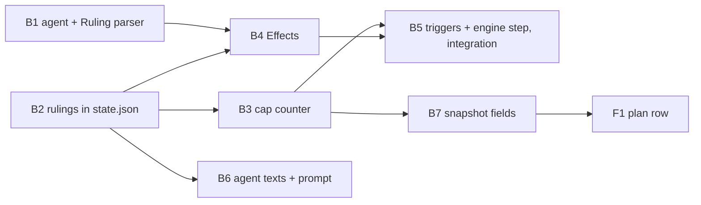

# Plan 015.00: Obi Wan Arbitrator

Framing 2 of the spec: an engine step, not a state. Spec open questions are taken at their recommendations (fenced `ruling` block; appeals as signature notes; disputes as `dispute:` mail; per-plan cap since the last `cap` ruling, fully struck rejections not counted; default cap 2).

What already exists on this branch and is reused, not rebuilt:

- `Config#max_rejections` and `merge.max_rejections` (`lib/openlanes/support/config.rb:124-129`).
- `Vcs::GitHub#comment` (`lib/openlanes/vcs/github.rb:326`), `Vcs::Review`, `Plans::ReviewLabel`.
- `Engine::Arbitration#call(plan:, count:, max:)`, the stub seam `Verification::Outcome` already calls at the cap (`lib/openlanes/engine/verification/outcome.rb:467`).
- `Verification::Outcome#rejections` (`outcome.rb:283`), the current counter, derived from signatures.
- chewie (`agents/chewie-verifier.md`) signs `Completed, round N (verified|rejected)`; plan 014 is in.

## Order and dependency graph

Waves: B1, B2 → B3, B4, B6 → B5, B7 → F1. B3 and B5 both edit `lib/openlanes/engine/verification/outcome.rb` (different methods), so they are sequential: B5 starts after B3 lands. B5 and B6 both read `rulings` but write different files.

## Backend

### B1 The agent and the ruling parser (spec items 1, 2, 12)

- **Discipline:** back end.
- **Owns:** `agents/obi-wan-kenobi-arbitrator.md`; `lib/openlanes/arbitration.rb` (facade, `OpenLanes::Arbitration`); `lib/openlanes/arbitration/ruling.rb` (`Ruling = Data.define(:kind, :pr, :outcome, :struck, :critical, :winner, :reason)`, `Ruling.parse(text) → Ruling`, raising `Ruling::Missing`, `Ruling::Ambiguous`, `Ruling::IllegalOutcome`; `Ruling::OUTCOMES` per kind); `evals/cases/obi-wan-kenobi-arbitrator/*.yml` (one per kind); `spec/openlanes/arbitration/ruling_spec.rb`; the read-only assertions in `spec/openlanes/agents/registry_spec.rb`.
- **Must not touch:** `lib/openlanes/engine/**`, `lib/openlanes/plans/plan_state.rb`, other `agents/*.md`.
- **Depends on:** nothing.
- **Done when:** `ruling_spec.rb` covers each kind and legal outcome, a missing block, two blocks and an illegal outcome; `registry_spec.rb` asserts the agent is read-only (`allowed_tools` exactly `Read, Grep, Glob`, `Bash(gh pr view:*)`, `Bash(gh pr diff:*)`, `Bash(openlanes state show:*)`, `Bash(openlanes mail read:*)`) and that `Registry#for_status` returns it for no status; `openlanes agents list` shows it; `openlanes evals` scores the new cases offline.

### B2 Rulings in `state.json` (spec item 3)

- **Discipline:** back end.
- **Owns:** `lib/openlanes/plans/plan_state.rb` (`#rule!(kind:, pr:, round:, outcome:, findings:, winner:, reason:, trigger:, at: Time.now)` under `#locked`; `#rulings → Array<Hash>`, empty when the key is absent); `schemas/plan-state.schema.json` (`rulings` array, `additionalProperties: false` kept); the `rulings` listing in `openlanes state show` (`lib/openlanes/cli/state/subcommands/show.rb`); `spec/openlanes/plans/plan_state_spec.rb`.
- **Must not touch:** `lib/openlanes/arbitration/**`, `lib/openlanes/engine/**`.
- **Depends on:** nothing.
- **Done when:** `plan_state_spec.rb` writes and reads one ruling, validates it against the schema, and loads a `state.json` without `rulings` as empty; the `state show` spec lists a ruling.

### B3 The cap counter (spec item 5)

- **Discipline:** back end.
- **Owns:** `lib/openlanes/arbitration/counter.rb` (`Counter#call(plan) → Integer`: hansolo and chewie `rejected` signatures since the last `cap` ruling, skipping rejections whose findings were all struck); `Verification::Outcome#rejections` becomes a one-line delegation to it (`lib/openlanes/engine/verification/outcome.rb`, that method only); `spec/openlanes/arbitration/counter_spec.rb`; any missing refusals (`0`, `-1`, `"two"`) in `spec/openlanes/support/config_spec.rb`.
- **Must not touch:** the rest of `outcome.rb`, `dispatcher.rb`, `plan_state.rb`.
- **Depends on:** B2.
- **Done when:** `counter_spec.rb` over a fixture `state.json` counts hansolo plus chewie rejections, resets after a `cap` ruling, and skips a fully struck rejection; `config_spec.rb` covers parsing, M5 defaults (3/2/2/1), 2 when `build_quality` is unset, and the three refusals.

### B4 Effects of a ruling (spec items 4, 7)

- **Discipline:** back end.
- **Owns:** `lib/openlanes/arbitration/effects.rb` (`Effects#apply(plan:, ruling:) → Result`, the only code acting on a ruling: `PlanState#rule!`; the engine's PR comment opening `⚖️ Ruling (<kind>): <outcome>` and quoting the reason, through `Vcs::GitHub#comment`; labels only through `Vcs::Review`; the state move; the engine-written `blocked.md` `## B1` for `cap/no_go`; mail through `Mailbox#append`); `spec/openlanes/arbitration/effects_spec.rb`.
- **Must not touch:** `lib/openlanes/vcs/**`, `dispatcher.rb`, `plan_state.rb`.
- **Depends on:** B1, B2.
- **Done when:** `effects_spec.rb` has one example per row of the spec's table against `PlansFixture` and the fake `gh` (including `too_lenient`: label `review-rejected`, plan 👀 → 🔴, counter one higher; `struck`: PR comment names F2 as struck), plus one where `Vcs::Review` refuses (CI red or pending), leaving label and plan alone and saying so in the PR comment.

### B5 Triggers and the engine step (spec items 6, 8, and the `(passed)` verdict) — integration check

- **Discipline:** back end.
- **Owns:** `lib/openlanes/engine/arbitration.rb` (replaces the stub: `#triggered(plan) → trigger or nil` in the spec's order — unanswered appeal note, unread `dispute:` mail, cap reached at 🔴, `review-passed` at `medium`/`mvp` with no `passed_check` ruling for the head SHA; `#call` runs the arbitrator through `Execution.executor`, parses with `Ruling.parse`, hands the result to `Effects`; a parse failure records an Interrupted stage); `lib/openlanes/arbitration/triggers.rb` if the triggers outgrow the engine file; in `lib/openlanes/engine/dispatcher.rb`: one call in the settle path, the `(passed)` word in `verdict_of` (stays at 👀), and the skip that keeps an arbitrated plan from other agents that tick; in `lib/openlanes/engine/verification/outcome.rb` (outside `#rejections`): the next chewie rejection after `cap/go` goes to ⭕️ with `blocked.md`; wiring in `lib/openlanes/engine/run_workflow.rb`; `spec/openlanes/engine/arbitration_spec.rb`, `spec/openlanes/engine/dispatcher_arbitration_spec.rb`.
- **Must not touch:** `lib/openlanes/arbitration/{ruling,effects,counter,appeal}.rb`, `agents/**`.
- **Depends on:** B3, B4.
- **Done when:** a dispatcher spec per trigger; one asserting luke is not started on a capped 🔴 plan; one where a chewie rejection after `cap/go` goes to ⭕️ with `blocked.md`; one at `top_notch`, `high` and unset `build_quality` showing zero `passed_check` rulings across a run.
- **Integration check (this unit owns it):** `dispatcher_arbitration_spec.rb` runs real ticks over a `PlansFixture` tree with the fake `gh` and a fake adapter whose final text is a ruling block; nothing inside openlanes is stubbed. It must show, end to end: a capped 🔴 plan → the arbitrator runs instead of luke and rey → `no_go` → plan at ⭕️, `blocked.md` `## B1` quotes the ruling, exactly one `rulings` entry, exactly one `gh pr comment` argv, HEAD unmoved and `git status` clean in the arbitrator's worktree; and the live snapshot (B7) for that plan then carries the ruling and `rejections: {count, max}`.

### B6 Agent texts and the prompt (spec items 9, 10, 11)

- **Discipline:** back end.
- **Owns:** `agents/hansolo-reviewer.md` (findings as `### F<n> [critical|minor] <file>:<line>`; a `review-passed` row signing `(passed)`; `rejected N/<max_rejections>` read from the prompt; the "findings after 2 rejections → slop" rule removed); `agents/luke-backend.md`, `agents/rey-frontend.md` (appeal via `--note "appeal: F<n> because <reason>"`; disputes by `mail send --to obi-wan-kenobi-arbitrator` with a body starting `dispute:`); `lib/openlanes/execution/prompt.rb` (gives hansolo `max_rejections` and the struck findings from `rulings`); `lib/openlanes/arbitration/appeal.rb` (`Appeal.parse(note) → Appeal(finding:, reason:)` or nil); `evals/cases/hansolo-reviewer/<struck-finding>.yml`; `spec/openlanes/execution/prompt_spec.rb`; `spec/openlanes/arbitration/appeal_spec.rb`.
- **Must not touch:** `dispatcher.rb`, `lib/openlanes/arbitration/{ruling,effects,counter}.rb`, `agents/obi-wan-kenobi-arbitrator.md`.
- **Depends on:** B2.
- **Done when:** `prompt_spec.rb` shows the configured cap and a struck F2 in hansolo's prompt; `appeal_spec.rb` parses `appeal: F2 because …` and returns nil for malformed notes; the hansolo eval case scores offline.

### B7 Snapshot fields (spec item 13, back half)

- **Discipline:** back end.
- **Owns:** `lib/openlanes/live/snapshot.rb` (per plan: `rejections: {count, max}`, `ruling` = the latest ruling or null, `arbitrating: true|false`); `spec/openlanes/live/snapshot_spec.rb`; the field shapes in `contract.md`.
- **Must not touch:** `web/**`, `lib/openlanes/engine/**`.
- **Depends on:** B3.
- **Done when:** `snapshot_spec.rb` asserts the three fields for a plan with two rejections and one ruling, and for a plan with neither.

## Frontend

### F1 Plan row: "rejected N of M" and the ⚖️ marker (spec item 13, front half)

- **Discipline:** front end.
- **Owns:** `web/src/api/types.ts` (the three snapshot fields); the plan-row component under `web/src/board/` and its `*.test.tsx`.
- **Must not touch:** `lib/**`, `agents/**`.
- **Depends on:** B7 (shapes in `contract.md`).
- **Done when:** a Vitest spec renders "rejected 2 of 3" from `rejections`, nothing when `count` is 0, and the ⚖️ marker only while `arbitrating` is true.

## HTTP surface

No. No route is added or changed and no `openapi.yaml` is needed; the existing live snapshot payload gains three per-plan fields, documented in `contract.md` by B7.

## Task completed when

- Each ruling is a dated entry in `state.json` (a `rulings` array that `schemas/plan-state.schema.json` validates) and one PR comment posted by the engine, never by the agent. `openlanes state show --plan 015` lists it.
- A `review-passed` PR with a critical open finding is downgraded to `review-rejected`: in a spec run against `PlansFixture` and the fake `gh` from #26, a recorded `too_lenient` ruling leaves the PR labelled `review-rejected`, the plan at 🔴, and the rejection count one higher.
- A plan whose hansolo and chewie rejections reach `merge.max_rejections` is not handed back to luke and rey: the next tick runs the arbitrator instead, and a `no_go` ruling leaves the plan at ⭕️ with a `blocked.md` whose `## B1` quotes the ruling, so it shows under Needs you.
- A `go` ruling at the cap moves the PR to `ready-to-merge` through `Vcs::Review` (which still refuses it while CI is red) and the plan back to 🟢 for one last verification.
- A builder signature with the note `appeal: F2 because <reason>` produces exactly one `appeal` ruling; a `struck` ruling makes the next hansolo prompt list F2 as struck, and the PR comment says so.
- The arbitrator's process cannot write: its `allowed_tools` are read-only, `Executor`'s after-check sees no HEAD move, and `git status` in its worktree is clean after a ruling.
- At `top_notch` and `high` (and when `build_quality` is unset) no `review-passed` check runs: zero `passed_check` rulings across a run.

## How to test

How to test it:

- Each ruling is a dated entry in `state.json` (a `rulings` array that `schemas/plan-state.schema.json` validates) and one PR comment posted by the engine, never by the agent. `openlanes state show --plan 015` lists it.
- A `review-passed` PR with a critical open finding is downgraded to `review-rejected`: in a spec run against `PlansFixture` and the fake `gh` from #26, a recorded `too_lenient` ruling leaves the PR labelled `review-rejected`, the plan at 🔴, and the rejection count one higher.
- A plan whose hansolo and chewie rejections reach `merge.max_rejections` is not handed back to luke and rey: the next tick runs the arbitrator instead, and a `no_go` ruling leaves the plan at ⭕️ with a `blocked.md` whose `## B1` quotes the ruling, so it shows under Needs you.
- A `go` ruling at the cap moves the PR to `ready-to-merge` through `Vcs::Review` (which still refuses it while CI is red) and the plan back to 🟢 for one last verification.
- A builder signature with the note `appeal: F2 because <reason>` produces exactly one `appeal` ruling; a `struck` ruling makes the next hansolo prompt list F2 as struck, and the PR comment says so.
- The arbitrator's process cannot write: its `allowed_tools` are read-only, `Executor`'s after-check sees no HEAD move, and `git status` in its worktree is clean after a ruling.
- At `top_notch` and `high` (and when `build_quality` is unset) no `review-passed` check runs: zero `passed_check` rulings across a run.
