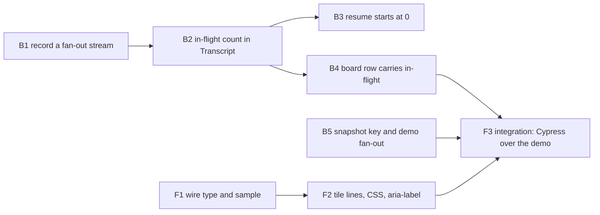

# Plan 019.00 — Multi-Agent Execution

The tile of an agent with sub-agents in flight is drawn with extra vertical lines on its right edge, one per sub-agent up to three, and returns to a plain tile when they end. The work is mostly data: the engine counts sub-agents ever started, never in flight, and the snapshot drops even that.

## Contract between the halves

Fixed here so both sides can start at once:

- `Live::Snapshot#car` gains `subagents:`, an Integer, the number of sub-agents in flight now. `0` when none. Never `null`, never absent from this engine.
- `Car` in `web/src/api/types.ts` gains `subagents: number`. The UI reads a missing field (an older engine's read-only board) as `0`.
- Cumulative counts (`Transcript#spawned`, `Progress#subagents` as consumed by `Executor#carry`, `Tally`) keep their meaning. In-flight is a separate field.

## Order and dependencies

| Unit | Discipline | Depends on               | Can run beside    |
| :--- | :--------- | :----------------------- | :---------------- |
| B1   | back end   | nothing                  | B5, F1, F2        |
| B2   | back end   | B1                       | B5, F1, F2        |
| B3   | back end   | B2                       | B4, B5, F1, F2    |
| B4   | back end   | B2                       | B3, B5, F1, F2    |
| B5   | back end   | nothing                  | everything but F3 |
| F1   | front end  | nothing (contract above) | all back-end units |
| F2   | front end  | F1                       | all back-end units |
| F3   | front end  | B4, B5, F2               | nothing, runs last |

Sequential because they share a file: none. Every file below has exactly one owner. B3 and B4 both read the `Progress` field B2 adds, which is why both wait on B2.

**Integration check: F3.**

## Backend

### B1 Record a fan-out stream

- **Discipline:** back end.
- **Owns:** `spec/fixtures/streams/subagent-fanout.ndjson` (a real `claude -p --output-format stream-json --verbose` recording, trimmed to the `system` and `result` events, with any session id, path or user name replaced by fictional values).
- **Must not touch:** `lib/`, every other unit's files.
- **Depends on:** nothing.
- **Done when:** the fixture exists and `jq -c 'select(.subtype=="task_started" or .subtype=="task_notification") | {subtype, task_id, status}' spec/fixtures/streams/subagent-fanout.ndjson` shows two `task_started` and two `task_notification` events whose `status` is one of `completed`, `failed`, `stopped`. B2's `transcript_spec.rb` replays it.
- **Block if:** the pinned `claude` emits no `task_notification`, or emits one without `status`. A count that never drops is not acceptable to the spec (open question 1), so sign `Blocked (product)` with the recording attached rather than inventing a fallback.
- **Note:** recording needs `claude` and the network. If the agent's boundary withholds that, block `(technical)` and ask a person to record it with the prompt in the spec's Research, Could not settle 1.

### B2 In-flight count in `Transcript`

- **Discipline:** back end.
- **Owns:** `lib/openlanes/execution/transcript.rb`, `spec/openlanes/execution/transcript_spec.rb`.
- **Must not touch:** `executor.rb`, `dispatcher.rb`, `board.rb`, `snapshot.rb`, `tally.rb`.
- **Depends on:** B1.
- **Shape:**
  - `Transcript#running` → `Integer`: tasks keyed by `task_id` that have a `task_started` and no terminal `task_notification`.
  - A `task_notification` whose `status` is `completed`, `failed` or `stopped` ends its task. Tokens are still taken from it, as today.
  - The parent's `result` event, or the stream ending, sets `running` to 0 (open question 4: a killed sub-agent may never send its notification).
  - `Progress` gains `running:`. `Progress#subagents` and `#spawned` stay cumulative.
- **Done when:** `transcript_spec.rb` has examples for: start, start, notification(completed) → `running` 1; second notification → 0; `failed` and `stopped` also end a task; a notification with an unknown status does not; `result` resets to 0 while `spawned` stays 2; the B1 fixture replayed end to end ends at `running` 0, `spawned` 2.

### B3 A resumed session starts at 0 in flight

- **Discipline:** back end.
- **Owns:** `lib/openlanes/execution/executor.rb`, `spec/openlanes/execution/executor_spec.rb`.
- **Must not touch:** `transcript.rb`, `dispatcher.rb`, `tally.rb`.
- **Depends on:** B2.
- **Shape:** `carry` (`executor.rb:~297`) keeps adding earlier sessions' `spawned` to `subagents`, and passes `running` through untouched: only the live session's sub-agents can be in flight.
- **Done when:** an `executor_spec.rb` example resumes after a session that spawned two sub-agents and asserts the first progress of the new session has `running` 0 and `subagents` 2.

### B4 The board row carries the in-flight number

- **Discipline:** back end.
- **Owns:** `lib/openlanes/engine/dispatcher.rb`, `lib/openlanes/engine/board.rb` (the doc of `subagents` only), `spec/openlanes/engine/dispatcher_spec.rb`.
- **Must not touch:** `transcript.rb`, `executor.rb`, `tally.rb`, `snapshot.rb`.
- **Depends on:** B2.
- **Shape:** the progress block (`dispatcher.rb:~977`) sets `job.subagents = progress.running`, so `Board::Row#subagents` (filled at `dispatcher.rb:~618`) means in flight now. `Tally` reads attempts, not rows, and keeps its cumulative figure; confirm that, do not change it.
- **Done when:** a `dispatcher_spec.rb` example drives a fake executor that yields `running` 2, then 0, and asserts the row's `subagents` is 2, then 0; the existing `tally_spec.rb` stays green unchanged.

### B5 The snapshot exposes `subagents`, and the demo fans out

- **Discipline:** back end.
- **Owns:** `lib/openlanes/live/snapshot.rb`, `spec/openlanes/live/snapshot_spec.rb`, `lib/openlanes/web/demo_board.rb`, `spec/openlanes/web/demo_board_spec.rb`, `openapi.yaml` in this plan folder.
- **Must not touch:** `dispatcher.rb`, `board.rb`, every `web/` file.
- **Depends on:** nothing (`Board::Row#subagents` already exists; B4 changes what fills it, not its type).
- **Shape:**
  - `Snapshot#car` (`snapshot.rb:184-204`) adds `subagents: row.subagents.to_i`.
  - The demo board gives one running car a sub-agent count that cycles: 3 for a few ticks, then 1, then 0, then again. It is the only real source F3 has, so the cycle must be deterministic and its period written in a comment.
- **Done when:** `snapshot_spec.rb` asserts every car has an Integer `subagents` and that a row with 0 gives 0; `demo_board_spec.rb` asserts the fanned-out car reaches 3 and later 0.

## Frontend

### F1 Wire type and sample

- **Discipline:** front end.
- **Owns:** `web/src/api/types.ts`, `web/src/board/sample.ts`.
- **Must not touch:** `Car.tsx`, `board.css`, any `lib/` file.
- **Depends on:** nothing; the contract at the top fixes the shape.
- **Shape:** `Car` gains `subagents: number`. `sampleCar` sets it to `0`, and one sample car sets it to `2` so the static preview shows the marker.
- **Before writing:** `types.ts` notes `sample.ts` was held by another agent. Run `alock check web/src/board/sample.ts`; a refused claim is a stop.
- **Done when:** `npm run typecheck` passes and `web/src/board/model.test.ts` sees the field on `sampleCar`.

### F2 The tile draws the lines

- **Discipline:** front end.
- **Owns:** `web/src/board/Car.tsx`, `web/src/board/board.css` (rules beside `.car`, `:48`), `web/src/board/Car.test.tsx` (new).
- **Must not touch:** `types.ts`, `sample.ts`, the rest of the tile's styling.
- **Depends on:** F1.
- **Shape:**
  - When `car.subagents > 0`, the tile gets class `car-fanned` and `min(car.subagents, 3)` real elements `` on its right edge (open questions 2 and 3: real elements, cap 3). A missing or 0 `subagents` draws none and adds no class.
  - The tile carries `title` and `aria-label` text "N sub-agents running", singular for 1, only when N > 0.
  - No "unknown count" path: this engine always sends an integer, so the spec's 2-lines-when-unknown rule has no input that reaches it.
- **Done when:** `Car.test.tsx` (vitest) renders `subagents` 0, 1, 3 and 5 and asserts 0, 1, 3, 3 `.car-stack-line` elements, the class present only when > 0, the labels "1 sub-agent running" and "3 sub-agents running", and no label at 0 or with the field absent. `npm run lint` and `npm test` pass.

### F3 Integration: Cypress over the demo engine

- **Discipline:** front end.
- **Owns:** `web/cypress/e2e/subagents.cy.ts` (new).
- **Must not touch:** `cypress.config.ts`, `web/cypress/support/`, any other spec, any `lib/` file.
- **Depends on:** B4, B5, F2.
- **What it must show,** through `just web-build` then `just web-e2e` against `openlanes web --demo`, nothing stubbed or intercepted: the demo's fanned-out car, found by its `data-car` attribute, shows 3 `.car-stack-line` elements and `aria-label` "3 sub-agents running" within the demo's cycle, and later 0 lines and no label, while every other car shows 0 lines throughout. The axe check in `board.cy.ts` stays green with the marker drawn.
- **Done when:** `subagents.cy.ts` passes in `bin/web-e2e`, and `bundle exec rspec` and `just lint` are green.

## HTTP surface

Yes, additively. The board snapshot response gains `subagents` (integer, ≥ 0) on every car. Nothing is removed or renamed. `luke-backend` writes `openapi.yaml` beside `contract.md` (owned by B5) describing the car object with the new field, so `openlanes api docs` lists it.

## Out of this plan

- Per-sub-agent activity, `Tally` accounting, Codex and Pi, scheduling, and the stale ratatui doc, as the spec's Non-Goals say.
- The 3-line cap is an assumption from the spec (open question 2); confirm with the owner at review.

## How to test

From the spec: verify in the browser that an agent that fanned out is visually different from the rest.

1. `just web-build`, then `openlanes web --demo` and open the board it prints.
1. Find car `001.00/rey-frontend`. Within its 12-tick cycle it shows 3 extra vertical lines on its right edge, then 1, then none; hovering it reads "3 sub-agents running" (then "1 sub-agent running"), and at 0 it has no such title.
1. Every other car stays a plain tile throughout.
1. Automated: `bin/web-e2e` runs `web/cypress/e2e/subagents.cy.ts` against two real demo servers, nothing stubbed; `bundle exec rspec` and `bundle exec rubocop` exit 0.

## Rebase decisions

Upstream PR #55 (`c8e29f4`, `05dacfa`, `74e2231`) landed the same data this plan built, as names: `Progress#running` and `Board::Row#running` are `Array<String>`, the car's `subagents` on the wire is `string[]`, and the page draws each one as a ghost tile beside its parent. Main's shape wins everywhere below; the branch's integer count is now `running.size` / `subagents.length`.

- `lib/openlanes/execution/transcript.rb`: kept main's `@running` (names keyed by the `Task` call's `tool_use_id`, ended by its `tool_result`); folded the branch's evidence in, so a `task_started` adds the same key (named by `subagent_type`, else `description`), a terminal `task_notification` removes it, a notification that overtook its start does not reopen it, and `finish` clears it. Dropped the branch's `@open` counter and its duplicate `running` method and `running:` keyword.
- `lib/openlanes/engine/dispatcher.rb`: took main's side (`job.running = progress.running`, `job.subagents` stays cumulative); the branch's `job.subagents = progress.running` would have put a list into an Integer field.
- `lib/openlanes/engine/board.rb`: rewrote the branch's `subagents` doc to main's meaning (cumulative), pointing at `running` for the in-flight list.
- `lib/openlanes/live/snapshot.rb`: took main's `subagents: Array(row.running)`; dropped the branch's `row.subagents.to_i`, which would have sent the cumulative count under the same key.
- `lib/openlanes/web/demo_board.rb`: kept the branch's fan-out cycle but as name lists (3 names, 1, none) instead of 3, 1, 0, so the demo matches the wire type.
- `web/src/api/fixtures/board.json`, `snapshot.json`, `web/src/board/sample.ts`: took main's name lists; the branch's `2` on rey-frontend matches main's two names.
- `web/src/api/types.ts`: dropped the branch's second `subagents: number` (a duplicate property next to main's `string[]`).
- `web/src/board/Car.tsx`: kept the branch's tile lines and label, counted from `car.subagents?.length`. The tile now shows both the lines and main's ghost tiles beside it; a reviewer may want only one of the two.
- `state.json`: took main's copy, the newer harness record (rey's attempt finished 19:10:01 vs 18:40:29 on the branch).
- Specs (`transcript_spec`, `executor_spec`, `dispatcher_spec`, `demo_board_spec`, `Car.test.tsx`, `model.test.ts`): adapted the branch's examples to lists; gave each `task_started` its own `tool_use_id`, since the shared default would now collapse two tasks into one; dropped the branch's snapshot Integer example, covered by main's "names the sub-agents still running".
