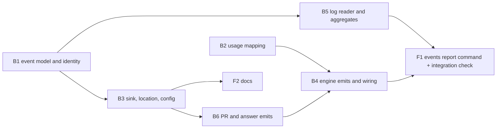

# Plan 020.01: Durable Run Events

Builds the opt-in, append-only JSONL event log from `spec.md` (In scope 1 to 11) and the `openlanes events report` command that reads it. One pull request, eight units.

## Decisions taken while planning

- **Sink location.** Plan 021.00 is still in research. Its recommendation is `${XDG_STATE_HOME:-~/.local/state}/openlanes/<project>-<6 hex of sha256(root)>/`, matching `apps/ports.rb` and `progress_log.rb`. This plan uses that default, under an `events/` subdirectory, behind one resolver (`Events::Location`), so 021.00 changes a single method if it decides otherwise. `.openlanes.yml` can override the directory.
- **Config key.** `.openlanes.yml` gains `events: { enabled: false, dir: <path> }`. Absent or `enabled: false` means the null sink, and no file or directory is created.
- **Run id.** No run id exists today (`engine/state_file.rb:137` keeps only pid, root and `started_at`). `Runner` mints one per `call`: a digest of node name and run start. It is an identifier, not text.
- **Unique run for block metrics.** `(plan, round, agent)`, per spec open question 6. A re-block after an answer is a new block on the same unique run.
- **Usage across adapters.** Reported per adapter, never summed across adapters (spec open question 9). Cost: `estimated: true` on every computed figure, `null` for codex and pi.
- **Front end means the CLI here.** There is no web work. `rey-frontend` owns the command, its renderer and the docs, per the spec's own split.

## Order and dependencies

Sequence: B1 and B2 in parallel; then B3 and B5 in parallel; then B6; then B4; then F1. F2 can start once B3 has fixed the config key. B4 and B6 are sequential because B4 constructs the classes B6 changes and passes them the `events:` keyword B6 adds.

Pair contract (spec, "Back end / front end"): `luke-backend` mails `rey-frontend` the field names of `Events::Report::Result` (B5) before F1 starts coding. Neither side renames a field without mail.

## Backend

### B1 Event model and identity

- **Discipline:** back end.
- **Owns:** `lib/openlanes/events/event.rb`, `lib/openlanes/events/identity.rb`, `spec/openlanes/events/event_spec.rb`, `spec/openlanes/events/identity_spec.rb`.
- **Must not touch:** every file owned by another unit; in particular `lib/openlanes/events.rb` (B3).
- **Depends on:** nothing.
- **Shape:** `Events::Event = Data.define(:event_id, :kind, :at, :project, :plan, :run, :agent, :adapter, :model, :payload)`. `Event::KINDS`: `run_started`, `run_finished`, `agent_started`, `agent_finished`, `block_raised`, `human_answered`, `pr_opened`, `pr_reviewed`, `pr_merged`, `pr_closed`, `failure`. `Event::PAYLOAD_KEYS`, one allowlist per kind; constructing an event with a key outside it raises. The only string payload that is not an id is `failure`'s `error_class`, bounded in length. `Event#to_h` and `Event.from_h` round-trip JSON. `Identity.event_id(node:, checkout:, plan:, round:, agent:, invocation_start:, kind:, seq:)` returns the SHA-256 hex.
- **Done when:** `event_spec.rb` builds every kind and asserts its fields, and asserts the serialised key set of every kind against the allowlist (spec item 10); `identity_spec.rb` shows the same inputs give the same id and any one changed input gives a different one (spec item 3).

### B2 Usage mapping

- **Discipline:** back end.
- **Owns:** `lib/openlanes/events/usage.rb`, `spec/openlanes/events/usage_spec.rb`.
- **Must not touch:** `lib/openlanes/execution/transcript.rb`, `lib/openlanes/adapters/*`, `lib/openlanes/live/meter.rb` (read only).
- **Depends on:** nothing.
- **Shape:** `Events::Usage = Data.define(:adapter, :input_tokens, :output_tokens, :cache_read_tokens, :cache_write_tokens, :cost_usd, :estimated, :incomplete)`, built by `Usage.from(adapter:, model:, totals:, subagents_spawned: 0)`. Claude: tokens from the `result` accounting, cost from `Model#cost` with `estimated: true`, `incomplete: true` when sub-agents spawned. Codex and pi: tokens read defensively (nil when absent), `cost_usd: nil`. `total_cost_usd` is never read.
- **Done when:** `usage_spec.rb` has one example per adapter, a codex and a pi example asserting cost is `nil` and not `0`, and a claude example flagging a sub-agent run `incomplete` (spec item 8).

### B3 Sink, location and config key

- **Discipline:** back end.
- **Owns:** `lib/openlanes/events.rb` (facade), `lib/openlanes/events/sink.rb`, `lib/openlanes/events/null_sink.rb`, `lib/openlanes/events/location.rb`, `lib/openlanes/support/config.rb` (the `events:` key only), `spec/openlanes/events/sink_spec.rb`, `spec/openlanes/events/location_spec.rb`, `spec/openlanes/support/config_spec.rb` (new examples only).
- **Must not touch:** `lib/openlanes/live/*`, `lib/openlanes/engine/*`.
- **Depends on:** B1.
- **Shape:** `Events.emitter(root:, config:, node:)` returns a `Sink` or the `NullSink`. `Sink#emit(event)` appends one JSON line to `<dir>/<node.id>.jsonl` with a single `O_APPEND` write, creates the directory on first write, and rescues every `StandardError` to a warning: it never raises and never touches Redis. `Location.dir(root:, config:)` is the only place that knows the default path. Config parses `events.enabled` (boolean) and `events.dir` (absolute path) and fails on anything else.
- **Done when:** `sink_spec.rb` writes events and reads them back, shows the null sink creates no file or directory (spec items 4 and 5), shows a write still lands when a `Live::Store` double raises on every call (spec item 6), and shows an unwritable directory produces a warning, not an exception; `location_spec.rb` covers `XDG_STATE_HOME` set, unset and relative; `config_spec.rb` covers the key present, absent and malformed.

### B4 Engine emits and wiring

- **Discipline:** back end.
- **Owns:** `lib/openlanes/engine/runner.rb`, `lib/openlanes/engine/dispatcher.rb`, `spec/openlanes/engine/events_emit_spec.rb`.
- **Must not touch:** `lib/openlanes/engine/pr_outcomes.rb`, `lib/openlanes/vcs/publisher.rb`, `lib/openlanes/lifecycle/unblocker.rb` (B6), `lib/openlanes/live/*`.
- **Depends on:** B2, B3, B6.
- **Shape:** `Runner` mints the run id and builds the emitter once through `Events.emitter`; emits `run_started` and `run_finished`. `Dispatcher` emits `agent_started` in `start`; `agent_finished` (with `Usage`) and `block_raised` (when the agent signed Blocked) in `settle`; and `failure` with the error class when an attempt fails or the boundary check rejects it. It passes `events:` to the `PrOutcomes`, `Lifecycle::Unblocker` and `Vcs::Publisher` it constructs. Every emit is fire-and-forget; no emit can fail or stall a tick.
- **Done when:** `events_emit_spec.rb`, on a real `.plans` tree from `PlansFixture` with an injected executor (as `spec/openlanes/engine/dispatcher_spec.rb` does), shows one round produces `run_started`, `agent_started`, `agent_finished`, `run_finished`; a blocking agent adds `block_raised`; a failing attempt adds `failure` carrying only `error_class`; and with events disabled the run creates no file (spec item 2).

### B5 Log reader and aggregates

- **Discipline:** back end.
- **Owns:** `lib/openlanes/events/log.rb`, `lib/openlanes/events/report.rb`, `spec/openlanes/events/log_spec.rb`, `spec/openlanes/events/report_spec.rb`, `spec/fixtures/events/` (fixture node files).
- **Must not touch:** `lib/openlanes/events.rb` (B3: add facade methods after B3 lands), anything under `lib/openlanes/cli/` or `lib/openlanes/presentation/`.
- **Depends on:** B1.
- **Shape:** `Log.new(dir:)#events` reads every `*.jsonl` in the directory, skips malformed lines with a count, and dedupes by `event_id`. `Report.new(events)#call` returns `Report::Result = Data.define(:runs, :completion_rate, :blocks, :runs_needing_feedback, :intervention_rate, :time_to_answer, :pr_outcomes, :usage_by_run, :usage_by_model, :skipped_lines)`. `time_to_answer` pairs each `block_raised` with the next `human_answered` on the same `(plan, round, agent)`. Usage groups are keyed by adapter as well as model and never summed across adapters; a group containing any estimate is marked estimated.
- **Done when:** `report_spec.rb` with two node files holding one duplicate gives the expected numbers (spec item 9), and a fixture of 3 blocks over 2 unique runs reports 3 and 2 (spec item 7); `log_spec.rb` covers dedupe and a malformed line.

### B6 PR and human-answer emits

- **Discipline:** back end.
- **Owns:** `lib/openlanes/engine/pr_outcomes.rb`, `lib/openlanes/vcs/publisher.rb`, `lib/openlanes/lifecycle/unblocker.rb`, `spec/openlanes/events/pr_and_answer_emit_spec.rb`.
- **Must not touch:** `lib/openlanes/engine/dispatcher.rb`, `lib/openlanes/engine/runner.rb` (B4), `lib/openlanes/vcs/github.rb` (read only; it is the seam the spec doubles).
- **Depends on:** B3.
- **Shape:** each class takes `events:` defaulting to the `NullSink`. `Publisher` emits `pr_opened` with the PR number. `PrOutcomes` emits `pr_reviewed`, `pr_merged` or `pr_closed` only when it actually applies a change, so the watch re-asking every 15 seconds does not multiply events (and `event_id` dedupes anything that slips through). `Unblocker` emits `human_answered` per drained question, carrying the block id and answer time, never the answer text.
- **Done when:** `pr_and_answer_emit_spec.rb`, on `PlansFixture` trees with the `GitHub` double, shows each PR kind emitted once when an outcome is applied twice, and `human_answered` emitted per answered `B<n>` with no answer text in the payload (spec item 2).

## Frontend

### F1 `openlanes events report` command, and the integration check

- **Discipline:** front end (CLI).
- **Owns:** `lib/openlanes/cli/events/subcommands/report.rb`, `lib/openlanes/cli/events/events.rb` (if the prefix group needs a base), `lib/openlanes/cli.rb` (the `events` registration only), `lib/openlanes/presentation/events_report.rb`, `spec/openlanes/presentation/events_report_spec.rb`, `spec/openlanes/cli/events/report_spec.rb`, `spec/integration/events_report_spec.rb`.
- **Must not touch:** `lib/openlanes/events.rb` and `lib/openlanes/events/*` (B1, B2, B3, B5).
- **Depends on:** B4, B5.
- **Shape:** `openlanes events report [--dir PATH] [-o [FILE]] [--format table|json]`. Reads through `Events::Log` and `Events::Report`, renders `Report::Result` through `Presentation::EventsReport#render`, which returns a string and prints nothing. STDOUT carries the report, STDERR the progress and the box. Estimated cost carries an `(est.)` label; `nil` cost renders as `unknown`, never `$0`. When events are disabled it says so and names the `.openlanes.yml` key.
- **Integration check (this unit owns it):** `spec/integration/events_report_spec.rb` builds a `PlansFixture` tree with `events.enabled: true` in its `.openlanes.yml` and `XDG_STATE_HOME` pointed at a temp directory. It drives the real `Runner` for one round with an injected executor (one agent completes, one blocks), runs the real `Unblocker` on an answered `blocked.md`, and applies a merged `PrOutcomes` outcome from the `GitHub` double (the network seam, the only double besides the executor). It then runs `exe/openlanes events report --format json` as a subprocess, and must show: completion 1 of 2, 1 block over 1 unique run, one time-to-answer, one merged PR, usage grouped under the executor's adapter, and no key outside the allowlist in any line of the JSONL file.
- **Done when:** `presentation/events_report_spec.rb` covers the estimated label and `unknown` cost; `cli/events/report_spec.rb` covers `-o`, `--format json` and the disabled message; `spec/integration/events_report_spec.rb` passes as described.

### F2 Docs: configuration and multi-machine behaviour

- **Discipline:** front end (docs).
- **Owns:** `README.md` (the `## Configuration` section only), `docs/events.md`, `spec/openlanes/docs/events_doc_spec.rb`.
- **Must not touch:** `lib/openlanes/presentation/documentation.rb` (derived conventions, unrelated to events), any `lib/` file.
- **Depends on:** B3 (the config key and default path).
- **Shape:** `docs/events.md` documents the `events:` key, the default XDG path and its dependence on 021.00, the event kinds and their allowlisted fields, what is never stored (code, prompts, conversation text, `total_cost_usd`), and multi-machine behaviour: one writer per file, late arrival from offline nodes, nothing rewritten. `README.md` links to it from `## Configuration`.
- **Done when:** `events_doc_spec.rb` asserts `docs/events.md` exists and names the three multi-machine points, and that `README.md` links to it (spec item 11).

## HTTP surface

No. This plan adds no HTTP API and changes none; `luke-backend` writes no `openapi.yaml`.
