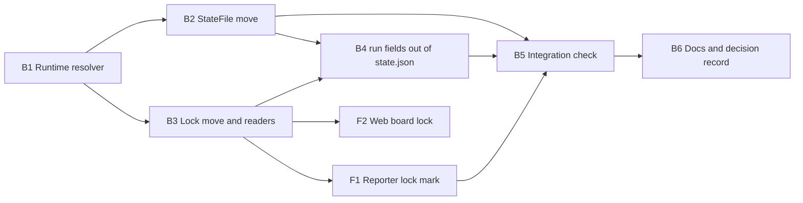

# Plan 021.00: Runtime State Outside Plans

Built from `spec.md` (In scope items 1–12). Eight units, one pull request.

## Order and dependencies

1. B1 first, alone. Everything else resolves paths through it.
2. B2 and B3 in parallel: they own disjoint files.
3. B4 after B2 and B3: it edits `dispatcher.rb` after B3 does, and reads the run record B2 relocates. Sequential on `dispatcher.rb`.
4. F1 and F2 in parallel once B3 has fixed the `Lock` value and the snapshot's `locked` shape.
5. B5 after B2, B4 and F1: it drives the real path end to end, including the reporter's text.
6. B6 last, so the docs describe what landed.

Contract between the halves (from the spec): `Plans::Lock.read` returns a value with `host`, `pid`, `started_at` and `foreign?`. The displays only format it. In JSON (`Lock#to_json_hash`, the snapshot's `locked`): `{ pid: Integer, host: String, started_at: ISO8601, foreign: Boolean }`, or `null`.

Deviation from the spec's half table: `live/snapshot.rb` goes to the back end (B3), because it builds the HTTP response the web board reads. The front end's share of items 6 and 7 is the two places a person sees a lock: the CLI reporter (F1) and the web board (F2).

## Backend

### B1 Runtime resolver

- **Discipline:** back end.
- **Owns:** `lib/openlanes/support/runtime.rb` (new, `OpenLanes::Runtime`, collapsed by Zeitwerk like the rest of `support/`), `spec/openlanes/support/runtime_spec.rb` (new), `spec/spec_helper.rb` (point `XDG_STATE_HOME` at a per-run temp directory so no spec writes into the developer's home).
- **Must not touch:** anything another unit owns, in particular `apps/ports.rb` (its own XDG lookup stays; sharing it is a later cleanup, not this plan).
- **Depends on:** nothing.
- **Shape:** `Runtime.state_home(env = ENV) -> String` (absolute `XDG_STATE_HOME`, else `~/.local/state`; empty and relative values ignored). `Runtime.dir(root:) -> String`, `<state_home>/openlanes/<basename(root)>-<6 hex of sha256(realpath root)>`. `Runtime.locks_dir(root:)`, `Runtime.state_file(root:)`. Directories are created on demand with `mkdir_p`, never at require time. `root` is the directory that holds `.plans/` (the plans dir's parent), so the harness on the main tree and an agent handed the same `--dir` address one state directory.
- **Done when:** `spec/openlanes/support/runtime_spec.rb` covers unset, empty, relative and absolute `XDG_STATE_HOME`, two roots giving distinct directories, and the same root through a symlink giving one.

### B2 StateFile moves to the state directory

- **Discipline:** back end.
- **Owns:** `lib/openlanes/engine/state_file.rb`, `spec/openlanes/engine/state_file_spec.rb`, `spec/integration/restart_spec.rb`, `.gitignore` (the repo's own: add the two temp patterns).
- **Must not touch:** `plans/lock.rb`, `engine/dispatcher.rb`, `plans/plan_state.rb`, `live/run_state.rb` (spec Non-goal 4).
- **Depends on:** B1.
- **Shape:**
  - `StateFile` writes `Runtime.state_file(root:)`; its `.<pid>.tmp` sits beside it (same filesystem, so `File.rename` stays atomic).
  - `#load` reads the new path, then `.plans/openlanes-state.json`, then `.plans/tmp/openlanes-state.json`. Never writes or deletes either legacy file.
  - `#begin_run!` records `host`. `#previous_run_dead?` returns false (not provably dead) when the recorded host differs from `Socket.gethostname`; a record with no `host` (legacy) keeps today's local-pid check.
  - `.ensure_ignored!` stops adding `.plans/openlanes-state.json` and `.plans/tmp/`, adds one line covering `*.tmp` under `.plans/`, never edits or removes a line it did not write, and still reports what it added through `UI`. Legacy lines already in a `.gitignore` are left alone.
- **Done when:** `state_file_spec.rb` asserts no `openlanes-state.json*` under `.plans/` after `save`, resumes from each legacy path, covers the foreign-host `previous_run_dead?` case with a stubbed `Socket.gethostname`, and runs `ensure_ignored!` against a `.gitignore` with unrelated content that is unchanged apart from the appended block; `restart_spec.rb` resumes an interrupted run from a legacy `.plans/openlanes-state.json`; `git check-ignore` matches `state.json.1.2.tmp` and `blocked.md.1.tmp` inside a plan folder, both against the repo `.gitignore` and against a fresh one written by `ensure_ignored!`.

### B3 Lock moves out of the folder; every reader follows

- **Discipline:** back end.
- **Owns:** `lib/openlanes/plans/lock.rb`, `lib/openlanes/engine/plan_locks.rb`, `lib/openlanes/lifecycle/resync.rb` (lock section only), `lib/openlanes/engine/dispatcher.rb` (`locked_elsewhere?` only), `lib/openlanes/live/snapshot.rb` (`locked` field), `spec/openlanes/plans/lock_spec.rb`, `spec/openlanes/engine/plan_locks_spec.rb`, `spec/openlanes/lifecycle/resync/dirs_spec.rb`, `spec/openlanes/live/snapshot_spec.rb`, and `contract.md` plus `openapi.yaml` in this plan folder.
- **Must not touch:** `presentation/reporter.rb` (F1), `web/` (F2), the `stage!` call and `resume_stranded` in `dispatcher.rb` (B4).
- **Depends on:** B1.
- **Shape:**
  - `Lock.path(dir)` becomes `<Runtime.locks_dir>/<ordinal>.lock`, the ordinal decoded from the folder name, so a rename while locked changes nothing. `Lock.legacy_path(dir)` is the old `locked-by.pid`.
  - `Lock.read(dir)` is the single reader entry point: new path first, legacy file second. Signature unchanged, so callers keep passing the plan folder.
  - `Lock.write` and the release touch only the new path. Removing a lock also removes a legacy file that a dead pid on this host left, which is how `resync dirs` keeps clearing old stale locks (item 8).
  - `Lock#foreign?` is `host != Socket.gethostname`. A foreign lock is never stale, never cleared, and `held_elsewhere?` stays true (Q1: no expiry).
  - `to_json_hash` adds `foreign:`.
- **Done when:** `lock_spec.rb` renames the folder while locked and still reads the lock, reads a legacy `locked-by.pid`, and keeps a foreign lock held; `plan_locks_spec.rb` shows the 0→1 write and 1→0 release land in the state directory; `dirs_spec.rb` clears a stale legacy lock on this host and leaves a foreign one; `snapshot_spec.rb` returns `locked` with `foreign`, `host` and `started_at` for a lock at each location.

### B4 Machine fields leave `state.json`

- **Discipline:** back end.
- **Owns:** `lib/openlanes/plans/plan_state.rb`, `schemas/plan-state.schema.json`, `lib/openlanes/engine/dispatcher.rb` (the `stage!` call near line 973 and `resume_stranded`), `spec/openlanes/plans/plan_state_spec.rb`, `spec/openlanes/engine/dispatcher_spec.rb` (stranded-resume examples only).
- **Must not touch:** `state_file.rb` (B2; read through its public methods only), `lock.rb` (B3).
- **Depends on:** B2, B3 (sequential on `dispatcher.rb` after B3).
- **Shape:** the dispatcher stops passing `run: { pid, host }` to `stage!`; the pid and host of a started stage are already in the run's `StateFile` record, which B2 makes host-aware. `PlanState#stranded` keeps reading `run` from stages written by older versions, so a crash under the old layout still resumes. The schema keeps `run` as an optional, deprecated property so old files validate; new files never contain it.
- **Done when:** `plan_state_spec.rb` loads a file whose stages carry `run`, still reports it stranded, and validates a newly written `state.json` against the schema with no `run` key; `dispatcher_spec.rb` resumes a stage stranded under the new layout from the `StateFile` record alone.

### B5 Integration check: runtime files land outside `.plans/`

- **Discipline:** back end.
- **Owns:** `spec/integration/runtime_state_spec.rb` (new).
- **Must not touch:** any `lib/` file.
- **Depends on:** B2, B4, F1.
- **What it must show,** with nothing stubbed except `Socket.gethostname` for the foreign case and `XDG_STATE_HOME` pointed at a temp directory: a real `.plans` tree (through `PlansFixture`) in a real git repo, a lock taken through `PlanLocks`, and a `StateFile` saved by a run; then
  - the only new paths under `.plans/` are durable files, and `git status --porcelain --ignored` lists no runtime file there;
  - the state directory holds `openlanes-state.json` and `locks/<ordinal>.lock`;
  - the folder is renamed while locked, and `Lock.read`, the reporter's 🔑 line and the snapshot's `locked` all still see the lock;
  - a legacy `locked-by.pid` from a dead local pid is cleared by `resync dirs`, and a foreign one is reported held on its host and kept;
  - an interrupted run resumes from a legacy `.plans/openlanes-state.json`, which is still there afterwards.
- **Done when:** `bundle exec rspec spec/integration/runtime_state_spec.rb` passes, and the whole suite and `just lint` are green.

### B6 Docs and decision record

- **Discipline:** back end.
- **Owns:** `README.md` (the "Plan folders" section and any other mention of `locked-by.pid` or `openlanes-state.json`), `docs/decisions/decisions-on-runtime-state.md` (new).
- **Must not touch:** code and specs.
- **Depends on:** B5.
- **Shape:** the decision record holds the inventory (spec Research, Inventory), durable versus operational per file, the XDG location and its keying by root, the read fallbacks and their removal one release later, the foreign-lock rule (held, shown, never auto-cleared), and Q4–Q8 as recorded assumptions.
- **Done when:** the decisions file exists, and `rg 'locked-by.pid' README.md` returns only lines that call it legacy.

## Frontend

### F1 Reporter shows who holds a lock

- **Discipline:** front end (CLI display).
- **Owns:** `lib/openlanes/presentation/reporter.rb`, `spec/openlanes/presentation/reporter_spec.rb`.
- **Must not touch:** `lock.rb` and every other B3 file.
- **Depends on:** B3.
- **Shape:** the 🔑 mark stays for any lock; a foreign one adds `held on <host> since <started_at>`. Formatting only, from the `Lock` value.
- **Done when:** `reporter_spec.rb` shows 🔑 for a lock in the state directory and for a legacy `locked-by.pid`, and the "held on" text for a foreign lock only.

### F2 Web board shows a foreign lock

- **Discipline:** front end (web).
- **Owns:** `web/src/api/types.ts` (`locked` gains `foreign: boolean`; its comment stops saying "in the plan folder"), `web/src/api/fixtures/snapshot.json`, `web/src/api/fixtures/board.json`, `web/src/board/model.ts`, `web/src/board/PlanRow.tsx`, `web/src/board/format.ts`, `web/src/board/model.test.ts`, `web/src/board/Board.test.tsx`.
- **Must not touch:** any Ruby file.
- **Depends on:** B3 (the `locked` shape).
- **Shape:** a locked plan shows a lock mark; a foreign lock adds "held on <host> since <time>". Display only.
- **Done when:** `model.test.ts` and `Board.test.tsx` cover no lock, a local lock and a foreign lock, and the web test suite and type check pass.

## HTTP surface

Yes, one change. The control-room snapshot's per-plan `locked` object gains `foreign: boolean`; `pid`, `host`, `started_at`, and `null` for no lock, are unchanged. No route is added or removed. B3 writes `openapi.yaml` beside `contract.md` describing the `locked` object, so `openlanes api docs` lists it.

## Decisions

### B1 (answered) — Suite exit 0 needs localhost connects unintercepted

The plan requires `bundle exec rspec` to exit 0. On the build machine a TCP connect to an unused localhost port succeeds, probably through a VPN or local proxy network extension, so `Ports.free?` and `Probe.ready?` see every port as taken. 30 examples in `spec/openlanes/apps/` and `spec/openlanes/cli/app_spec.rb` fail, and a clean checkout of `HEAD` (0d0d99c) fails the same 30. None of those files belong to this plan.

### D1 (decision) — Turn off the localhost interception before the suite gate

Answered:

- 2026-10-20
- By kig

Option a: turn off whatever intercepts localhost connects, re-run `bundle exec rspec`, and unblock once it exits 0. The 30 environmental failures are not accepted as baseline.

## How to test

- `bundle exec rspec spec/openlanes/runtime_spec.rb spec/integration/runtime_state_spec.rb spec/integration/restart_spec.rb`: no failures. Runtime state (run record, locks) lives under `$XDG_STATE_HOME/openlanes/`, not `.plans/`.
- `bundle exec rspec spec/openlanes/plans/lock_spec.rb spec/openlanes/presentation/reporter_spec.rb`: 🔑 shows for a state-dir lock and a legacy `locked-by.pid`; "held on <host> since <time>" only for a foreign lock.
- `cd web && npx vitest run && npx tsc --noEmit`: all pass; the board shows nothing for no lock, a plain mark for a local lock, and the host for a foreign one.
- `bundle exec rspec && bundle exec rubocop`: rubocop clean. On a machine where a closed localhost port accepts connects, 30 failures appear in `spec/openlanes/apps/` and `cli/app_spec.rb`; they also fail on clean `main`.
- `ls .plans/*/` after `openlanes run` in a scratch project: no `locked-by.pid` or run-state file is written there.

## Rebase decisions

- `.plans/021.00━━⭕━━❯runtime-state-outside-plans/` (removed): main renamed the folder to ⭕ with a `blocked.md`, the branch to 🟡. The 🟡 folder holds every file of the ⭕ one plus the answered B1 and the verification notes, so it is kept and the stale ⭕ copy (blocked on B1, since answered) is dropped.
- `.plans/045.00━━⚪━━❯solid-sweep/state.json`: git paired it with the branch's deleted 021 ⚪ `state.json`. The branch never touched plan 045, so main's file is kept.
- `lib/openlanes/apps/ports.rb`, `lib/openlanes/apps/probe.rb`, `spec/fixtures/apps/servers/server.rb`, `spec/openlanes/apps/supervisor_spec.rb`, `spec/openlanes/cli/app_spec.rb`: main fixed the same refused-connect bug with `Probe.listening?` (asks the peer address), so main's side is kept and the branch's `TCPSocket.new` variant is dropped. The "Verification, luke-backend, round 2" note in `pull-requests.md` still describes `TCPSocket`; the fix that landed is main's.
- `lib/openlanes/engine/dispatcher.rb`: keeps main's `cwd: task.root` and drops the `run:` pid/host, which now lives in the runtime state file.
- `lib/openlanes/plans/plan_state.rb`: doc comment lists main's `session, cwd` and notes `run` only appears in files older releases wrote.
- `spec/openlanes/engine/dispatcher_spec.rb`: main's resumed-round expectations (`[1, 2]`, `signed(...)`) plus the branch's check that no stage carries `run`.
- `spec/openlanes/plans/plan_state_spec.rb`: both kept, main's `#finish!` block and the branch's "a stage written by this release" block.
