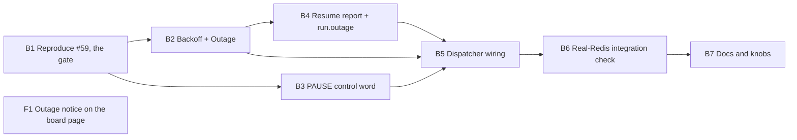

# Plan 022.00: Redis Outage Resilience

Spec: `spec.md` (framing 1, gated by 2). One pull request, eight units: seven back end, one front end.

Defaults taken from the spec's open questions, so nobody has to block on them:

- Backoff: 1 s initial, 30 s cap, full jitter (open question 1).
- No give-up timeout: the engine stays paused until Redis answers (open question 6).
- Outage length: `nodes[].heartbeat_at` when Redis still holds it, else the engine's own monotonic clock (open question 4).
- The page infers an outage from a stale snapshot; after recovery it reads `run.outage` (open question 5).

## Order and dependencies



| Wave | Units | Why this order |
| :-- | :-- | :-- |
| 1 | B1 | The gate. Its finding decides whether B5 fixes a real raise or only adds pause and backoff. |
| 2 | B2, B3, F1 | Disjoint files, run together. F1 builds only against the `run.outage` shape fixed below. |
| 3 | B4 | Needs B2's `Outage#window` for the duration fallback. |
| 4 | B5 | The only unit that edits `dispatcher.rb`, `session.rb` and `publisher.rb`. If B1's raise is in one of these, B1 writes the failing spec and B5 makes it pass, so the two are sequential on that file. |
| 5 | B6 | Exercises the whole chain against a real `redis-server`. |
| 6 | B7 | Documents and configures what B2 to B6 actually shipped. |

**Gate after B1.** If the reproduction shows the shutdown is outside the Redis path (for example a missing rescue elsewhere), B1 fixes that raise and writes the finding below; B2 to B7 still ship, because the spec asks for pause and backoff either way (spec, Goal). If the finding changes B5's shape beyond what is written here, B1 blocks with a technical question instead of improvising.

### Wire shape shared by B4 and F1

Additive field on the snapshot's `run` object (`Live::Snapshot#run`, `web/src/api/types.ts`), set only after an outage this run has recovered from, `null` otherwise:

```json
"outage": {
  "started_at": "2026-10-16T18:40:00Z",
  "ended_at": "2026-10-16T18:41:12Z",
  "seconds": 72,
  "measured_by": "heartbeat | clock",
  "reconciled_from": "redis | file | null"
}
```

Field names are fixed here, so `luke-backend` and `rey-frontend` need not pair on them again. A change goes through mail to both sides.

## Backend

### B1 Reproduce #59

- **Discipline:** back end.
- **Owns:** `spec/openlanes/engine/redis_outage_spec.rb` (new); the one file the raise comes from, when no other unit owns it; the `## Reproduction` section at the end of this `plan.md`.
- **Must not touch:** `lib/openlanes/engine/dispatcher.rb`, `lib/openlanes/live/session.rb`, `lib/openlanes/live/publisher.rb` (B5 owns them; a raise there gets a failing spec and the finding only); every other unit's files.
- **Depends on:** nothing.
- **Work:** run `openlanes run` against a throwaway `redis-server` on a spare port, stop Redis mid-run, record the exit status and the line that raised. Then a spec that drives the same path and fails before the fix.
- **Done when:** `spec/openlanes/engine/redis_outage_spec.rb` fails on `main` and passes on the branch (after B1's fix, or after B5's when the raise is in a B5 file); the exit status, raising line and finding are under `## Reproduction`.

### B2 Backoff and outage state

- **Discipline:** back end.
- **Owns:** `lib/openlanes/live/backoff.rb`, `lib/openlanes/live/outage.rb`, `spec/openlanes/live/backoff_spec.rb`, `spec/openlanes/live/outage_spec.rb` (all new).
- **Must not touch:** `store.rb`, `dispatcher.rb`, `session.rb`, `control.rb`; other units' files.
- **Depends on:** B1.
- **Shape:**
  - `Live::Backoff`, `Data.define(:initial, :cap, :jitter)`, defaults `1.0`, `30.0`, `:full`; `#delay(attempt, rand:)` returns seconds. Full jitter is `rand * min(cap, initial * 2**attempt)`; `jitter: :none` drops the random factor.
  - `Live::Outage`, the paused flag: `#trip!(error, now:)` records the start (monotonic and wall clock) on the first call and returns `true`, `false` after; `#paused?`; `#due?(now)` says whether the next probe is due; `#probe!(store, now:)` does one `store.ping`, clears the flag and returns the finished window on success, schedules the next attempt on `Unavailable`; `#window` (started, ended, seconds by clock).
  - Clock and random source are injected, so no spec sleeps.
- **Done when:** `backoff_spec.rb` asserts the delay sequence and the cap with a fixed random source; `outage_spec.rb` drives a `MemoryStore` double that raises, then recovers, and the flag flips both ways (spec, In scope 2 and 5).

### B3 `PAUSE` control word

- **Discipline:** back end.
- **Owns:** `lib/openlanes/execution/control.rb`, `lib/openlanes/execution/prompt.rb`, `spec/openlanes/execution/control_spec.rb`, `spec/openlanes/execution/prompt_spec.rb`.
- **Must not touch:** `dispatcher.rb`, `executor.rb`, `agents/*.md`; other units' files.
- **Depends on:** B1.
- **Shape:** `Control::PAUSE = "PAUSE"`, `Control.pause!` (broadcast to every registered file), `Control.resume!` (clears `PAUSE` from files that carry it, leaves any other word), `Control.paused?`. Not added to `WORDS`: a person does not send `PAUSE` from the board, the engine does. The prompt's control-file section gains one paragraph: `PAUSE` means the engine lost its live store; finish the current step, write results to disk, keep to local work, start nothing that needs mail or the board, check again every thirty seconds. It is not `HOLD`.
- **Done when:** `control_spec.rb` reads `PAUSE` from a registered file after `pause!` and an empty file after `resume!`, and a `WRAP_UP` written during the pause survives `resume!`; `prompt_spec.rb` asserts the paragraph.

### B4 Resume report and `run.outage`

- **Discipline:** back end.
- **Owns:** `lib/openlanes/live/outage_report.rb` (new), `lib/openlanes/live/run_record.rb`, `lib/openlanes/live/snapshot.rb`, `spec/openlanes/live/outage_report_spec.rb` (new), `spec/openlanes/live/run_record_spec.rb`, `spec/openlanes/live/snapshot_spec.rb`.
- **Must not touch:** `publisher.rb`, `dispatcher.rb`, `session.rb`; other units' files.
- **Depends on:** B2.
- **Shape:**
  - `RunRecord#reconcile` (callable after an outage, sharing `restore`'s `seq` comparison at `run_record.rb:53` rather than copying it) returns `:redis`, `:file` or `nil`, naming the side that won.
  - `Live::OutageReport.new(store:, keys:, node:, window:, reconciled_from:)` with `#to_h` (the wire shape above) and `#line` (one log line: duration, how measured, which side won). Duration uses this node's `nodes[].heartbeat_at` when Redis still holds one from before the outage, otherwise the window's monotonic seconds; `measured_by` says which.
  - `Snapshot#run` gains `outage:` from an optional `outage:` keyword, `nil` by default.
- **Done when:** `outage_report_spec.rb` asserts the line and the hash for the no-loss case (heartbeat present, Redis wins or ties) and the RDB-rollback case (heartbeat gone or older, file wins, `measured_by: "clock"`); `run_record_spec.rb` covers `reconcile` both ways; `snapshot_spec.rb` asserts `run.outage` is `nil` by default and the hash when given (spec, In scope 6).

### B5 Dispatcher wiring: pause, probe, resume

- **Discipline:** back end.
- **Owns:** `lib/openlanes/engine/dispatcher.rb`, `lib/openlanes/live/session.rb`, `lib/openlanes/live/publisher.rb`, `spec/openlanes/engine/dispatcher_outage_spec.rb` (new), `spec/openlanes/live/publisher_spec.rb`; and the fix that makes `redis_outage_spec.rb` pass when B1's raise is in one of these files.
- **Must not touch:** `control.rb`, `prompt.rb`, `backoff.rb`, `outage.rb`, `outage_report.rb`, `run_record.rb`, `snapshot.rb`, `web/`.
- **Depends on:** B1, B2, B3, B4.
- **Shape:**
  - The dispatcher holds one `Live::Outage`. Each existing `rescue Live::Unavailable` the tick reaches (`drain_mail`, `RunRecord#flush`, `Commands#call`, and the publisher's own rescue through a new `Publisher#on_unavailable` hook wired in `Session`) calls `outage.trip!`; the first trip logs once and calls `Control.pause!`.
  - `paused?` sits beside `resting?` (`dispatcher.rb:747`) at the same decision point: while paused no plan is assigned, but the tick still runs the clock, the local control file, Ctrl-C and `STOP` (spec, Risks 3). Redis-backed commands and mail are skipped, not attempted, while paused.
  - When `outage.due?`, the tick calls `outage.probe!`. On success: `RunRecord#reconcile`, build `OutageReport` and log its line, `Control.resume!`, pass `outage:` into the next snapshot, resume assignment.
  - The same `Store` object is reused across the outage (spec, Research 3). Probes run on the dispatcher's thread only, so no second thread shares the `Store` mid-probe (spec, Risks 5).
- **Done when:** `dispatcher_outage_spec.rb`, over a `PlansFixture` tree and a `MemoryStore` that raises then recovers, shows no agent assigned during the pause, `PAUSE` in a running agent's control file, a local `STOP` honored while paused, and assignment plus a cleared control file after recovery (spec, In scope 3 and 4); `publisher_spec.rb` covers `on_unavailable`; `redis_outage_spec.rb` passes.

### B6 Real-Redis integration check

- **Discipline:** back end.
- **Owns:** `spec/openlanes/live/redis_outage_integration_spec.rb` (new), `spec/support/redis_server.rb` (new: starts and stops a throwaway `redis-server` on an ephemeral port in a temp dir).
- **Must not touch:** anything under `lib/`; other units' specs.
- **Depends on:** B5.
- **This is the integration check.** Nothing stubbed between the engine and Redis: a real `redis-server`, a real `Live::Store`, `Session`, `Publisher` and `Dispatcher` over a `PlansFixture` tree, with a stand-in agent process that only sleeps. It must show, in order:
  1. a snapshot published to the real Redis;
  2. Redis killed: the dispatcher reports paused, the agent's control file reads `PAUSE`, no new plan is assigned, the engine is still running;
  3. Redis restarted on the same port: the same `Store` answers `ping`, the control file is cleared, the resume line is logged, and the next snapshot read back from Redis carries `run.outage` with `seconds > 0`;
  4. a restart with the data dir wiped (the RDB-rollback case): the read-back snapshot has `reconciled_from: "file"`.
- Skipped with a stated reason when no `redis-server` is on `PATH` (spec, In scope 7).
- **Done when:** `redis_outage_integration_spec.rb` passes with `redis-server` present and reports a skip, not a failure, without it.

### B7 Docs and knobs

- **Discipline:** back end.
- **Owns:** `README.md`, `lib/openlanes/support/config.rb` (the `redis.backoff.initial`, `.cap` and `.jitter` keys of `.openlanes.yml`), `lib/openlanes/engine/runner.rb` (passes the backoff into the dispatcher), `spec/openlanes/config_spec.rb`, `spec/openlanes/engine/runner_spec.rb`.
- **Must not touch:** `dispatcher.rb`, `backoff.rb`; other units' files.
- **Depends on:** B6.
- **Done when:** `config_spec.rb` reads the three keys and falls back to B2's defaults; `runner_spec.rb` shows the configured backoff reaching the dispatcher; README has a short "When Redis goes away" section (pause, `PAUSE`, backoff, resume line, knobs, no give-up timeout); `openlanes docs` regenerates cleanly; `just lint` and `just test` are green (spec, In scope 8).

## Frontend

### F1 Outage notice on the board page

- **Discipline:** front end.
- **Owns:** `web/src/api/types.ts` (the `outage` field on the run type), `web/src/shell/Header.tsx`, `web/src/shell/Header.test.tsx`, `web/src/api/fixtures/snapshot.json` (adds `run.outage: null`), one new fixture `web/src/api/fixtures/snapshot-outage.json`.
- **Must not touch:** anything under `lib/` or `spec/`; other web files.
- **Depends on:** nothing beyond the wire shape fixed above.
- **Shape:** two header states.
  - Stale: the snapshot's `at` is older than a threshold (about 15 s) while the page is open: "Engine not publishing for N s, Redis may be down". The engine cannot publish while Redis is gone (spec, open question 5), so staleness is the only live signal.
  - Recovered: `run.outage` is set: "Redis was down N s (by heartbeat|clock), run state from redis|file".
- **Done when:** `Header.test.tsx` renders both states from fixtures, and neither when `run.outage` is `null` and the snapshot is fresh; the web lint and unit suite are green. B6's read-back proves the field arrives from a real engine.

## HTTP surface

Yes, additively. No route is added or changed; the `GET /api/board` response and the `event: board` stream gain the optional `run.outage` object above. `luke-backend` writes `openapi.yaml` beside `contract.md` describing the snapshot's `run` object with the new field, so `openlanes api docs` lists it.

## Reproduction

_Written by B1 (luke-backend, round 2)._

- **How.** Not through the `openlanes run` CLI. It ran through a real `Dispatcher`, `Session` and `Live::Store` over a `PlansFixture` tree, against a throwaway `redis-server` on an ephemeral port (`spec/support/redis_server.rb`). Between two ticks the server was stopped, its `dump.rdb` deleted, and started again on the same port.
- **What raised.** `RedisClient::CommandError: NOGROUP No such key '…:commands' or consumer group 'engine' in XREADGROUP with GROUP option`, from `Live::Store#call` (`store.rb:263`) via `Commands#read` (`commands.rb:118`), `Commands#call` (`commands.rb:89`) and the dispatcher's before-tick hooks. The tick raised, so the run ended.
- **Why.** `Store#guarded` maps connection errors to `Unavailable` but re-raises `CommandError`. `Commands#prepare` makes the consumer group once per engine (`@ready`). A Redis that comes back empty (no AOF, or an RDB snapshot older than the group) has no group. The client reconnects without a connection error, and no rescue in the tick catches `CommandError`. A short restart never trips an outage at all, which is why reading the code (research answer 1) found no shutdown path.
- **Fix.** `Commands#call` rescues `NOGROUP`, logs it, and makes the group again on the next tick (`lib/openlanes/live/commands.rb`).
- **Proof.** `spec/openlanes/engine/redis_outage_spec.rb`: 2 examples. Both fail with the `NOGROUP` error above when the rescue is removed, and both pass with it. Skipped, with the reason, when no `redis-server` is on `PATH`.
- **Exit status of a real `openlanes run`.** Not recorded; the spec drives the same tick.
