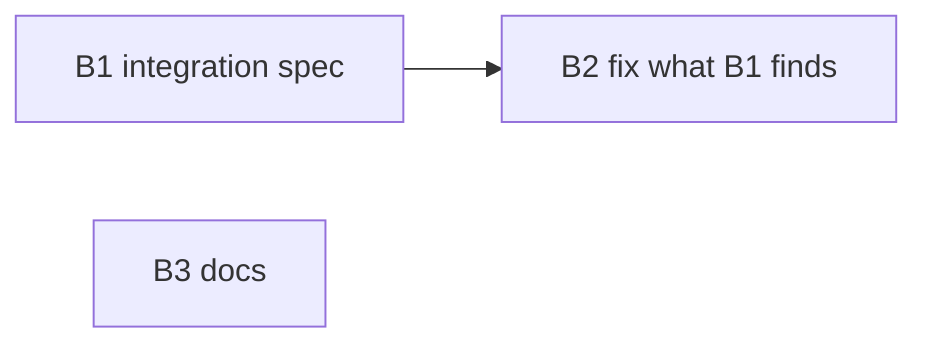

# Plan 024.00: Resume Sessions Across Rounds

## Where this starts

M1 is already on `main`, in `95597c2` ("Decide from state.json when a session resumes"):

- `Plans::PlanState#stage!` records `session` and `cwd` per round; `#resumption(agent:, state:, root:)` returns a `Resumption(session, reason)`.
- `Engine::Dispatcher#resumption_for` asks it, logs `resuming session …` / `fresh session: …`, and passes `resume:` to the executor; `#record_session` writes the id as soon as the stream names it.
- `Execution::Executor#call` drops `resume` for an adapter that cannot resume, and `#lost_session` (`SESSION_MISSING`) relaunches fresh with a warning.
- Unit specs exist for each piece: `spec/openlanes/plans/plan_state_resumption_spec.rb`, `spec/openlanes/engine/dispatcher_resume_spec.rb`, `spec/openlanes/execution/executor_resume_spec.rb`.

What is missing: no spec drives all of it at once. The dispatcher spec stubs the executor with a lambda, and the executor spec stubs the process, so nothing proves that a real `claude` argv in round 2 carries round 1's id. This plan adds that proof, fixes whatever it finds, and documents resuming by hand.

## Order and dependencies

- B1 first. B2 is sequential after B1: both may edit the same spec while a failure is chased.
- B3 is independent and may run beside B1 or B2; it owns no file they own.

## Backend

### B1. End-to-end resume across rounds (integration check)

- **Discipline:** back end.
- **Owns:** `spec/integration/resume_across_rounds_spec.rb` (new); a fake-CLI helper inside it, or `spec/support/fake_agent_cli.rb` (new) if a second spec would reuse it.
- **Must not touch:** `lib/**`, `docs/**`, the existing `*_resume_spec.rb` / `*_resumption_spec.rb` files.
- **Depends on:** nothing.
- **Done when:** `bundle exec rspec spec/integration/resume_across_rounds_spec.rb` is green.

Nothing stubbed between `Engine::Runner` and the child process: a real `Runner` (`isolation: :shared`, `jobs: 1`, an agent with `rounds: 2`, as `dispatcher_resume_spec.rb` sets it up), the real `Execution::Executor`, and a fake `claude` script on `PATH` in a temp `bin` (the pattern in `spec/support/control_room_process.rb`). The script appends its argv to a log, prints a stream-json `system`/`init` event naming `sess-<n>`, then a failing `result` event, and exits 1, so the plan does not move and the agent gets a second round. It must show:

- `state.json` `stages`: round 1 and round 2 each carry their own `session` and the checkout as `cwd`.
- The second logged argv contains `--resume sess-1`; the first contains no `--resume`.
- Session lost: when the script is invoked with `--resume`, it prints `No conversation found with session ID: …` on stderr and exits 1 having spent nothing. The next logged argv has no `--resume`, and the UI log (via `UI.tap_log`) holds `session sess-1 not found, starting … fresh`.
- Plan moved: with round 1's stage settled to another state (`to:` ≠ current), round 2's argv has no `--resume` and the log holds `fresh session: the plan moved to …`.
- No resume support: the same agent on `adapter: codex`, with a fake `codex` script, never gets a resume flag, and the log holds `fresh session: codex cannot resume one`.

### B2. Fix what the integration check exposes

- **Discipline:** back end.
- **Owns:** only the files a B1 failure points at, among `lib/openlanes/execution/executor.rb`, `lib/openlanes/engine/dispatcher.rb`, `lib/openlanes/plans/plan_state.rb`, `lib/openlanes/adapters/claude.rb`, `lib/openlanes/execution/transcript.rb`, plus a regression example in that file's existing unit spec.
- **Must not touch:** `docs/**`, `schemas/plan-state.schema.json` unless a recorded field is actually missing from it.
- **Depends on:** B1.
- **Done when:** B1's spec, `bundle exec rspec` and `just lint` are all green. If B1 passes on its first run, this unit is a no-op: say so in the ledger note.

### B3. Document resuming an agent by hand

- **Discipline:** back end (docs only).
- **Owns:** `docs/USAGE.md` (a short "Resuming an agent's session" passage next to the Ctrl-C notes near line 166), `docs/decisions/decisions-on-agent-memory-and-sessions.md` (M1 marked implemented, pointing at `PlanState#resumption` and `Dispatcher#resumption_for`).
- **Must not touch:** `lib/**`, `spec/**`, `README.md`.
- **Depends on:** nothing.
- **Done when:** the passage shows reading `session` and `cwd` from `openlanes state show … | jq '.stages[-1] | {session, cwd}'` and `cd <cwd> && claude --resume <session>`; it states the rules (same agent, same state, same checkout, claude only); `just lint` stays green.

## Frontend

None: this plan changes how the engine invokes agents, with no interface work.

## HTTP surface

No. The plan adds and changes no HTTP API, so there is no `openapi.yaml`.

## Task completed when

- Every round's session id is stored in its `stages` entry in `state.json`.
- Round 2 of the same agent on the same state, in the same checkout, is invoked with `--resume <round 1 session id>`.
- A plan that moved to another state, or a session that cannot be found, starts fresh, and the log says why.
- An adapter that cannot resume starts fresh as today.

## How to test

- Every round's session id is stored in its `stages` entry in `state.json`.
- Round 2 of the same agent on the same state, in the same checkout, is invoked with `--resume <round 1 session id>`.
- A plan that moved to another state, or a session that cannot be found, starts fresh, and the log says why.
- An adapter that cannot resume starts fresh as today.

## Build notes (luke-backend, round 1)

- Baseline before any change: `bundle exec rspec` 3544 examples, 0 failures, 9 pending (Redis-gated integration specs that skip without a Redis).
- B1: `spec/integration/resume_across_rounds_spec.rb`, 6 examples, green on first run. Real `Runner` and `Executor`, real `Child`; the fake `claude`/`codex` reach it through the executor's `spawn:` seam with `PATH` set to the temp bin plus `/usr/bin:/bin`, because `Child` spawns in Bundler's unbundled environment, whose `PATH` is fixed when Bundler loads. The fake reports a little usage in its failing `result`: one that spent nothing would read as a lost session and be retried fresh. Mutation check: forcing `resume = nil` in `Executor#call` fails 3 of the 6.
- "Plan moved" is seeded as an earlier run's round 1 that settled to `researched` with `sess-0`; the run's round 1 starts fresh with `fresh session: the plan moved to researched after round 1 (sess-0)`.
- B2: no-op. B1 passed on its first run; nothing in `lib/` changed.
- B3: `docs/USAGE.md` "Resuming an agent's session"; M1 marked implemented in `docs/decisions/decisions-on-agent-memory-and-sessions.md`.
- After: `bundle exec rspec` 3550 examples, 0 failures, 9 pending; `bundle exec rubocop` no offenses.
