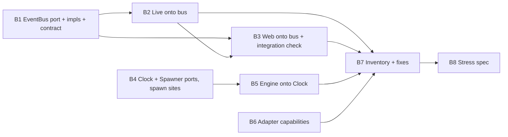

# Plan: Solid Seams and Thread Safety (038.00)

Framing A from the spec, port-first: four seams (`EventBus`, `Clock`, a process port, adapter capabilities), call sites moved onto them, then the shared-state audit and the stress spec. All work is back end. Users see no change in behaviour.

## Decisions taken while planning

Each of these adopts the spec's stated default, or settles a naming point the spec left open.

- **`Live::News` stays and calls the bus** (spec OQ1). `Store` and `MemoryStore` become the backing of `RedisBus` and `MemoryBus`, not replacements for them.
- **The bus also carries transactional appends.** Most `xadd` calls run inside `store.multi { |tx| ... }` (`live/publisher.rb:82`, `live/commands.rb:207-219`, `live/mail.rb:45`, `web/demo.rb:122-181`). So the bus offers `transaction { |tx| tx.append(...) }` as well as a single `append`. Otherwise those sites would keep reaching the store through `tx`.
- **There are more call sites than the spec lists.** `rg` also finds `live.rb:163`, `live/mail.rb:45`, `live/copilot.rb:87,173`, `live/chat.rb:625,628` and `web/app.rb:228`. They move too, or the "bus only" check cannot pass.
- **The process port is called `OpenLanes::Spawner`, not `Process`.** Zeitwerk would resolve an `OpenLanes::Process` ahead of `::Process` at every bare `Process.kill`/`Process.wait` under `lib/openlanes`, which breaks unrelated code. The `Clock` port is `OpenLanes::Clock` (`support/clock.rb`). Inside `Execution`, a bare `Clock` still means `Execution::Clock`, the timeout timer, so code there writes `OpenLanes::Clock` in full.
- **The process port covers `Process.spawn` only** (spec OQ5). It has three sites. The `Open3.capture2` calls are short and synchronous, and they stay as they are (45.00 territory).
- **Stress spec: N = 8 threads**, each running one full `Dispatcher` tick against a shared tree, `MemoryBus` and a fake clock. Each plan is assigned at most once (spec OQ2).
- **The inventory covers `execution/child.rb` handles** (spec OQ3).
- **038 does not wait for 034** (spec OQ4). "Runs alone under the global lock" is met by the operator running no other plan while 038 builds. A human may still overturn this. It contradicts the criterion's literal wording.
- **Adapter capability predicates stay as methods** (`compacts?`, `resumes?`, …) and delegate to one frozen `capabilities` value. Executor and Dispatcher callers keep compiling unchanged, so the adapter unit never touches `dispatcher.rb`.

## Order and dependency graph

- Wave 1, in parallel: B1, B4, B6.
- Wave 2: B2 (after B1) and B5 (after B4), in parallel.
- Wave 3: B3 (after B1 and B2).
- Wave 4: B7, sequential after B2, B3, B5 and B6, because its fixes may edit files those units own.
- Wave 5: B8.

Units that share a file run in sequence:

- B7 runs after every unit whose files it may fix.
- B5 and B6 both sit near `engine/dispatcher.rb`, but only B5 writes it.

The integration check belongs to **B3**.

## Backend

### B1 EventBus port, RedisBus, MemoryBus, contract spec

- **Discipline:** back end
- **Owns:**
  - `lib/openlanes/live/event_bus.rb`: the port module. It defines `publish(channel, payload)`, `subscribe(channels:, patterns: [])`, `append(stream, fields, maxlen: nil)`, `transaction { |tx| tx.append(...) }` and `db`.
  - `lib/openlanes/live/event_bus/redis_bus.rb`: wraps `Live::Store`.
  - `lib/openlanes/live/event_bus/memory_bus.rb`: wraps `Live::MemoryStore`.
  - `spec/support/shared_examples/event_bus_contract.rb`.
  - `spec/openlanes/live/event_bus_spec.rb`.
- **Must not touch:** call sites in `live/*.rb` other than the files above, anything under `web/`, and `live/store.rb` and `live/memory_store.rb`, beyond what the wrappers need exposed.
- **Depends on:** nothing
- **Done when:** `spec/openlanes/live/event_bus_spec.rb` runs the shared contract against `MemoryBus` always, and against `RedisBus` when Redis is reachable. Both pass. The contract covers publish/subscribe delivery, append ordering, `maxlen` trimming and atomicity inside a transaction. The stream ID and cursor format is unchanged, because web cursors rely on it.

### B2 Live call sites onto the bus

- **Discipline:** back end
- **Owns:** `lib/openlanes/live.rb`, `live/news.rb`, `live/publisher.rb`, `live/commands.rb`, `live/mail.rb`, `live/copilot.rb`, `live/chat.rb`, and their existing specs under `spec/openlanes/live/`.
- **Must not touch:** `live/event_bus*`, `web/*`, `engine/*`. Leave `News::KINDS` and the nudge wire format alone (`live/news.rb:25-27`), and the Redis key layout too.
- **Depends on:** B1
- **Done when:**
  - `rg "store\.(publish|subscriber|xadd)|tx\.xadd" lib/openlanes/live` finds hits only in `live/event_bus/`.
  - `spec/openlanes/live/news_spec.rb`, `publisher_spec.rb`, `commands_spec.rb`, `mail_spec.rb`, `copilot_spec.rb` and `chat_spec.rb` pass on `MemoryBus`.

### B3 Web call sites onto the bus, plus the integration check

- **Discipline:** back end. `rey-frontend` writes no page code.
- **Owns:**
  - `lib/openlanes/web/demo.rb`, `web/app.rb`, `web/server.rb`, `web/stores.rb`, `web/events.rb`, `web/context.rb`.
  - Their existing specs.
  - `spec/openlanes/web/event_bus_integration_spec.rb`.
- **Must not touch:** `live/*`, `engine/*`, and anything under `web/` that is page code (`web/src`, `web/dist`).
- **Depends on:** B1, B2
- **Done when:**
  - `rg "store\.(publish|subscriber|xadd)|tx\.xadd" lib/openlanes/web` is empty.
  - Every existing web spec and the e2e job pass.
  - **Integration check**, `spec/openlanes/web/event_bus_integration_spec.rb`: it boots the real web server on an ephemeral port over `MemoryBus` and opens a real HTTP `GET /api/events` stream. A real `Live::Publisher` then publishes a board snapshot, with nothing stubbed between them. The stream must show:
    1. a `board` event carrying that snapshot's `seq`;
    2. events in the order they were appended;
    3. on reconnect with `Last-Event-ID`, only the entries after that ID.

### B4 Clock and Spawner ports, and the three spawn sites

- **Discipline:** back end
- **Owns:**
  - `lib/openlanes/support/clock.rb`: `OpenLanes::Clock` with `System` and `Fake`. Each offers `now`, `sleep(seconds)` and `monotonic`. `Fake#advance(seconds)` moves time forward, and `Fake#sleep` advances rather than blocks.
  - `lib/openlanes/support/spawner.rb`: `OpenLanes::Spawner` with `System` (wraps `Process.spawn`) and `Fake` (records argv and options, and returns scripted pids and statuses).
  - `lib/openlanes/execution/child.rb`, `lib/openlanes/web/launcher.rb` and `lib/openlanes/vcs/refresh.rb`. Each takes `spawner:` and defaults to `Spawner::System`.
  - `spec/openlanes/support/clock_spec.rb`, `spec/openlanes/support/spawner_spec.rb`, plus additions to `spec/openlanes/execution/child_spec.rb`.
- **Must not touch:** `execution/clock.rb` (the timeout timer stays), `engine/*`, and the `web/` files B3 owns (`launcher.rb` is B4's alone).
- **Depends on:** nothing
- **Done when:**
  - `rg "Process\.spawn" lib` finds only `support/spawner.rb`.
  - `child_spec.rb` runs `Child` on `Spawner::Fake`.
  - `clock_spec.rb` and `spawner_spec.rb` pass.

### B5 Engine onto the Clock port

- **Discipline:** back end
- **Owns:** `lib/openlanes/engine/dispatcher.rb`, `engine/runner.rb`, `engine/state_file.rb`, `engine/coverage_gate.rb`, `engine/extensions.rb`, `engine/narrator.rb`, `engine/pr_outcomes.rb`, `engine/quality_question.rb`, `engine/verification/outcome.rb`, `lib/openlanes/engine.rb` (facade wiring) and `spec/openlanes/engine/dispatcher_clock_spec.rb`.
- **Must not touch:** `support/clock.rb` (B4's), `adapters/*` and `execution/*`.
- **Depends on:** B4
- **Done when:**
  - `rg "Time\.now" lib/openlanes/engine` is empty.
  - `Dispatcher` takes `clock:`. The existing `sleeper:` becomes `clock.sleep`, with `sleeper:` kept as a compatibility keyword until 045.
  - `spec/openlanes/engine/dispatcher_clock_spec.rb` advances a `Clock::Fake` and sees a timestamp or timeout decision follow it.
  - All existing `spec/openlanes/engine/*` pass.

### B6 Adapter capability contract

- **Discipline:** back end
- **Owns:**
  - `lib/openlanes/adapters/capabilities.rb`: a `Data.define` holding `compacts`, `resumes`, `enforces_tool_denial` and `compact_prompt`.
  - `adapters/base.rb`, which declares `capabilities` abstract and turns the predicates into delegations.
  - `adapters/claude.rb`, `adapters/codex.rb`, `adapters/pi.rb`, each declaring its full `capabilities` explicitly.
  - `lib/openlanes/adapters.rb`, which exposes a lean-argv accessor, so callers no longer need `Claude::LEAN`.
  - `lib/openlanes/lifecycle/brief.rb`.
  - `spec/openlanes/adapters/capabilities_spec.rb`.
- **Must not touch:** `engine/dispatcher.rb` (B5's) and `execution/executor.rb`. Both already branch on predicates, which keep working.
- **Depends on:** nothing
- **Done when:**
  - `capabilities_spec.rb` iterates every registered adapter, asserts it declares every capability field without inheriting a default, and asserts that `Base#capabilities` raises.
  - `rg "Adapters::Claude" lib` finds nothing outside `adapters/`.
  - `rg "adapter.*\.name ==|case .*adapter" lib/openlanes/{execution,engine}` is empty.
  - `claude_spec.rb`, `codex_spec.rb` and `pi_spec.rb` pass.

### B7 Thread-safety inventory, guard spec and fixes

- **Discipline:** back end
- **Owns:**
  - `docs/thread-safety.md`: one row per shared mutable object under `lib/openlanes`. Each row gives the file, the object, its owner, the threads that touch it, its guard or the reason none is needed, and a status of `guarded`, `frozen`, `thread-local` or `unguarded`.
  - `spec/openlanes/thread_safety_inventory_spec.rb`.
  - The fixes the inventory calls for. **Sequential:** these may edit files owned by B2, B3, B4, B5 or B6, which is why B7 runs after all of them.
- **Must not touch:** behaviour. A fix is a freeze, `Data.define`, `Mutex` or `Concurrent::Map`, and nothing else. No renames, which are 045's.
- **Depends on:** B2, B3, B5, B6
- **Done when:**
  - `thread_safety_inventory_spec.rb` fails when any file under `lib/openlanes` that creates a `Mutex`, `Monitor`, `Queue` or `Concurrent::` object is missing from `docs/thread-safety.md`.
  - The same spec fails when the document has any row whose status is `unguarded`.
  - The inventory covers the 25 known guard sites, `Live::Claims` and the `execution/child.rb` handle shared with the timeout thread.

### B8 Concurrent dispatch stress spec

- **Discipline:** back end
- **Owns:** `spec/openlanes/engine/dispatcher_stress_spec.rb`, plus any helper under `spec/support/` that it alone uses.
- **Must not touch:** files under `lib/`. A race it finds goes back to B7's inventory as a row and a fix.
- **Depends on:** B7
- **Done when:**
  - `dispatcher_stress_spec.rb` runs 8 threads. Each thread runs one full `Dispatcher` tick over a shared `PlansFixture` tree, a shared `MemoryBus` and a shared `Clock::Fake`, with `Spawner::Fake` standing in for agents. The spec uses a fixed seed and a bounded join timeout, and no real sleeps.
  - It asserts that no thread raised, and that every eligible plan was assigned exactly once, with nothing lost or duplicated.
  - `for i in $(seq 20); do bundle exec rspec spec/openlanes/engine/dispatcher_stress_spec.rb || break; done` is green 20 times in a row.
  - `just ci` is green, with coverage at or above 95%.

## Frontend

No front-end units: the page code is unchanged. B3's integration check and the existing e2e job prove the browser's event stream still works.

## HTTP surface

No. `GET /api/events` and every other route keep their paths, shapes and SSE framing. No `openapi.yaml` changes.

## Task completed when

- Engine, Live and Web publish and subscribe only through `EventBus`.
- Every adapter declares its capabilities, and the Executor branches on capabilities, never on adapter names.
- A thread-safety inventory of shared state is written down, and a stress spec runs N concurrent dispatch ticks green.
- Runs alone under the global lock (034).

## How to test

- Engine, Live and Web publish and subscribe only through `EventBus`.
- Every adapter declares its capabilities, and the Executor branches on capabilities, never on adapter names.
- A thread-safety inventory of shared state is written down, and a stress spec runs N concurrent dispatch ticks green.
- Runs alone under the global lock (034).
