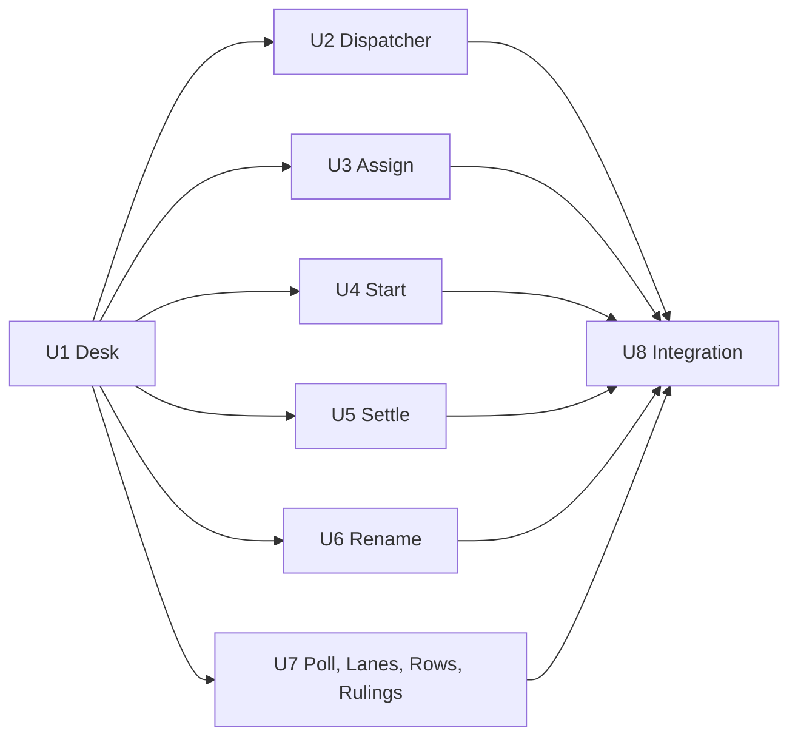

Refactor share: 14 of 2166 tracked files (0.6%), 2960 of 197445 tracked lines (1.5%); threshold 50%, so `concurrent`.

# Plan: Split Dispatcher (045.02)

Cut `Engine::Dispatcher` and its `dispatcher/` steps to the A8 limits that `.rubocop.yml` already sets (ClassLength 100, MethodLength 10, ParameterLists 4, AbcSize 20), with no change in behaviour. `045.01` (dry-system wiring, `Container` and `Deps[...]`) is merged, so collaborators that come from the container are taken through `include Deps[...]` as each seam is cut.

## Starting point

| File                    | Lines | In `.rubocop_todo.yml` under                       |
| ----------------------- | ----: | -------------------------------------------------- |
| `dispatcher.rb`         |   390 | AbcSize, ClassLength, MethodLength, ParameterLists |
| `dispatcher/desk.rb`    |   470 | AbcSize, ClassLength, MethodLength, ParameterLists |
| `dispatcher/rename.rb`  |   419 | AbcSize, ClassLength, MethodLength                 |
| `dispatcher/settle.rb`  |   370 | AbcSize, ClassLength, MethodLength                 |
| `dispatcher/start.rb`   |   367 | AbcSize, ClassLength, MethodLength                 |
| `dispatcher/assign.rb`  |   354 | AbcSize, ClassLength, MethodLength                 |
| `dispatcher/poll.rb`    |   155 | AbcSize, MethodLength                              |
| `dispatcher/lanes.rb`   |   152 | AbcSize, MethodLength                              |
| `dispatcher/rows.rb`    |   100 | AbcSize, MethodLength                              |
| `dispatcher/rulings.rb` |    65 | AbcSize, MethodLength                              |

Known A8 hit: `settle.rb:338` builds a spend lambda over `result.public_send(field)`, a computed name. It goes, replaced by literal readers.

## Rules every unit follows

- `Desk`'s public methods are the contract the steps and `Dispatcher` (through `def_delegators :@desk, *Desk.public_instance_methods(false)`) rely on. A unit may move a method's body into a collaborator; it may not rename or remove a public method another file calls.
- Extracted classes live under `lib/openlanes/engine/dispatcher/<step>/`, one class per file, namespaced `Engine::Dispatcher::<Step>::<Name>`, so Zeitwerk and the container key agree.
- Existing spec assertions do not change (A9). New classes get new spec files under `spec/openlanes/engine/dispatcher/<step>/`, keeping coverage at or above `main`.
- `Thread.new` sites stay where they are (`045.13`, `concurrent-ruby-threads`, moves them).
- No unit but U8 edits `.rubocop_todo.yml` or `docs/architecture/`, so no two units write them.

## Order and dependency graph

U1 first: every step reads the desk, so its shape settles before the steps are cut. U2 to U7 own disjoint files and may run in any order or together. U8 last.

## Backend

### U1 Desk

- **Discipline:** back end.
- **Owns:** `lib/openlanes/engine/dispatcher/desk.rb`; new `lib/openlanes/engine/dispatcher/desk/*.rb` (candidates: the run registers `running`, `recent`, `attempts`, `history`, `requeues`; profile lookups `adapter_of`, `model_for`, `rounds_for`, `rounds_allowed`, `profile_fields`; budget and holds `budget_refusal`, `announce_budget`, `budget_holds`, `held_outside?`; recovery records `harness_resume`, `write_interrupted`, `stage!`, `remember`, `forget_round`); `spec/openlanes/engine/dispatcher/desk_spec.rb` (examples added only), `spec/openlanes/engine/dispatcher/desk_context.rb`, new `spec/openlanes/engine/dispatcher/desk/*_spec.rb`.
- **Must not touch:** `dispatcher.rb`, every other `dispatcher/*.rb`, `.rubocop_todo.yml`, `docs/architecture/`.
- **Depends on:** nothing.
- **Shape:** `Desk#initialize(runner:, state:, rounds:, clock:, stay:, journal:, extensions:, budget:)` drops to four parameters or fewer: `clock` from `Deps["clock"]`, the rest grouped in a `Desk::Setup` `Data.define` value. Public method names and return values unchanged; `Desk` delegates to its collaborators.
- **Done when:** `spec/openlanes/engine/dispatcher/desk_spec.rb` and the new `spec/openlanes/engine/dispatcher/desk/*_spec.rb` pass, and `wc -l` shows `desk.rb` and each `desk/*.rb` ≤ 100.

### U2 Dispatcher

- **Discipline:** back end.
- **Owns:** `lib/openlanes/engine/dispatcher.rb`; new `lib/openlanes/engine/dispatcher/controls.rb` (`kill`, `extend`, `answer_extension`, `requeue`, `compact`, `prefer_model`, `concurrency=`), `lib/openlanes/engine/dispatcher/ticker.rb` (`build_tick`, `build_steps`, the `before_tick` hooks), `lib/openlanes/engine/dispatcher/restart.rb` (`reattach`, `resume_stranded`, `persist`, `clear_blocked`, `convert_questions`), `lib/openlanes/engine/dispatcher/options.rb`; new `spec/openlanes/engine/dispatcher/{controls,ticker,restart,options}_spec.rb`.
- **Must not touch:** `desk.rb` and `desk/`, every step file, `.rubocop_todo.yml`, `docs/architecture/`.
- **Depends on:** U1.
- **Shape:** callers (`Runner`, the CLI) stay unedited and keep passing the keywords they pass today (`runner:`, `state:`, `rounds:`, `sleeper:`, `clock:`, `on_board:`, …). `initialize` collects them into a `Dispatcher::Options` `Data.define` value, so no method past the entry point takes more than four parameters. `clock` comes through `Deps["clock"]`, not a `Container["clock"]` default in the signature. Public methods (`run`, `tick`, `done?`, `kill`, `extend`, `requeue`, `compact`, `prefer_model`, `concurrency=`, `before_tick`, `answer_extension`, `board`, the desk delegators) stay on `Dispatcher` and forward.
- **Done when:** `spec/openlanes/engine/dispatcher_spec.rb` and every `spec/openlanes/engine/dispatcher_*_spec.rb` pass unchanged, the new `{controls,ticker,restart,options}_spec.rb` pass, and `wc -l` shows `dispatcher.rb` and each new file ≤ 100.

### U3 Assign

- **Discipline:** back end.
- **Owns:** `lib/openlanes/engine/dispatcher/assign.rb`; new `lib/openlanes/engine/dispatcher/assign/*.rb`; `spec/openlanes/engine/dispatcher/assign_spec.rb` (examples added only); new `spec/openlanes/engine/dispatcher/assign/*_spec.rb`.
- **Must not touch:** `desk.rb`, `dispatcher.rb`, other steps, `.rubocop_todo.yml`, `docs/architecture/`.
- **Depends on:** U1.
- **Shape:** `Assign` stays a `Step` with its `call`; candidate selection, the refusals (budget, locks, holds, fences) and the pairing rule become collaborators.
- **Done when:** `assign_spec.rb` and the new `assign/*_spec.rb` pass; each file ≤ 100 lines.

### U4 Start

- **Discipline:** back end.
- **Owns:** `lib/openlanes/engine/dispatcher/start.rb`; new `lib/openlanes/engine/dispatcher/start/*.rb`; `spec/openlanes/engine/dispatcher/start_spec.rb` (examples added only); new `spec/openlanes/engine/dispatcher/start/*_spec.rb`.
- **Must not touch:** `desk.rb`, `dispatcher.rb`, other steps, `.rubocop_todo.yml`, `docs/architecture/`.
- **Depends on:** U1.
- **Shape:** `Start#call` keeps its `Thread.new` site in place; worktree preparation, prompt and profile assembly and the spawn record become collaborators.
- **Done when:** `start_spec.rb` and the new `start/*_spec.rb` pass; each file ≤ 100 lines.

### U5 Settle

- **Discipline:** back end.
- **Owns:** `lib/openlanes/engine/dispatcher/settle.rb`; new `lib/openlanes/engine/dispatcher/settle/*.rb`; `spec/openlanes/engine/dispatcher/settle_spec.rb` (examples added only); new `spec/openlanes/engine/dispatcher/settle/*_spec.rb`.
- **Must not touch:** `desk.rb`, `dispatcher.rb`, other steps, `.rubocop_todo.yml`, `docs/architecture/`.
- **Depends on:** U1.
- **Shape:** the spend tally replaces `result.public_send(field)` with literal readers; outcome classification, the ledger write and the boundary-failure report become collaborators.
- **Done when:** `settle_spec.rb` and the new `settle/*_spec.rb` pass; each file ≤ 100 lines; `rg "public_send|method_missing|send\(" lib/openlanes/engine/dispatcher` prints nothing.

### U6 Rename

- **Discipline:** back end.
- **Owns:** `lib/openlanes/engine/dispatcher/rename.rb`; new `lib/openlanes/engine/dispatcher/rename/*.rb`; `spec/openlanes/engine/dispatcher/rename_spec.rb` (examples added only); new `spec/openlanes/engine/dispatcher/rename/*_spec.rb`.
- **Must not touch:** `desk.rb`, `dispatcher.rb`, other steps, `.rubocop_todo.yml`, `docs/architecture/`.
- **Depends on:** U1.
- **Shape:** `Rename#call` keeps the order in which it fires events and publishes; the signature-to-event mapping, the publish hand-off and the follow-on chain become collaborators. `StateMachine` and `Publisher` calls are moved, not rewritten.
- **Done when:** `rename_spec.rb` and the new `rename/*_spec.rb` pass; each file ≤ 100 lines.

### U7 Poll, Lanes, Rows, Rulings

- **Discipline:** back end.
- **Owns:** `lib/openlanes/engine/dispatcher/{poll,lanes,rows,rulings}.rb`, any new file under `lib/openlanes/engine/dispatcher/{poll,lanes,rows,rulings}/`; `spec/openlanes/engine/dispatcher/{poll,lanes,rows,rulings}_spec.rb` (examples added only) and new specs beside them.
- **Must not touch:** `desk.rb`, `dispatcher.rb`, `assign.rb`, `start.rb`, `settle.rb`, `rename.rb`, `.rubocop_todo.yml`, `docs/architecture/`.
- **Depends on:** U1.
- **Shape:** mostly long methods and AbcSize: extract private methods, or a collaborator where the class would pass 100 lines (`rows.rb` is at exactly 100, `poll.rb` and `lanes.rb` over).
- **Done when:** `{poll,lanes,rows,rulings}_spec.rb` pass; each file ≤ 100 lines.

### U8 Integration check: the run is unchanged and the limits hold

- **Discipline:** back end.
- **Owns:** `.rubocop_todo.yml` (deleting every `lib/openlanes/engine/dispatcher*` entry under AbcSize, ClassLength, MethodLength and ParameterLists), `docs/architecture/` (regenerated by `just update-architecture`; `docs/architecture/before/` untouched), new `spec/openlanes/engine/dispatcher_split_integration_spec.rb` and its fixture under `spec/fixtures/`.
- **Must not touch:** any file under `lib/`; a failing check goes back to the unit that owns the file.
- **Depends on:** U2, U3, U4, U5, U6, U7.
- **Integration check, nothing stubbed but the agent CLI:** `dispatcher_split_integration_spec.rb` builds a real `.plans` tree with `PlansFixture`, runs `Runner` through the real `Dispatcher` with `--isolation shared` and the scripted fake adapter the dispatcher specs already use, for one plan that moves 📋 → ⭐ → into build and one that blocks. It must show the folder names after each tick, the files written in each plan folder (`state.json` signatures, `blocked.md`) and the board text from `Rows#board`, all equal to a fixture captured on `main` before the split.
- **Done when:**
  - `just ci` is green (rubocop with the dispatcher entries gone from the todo, then the suite), and coverage in `coverage/.last_run.json` is not below the `main` figure recorded at the start.
  - `spec/openlanes/engine/dispatcher_split_integration_spec.rb` passes.
  - `spec/openlanes/docs/architecture_doc_spec.rb` passes.
  - `wc -l lib/openlanes/engine/dispatcher.rb lib/openlanes/engine/dispatcher/**/*.rb` shows every file ≤ 100.
  - `rg "method_missing|public_send|send\(" lib/openlanes/engine` has no computed-name hit.
  - The pull request body lists every todo entry removed.

## Frontend

None: `spec.md` says `frontend: false`, and this is a back-end restructuring.

## HTTP surface

No. The plan adds and changes no HTTP API.

## How to test

From the checkout, with Ruby activated (`eval "$(rbenv init -)"`):

- `bundle exec rubocop`: 1050 files inspected, no offenses detected, exit 0. The dispatcher files are linted at the real limits now, because every `lib/openlanes/engine/dispatcher*` entry is gone from `.rubocop_todo.yml`.
- `bundle exec rspec`: about 6600 examples, 0 failures, 9 pending, coverage not below 99.25%, exit 0.
- `bundle exec rspec spec/openlanes/engine/dispatcher_split_integration_spec.rb`: 1 example, 0 failures. A real `Runner` drives the split `Dispatcher` under `--isolation shared`; the folder names per tick, `state.json` signatures, `blocked.md`, attempts and board text equal `spec/fixtures/dispatcher_split/run.yml`, which was recorded on main before the split.
- `bundle exec rspec spec/openlanes/docs/architecture_doc_spec.rb`: passes, so `docs/architecture/` matches `lib/`.
- `wc -l lib/openlanes/engine/dispatcher.rb lib/openlanes/engine/dispatcher/*.rb lib/openlanes/engine/dispatcher/*/*.rb | gawk '$1>100'`: prints only the `total` line; no file is over 100 lines.
- `rg "method_missing|public_send|send\(" lib/openlanes/engine`: prints nothing.
- `rg "lib/openlanes/engine/dispatcher" .rubocop_todo.yml`: prints nothing.
- `./exe/openlanes run --help` still lists the same flags; a dry run (`./exe/openlanes run -n`) in any project with a `.plans` folder shows the same board and assignments as before the split.

## Rebase decisions

- `lib/openlanes/engine/dispatcher.rb`: kept the branch's split version and dropped main's inline `build_tick`, `build_steps` and friends. Main's only change to the old file was `snapshot: watch&.snapshot` on `Steps::Context.new`, so I ported that line into `Dispatcher::Ticker#build_steps`, where the code now lives.
- `lib/openlanes/engine/dispatcher/ticker.rb`: added `snapshot: watch&.snapshot` to the `Steps::Context` call, so the PR watch's shared snapshot still reaches the steps (`Steps::Context` already accepts it).
- `docs/architecture/README.md`: the file is generated, so I did not merge the edge counts by hand. I regenerated it with `just update-architecture` from the resolved `lib/`.
