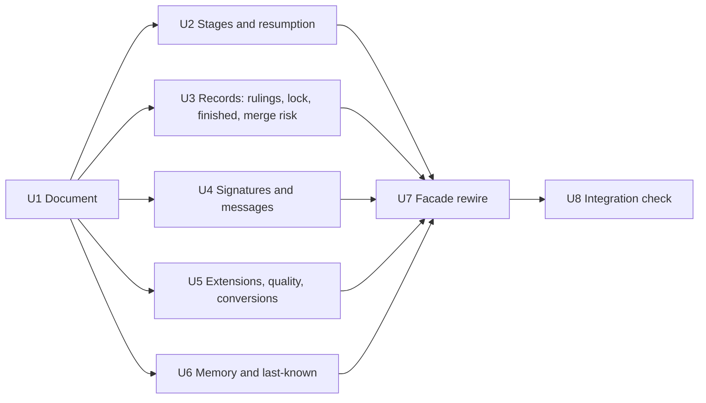

Refactor share: about 45 of 2460 tracked files (1.8%), about 6,500 of 308,276 tracked lines (2.1%: `plan_state.rb` 1,033, its three specs 814, `.rubocop_todo.yml` 711, `docs/architecture/` 3,909); threshold 50%, so `concurrent`.

# Plan: Split Plan State (045.04)

Cut `Plans::PlanState` (`lib/openlanes/plans/plan_state.rb`, 1,033 lines) to the A8 limits that `.rubocop.yml` already sets (ClassLength 100, MethodLength 10, ParameterLists 4, AbcSize 20), with no change in behaviour. `045.01` (`Container`, `Deps[...]`) is merged, and nothing here needs a feature another open plan builds, so `depends_on: [none]`. (The umbrella chained 045.04 behind 045.03 `split-executor`; that folder no longer exists anywhere under `.plans/`, and splitting `PlanState` uses nothing a split `Executor` would provide.)

## Starting point

| File | Lines | In `.rubocop_todo.yml` under |
| --- | ---: | --- |
| `lib/openlanes/plans/plan_state.rb` | 1,033 | AbcSize, ClassLength, MethodLength, ParameterLists |

The file is already organised in sections, which are the seams:

| Section (today's lines) | Public methods |
| --- | --- |
| store (63–101, 939–1017) | `for`, `dir`, `path`, `exist?`, `read`, `update`; private `skeleton`, `identity`, `write`, `locked`, `lock_key`, `parse_time` |
| rulings, resume (103–167) | `stages`, `signatures`, `messages`, `rulings`, `rule!`, `state`, `resume_until`, `resumed?`, `resume_anyway!` |
| global lock (169–202) | `global_lock_taken_at`, `take_global_lock!`, `release_global_lock!` |
| finished (203–271) | `FINISH_KINDS`, `Finished`, `finished`, `finish!`, `unfinish!` |
| the harness (272–412) | `stage!`, `resumption` (+ its value type), `state!`, `moves`, `stranded`; private `started`, `moved_since`, `alive?` |
| the agents (414–528) | `sign!`, `message!`, `deliver!`, `ack!`; private `same_message?` |
| conversions (529–557) | `conversions`, `converted?`, `conversion!` |
| extensions, quality (558–689) | `extensions`, `ask_extension!`, `estimate_extension!`, `settle_extension!`, `amend_extension!`, `quality_ask`, `ask_quality!`, `settle_quality_ask!`, `spend_extension!` |
| merge risk (690–722) | `merge_risk`, `assess!`, `rebased!` |
| memory (723–874) | `MEMORY`, `HELD`, `journal`, `journal!`, `held`, `hold!`, `forget_held!`, `answer!`, `blocked_by` |
| last-known, ledger (875–937) | `LAST_KNOWN`, `record_last_known`, `last_known`, `last_known_states`, `ledger` |

About 130 files under `lib/` and `spec/` name `PlanState`. None of them is edited by this plan.

## Rules every unit follows

- **The public surface of `PlanState` is the contract.** Every public method, constant (`FILENAME`, `VERSION`, `SCHEMA_ID`, `FAILED_START`, `SCHEMA_PATH`, `FINISH_KINDS`, `MEMORY`, `HELD`, `LAST_KNOWN`) and nested value type (`PlanState::Finished`, the resumption value) keeps its name, signature, keyword defaults and return value. Callers stay unedited.
- **`state.json` stays byte-identical**: same keys, same key order, same `JSON.pretty_generate` output, same lock file name in `Dir.tmpdir`. The key order inside each record is part of the contract; a moved method builds its hash in the same order.
- Extracted classes live under `lib/openlanes/plans/plan_state/`, one class per file, namespaced `Plans::PlanState::<Name>`, so Zeitwerk and the container key agree. Each section object is built with the `Document` (U1) and nothing else of `PlanState`'s; a section never calls another section.
- `Deps[...]`: a section that reads the clock itself takes `include Deps["clock"]`. Public keyword defaults such as `at: Time.now` stay as written on the `PlanState` facade, because they are part of the signature callers see. Do not add a `Deps` key that is not registered today.
- **ParameterLists.** Public signatures over four keywords (`rule!` 10, `sign!` 6, `message!` 6, `conversion!` 7, `journal!` 5, `ask_extension!`) keep their keywords on the facade. Behind it, a section method takes a `Data.define` value (for example `Signature`, `Message`, `Ruling`, `Conversion`) built by the facade, so no section method takes more than four parameters. An inline `rubocop:disable Metrics/ParameterLists` is allowed only on a facade method whose keyword list is the callers' contract, with the reason on the line; the pull request lists each one.
- A8 metaprogramming: `def_delegators` over literal method names and `Data.define` only. No `send`, `public_send` or `method_missing`.
- Existing spec assertions do not change (A9). `spec/openlanes/plans/plan_state_spec.rb`, `plan_state_journal_spec.rb` and `plan_state_resumption_spec.rb` gain examples only. New classes get new spec files under `spec/openlanes/plans/plan_state/`.
- No unit but U8 edits `.rubocop_todo.yml` or `docs/architecture/`. No unit but U7 edits `lib/openlanes/plans/plan_state.rb`. So no file has two writers that could run at the same time.

## Order and dependency graph

U1 first: every section reads and writes through the `Document`. U2 to U6 create new files only and may run in any order or together; until U7, `plan_state.rb` still carries its own copies, so the suite stays green throughout. U7 is sequential after all five because it is the only writer of `plan_state.rb`. U8 last.

## Backend

### U1 Document: the store

- **Discipline:** back end.
- **Size:** medium.
- **Owns:** new `lib/openlanes/plans/plan_state/document.rb`; new `spec/openlanes/plans/plan_state/document_spec.rb`.
- **Must not touch:** `lib/openlanes/plans/plan_state.rb`, every other `plan_state/*.rb`, `.rubocop_todo.yml`, `docs/architecture/`.
- **Depends on:** nothing.
- **Shape:** `PlanState::Document.new(dir:)` with `path`, `exist?`, `read`, `update { |data| }`, `identity`, `parse_time(text)`; private `skeleton`, `write`, `locked`, `lock_key`. Moved bodies, not rewritten: same temp-file name, same lock file `openlanes-plan-<16 hex>.lock`, same `Error` message on bad JSON. `updated_at` uses `Time.now` exactly as today (or `clock.now` via `Deps["clock"]` only if the provider returns the same `Time.now`; the spec proves which).
- **Done when:** `spec/openlanes/plans/plan_state/document_spec.rb` passes, covering a missing file (skeleton), bad JSON, two concurrent `update` calls losing nothing, and the lock key staying the same across a folder rename; `wc -l` shows `document.rb` ≤ 100.

### U2 Stages and resumption

- **Discipline:** back end.
- **Size:** medium.
- **Owns:** new `lib/openlanes/plans/plan_state/stages.rb` (`stages`, `stage!`, `state`, `state!`, `moves`, `resume_until`, `resumed?`, `resume_anyway!`), new `lib/openlanes/plans/plan_state/resumption.rb` (`resumption`, its value type, `stranded`, and the private `started`, `moved_since`, `alive?`); new `spec/openlanes/plans/plan_state/{stages,resumption}_spec.rb`.
- **Must not touch:** `plan_state.rb`, `document.rb`, other sections, `.rubocop_todo.yml`, `docs/architecture/`.
- **Depends on:** U1.
- **Shape:** the resumption value type keeps its constant name under `PlanState` (moved to its own file if it is a nested `Data.define` today). `stranded`'s `alive:` and `pid:` keywords stay.
- **Done when:** the two new specs pass; each file ≤ 100 lines.

### U3 Records: rulings, global lock, finished, merge risk

- **Discipline:** back end.
- **Size:** small.
- **Owns:** new `lib/openlanes/plans/plan_state/{rulings,lock_record,finish,merge_risk}.rb`, new `lib/openlanes/plans/plan_state/finished.rb` (the `Finished` value, moved), and their specs under `spec/openlanes/plans/plan_state/`.
- **Must not touch:** `plan_state.rb`, `document.rb`, other sections, `lib/openlanes/plans/global_lock.rb`, `.rubocop_todo.yml`, `docs/architecture/`.
- **Depends on:** U1.
- **Shape:** `Rulings#rule!(ruling)` takes a `PlanState::Ruling` `Data.define` built by the facade; the hash it writes keeps today's key order and `.compact`. The class is named `LockRecord`, not `GlobalLock`, so it is not confused with `Plans::GlobalLock`, which reads these records back across the tree.
- **Done when:** the new specs pass; each file ≤ 100 lines.

### U4 Signatures and messages

- **Discipline:** back end.
- **Size:** medium.
- **Owns:** new `lib/openlanes/plans/plan_state/signatures.rb` (`signatures`, `sign!`, `ledger`), new `lib/openlanes/plans/plan_state/messages.rb` (`messages`, `message!`, `deliver!`, `ack!`, private `same_message?`); their specs under `spec/openlanes/plans/plan_state/`.
- **Must not touch:** `plan_state.rb`, `document.rb`, other sections, `lib/openlanes/plans/mailbox.rb`, `lib/openlanes/plans/ledger.rb`, `.rubocop_todo.yml`, `docs/architecture/`.
- **Depends on:** U1.
- **Shape:** `sign!` and `message!` arrive as `Signature` and `Message` `Data.define` values. Message numbering, ids and the `reserved:` rule of `deliver!` unchanged. `ledger` returns the same `Ledger::Reading`, line numbers included.
- **Done when:** the new specs pass; each file ≤ 100 lines.

### U5 Extensions, quality ask, conversions

- **Discipline:** back end.
- **Size:** medium.
- **Owns:** new `lib/openlanes/plans/plan_state/{extensions,quality_ask,conversions}.rb`; their specs under `spec/openlanes/plans/plan_state/`.
- **Must not touch:** `plan_state.rb`, `document.rb`, other sections, `lib/openlanes/plans/estimate.rb`, `.rubocop_todo.yml`, `docs/architecture/`.
- **Depends on:** U1.
- **Shape:** `extensions.rb` holds ask, estimate, settle, amend and spend; if it passes 100 lines, `estimate_extension!` and its arithmetic go to `plan_state/estimate_request.rb`. `conversion!` takes a `Conversion` value.
- **Done when:** the new specs pass; each file ≤ 100 lines.

### U6 Memory and last-known state

- **Discipline:** back end.
- **Size:** medium.
- **Owns:** new `lib/openlanes/plans/plan_state/{memory,holds,answers,last_known}.rb`; their specs under `spec/openlanes/plans/plan_state/`.
- **Must not touch:** `plan_state.rb`, `document.rb`, other sections, `lib/openlanes/plans/journal.rb`, `lib/openlanes/plans/last_known_state.rb`, `.rubocop_todo.yml`, `docs/architecture/`.
- **Depends on:** U1.
- **Shape:** `Memory` (`journal`, `journal!`), `Holds` (`held`, `hold!`, `forget_held!`), `Answers` (`answer!`, `blocked_by`), `LastKnown` (`record_last_known`, `last_known`, `last_known_states`). The `MEMORY`, `HELD` and `LAST_KNOWN` keys stay defined on `PlanState` and are read from there.
- **Done when:** the new specs pass; each file ≤ 100 lines.

### U7 Facade rewire

- **Discipline:** back end.
- **Size:** large.
- **Owns:** `lib/openlanes/plans/plan_state.rb`; `spec/openlanes/plans/plan_state_spec.rb`, `plan_state_journal_spec.rb`, `plan_state_resumption_spec.rb` (examples added only).
- **Must not touch:** any `plan_state/*.rb` (a defect found there goes back to its owning unit), every caller of `PlanState`, `.rubocop_todo.yml`, `docs/architecture/`.
- **Depends on:** U2, U3, U4, U5, U6.
- **Shape:** `PlanState` keeps its constants, `self.for(dir)`, `initialize(dir:)`, `dir`, `path`, `exist?`, `read`, `update`, and forwards every other public method to its section through `def_delegators` over literal names, or through a one-line method where the facade builds the `Data` value from today's keywords. The moved bodies and private helpers are deleted from this file.
- **Done when:** the three existing `plan_state*_spec.rb` files and every spec that names `PlanState` pass unchanged; `wc -l lib/openlanes/plans/plan_state.rb` ≤ 100.

### U8 Integration check: `state.json` is unchanged and the limits hold

- **Discipline:** back end.
- **Size:** small.
- **Owns:** `.rubocop_todo.yml` (deleting the four `lib/openlanes/plans/plan_state.rb` entries, under AbcSize, ClassLength, MethodLength and ParameterLists), `docs/architecture/` (regenerated by `just update-architecture`; `docs/architecture/before/` untouched), new `spec/openlanes/plans/plan_state_split_integration_spec.rb` and its fixture `spec/fixtures/plan_state_split/state.json`.
- **Must not touch:** any file under `lib/`; a failing check goes back to the unit that owns the file.
- **Depends on:** U7.
- **Integration check, nothing stubbed:** the spec builds a real `.plans` tree with `PlansFixture` and drives the real CLI (`openlanes state sign`, `state resume`, `state estimate`, `mail send`, `mail read`) plus the engine-side writers (`stage!`, `rule!`, `finish!`, `take_global_lock!`, `journal!`, `hold!`, `answer!`, `conversion!`, `assess!`) with fixed `at:` times, including two `update`s racing from two threads. It must show that the resulting `state.json`, with `updated_at` normalised, is byte-equal to the fixture, and that `state show` output is unchanged. The fixture is recorded by running the same script against `main` before the split (a temporary checkout of `main`, removed afterwards), and the pull request says so.
  - **amended (after review, staff-reviewer F2):** the spec as built drives every `state.json` writer through the `PlanState` facade (`spec/fixtures/plan_state_split/drive.rb`), not through the CLI, and it does not compare `state show` output. The CLI commands (`state sign`, `state resume`, `state estimate`, `mail send`, `mail read`) call those same facade methods with the same keywords, and the facade kept every public name and keyword (its three original specs are unchanged). How `cli/state/subcommands/*.rb` maps options onto the facade is covered by `spec/openlanes/cli/state_spec.rb` and `spec/openlanes/cli/state/estimate_spec.rb`, which this plan does not touch and which stay green. A CLI-driven byte comparison is left to a later plan: the fixture would have to be re-recorded on pre-split code.
- **Done when:**
  - `just ci` is green (rubocop with the `plan_state.rb` entries gone from the todo, then the suite), and coverage in `coverage/.last_run.json` is not below the `main` figure recorded at the start.
  - **amended (after review, staff-reviewer F2):** the `main` coverage figure was not recorded at the start, so this item cannot be judged as written. What was measured: the branch suite reports 99.04% line coverage (round 2), and every new file under `lib/openlanes/plans/plan_state/` has its own spec. A reviewer who needs the comparison runs `bundle exec rspec` on `main` and reads `coverage/.last_run.json`.
  - `spec/openlanes/plans/plan_state_split_integration_spec.rb` passes.
  - `spec/openlanes/docs/architecture_doc_spec.rb` passes.
  - `wc -l lib/openlanes/plans/plan_state.rb lib/openlanes/plans/plan_state/*.rb | gawk '$1>100'` prints only the `total` line.
  - `rg "method_missing|public_send|send\(" lib/openlanes/plans/plan_state*` prints nothing.
  - `rg "plans/plan_state" .rubocop_todo.yml` prints nothing.
  - The pull request body lists every todo entry removed and every inline `rubocop:disable` added, with its reason.

## Frontend

None: `spec.md` says `frontend: false`, and this is a back-end restructuring.

## HTTP surface

No. The plan adds and changes no HTTP API; the control room reads `state.json` exactly as before.

## How to test

- `bundle exec rubocop`: no offenses, and `rg "plans/plan_state" .rubocop_todo.yml` prints nothing.
- `bundle exec rspec`: 0 failures. A loaded machine takes about 9 minutes, so do not wrap it in a shorter timeout.
- `bundle exec rspec spec/openlanes/plans/plan_state_split_integration_spec.rb`: 2 examples pass. The first proves `state.json` is byte-identical to the fixture recorded on the pre-split code; the second shows two racing threads lose no signature.
- `bundle exec rspec spec/openlanes/plans/plan_state spec/openlanes/plans/plan_state*_spec.rb`: every section spec and the three original `PlanState` specs pass, with their assertions unchanged.
- `wc -l lib/openlanes/plans/plan_state.rb lib/openlanes/plans/plan_state/*.rb | gawk '$1>100'`: prints only the `total` line.
- `rg "method_missing|public_send|send\(" lib/openlanes/plans/plan_state*`: prints nothing.
- `bundle exec rspec spec/openlanes/docs/architecture_doc_spec.rb`: passes, so `docs/architecture/` is current.
- `bundle exec rspec spec/openlanes/web/branch_diff_spec.rb spec/openlanes/adapters`: pass even with `git config diff.external difft` set and a model list cached under `~/.cache/openlanes`.
