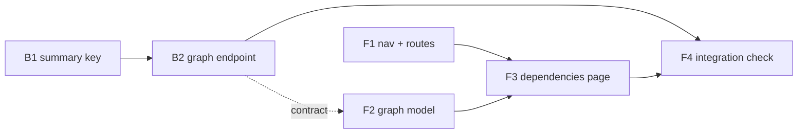

Not a refactor (new endpoint, new page, one new frontmatter key): file and line shares not measured; threshold 50%.

# Plan: Plan Dependencies

## Decisions taken in planning

- **Layout:** `@dagrejs/dagre`, rank direction `LR`. Smaller and synchronous, unlike elkjs; the graph is tens of nodes, not thousands.
- **Routing:** no router library. A small `useRoute` hook over `history.pushState` / `popstate` covers three paths.
- **Data:** a new `GET /api/dependencies`, not the SSE board snapshot. The snapshot leaves out the archive, and this page needs it when Done is checked. The page refetches when the board's SSE news says a plan moved.
- **G7 (dashed outline per DAG):** left for a follow-up plan. The model unit still returns each node's group id, so the follow-up only has to draw it.
- **depends_on:** `[none]`. Plan 058 depends on this one (it adds Project settings to the nav built here); 057 builds nothing this plan needs.

### B1 (answered) — Seven suite failures from the repo's own `.openlanes.yml`

On a clean checkout of `4fcb6eb2`, seven examples fail (`spec/openlanes/agents/routing_spec.rb`, `spec/openlanes/engine/dispatcher_spec.rb`, `spec/openlanes/engine/run_workflow_spec.rb`). `Config.current` reads the checkout's `.openlanes.yml` from inside the suite, so `frontend: true` and `desired_codebase_quality: high` leak into those specs.

### D1 (decision) — Suite ignores the checkout's `.openlanes.yml`

Answered:

- 2026-11-12
- By hermes

Option a: `spec_helper` pins `Config.current` to an empty config by default, and the Config specs opt back in. Option b (drop the keys from `.openlanes.yml`) and option c (accept seven failures as baseline) are rejected.

______________________________________________________________________

## Order and dependency graph



B1 and F1 start together. F2 builds against the response shape in `## HTTP surface`, so it does not wait for B2's code. F4 is last.

## Backend

### B1 `summary:` in spec.md frontmatter

- **Discipline:** back end
- **Owns:** `lib/openlanes/plans/spec.rb` (a `summary` attribute, validated as a String, with a non-string value named in `problems`; `Spec.summary(text)` prefers the key and falls back to the first prose paragraph under "What we are trying to achieve", then to today's first prose paragraph), `lib/openlanes/presentation/documentation.rb` (list `summary:` among the frontmatter keys), the spec agent's `agents/*.md` (writes `summary:` when it fills a spec in), `docs/WORKFLOW.md` (regenerated by `just update-workflow`), `spec/openlanes/plans/spec_spec.rb`, `spec/openlanes/presentation/documentation_spec.rb`
- **Must not touch:** `lib/openlanes/web/**`, `web/**`
- **Depends on:** nothing
- **Done when:** `spec/openlanes/plans/spec_spec.rb` covers key present, key not text (a problem), and both fallbacks; `spec/openlanes/presentation/documentation_spec.rb` finds `summary:` in `openlanes docs` output.

### B2 `GET /api/dependencies`

- **Discipline:** back end
- **Owns:** `lib/openlanes/web/dependency_graph.rb` (`Web::DependencyGraph.new(tree).to_h`: every plan, archive included, plus edges from `Plans::Dependencies`, plus the states in `STATUSES` order), the route in `lib/openlanes/web/app.rb`, `openapi.yaml` beside the web `contract.md` and that contract's HTTP section, `spec/openlanes/web/dependency_graph_spec.rb`, the route's example in the app spec
- **Must not touch:** `lib/openlanes/plans/spec.rb`, `web/**`
- **Depends on:** B1 (reads `Spec.summary`)
- **Done when:** `spec/openlanes/web/dependency_graph_spec.rb` builds a `PlansFixture` tree with an archived plan and a chain, and asserts one node per plan, one edge per `depends_on:` entry and states in `STATUSES` order; the app spec gets `200` and that JSON from the route.

## Frontend

### F1 Top nav and page routes

- **Discipline:** front end
- **Owns:** `web/src/shell/Nav.tsx`, `web/src/shell/useRoute.ts`, `web/src/App.tsx` (renders the nav fixed to the top, picks the page from the path: `/` board, `/dependencies` graph), the nav's rules in `web/src/shell/shell.css`, `web/src/shell/Nav.test.tsx`, `web/src/shell/useRoute.test.ts`, `web/src/App.test.tsx`
- **Must not touch:** `web/src/board/**` (the board is unchanged), `web/src/dependencies/**`
- **Depends on:** nothing
- **Done when:** `Nav.test.tsx` and `App.test.tsx` show a click changes page with no reload, the URL follows, and mounting at `/dependencies` opens that page. The nav leaves room for plan 058's "Project settings" link.

### F2 Graph model: fetch, filter, bridges, layout

- **Discipline:** front end
- **Owns:** `web/src/api/dependencies.ts` (the query against `GET /api/dependencies`), the response types in `web/src/api/types.ts`, `web/src/dependencies/model.ts` (pure: `visible(graph, checked)`, `bridges(graph, hidden)` returning dashed edges with the hidden ordinals they pass through, `layout(nodes, edges)` via dagre, a group id per connected component), `web/src/dependencies/useStateFilter.ts` (localStorage per project, default every state but Done and Abandoned), `web/package.json` and `web/package-lock.json` (add `@xyflow/react`, `@dagrejs/dagre`), `web/src/dependencies/model.test.ts`, `web/src/dependencies/useStateFilter.test.ts`, `web/src/api/dependencies.test.ts`
- **Must not touch:** `web/src/App.tsx`, `web/src/shell/**`, `lib/**`
- **Depends on:** B2's response shape (below), not its code
- **Done when:** `model.test.ts` covers the A→B→C case with B hidden (one dashed A→C bridge naming B), a chain of two hidden plans, and a hidden plan at a chain's end (no bridge); `useStateFilter.test.ts` covers the default and the remembered choice.

### F3 Plan dependencies page

- **Discipline:** front end
- **Owns:** `web/src/dependencies/DependenciesPage.tsx`, `StateFilter.tsx` (one checkbox per state, in the order the endpoint sends), `PlanNode.tsx` (number, title, state as the board draws it; Radix tooltip on hover, pinned on click, `summary` text), `BridgeEdge.tsx` (dashed, tooltip names the hidden plans), `dependencies.css`, and their tests `DependenciesPage.test.tsx`, `StateFilter.test.tsx`, `PlanNode.test.tsx`
- **Must not touch:** `web/src/App.tsx`, `web/src/shell/**`, `web/src/dependencies/model.ts`, `web/package.json`
- **Depends on:** F1 (route to mount on), F2 (model and dependencies installed)
- **Done when:** the component tests show unchecking a state removes its boxes, a bridged edge renders dashed with its tooltip, and hover and click show the summary. Positions are laid out again on every filter change (G5).

### F4 Integration check: real server, real `.plans`

- **Discipline:** front end
- **Owns:** `web/cypress/e2e/dependencies.cy.ts`, its `.plans` fixture under `web/cypress/fixtures/`
- **Must not touch:** everything owned above
- **Depends on:** B2, F3
- **Done when:** `dependencies.cy.ts`, run against the Sinatra server serving a fixture `.plans` with an archived plan and a three-plan chain, nothing stubbed, shows: the nav switches Board ⇄ Plan dependencies with no reload and a refresh at `/dependencies` stays there; one box per plan and one arrow per edge; checking Done brings the archived plan in; unchecking the middle plan's state leaves a dashed bridge whose tooltip names it; hovering a box shows its `summary:` and a plan without one shows the fallback paragraph.

## HTTP surface

Yes. One new read-only route; `backend-coder` writes `openapi.yaml` beside `contract.md`.

`GET /api/dependencies` → `200`

```json
{
  "states": [{ "key": "ready_for_planning", "emoji": "📋", "name": "Ready for Planning" }],
  "plans": [{ "ordinal": "056.00", "title": "Plan Dependency Graph", "state": "ready_for_planning",
              "summary": "…", "archived": false }],
  "edges": [{ "from": "056.00", "to": "058.00" }]
}
```

`from` is the dependency, `to` the dependent, so arrows run left to right. `states` is in `STATUSES` order.

## Task completed when

- The nav switches between the pages without a reload, the URL says which page is open, and a refresh stays on it.
- Every plan in `.plans` (archive included, when Done is checked) has one box and every `depends_on:` edge one arrow.
- Unchecking a state removes its boxes; a hidden plan in a chain leaves a dashed bridge with the right tooltip.
- Hover and click show the `summary:` paragraph, or the fallback.
- `summary:` is validated as text in spec.md frontmatter, and `openlanes docs` lists it.
- Component tests for the filter and the bridging, and a Cypress test that opens the page, filters, and hovers a box.

## How to test

- The nav switches between the pages without a reload, the URL says which page is open, and a refresh stays on it.
- Every plan in `.plans` (archive included, when Done is checked) has one box and every `depends_on:` edge one arrow.
- Unchecking a state removes its boxes; a hidden plan in a chain leaves a dashed bridge with the right tooltip.
- Hover and click show the `summary:` paragraph, or the fallback.
- `summary:` is validated as text in spec.md frontmatter, and `openlanes docs` lists it.
- Component tests for the filter and the bridging, and a Cypress test that opens the page, filters, and hovers a box.
