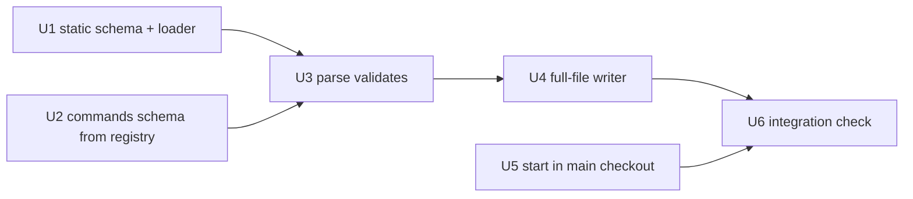

Not a refactor (no `implementation_requirement: refactor`, nothing moved or renamed across the codebase), so the share measures do not apply; threshold `refactor.threshold` unset, 50 percent.

# Plan 057.00: Config Schema and Main Checkout

## Order and dependency graph

- U1, U2, U5 run in parallel.
- U3 then U4, sequential: both edit `lib/openlanes/support/config.rb` and `spec/openlanes/config_spec.rb`.
- U6 last.

## Decisions taken in planning

- `json_schemer` moves from the Gemfile's `:test` group to a runtime `spec.add_dependency` in `openlanes.gemspec`, because `Config.parse` validates at runtime (S4).
- The `commands` part of the schema is built from the dry-cli registry at load time and merged into the document, so parsing always matches the CLI as it stands. The checked-in file holds the same merged document so editors can validate; a spec fails when the file is stale, and `just update-config-schema` rewrites it (the `just update-architecture` pattern). A new flag needs no hand edit.
- Error messages keep today's shape, `"<path>: <key>: <problem>; known: …"`. Schema errors are mapped into that shape rather than printed raw.

## Backend

### U1: Static schema and its loader

- **Discipline:** back end.
- **Owns:** `schemas/openlanes-config.schema.json` (every top-level and nested key except the `commands` properties: type, `enum`, `default`, `description` taken from the header comment of `config.rb`); `lib/openlanes/support/config/schema.rb`, `OpenLanes::Config::Schema` with `document` (static part merged with U2's `commands`), `keys` (top level), `keys_for(section)`, `defaults` (a nested Hash), `errors(settings)` (json_schemer results), `write(path = SCHEMA_PATH)`; `spec/openlanes/config/schema_spec.rb`.
- **Must not touch:** `lib/openlanes/support/config.rb`, `lib/openlanes/cli/**`, `openlanes.gemspec`.
- **Depends on:** nothing. (If U2 is not in yet, `document` leaves `commands` an open object and U3 wires the merge.)
- **Done when:** `spec/openlanes/config/schema_spec.rb` passes: the schema is valid draft 2020-12, its top-level keys equal today's `Config::KEYS`, each nested section's keys equal today's `*_KEYS`, every leaf has `description` and `default` (or is explicitly nullable). The spec fails when a key is missing or extra.

### U2: `commands` schema from the dry-cli registry

- **Discipline:** back end.
- **Owns:** `lib/openlanes/support/config/commands_schema.rb`, `OpenLanes::Config::CommandsSchema.build(registry = OpenLanes::CLI)` returning the JSON Schema object for `commands:` (one property per command, its declared options with type, `enum` from `values:`, `default`, `description` from `desc:`); `spec/openlanes/config/commands_schema_spec.rb`.
- **Must not touch:** `lib/openlanes/cli.rb`, `lib/openlanes/cli/**`, `schemas/**`, `config.rb`.
- **Depends on:** nothing.
- **Done when:** `spec/openlanes/config/commands_schema_spec.rb` passes: every registered command appears with exactly the options it declares; a command class defined in the spec with a new option, on a throwaway registry, shows up in the output with no other edit.

### U3: `Config.parse` validates against the schema

- **Discipline:** back end.
- **Owns:** `lib/openlanes/support/config.rb` (parse path; `KEYS`, `MERGE_KEYS`, `BACKOFF_KEYS`, `PLAN_KEYS`, `QUESTION_KEYS`, `EVENT_KEYS`, `REFACTOR_KEYS`, `REVIEW_KEYS`, `MERGERS`, `QUALITIES` derived from `Config::Schema` or removed); `openlanes.gemspec`, `Gemfile`, `Gemfile.lock` (json_schemer to runtime); `spec/openlanes/config_spec.rb`; `justfile` (`update-config-schema` recipe); the regenerated `schemas/openlanes-config.schema.json` (written by `Config::Schema.write`, after U1 and U2 are in).
- **Must not touch:** `lib/openlanes/cli/**`, `lib/openlanes/support/project.rb`.
- **Depends on:** U1, U2.
- **Done when:** `spec/openlanes/config_spec.rb` passes, including new examples: a value the schema refuses (wrong type, value outside `enum`, unknown nested key) is refused by `Config.parse` with the same message as before this plan; a freshness example fails when the checked-in schema differs from `Config::Schema.document`. Existing callers (`init.rb`, `Base.default_params`) still work against the derived constants. `just lint` clean.

### U4: Full-file writer

- **Discipline:** back end.
- **Owns:** `lib/openlanes/support/config.rb` (`to_yaml` writes every key, filling unset ones from `Config::Schema.defaults`); `lib/openlanes/cli/init/init.rb` (writes the whole file); `spec/openlanes/config_spec.rb` (round-trip examples); `spec/openlanes/cli/init_spec.rb`.
- **Must not touch:** `schemas/**`, `lib/openlanes/support/config/*.rb`, `lib/openlanes/cli/start/**`.
- **Depends on:** U3 (same files; sequential).
- **Done when:** round-trip examples in `spec/openlanes/config_spec.rb` pass (`Config.parse(config.to_yaml)` equals `config` with defaults filled, and the YAML holds every schema key), and `spec/openlanes/cli/init_spec.rb` shows `openlanes init` writing every key.

### U5: `openlanes start` boots in the main checkout

- **Discipline:** back end.
- **Owns:** `lib/openlanes/support/project.rb` (`Project.main_checkout(dir = Dir.pwd)` from `git rev-parse --git-common-dir`; reuse or move the primary-checkout check `openlanes create` uses, so there is one definition); `lib/openlanes/cli/start/start.rb` (chdir to the main checkout before anything boots, one STDERR line naming it); `lib/openlanes/cli/create/create.rb` only if the check moves; `spec/openlanes/cli/start_spec.rb`; the existing `Project` spec.
- **Must not touch:** `lib/openlanes/support/config.rb`, `lib/openlanes/support/config/**`, `schemas/**`.
- **Depends on:** nothing.
- **Done when:** `spec/openlanes/cli/start_spec.rb` passes with a real temp repo and a real `git worktree add`: started in the worktree, the working directory at boot is the main checkout and STDERR says so; started in the main checkout, nothing extra is printed.

### U6: Integration check

- **Discipline:** back end.
- **Owns:** `spec/openlanes/config_schema_integration_spec.rb`.
- **Must not touch:** everything under `lib/` and `schemas/`.
- **Depends on:** U4, U5.
- **Done when:** the spec passes, nothing stubbed: in a temp git repo, `exe/openlanes init` (subprocess) writes `.openlanes.yml`; the file validates against the checked-in `schemas/openlanes-config.schema.json` with json_schemer and holds every schema key; `Config.load` returns a `Config` whose `to_yaml` reproduces the file; a corrupted value is refused with today's message shape; from a `git worktree add` checkout, `exe/openlanes start` (dry run or immediate stop) says on STDERR that it moved to the main checkout.

## Frontend

None in this plan; plan 058 renders the settings page.

## HTTP surface

No. This plan adds no route and changes none.

## Task completed when

- Every key `Config.parse` accepts is in the schema, and a spec fails when one is missing or extra.
- `Config.parse` refuses a value the schema refuses, with the same message shape as today.
- Writing a config produces every key; parsing it back gives the same `Config`.
- A new option on a command appears in the generated `commands` schema with no hand edit.
- `openlanes start` run in a worktree boots in the main checkout, and says so on STDERR.

## How to test

- Every key `Config.parse` accepts is in the schema, and a spec fails when one is missing or extra.
- `Config.parse` refuses a value the schema refuses, with the same message shape as today.
- Writing a config produces every key; parsing it back gives the same `Config`.
- A new option on a command appears in the generated `commands` schema with no hand edit.
- `openlanes start` run in a worktree boots in the main checkout, and says so on STDERR.

## Rebase decisions

- `.plans/057.00━━👀━━❯…/spec.md`, `plan.md`, `state.json`: kept main's folder as is. `origin/main` already holds the plan in review (`in_review`, with `pull-requests.md`); the branch's commit only carried it to the earlier `building` state, so replaying that rename would move the plan backwards.
- `.plans/057.00━━🟡━━❯…/` (spec.md, plan.md, state.json): dropped from the rebased tree. `spec.md` and `plan.md` are byte-identical to main's `👀` copies; `state.json` is the older `building` snapshot, superseded by main's. Still in git history on the original branch commit.
- `.plans/057.00━━📋━━❯…/spec.md`: both sides deleted it (renamed away), nothing to keep.
- `.plans/068.00━━📋━━❯unblock-interview-chat/state.json`: kept main's version. The branch's base never had plan 068, so its "deletion" is only absence; the plan is unrelated to 057.
- Source, spec and schema files from the commit applied cleanly and were left untouched.
- `schemas/openlanes-config.schema.json`: regenerated with `Config::Schema.write` after the rebase. Main added CLI options (`memory` on `run` and `evals`, the `memory list` command) after the branch was cut, so the checked-in generated `commands` schema was stale and its staleness spec failed; the regeneration adds exactly those 48 lines.
