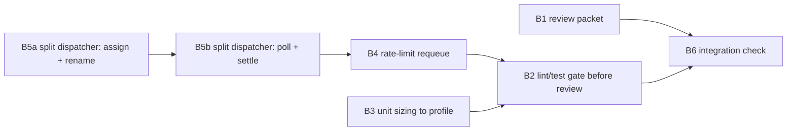

Refactor share (unit B5 only): ~12 of 1920 tracked files (0.6%), ~4,000 of 228,215 lines (1.8%); threshold 50% (unset in `.openlanes.yml`). Not over, so concurrent.

# Plan 060.00: Improve OpenLanes, low-hanging fruit

`spec.md` needs `depends_on: [none]`. Plan 057 (config schema) and 061/062 (reviews, deploy-assessor) touch the same files (`support/config.rb`, the reviewer step), so they are merge risks, not dependencies.

## Order and dependency graph

- First, B5a then B5b: behaviour-preserving split. Every existing `spec/openlanes/engine/dispatcher_*_spec.rb` stays green **unchanged**.
- B1 and B3 can run beside B5a/B5b. They touch neither `dispatcher.rb` nor `steps/`.
- B4, then B2. Both edit `steps/settle.rb`. B2 also edits `support/config.rb` after B3, so B2 waits for both.
- B6 is last.
- Shared files: `docs/architecture/` (regenerated with `just update-architecture`) and `.rubocop_todo.yml`. The unit that lands a change to `lib/` regenerates them. Units that can run at the same time (B1, B3, B5a) commit them in sequence, in the order B5a, B1, B3, so no two of them edit those files at once.

## Backend

### B5a Split dispatcher: assign and rename steps

- **Discipline:** back end (refactor)
- **Owns:** `lib/openlanes/engine/dispatcher.rb`, new `lib/openlanes/engine/steps/assign.rb` (starting, staying, unblocking, discarding; the `---- starting`/`staying`/`unblocking`/`discarding` sections), new `lib/openlanes/engine/steps/rename.rb` (finished plans, state transitions after settle), `spec/openlanes/engine/steps/assign_spec.rb`, `spec/openlanes/engine/steps/rename_spec.rb`
- **Must not touch:** `execution/executor.rb`, `agents/profile.rb`, `support/config.rb`, `agents/*.md`
- **Depends on:** nothing
- **Done when:** both new specs pass, every `spec/openlanes/engine/dispatcher_*_spec.rb` passes without edits, `just ci` is green, and `Dispatcher` keeps `tick` as the orchestrator. Each step follows the `Steps::Merges`/`Steps::Watch` shape: `initialize(context, ...)` and `call`.

### B5b Split dispatcher: poll and settle steps

- **Discipline:** back end (refactor)
- **Owns:** `lib/openlanes/engine/dispatcher.rb` (after B5a), new `lib/openlanes/engine/steps/poll.rb`, new `lib/openlanes/engine/steps/settle.rb` (the `---- settling` section, plus more-time/more-rounds E1 if it is settle-only), `spec/openlanes/engine/steps/poll_spec.rb`, `spec/openlanes/engine/steps/settle_spec.rb`
- **Must not touch:** as B5a
- **Depends on:** B5a (same file)
- **Done when:** both specs pass and the dispatcher specs pass unchanged. Target: `dispatcher.rb` under 1,000 lines and under 60 methods, with the rest moved into `steps/`. Merging, verification and PR-watch sections may stay where they are if moving them would need more than one sitting to review.

### B1 One prepared review packet

- **Discipline:** back end
- **Owns:** new `lib/openlanes/engine/review_packet.rb` (`ReviewPacket.build(subject, checkout) -> ReviewPacket`, with `diff`, `digest`, `head_sha`, `to_prompt`; cached per plan and PR head sha, so three reviewers share one build), `lib/openlanes/execution/prompt.rb` (inject `to_prompt` for reviewer agents only), `agents/staff-reviewer.md`, `agents/security-reviewer.md`, `agents/design-reviewer.md` (read the packet; run `gh pr diff` only when the packet says it was truncated), `spec/openlanes/engine/review_packet_spec.rb`, `spec/openlanes/execution/prompt_review_packet_spec.rb`
- **Must not touch:** `dispatcher.rb`, `steps/*`, `executor.rb`
- **Depends on:** nothing
- **Done when:** the specs show one diff build for three reviewer prompts on the same head, a rebuild when the head sha changes, the digest holding spec.md "What needs to be done", the plan.md unit headings, `contract.md` when present and the pull-requests.md row, and a size cap with a truncation note. `GitHub` is a seam, so the diff comes through a double.

### B3 Size the builder by the work unit

- **Discipline:** back end
- **Owns:** `agents/planner.md` (each unit carries `**Size:** small|medium|large`), new `lib/openlanes/plans/unit_sizes.rb` (reads plan.md: `UnitSizes.parse(text) -> {unit_id => size}`, `largest`), `lib/openlanes/agents/profile.rb` (new precedence step between spec `phases` and `depth`: the plan's largest unit size maps to model and effort for builder agents), `lib/openlanes/support/config.rb` (`sizing:` key with `small`/`medium`/`large` → `{model:, effort:}`; defaults small→sonnet/medium, medium→opus/medium, large→opus/high; setting `large.model: fable` allows Fable), `lib/openlanes/adapters/claude.rb` (add a Fable 5.2 catalogue entry, id `claude-fable-5-2`, if the catalogue lacks one), `spec/openlanes/plans/unit_sizes_spec.rb`, `spec/openlanes/agents/profile_sizing_spec.rb`, `spec/openlanes/support/config_sizing_spec.rb`
- **Must not touch:** `dispatcher.rb`, `steps/*`, `executor.rb`, reviewer agents
- **Depends on:** nothing
- **Done when:** the specs show each size mapping to its configured profile, `run --model` and spec `phases` still winning over sizing, a plan.md without sizes falling back to today's behaviour, `large` reaching Fable only when `sizing.large.model` names it, and `openlanes docs` listing the `**Size:**` field.

### B4 Rate limits pause and requeue, not fail

- **Discipline:** back end
- **Owns:** new `lib/openlanes/execution/rate_limit.rb` (`RateLimit.detect(status, transcript) -> RateLimit | nil`, recognising HTTP 429, `rate_limit_error`, `overloaded_error` and 529 in what each adapter prints; returns `retry_after` when given), `lib/openlanes/execution/executor.rb` (report a rate-limited outcome as its own result, not a failed attempt), `lib/openlanes/engine/steps/settle.rb` (requeue with exponential backoff and jitter, capped; the board shows "rate-limited, retry in Ns"; it costs no attempt), `spec/openlanes/execution/rate_limit_spec.rb`, `spec/openlanes/engine/steps/settle_rate_limit_spec.rb`
- **Must not touch:** `agents/profile.rb`, `support/config.rb`, `review_packet.rb`
- **Depends on:** B5b (`steps/settle.rb`)
- **Done when:** first check what exists today: `Executor#lost_session` and `dispatcher_outage_spec.rb` already cover start-up overloads. Then extend that path rather than duplicate it, and record the finding in the PR body. The specs must show a mid-run 429 requeued with growing delay, the attempt counter unchanged, `retry_after` honoured, and an outage across all `jobs` pausing new assignments rather than burning every plan's attempts.

### B2 Lint and tests gate review

- **Discipline:** back end
- **Owns:** new `lib/openlanes/engine/pre_review_gate.rb` (`PreReviewGate.call(checkout) -> Verdict(passed?, reason, log_tail)`, running the command `Execution::Checks` already derives from the justfile or Gemfile, in the plan's checkout through `Execution::Child`), `lib/openlanes/engine/steps/settle.rb` (after B4: when a builder signs Completed toward review, run the gate first; if it is red, send the plan back to the builder with the log tail in its mail, and start no reviewer), `lib/openlanes/support/config.rb` (after B3: `review.gate: true` by default, plus `review.gate_timeout`), `spec/openlanes/engine/pre_review_gate_spec.rb`, `spec/openlanes/engine/steps/settle_gate_spec.rb`
- **Must not touch:** `executor.rb`, `profile.rb`, reviewer agents
- **Depends on:** B4 (`settle.rb`), B3 (`config.rb`)
- **Done when:** the specs show that a red suite (a fixture checkout whose `just ci` exits 1) returns the plan to backend-coder with no reviewer process started, a green one goes on to review, and `review.gate: false` skips the gate. The verification-time coverage gate stays as it is.

### B6 Integration check

- **Discipline:** back end
- **Owns:** `spec/openlanes/integration/low_hanging_fruit_spec.rb`, `docs/WORKFLOW.md` (`just update-workflow`)
- **Must not touch:** any `lib/` file
- **Depends on:** B1, B2, B3, B4, B5b
- **Done when:** a real `Runner` drives a real `.plans` tree (`PlansFixture`, `:tree` tag) and a fixture checkout through one plan, with only the agent CLIs and `GitHub` replaced by doubles (the house seams). It must show all of the following:
  1. a planned plan with a `large` unit started on the `sizing.large` profile;
  2. a first build with a red suite bounced to the builder, no reviewer started;
  3. an injected 429 on the second build requeued without an attempt counted;
  4. a green third build starting three reviewers whose prompts all carry the same packet `head_sha`, with one diff fetch through the `GitHub` double.

  `just ci` is green, and `spec/openlanes/docs/architecture_doc_spec.rb` passes.

## Frontend

No front-end units: the only visible change is a board status phrase, which the back end already sends.

## HTTP surface

No. The plan adds or changes no HTTP API.

## How to test

- Run `bundle exec rspec` and `bundle exec rubocop`: both exit 0.
- Run `bundle exec rspec spec/openlanes/plans/unit_sizes_spec.rb spec/openlanes/agents/profile_sizing_spec.rb spec/openlanes/config_sizing_spec.rb`: each `**Size:**` maps to its configured model and effort, and `sizing.large.model: fable` is the only way to reach Fable.
- Run `bundle exec rspec spec/openlanes/engine`: the dispatcher specs pass unchanged after the split into `steps/`.
- Run `bundle exec rspec spec/openlanes/integration/low_hanging_fruit_spec.rb`: a large unit starts on the large profile, a red suite bounces to the builder with no reviewer, a 429 is requeued without an attempt, and three reviewers share one packet head sha.
- Run `just update-architecture` and `bundle exec rspec spec/openlanes/docs/architecture_doc_spec.rb`: the docs are current.
- Run `./exe/openlanes docs | rg Size`: the `**Size:**` field is listed.
- There is no front end; nothing to click.
