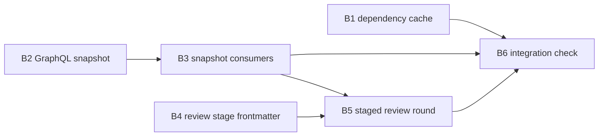

Not a refactor: about 16 of 1920 tracked files (under 1%) and under 3% of tracked lines, against a threshold of 50%.

# Plan: Speed Up Openlanes

Three speed-ups, one pull request: warm dependencies for worktrees, one batched GraphQL query in place of per-PR `gh` polling, and reviews in two stages.

## Decisions

- **D1, warm worktrees by sharing, not pooling.** A pool of pre-made worktrees fights the one-branch-per-plan naming in `Vcs::Worktree`. Instead, dependencies are installed once per lockfile digest into a shared cache outside the repo (`~/.cache/openlanes/deps/<kind>/<digest>`), and each new or reused worktree gets them from there before the agent starts, off the agent's clock. Bundler is pointed at the cache with a worktree-local `.bundle/config` (`BUNDLE_PATH`). `node_modules` is cloned from the cache (`cp -cR`, APFS clonefile; a plain copy elsewhere). A failure is logged and the plan goes on, the same way a failed seed does today.
- **D2, one snapshot per poll.** One `gh api graphql` call returns every open pull request with what the steps ask today (state, head OID, labels, mergeable, review decision, check rollup). Merges, Sweeps, Watch, `PrWatch` and `Verification::Driver` read that snapshot instead of calling `gh` per PR. The poll stays at most once per `Steps::POLL`, now 10 seconds, since a poll is one call. Check results are mapped into the same buckets `GitHub#checks` returns today, so callers see no difference in shape.
- **D3, two-stage review.** `staff-reviewer` runs first. `security-reviewer` and `design-reviewer` start only after it approves. A rejection or `slop` from staff decides the round right away. A stage-2 reviewer that declares `watches:` globs is skipped when the diff touches none of them. As shipped, `security-reviewer` declares none, so it always runs after a pass, and `design-reviewer` watches `lib/**`, `app/**` and `web/src/**`. A person can widen or narrow those globs in the agent file.

## Order and dependency graph

B1, B2 and B4 can start at once. B3 and B5 both write `lib/openlanes/engine/dispatcher.rb`, so they are sequential: B3 first, then B5. B6 comes last.

## Backend

### B1 Shared dependency cache for worktrees

- **Discipline:** back end.
- **Owns:** `lib/openlanes/vcs/warmup.rb` (new: `Vcs::Warmup` with `call(path) -> Result`, plus `digest(lockfile)`), `lib/openlanes/vcs/worktree.rb` (calls `Warmup` after `seed`, on both the new and the reused path), `spec/openlanes/vcs/warmup_spec.rb`, `spec/openlanes/vcs/worktree_spec.rb`.
- **Must not touch:** `lib/openlanes/vcs/github.rb`, `lib/openlanes/engine/**`, `agents/*.md`.
- **Depends on:** nothing.
- **Done when:** `spec/openlanes/vcs/warmup_spec.rb` shows that two worktrees with the same `Gemfile.lock` and `package-lock.json` digests install once and share the cache, that a changed lockfile gets a new cache entry, that a checkout with no lockfile is left alone, and that an install failure is reported, not raised. `spec/openlanes/vcs/worktree_spec.rb` shows warm-up runs on both paths. The installer is an injected command, so the suite never runs bundler or npm for real.

### B2 One GraphQL snapshot of every open pull request

- **Discipline:** back end.
- **Owns:** `lib/openlanes/vcs/github.rb` (new `open_pull_snapshot(repo: nil) -> Vcs::PullSnapshot`, paginated past 100), `lib/openlanes/vcs/pull_snapshot.rb` (new `Data.define`: `pulls`, `taken_at`; `#`, `#checks(number)` in `GitHub#checks`'s bucket shape), `spec/openlanes/vcs/github_spec.rb`, `spec/openlanes/vcs/pull_snapshot_spec.rb`, plus the JSON fixture it parses.
- **Must not touch:** `lib/openlanes/engine/**`, `lib/openlanes/vcs/worktree.rb`.
- **Depends on:** nothing.
- **Done when:** `spec/openlanes/vcs/pull_snapshot_spec.rb` parses a recorded GraphQL response (two pages, mixed check runs and status contexts) into the same rows and buckets `pulls`, `labels` and `checks` produce today, and `spec/openlanes/vcs/github_spec.rb` shows exactly one `gh api graphql` call per page.

### B3 Steps and verification read the snapshot

- **Discipline:** back end.
- **Owns:** `lib/openlanes/engine/steps.rb` (`POLL = 10`; `Context` gains `snapshot`), `lib/openlanes/engine/steps/snapshot.rb` (new: takes at most one `open_pull_snapshot` per interval and hands it to every reader in that tick), `lib/openlanes/engine/steps/merges.rb`, `lib/openlanes/engine/steps/sweeps.rb`, `lib/openlanes/engine/steps/watch.rb`, `lib/openlanes/engine/pr_watch.rb`, `lib/openlanes/engine/verification/driver.rb`, `lib/openlanes/engine/run_workflow.rb` (wiring only), `lib/openlanes/engine/dispatcher.rb` (wiring only, where `Steps::*` are built, near line 574), and their specs under `spec/openlanes/engine/`.
- **Must not touch:** `lib/openlanes/engine/reviews.rb`, `lib/openlanes/vcs/github.rb`, `lib/openlanes/agents/**`.
- **Depends on:** B2.
- **Done when:** `spec/openlanes/engine/steps/snapshot_spec.rb` shows one snapshot per interval, shared across Merges, Sweeps and Watch in a tick. The existing specs for those steps, `pr_watch_spec.rb` and `verification/driver_spec.rb` pass against a GitHub double that answers only `open_pull_snapshot`, and fail if a per-PR call is made (except writes: labels, merge, comment).

### B4 Review stage in agent frontmatter

- **Discipline:** back end.
- **Owns:** `lib/openlanes/agents/agent.rb` (`review_stage` Integer, default 1; `watches` Array of globs, default empty), `lib/openlanes/agents/registry.rb` (validation: `watches:` only on a reviewer), `agents/staff-reviewer.md` (`review_stage: 1`), `agents/security-reviewer.md` (`review_stage: 2`), `agents/design-reviewer.md` (`review_stage: 2`, `watches:` per D3), `spec/openlanes/agents/agent_spec.rb`, `spec/openlanes/agents/registry_spec.rb`.
- **Must not touch:** `lib/openlanes/engine/**`, the body text of the agent files.
- **Depends on:** nothing.
- **Done when:** `spec/openlanes/agents/agent_spec.rb` reads both keys and their defaults, and `spec/openlanes/agents/registry_spec.rb` refuses `watches:` on an agent whose `phase:` is not `review`. `openlanes docs` regenerates cleanly, and `just update-architecture` leaves `docs/architecture_doc_spec.rb` green.

### B5 Staged review round

- **Discipline:** back end.
- **Owns:** `lib/openlanes/engine/reviews.rb` (`reviewers(subject)` returns the current stage's reviewers; new `stage_two(subject, changed_files)`; `decide` returns a pending `Decision` that names the stage-2 reviewers after a staff approval, and decides at once on a staff rejection or `slop`), `lib/openlanes/engine/dispatcher.rb` (starts stage-2 reviewers when a decision asks for them; the changed files come from `git diff --name-only <base>...HEAD` in the plan's worktree, with no network), `spec/openlanes/engine/reviews_spec.rb`, `spec/openlanes/engine/dispatcher_spec.rb`.
- **Must not touch:** `lib/openlanes/engine/steps/**`, `lib/openlanes/vcs/**`, `agents/*.md`.
- **Depends on:** B4, and B3 (sequential: both write `dispatcher.rb`).
- **Done when:** `spec/openlanes/engine/reviews_spec.rb` covers four cases. Staff rejects: decided rejected, no stage 2. Staff approves: security and design pending. A diff outside design's `watches`: design is skipped. A restart mid-round: stage-1 verdicts in `state.json` still count. `spec/openlanes/engine/dispatcher_spec.rb` shows that only `staff-reviewer` starts at ⏳, and that stage 2 starts on the next tick after its approval.

### B6 Integration check

- **Discipline:** back end.
- **Owns:** `spec/openlanes/integration/speed_up_spec.rb`, and any fake-agent script it needs under `spec/support/`.
- **Must not touch:** anything under `lib/`.
- **Depends on:** B1, B3, B5.
- **Done when:** one real `Runner` run over a `PlansFixture` tree in a temp git repo, with real worktrees and a fake agent CLI, shows all of the following:
  - Two plans' worktrees: the dependency installer runs once.
  - One GitHub poll with three open pull requests: exactly one `open_pull_snapshot` call and no per-PR read.
  - A plan entering review: only `staff-reviewer` starts. After it approves, `security-reviewer` starts, plus `design-reviewer` when the diff touches `lib/`. The plan reaches ✅ once all of them have approved.

  The only stand-ins are the GitHub seam (the house rule: the suite never reaches the network) and the agent CLI. `bundle exec rspec` and `just lint` stay green.

## Frontend

No front-end work in this plan.

## HTTP surface

No. The plan adds and changes no HTTP API.

## How to test

- Run `bundle exec rspec` and `bundle exec rubocop`: both exit 0.
- B1: `bundle exec rspec spec/openlanes/vcs/warmup_spec.rb spec/openlanes/vcs/worktree_spec.rb`. Two worktrees with the same lockfile digests install once; a changed lockfile gets a new cache entry; a checkout with no lockfile is left alone; an install failure is reported, not raised.
- B2: `bundle exec rspec spec/openlanes/vcs/pull_snapshot_spec.rb spec/openlanes/vcs/github_spec.rb`. A two-page recorded response parses into the same rows and buckets as today, with one `gh api graphql` call per page.
- B3: `bundle exec rspec spec/openlanes/engine`. One snapshot per interval is shared by Merges, Sweeps and Watch; a per-PR read fails the specs.
- B4: `bundle exec rspec spec/openlanes/agents`, then `./exe/openlanes docs`. `review_stage` and `watches` default correctly, `watches:` on a non-reviewer is refused, and docs regenerate cleanly.
- B5: `bundle exec rspec spec/openlanes/engine/reviews_spec.rb spec/openlanes/engine/dispatcher_spec.rb`. Only `staff-reviewer` starts first; stage 2 follows its approval; design is skipped when the diff misses its `watches`.
- B6: `bundle exec rspec spec/openlanes/integration/speed_up_spec.rb`. One install for two worktrees, one snapshot call for three open pull requests, staged review reaching ✅.
- Front end: none, nothing to see in a browser.

______________________________________________________________________

### B1 (answered) — Pre-existing suite failures are out of scope for this plan

The requirements say the whole `bundle exec rspec` run must exit 0, but 12 examples fail outside the files this plan touches: seven on a clean base checkout (front-end routing in `routing_spec.rb` and `dispatcher_spec.rb`, plus `run_workflow_spec.rb`), four because the shell sets an openlanes admin-login variable (`cli/web_spec.rb`, `cli/engine_command_spec.rb`), and one that needs a live Redis (`redis_outage_spec.rb`). Must they be fixed here?

### D1 (decision) — Accept the 12 failures as baseline; fix them in a separate plan

Answered:

- 2026-11-12
- By hermes

Treat the 12 pre-existing failures as the baseline for this plan and fix them in a separate plan. This plan goes on to review as it is; the "full suite exits 0" requirement is satisfied when no failures beyond that baseline appear.

> Folded from `blocked.md` by the unblocker on 2026-11-12.

## Rebase decisions

- `lib/openlanes/vcs/worktree.rb`: kept both. Main's `Prewarm` (clones `node_modules` from the main checkout) and this plan's `Warmup` (shared Bundler/npm cache) both stay; `Worktree.new` takes `prewarm:` and `warmup:`, and one `furnish` does seed, then prewarm, then warm, on both `checkout_for` paths. Dropped the branch's direct `seed`/`warm` calls in favour of main's `furnish`.
- `lib/openlanes/vcs/warmup.rb`: `Warmup#npm` now leaves an existing `node_modules` alone (counts it as shared) when the cache entry is not complete, because `npm ci` would delete the clone `Prewarm` just made and install again. Main's `Prewarm` wins the overlap; spec added in `warmup_spec.rb`.
- `lib/openlanes/agents/agent.rb`: both sides added keyword fields; kept `small_diff` (main) and `review_stage`, `watches` (branch).
- `lib/openlanes/agents/registry.rb`: kept `small_diff:` (main) and `review_stage:`, `watches:` (branch) in the Agent build.
- `.plans/061.00` folder: main renamed the plan folder to 🔴 (a later, fuller state.json: 20 stages against 7) and the branch to 🟡 (an earlier snapshot). Kept main's 🔴 folder as is and dropped the branch's 🟡 copy, since one ordinal cannot have two folders and the harness renames the folder to the live state itself. This also kept main's later `contract.md` and `pull-requests.md` over the branch's older ones.
- `.plans/068.00/state.json`: the branch deleted it, main had changed it. Kept main's; the deletion was plan bookkeeping, not part of this plan's work.
- `agents/design-reviewer.md`, `lib/openlanes/agents/agent.rb`: kept `watches` (branch) beside main's frontmatter; in `agent.rb` kept main's `rounds: Agent::DEFAULT_ROUNDS` over the branch's literal `1`, and added `watches: []`.
