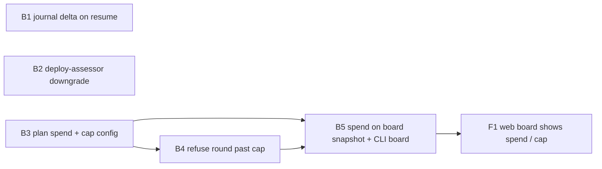

Not a refactor (no `implementation_requirement: refactor`, nothing moved or renamed), so the share check does not apply; about 12 of 1920 tracked files are touched (~0.6%), against the 50% threshold.

# Plan 062.00: Make Openlanes Cheaper

Three independent savings, plus the board surface for the third:

1. The journal in the prompt: a resumed session gets only entries newer than its last round.
2. deploy-assessor runs on sonnet when the diff is under a size threshold.
3. A dollar cap per plan: derived spend, refusal of a new round past the cap, shown on the board.

## Order and dependency graph

B1, B2 and B3 can run in parallel. B4 and B5 come after B3. B4 and B5 share no file, but B5's integration check runs through B4's refusal, so B5 goes after B4. F1 goes last.

## Backend

### B1 Journal delta on a resumed session

- **Discipline:** back end
- **Owns:** `lib/openlanes/execution/prompt.rb` (`journal_so_far`, `continuation`, `JOURNAL_LIMIT` comment), `spec/openlanes/execution/prompt_spec.rb`
- **Must not touch:** `lib/openlanes/execution/executor.rb` (B2), `lib/openlanes/plans/journal.rb`, `lib/openlanes/plans/plan_state.rb`
- **Depends on:** nothing
- **Shape:** `journal_so_far(since_round: nil)`. A fresh session gets the full journal, capped at `JOURNAL_LIMIT` as now. A resumed session (`Prompt#continuation`, or any prompt built for a `--resume`) gets only entries from rounds after the session's last round, plus one line saying how many earlier entries the session already holds and the `state show` command that reads them back. Override numbering stays global, so "overridden by N" stays correct.
- **Done when:** `prompt_spec.rb` shows that a resumed prompt for round 3, with journal rounds 1 to 3, lists only round 3 entries and the "already holds" line, and that a fresh prompt is unchanged.

### B2 deploy-assessor on sonnet for small diffs

- **Discipline:** back end
- **Owns:** `agents/deploy-assessor.md` (frontmatter only), `lib/openlanes/agents/agent.rb`, `lib/openlanes/agents/profile.rb`, `lib/openlanes/execution/executor.rb` (only the `Profile.resolve` call site near line 526), `spec/openlanes/agents/profile_spec.rb`, `spec/openlanes/agents/agent_spec.rb`
- **Must not touch:** `lib/openlanes/execution/prompt.rb` (B1), `lib/openlanes/engine/dispatcher.rb` (B4), `lib/openlanes/support/config.rb` (B3)
- **Depends on:** nothing
- **Shape:** a new frontmatter key, `small_diff: { under_lines: 300, model: sonnet, effort: medium }`, read by `Agent#small_diff`. `Profile.resolve(agent, ..., diff_lines: nil)` applies it when `diff_lines` is known and under the threshold, and only when no `run --model` or spec `phases.<phase>` override applies, since those outrank it. The executor counts `diff_lines` locally (`git diff --shortstat <base>...HEAD`, insertions plus deletions), with no network. The threshold lives in the agent's own frontmatter, because the routing facts belong in `agents/*.md`.
- **Done when:** `profile_spec.rb` covers a 120-line diff (sonnet/medium), a 900-line diff (opus/high), an unknown diff (opus/high), and an explicit `--model` that beats the downgrade. `agent_spec.rb` parses the key. `openlanes agents` still lists deploy-assessor.

### B3 Plan spend and the cap setting

- **Discipline:** back end
- **Owns:** `lib/openlanes/events/plan_spend.rb` (new), `lib/openlanes/support/config.rb` (the `budget.plan_usd` key), `schemas/` entry for that key if the config schema lists keys, `spec/openlanes/events/plan_spend_spec.rb`, `spec/openlanes/support/config_spec.rb`
- **Must not touch:** `lib/openlanes/engine/dispatcher.rb`, `lib/openlanes/engine/board.rb`, `lib/openlanes/live/snapshot.rb`
- **Depends on:** nothing
- **Shape:** `Events::PlanSpend.for(ordinal, events)` returns `Data.define(:ordinal, :usd, :unpriced_runs, :cap)`, plus `over?` and `share`. It sums `Usage#cost_usd` from the event journal and counts nil-cost runs as `unpriced_runs`, never as $0. Spend is derived and never stored, so nothing is written down twice. The cap is `budget.plan_usd` in `.openlanes.yml`, and leaving it unset means no cap. `PlanSpend.cap_for(config)` is the one place that reads it.
- **Done when:** `plan_spend_spec.rb` sums priced runs across agents and rounds for one plan, ignores other plans, reports unpriced runs separately, and answers `over?` at, below and above the cap. `config_spec.rb` reads the key and its absence.

### B4 Refuse a new round once a plan passes its cap

- **Discipline:** back end
- **Owns:** `lib/openlanes/engine/dispatcher.rb` (the assign step, or the `steps/` object that holds assignment if one exists by then), `spec/openlanes/engine/dispatcher_spec.rb`
- **Must not touch:** `lib/openlanes/events/plan_spend.rb` (B3), `lib/openlanes/engine/board.rb` (B5)
- **Depends on:** B3
- **Shape:** before assigning an agent to a plan, the dispatcher asks `PlanSpend`. A plan that is `over?` gets no agent. It is held the way queued plans are, with the reason `over budget: $X of $Y`, and no state is fired and no folder is renamed. A round already running finishes. The plan counts as not movable for the fixed-point check, so a run whose only remaining plans are over cap stops rather than spinning.
- **Done when:** `dispatcher_spec.rb` shows a plan with recorded spend past the cap is not assigned and is reported as held, a plan under the cap in the same tree is assigned, and a run with only over-cap plans reaches a fixed point.

### B5 Spend on the board (CLI board and live snapshot), the integration check

- **Discipline:** back end
- **Owns:** `lib/openlanes/engine/board.rb`, `lib/openlanes/live/snapshot.rb`, `spec/openlanes/engine/board_spec.rb`, `spec/openlanes/live/snapshot_spec.rb`, `spec/openlanes/integration/plan_budget_spec.rb` (new)
- **Must not touch:** `lib/openlanes/engine/dispatcher.rb` (B4), `web/` (F1)
- **Depends on:** B3, B4
- **Shape:** each plan row in the board gains `spend: { usd:, cap:, over:, unpriced_runs: }` (cap nil when unset). The CLI board prints `$1.84 / $5.00`, marks a plan over its cap, and prints `$1.84` alone with no cap.
- **Integration check (this unit owns it):** `plan_budget_spec.rb` builds a real `.plans` tree through `PlansFixture`, writes a real event journal with priced usage for one plan past `budget.plan_usd`, runs the dispatcher's assign step with a stub executor (the only double, since no agent may really start), then serves the live snapshot through the real web app (`Rack::Test` on `Web::App`, the events or board endpoint). It must show the over-cap plan held with the `over budget` reason, the under-cap plan assigned, and the snapshot JSON carrying both plans' `spend` with the right `usd`, `cap` and `over`.
- **Done when:** `board_spec.rb`, `snapshot_spec.rb` and `plan_budget_spec.rb` pass.

## Frontend

### F1 Web board shows spend against cap

- **Discipline:** front end
- **Owns:** `web/src/board/model.ts`, `web/src/board/Car.tsx`, `web/src/board/format.ts`, `web/src/board/board.css`, `web/src/board/model.test.ts`, `web/src/board/Car.test.tsx`
- **Must not touch:** `lib/` (B1 to B5), `web/src/board/Board.tsx` unless a row layout change truly needs it
- **Depends on:** B5 (the snapshot's `spend` shape)
- **Shape:** the plan card shows `$1.84 / $5.00` with a thin meter. Over the cap it shows a distinct over-budget style and the `over budget` hold reason. With no cap it shows the dollar figure alone. Unpriced runs show as `+N unpriced`, never folded in as $0.
- **Done when:** `model.test.ts` parses `spend` (with a cap, without one, and over it), `Car.test.tsx` renders all three states, and `just lint` plus the vitest suite are green.

## HTTP surface

No new route. The existing live snapshot or event stream payload gains a `spend` object per plan (B5). No `openapi.yaml` is needed, because the plan adds no endpoint and the snapshot is not described by one.

## Notes for the builder

- 060.00 plans builder sizing through `Agents::Profile` and 064.00 plans live per-plan cost on the board. Both overlap B2, B5 and F1 in files, which is a merge risk only. Whichever merges second rebases.
- Costs are estimates (`Usage` ignores cache reads and writes), and the board says "est." wherever it shows dollars.

## How to test

- Journal delta (B1): `bundle exec rspec spec/openlanes/execution/prompt_journal_spec.rb`. A resumed prompt lists only the new round's entries plus the "already holds" line; a fresh prompt is unchanged.
- deploy-assessor downgrade (B2): `bundle exec rspec spec/openlanes/agents`, then `./exe/openlanes agents`. deploy-assessor is still listed; a small diff resolves to sonnet/medium, a large or unknown one to opus/high, and `--model` wins.
- Plan spend and cap (B3, B4): `bundle exec rspec spec/openlanes/events/plan_spend_spec.rb spec/openlanes/engine/budget_spec.rb spec/openlanes/engine/dispatcher_budget_spec.rb`. Spend sums priced runs per plan, unpriced runs count apart, and a plan past `budget.plan_usd` is held with `over budget: $X of $Y` while one under the cap is assigned.
- Integration (B5): `bundle exec rspec spec/openlanes/integration/plan_budget_spec.rb`. The snapshot served through the web app carries `spend` for both plans.
- Web board (F1): `cd web && npx vitest run src/board`. With a cap a plan row shows `est. $1.84 / $5.00` and a meter; over the cap it turns red with `over budget`; with no cap only the figure; unpriced runs show as `+N unpriced`.
- Everything: `bundle exec rspec`, `bundle exec rubocop` and `cd web && npx vitest run` all exit 0.
