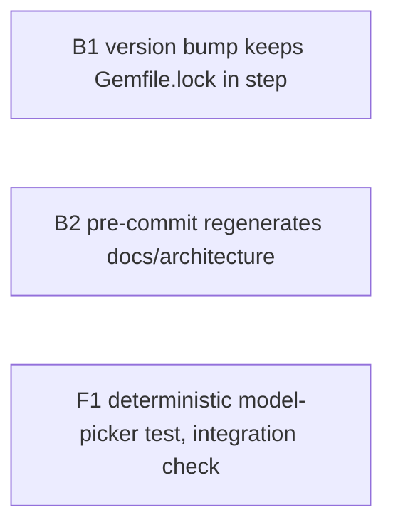

Not a refactor: 7 of 1,920 tracked files (under 1%), and well under 1% of lines; threshold 50% (unset in `.openlanes.yml`).

# Plan 063.00: Make OpenLanes More Reliable

Three independent fixes, one pull request. None waits on another plan (`depends_on: [none]`).

## What the planner found

- **No version-bump recipe exists.** `justfile` has `version`, `publish` and `release`, nothing that changes `VERSION`. `origin/main` already has `Gemfile.lock` at `openlanes (4.0.1)`, so the drift the spec names was fixed by hand. The fix is a recipe that cannot leave the lock behind, plus a spec that fails whenever the two disagree.
- **`lefthook.yml` is a stale copy from a Rails app.** Its `format`, `rubocop` and `rspec` jobs use `root: "frontend/"` and `root: "rails/"`, which don't exist here, so only `gitleaks` ever runs. The new job goes at the repository root. Repairing the three dead jobs is out of scope (see B2).
- **The flaky test** is `keyboard.cy.ts`, "switches an agent's model from its drawer with the arrow keys". Its `choose` helper reads `document.activeElement` once per key, with no retry, so it can read focus before the previous key has landed. Its own comment says so.

## Order and dependency graph

All three units are independent and may run at the same time: no file has two owners.

## Backend

### B1 Version bump that regenerates Gemfile.lock

- **Discipline:** back end.
- **Owns:** `justfile` (a new `bump version` recipe only), `bin/bump-version` (new), `spec/openlanes/release/bump_version_spec.rb` (new), `spec/openlanes/release/lockfile_version_spec.rb` (new).
- **Must not touch:** `lefthook.yml`, `web/**`, `lib/openlanes/version.rb` (the script edits it when run; the unit does not commit a bump).
- **Depends on:** nothing.
- **Shape:** `just bump <version>` calls `bin/bump-version <version>`. The script rejects anything that isn't `MAJOR.MINOR.PATCH`, rewrites `VERSION` in `lib/openlanes/version.rb`, then runs `bundle lock` so the `openlanes (x.y.z)` lines in `Gemfile.lock` follow. It fails non-zero if the lock still disagrees afterwards. `--dry-run` prints what it would change and writes nothing.
- **Done when:**
  - `spec/openlanes/release/bump_version_spec.rb` runs the script against a temp copy of `version.rb`, `Gemfile`, `Gemfile.lock` and `openlanes.gemspec`, and shows that both files carry the new version, that a malformed version is refused, and that `--dry-run` leaves both files unchanged.
  - `spec/openlanes/release/lockfile_version_spec.rb` asserts every `openlanes (…)` entry in the real `Gemfile.lock` equals `OpenLanes::VERSION`, so a bump made any other way fails the suite.

### B2 Pre-commit regenerates the architecture docs when lib/ changes

- **Discipline:** back end.
- **Owns:** `lefthook.yml` (one new job only), `spec/openlanes/support/lefthook_spec.rb` (new).
- **Must not touch:** `justfile`, `docs/architecture/before/**`, `lib/**`, `web/**`.
- **Depends on:** nothing.
- **Shape:** a `pre-commit` job named `architecture`, at the repository root, `glob: "lib/**/*.rb"`, that runs `just update-architecture` and then `git add docs/architecture`. lefthook's `stage_fixed` only restages the matched staged files, so it would miss the regenerated docs; the job has to stage them itself. Because `parallel: true` is set, the job must not edit anything another job reads.
- **Out of scope:** the dead `format`, `rubocop` and `rspec` jobs. Note them in the PR description as a follow-up instead of fixing them here.
- **Done when:** `spec/openlanes/support/lefthook_spec.rb` loads `lefthook.yml` and asserts the `architecture` job exists, has no `root`, globs `lib/**/*.rb`, and runs `just update-architecture` and stages `docs/architecture`. Manual check, recorded in the PR: in a scratch branch, touch a class in `lib/`, `git commit`, then confirm `docs/architecture/` changes are in the commit and `spec/openlanes/docs/architecture_doc_spec.rb` passes.

### B2 Block (answered) — Permission to edit lefthook.yml

B2's `lefthook.yml` edit was refused by the agent permission layer, because git hooks run code on every commit. Everything else in B2 is done, and `spec/openlanes/support/lefthook_spec.rb` fails (5 examples) until the job exists.

### D2 (decision) — Permission to edit lefthook.yml

Answered:

- 2026-11-12
- By hermes

Grant the agent permission to edit `lefthook.yml`, then rerun backend-coder. It adds one job under `pre-commit.jobs`, before `gitleaks`: name `architecture`, no `root`, glob `lib/**/*.rb`, run `just update-architecture && git add docs/architecture`, no `stage_fixed`. It then runs the manual commit check in the Done when above. The three dead jobs (`format`, `rubocop`, `rspec`) stay out of scope.

## Frontend

### F1 Deterministic model-picker keyboard test (integration check)

- **Discipline:** front end.
- **Owns:** `web/cypress/e2e/keyboard.cy.ts` (the "switches an agent's model…" example only), and `web/cypress/support/e2e.ts` only if a shared helper is cleaner.
- **Must not touch:** `web/src/**` unless the test shows a real product bug, and then only the model picker component, with that bug named in the PR. Also `justfile`, `lefthook.yml`, `lib/**`.
- **Depends on:** nothing.
- **Shape:** each arrow key waits on a retrying Cypress assertion that focus has moved, for example `cy.focused()` with `should` on the option's text or `aria-selected`, before deciding on the next key. No one-shot `cy.document()` reads of `activeElement`, and no fixed `cy.wait`. The test still drives only the keyboard.
- **Integration check:** this unit runs against the real demo server started by `bin/web-e2e`, with nothing stubbed. It must show three things: the drawer opens with the keyboard, the listbox reaches Opus 5.5 by arrow keys, and after Enter, `/api/board` reports `claude-opus-5-5` for `005.00/staff-reviewer` and the drawer reads "Model Opus 5.5".
- **Done when:** `web/cypress/e2e/keyboard.cy.ts` passes 10 consecutive runs (`just web-e2e`, limited to that spec), and the full `just web-e2e` is green once. Record the 10-run result in the PR.

## HTTP surface

No. The plan adds and changes no HTTP API. F1 only reads the existing `/api/board`.

## How to test

Run from the repository root, with `eval "$(rbenv init -)"` active.

- B1, version bump:
  - `bundle exec rspec spec/openlanes/release` passes: the script bumps both `version.rb` and `Gemfile.lock` in a temp copy, refuses a malformed version, and `--dry-run` writes nothing.
  - `bin/bump-version --dry-run 9.9.9` prints the planned changes and `git status` shows no new modification.
- B2, pre-commit architecture job:
  - `bundle exec rspec spec/openlanes/support/lefthook_spec.rb` passes once the `architecture` job is in `lefthook.yml`.
  - On a scratch branch, change a class under `lib/` and `git commit`: the commit also contains the regenerated `docs/architecture/` files, and `bundle exec rspec spec/openlanes/docs/architecture_doc_spec.rb` passes.
- F1, model-picker keyboard test:
  - `just web-build`, then `just web-e2e`: all 9 specs pass (37 examples), including `keyboard.cy.ts`.
  - In `keyboard.cy.ts` the model-picker example opens the drawer, reaches Opus 5.5 with the arrow keys, and after Enter the drawer reads "Model Opus 5.5".
- Whole build: `bundle exec rspec` and `bundle exec rubocop` exit 0.
