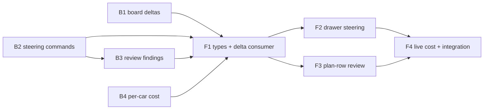

Not a refactor (no `implementation_requirement: refactor`, nothing moved or renamed), so no share is measured; threshold 50 percent (unset in `.openlanes.yml`).

# Plan 064.00: Make OpenLanes more interactive

Four features from `spec.md`, each a back-end unit with a matching front-end unit:

1. Board deltas over the existing event stream (`Web::Events`), in place of full snapshots.
1. Steering a running agent from its drawer: send a note, extend time, stop after this step.
1. The diff and the reviewers' findings in the plan row, with accept and strike buttons that feed the arbitrator.
1. Cost and elapsed time per plan and per agent, live.

## Found already in the code (verify, do not rebuild)

- `Live::Command::KINDS` already has `message` (send a note), `wrap_up`, `hold` and `stop`. `AgentDrawer.tsx` sends `message` today.
- `Execution::Clock#extend!` and `Dispatcher` (`job.handle&.extend!(seconds)`, `dispatcher.rb:326`) exist. No page command reaches them yet.
- Plan rows already carry `up`, `down`, `cost` and `elapsed` (`web/src/api/types.ts`). Cars carry `up`, `down` and `elapsed`, but no `cost`.
- `set_concurrency` is wired end to end.

B2 starts by checking what `wrap_up` does to a running agent. "Stop after this step" has to mean "finish the current step, sign, exit". If `wrap_up` already does that, the button sends `wrap_up`. If it doesn't, B2 adds a `stop_after_step` kind.

## Order and dependency graph

- B1, B2 and B4 can run at the same time. B3 comes after B2, because both edit `live/command.rb`, `live/commands.rb` and `web/demo_board.rb`.
- F1 owns every change to `web/src/api/types.ts`, so it comes first on the front end.
- F2 and F3 can run at the same time.
- F4 comes after F2 (both edit `AgentDrawer.tsx`) and after F3 (both edit `PlanRow.tsx`).

## Backend

### B1 Board deltas on the event stream

- **Discipline:** back end
- **Owns:** `lib/openlanes/live/board_delta.rb` (new: `BoardDelta.diff(before, after) -> { upsert: [plan/node hashes], remove: [keys] }`), `lib/openlanes/web/events.rb`, `spec/openlanes/live/board_delta_spec.rb`, `spec/openlanes/web/events_spec.rb`
- **Must not touch:** `live/command.rb`, `live/commands.rb`, `live/snapshot.rb`, `engine/board.rb`, anything under `web/`
- **Depends on:** nothing
- **Done when:** `spec/openlanes/live/board_delta_spec.rb` and `spec/openlanes/web/events_spec.rb` pass. A stream sends one full `board` frame on connect, or on a resume whose `Last-Event-ID` it can't honor, and after that only `board_delta` frames, each carrying a `base` seq. A delta that wouldn't be smaller than the board is sent as a full `board`.

### B2 Steering commands: extend time, stop after this step

- **Discipline:** back end
- **Owns:** `lib/openlanes/live/command.rb` (adds `extend_time`, payload `seconds`, a plan and agent kind; adds `stop_after_step` only if the `wrap_up` check calls for it), `lib/openlanes/live/commands.rb` (handler that reaches `Dispatcher`/`job.handle.extend!`, capped like `Engine::Extensions` caps grants), `lib/openlanes/web/demo_board.rb` (the same handlers for the demo), `spec/openlanes/live/command_spec.rb`, `spec/openlanes/live/commands_spec.rb`, `spec/openlanes/web/demo_board_spec.rb`
- **Must not touch:** `web/events.rb`, `live/snapshot.rb`, `engine/board.rb`, anything under `web/`
- **Depends on:** nothing
- **Done when:** the three specs pass. `extend_time` against a running car moves its `Clock` deadline and writes the `WARN: ... time was extended` line to the control file. Against a car that isn't running, it replies with a refusal and doesn't raise. The `wrap_up` finding is written as one sentence in `contract.md`.

### B3 Review findings and diff, with accept/strike rulings

- **Discipline:** back end
- **Owns:** `lib/openlanes/web/plan_review.rb` (new: the branch diff against the base, `git diff --stat` plus the patch, size-capped, and the reviewers' findings read from `PlanState`), the route in `lib/openlanes/web/app.rb` (`GET /api/plans/:ordinal/review` → `{ diff: { stat, patch, truncated }, findings: [{ id, reviewer, severity, file, line, text, ruling }] }`), a `rule_finding` command kind (payload `finding`, `verdict: accept|strike`) in `live/command.rb`, `live/commands.rb` and `web/demo_board.rb` that records a person's ruling in `PlanState` where `Engine::Arbitration` reads rulings, `contract.md`, `openapi.yaml`, `spec/openlanes/web/plan_review_spec.rb`, plus additions to the B2 specs
- **Must not touch:** `web/events.rb`, `live/snapshot.rb`, `engine/board.rb`, anything under `web/`
- **Depends on:** B2 (the same three files)
- **Done when:** `spec/openlanes/web/plan_review_spec.rb` and `spec/openlanes/engine/arbitration_spec.rb` pass. A struck finding is recorded as a person's ruling, and `Arbitration#triggered` stops treating that finding as disputed. An accepted finding stays one the builder must address.

### B4 Live cost per agent

- **Discipline:** back end
- **Owns:** `lib/openlanes/engine/board.rb` (a `cost` field on `Row`, priced from the adapter's rates the way the plan total already is), `lib/openlanes/live/snapshot.rb` (puts `cost` on each car), `lib/openlanes/live/meter.rb` if the per-invocation figure has to come from there, `spec/openlanes/engine/board_spec.rb`, `spec/openlanes/live/snapshot_spec.rb`
- **Must not touch:** `web/events.rb`, `live/command.rb`, `live/commands.rb`, anything under `web/`
- **Depends on:** nothing
- **Done when:** both specs pass. A car's `cost` rises with its tokens. A plan's `cost` equals the sum of its cars' costs plus the spend `Meter` keeps for rows that have already left the board.

## Frontend

### F1 Types and the delta consumer

- **Discipline:** front end
- **Owns:** `web/src/api/types.ts` (`BoardDelta`, `Car.cost`, the `extend_time`, `rule_finding` and optional `stop_after_step` command kinds, `PlanReview`), `web/src/api/events.ts`, `web/src/api/useBoard.ts`, `web/src/api/events.test.ts`, `web/src/api/useBoard.test.tsx`
- **Must not touch:** `web/src/panels/*`, `web/src/board/*`
- **Depends on:** B1, B2, B3, B4 (their wire shapes in `contract.md`)
- **Done when:** `events.test.ts` and `useBoard.test.tsx` pass. A `board_delta` frame is applied onto the cached board. A delta whose `base` doesn't match the cached seq triggers a fresh full board rather than being applied.

### F2 Steering from the agent drawer

- **Discipline:** front end
- **Owns:** `web/src/panels/AgentDrawer.tsx`, `web/src/panels/AgentActionMenu.tsx`, `web/src/panels/command.ts`, `web/src/panels/AgentDrawer.test.tsx`
- **Must not touch:** `web/src/api/types.ts`, `web/src/board/*`
- **Depends on:** F1
- **Done when:** `AgentDrawer.test.tsx` passes. The drawer of a running car offers send a note (existing), extend time (+10 and +20 minutes), and stop after this step. Each sends its command and shows the reply. The buttons don't appear for a car that isn't running.

### F3 Diff and findings in the plan row

- **Discipline:** front end
- **Owns:** `web/src/api/planReview.ts` (new: query for `GET /api/plans/:ordinal/review`), `web/src/board/PlanReview.tsx` (new), `web/src/board/PlanReview.test.tsx`, `web/src/board/PlanRow.tsx`, `web/src/board/board.css`
- **Must not touch:** `web/src/api/types.ts`, `web/src/panels/*`
- **Depends on:** F1
- **Done when:** `PlanReview.test.tsx` passes. A plan with a pull request shows its diff stat, an expandable patch, and its findings. Accept or Strike sends `rule_finding`, and the finding's ruling updates.

### F4 Live cost and elapsed, plus the integration check

- **Discipline:** front end
- **Owns:** `web/src/board/Car.tsx`, `web/src/board/Car.test.tsx`, cost lines in `web/src/board/PlanRow.tsx` and `web/src/panels/AgentDrawer.tsx`, `web/src/board/format.ts`, `web/cypress/e2e/interactive.cy.ts` (new)
- **Must not touch:** `web/src/api/*`
- **Depends on:** F2 and F3 (they also edit `AgentDrawer.tsx` and `PlanRow.tsx`)
- **Done when:** `Car.test.tsx` passes, and the integration check below passes.

**Integration check (owned by F4):** `web/cypress/e2e/interactive.cy.ts` runs against the real `openlanes web` server on its demo board. The event stream and the HTTP routes are not stubbed. It must show:

- after the first full board, a car's tokens, cost and elapsed advance through `board_delta` frames, with no second `board` frame;
- Extend time on a running car's drawer gets the engine's reply, and the car's remaining time grows;
- Strike on a finding in a plan row returns that finding with `ruling: strike` after a reload;
- the plan row's cost equals the sum of its cars' costs.

## How to test

Run from the repository root, with Redis on `localhost:6379` (the demo and the e2e suite use db 14).

1. Ruby suite and lint, which cover B1 to B4 (`spec/openlanes/live/board_delta_spec.rb`, `spec/openlanes/web/events_spec.rb`, `spec/openlanes/live/command_spec.rb`, `spec/openlanes/live/commands_spec.rb`, `spec/openlanes/web/demo_board_spec.rb`, `spec/openlanes/web/plan_review_spec.rb`, `spec/openlanes/engine/arbitration_spec.rb`, `spec/openlanes/engine/board_spec.rb`, `spec/openlanes/live/snapshot_spec.rb`):
   - `bundle exec rspec` → `5975 examples, 0 failures`, exit 0, and a line coverage figure of at least 95 (`jq '.total.lines.percent' coverage/coverage.json` prints about 99).
   - `bundle exec rubocop` → `no offenses detected`.
1. Front-end unit tests, lint and types, which cover F1 to F4 (`boardDelta.test.ts`, `events.test.ts`, `useBoard.test.tsx`, `AgentDrawer.test.tsx`, `PlanReview.test.tsx`, `Car.test.tsx`):
   - `cd web && npm run lint && npm run typecheck && npx vitest run` (or `just web-test`) → all pass, 538 tests, no lint or type errors.
1. The integration check, Cypress against two real demo servers, nothing stubbed:
   - `just web-build && just web-e2e` (`bin/web-e2e` starts both `openlanes web --demo` servers and runs every spec), or only this plan's spec: `cd web && npx cypress run --spec cypress/e2e/interactive.cy.ts` with the `baseUrl`, `peer` and `plansDir` settings `bin/web-e2e` passes.
   - Expect `interactive.cy.ts` to report `4 passing`: a car advances through `board_delta` frames after one `board` frame; Extend time gets the engine's reply; a struck finding stays struck after a reload; a plan's cost is at least the sum of its cars' costs.
1. By hand, on the demo board:
   - `bundle exec exe/openlanes web --demo --no-open --port 11000`, then open `http://127.0.0.1:11000/`.
   - `curl -sN --max-time 6 http://127.0.0.1:11000/api/events | grep '^event:'` → exactly one `event: board`, then only `event: board_delta` lines (B1, F1).
   - Open a running car (click the agent's name on a car whose token count is moving). Its drawer offers `Extend time +10 min`, `Extend time +20 min` and `Stop after this step`; pressing Extend time shows a reply containing `more minutes`. Open a car that is not running: the three buttons are absent (B2, F2).
   - `curl -s http://127.0.0.1:11000/api/plans/<ordinal>/review` for a plan on the board → JSON with `diff.stat`, `diff.patch`, `diff.truncated` and a `findings` array; each finding has `id`, `reviewer`, `severity`, `file`, `line`, `text`, `ruling` (B3).
   - In a plan row with a pull request, press `Review`: the diff stat, an expandable patch and the findings appear. Press `Strike` on one finding: it shows `Struck`, and still does after reloading the page; `Accept` leaves it as one the builder must address (B3, F3).
   - Each running car shows `Cost so far` and elapsed time that rise with its tokens; the plan row's `Cost so far` is at least the sum of its cars' costs (B4, F4).

## HTTP surface

Yes. B3 adds `GET /api/plans/:ordinal/review`. B2 and B3 add the command kinds `extend_time` and `rule_finding` (and `stop_after_step` if needed) to the existing command endpoint. B1 adds the `board_delta` frame to the event stream. B3 writes `openapi.yaml` beside `contract.md`, covering the route, the new command payloads and the frame shape.

## Rebase decisions

Rebase of this branch onto `origin/main` (2026-11-12). One line per file, with the reason.

- `.openlanes.yml`: kept main's `coverage:` block; same keys, only the order differed.
- `.plans/064.00…/plan.md`, `pull-requests.md`, `state.json`: kept the branch's versions; main's side held none of this plan's later work (How to test, the full-suite rerun, the later stages and mail), only an older timestamp.
- `.plans/068.00…/state.json`: kept main's file; the branch never had plan 068, so the "deleted by them" side was only the branch's older base.
- `lib/openlanes/engine/dispatcher.rb`: kept main's `running` and `feed` accessors and applied the branch's change on top: `extend` returns whether a running agent's clock moved, and records the feed entry only when it did.
- `lib/openlanes/live/command.rb`, `commands.rb`: kept both kinds: main's `set_chime` plus the branch's `extend_time` and `rule_finding`.
- `lib/openlanes/live/snapshot.rb`: kept the branch's `row.up.to_i, row.down.to_i`; the same cost calculation as main, tolerant of nil tokens.
- `lib/openlanes/live/store.rb`: kept main's Monitor lock with its `failed_at` and `guarded`/`talk` handling; it covers what the branch's plain `@lock.synchronize` did, and drops the branch's duplicate.
- `lib/openlanes/web/demo_board.rb`: kept main's `spend` (prices at the car's model from the adapter catalogue) and removed the branch's `DEMO_RATES`; main says a car's cost is never a second rate table.
- `spec/spec_helper.rb`: kept both env lines (`OPENLANES_MODELS_OFFLINE`, and deleting `OPENLANES_ADMIN_CREDENTIALS`).
- `docs/architecture/README.md`, `openlanes-live.md`, `openlanes-web.md`: generated; took main's, then ran `just update-architecture`.
- `web/src/api/fixtures/board.json`, `snapshot.json`, `snapshot-outage.json`: kept main's cost figures; they come from main's per-model pricing.
- `web/src/api/types.ts`: removed the branch's second `cost?` on `Car`, which duplicated main's.
- `web/src/board/Car.tsx`: kept main's Round/elapsed block and `SpendBadge`, and added the branch's per-car `Cost so far` span before it.
- `web/src/board/Car.test.tsx`: kept both describe blocks (`SpendBadge`, and the car cost).
- `web/src/board/PlanRow.tsx`: kept main's `onUnblock` and `.plan-cost` span, and added the branch's `onCommand` and `PlanReview` imports. The branch's plan-level `Cost so far` span is dropped; main's `.plan-cost` shows the same figure.
- `web/cypress/e2e/interactive.cy.ts`: selector for the plan total changed from `.plan-meta [title='Cost so far']` to `.plan-meta .plan-cost`, parsed as digits and dots, because main's span has a screen-reader prefix.
- `web/src/panels/AgentDrawer.tsx`: kept main's Cost line (`n/a` when unreported, via `dollars`); dropped the branch's `cost` import and conditional line.

Checked after resolving: `bundle exec rspec` on live, web, dispatcher, arbitration, run_workflow, routing, findings and docs specs (1134 examples, 0 failures), `rubocop` clean, `npx vitest run` (581 passed).

- `.plans/064.00…/pull-requests.md`, `state.json` (second replay, commit "Make Openlanes More Interactive"): kept the side already on HEAD (`in_review`, design-reviewer stage, findings F201-F204); the replayed commit carried an older `building` snapshot of the same files, and taking it would roll the plan state back.

- `docs/architecture/README.md` (this replay): generated; took main's side to clear the markers, then regenerated with `openlanes uml self --directory docs/architecture`. Result: `Vcs ..> UI : 6` (main) and `Web ..> OpenLanes : 12` (branch adds callers). `architecture_doc_spec` passes.
