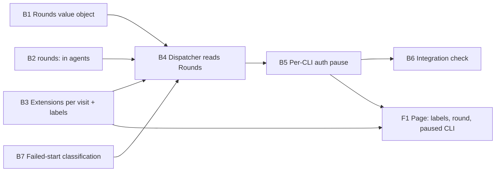

Not a refactor (no `implementation_requirement: refactor`; it changes behaviour in about 25 of the tracked files, well under the 50 percent `refactor.threshold` by file count and by line count), so `concurrent`.

# Plan: Durable Round Ledger

## Decisions on the spec's open questions

- **Budget per visit.** A round budget is counted per visit to a state, and a visit is identified by the plan's `moves` count at the time the round ran. A plan sent back from review starts that state fresh. Extension grants are scoped to the same visit, so they survive a restart and expire when the plan moves.
- **Defaults.** Coders (backend, frontend, chores) 3; planner, spec-writer, researcher and every reviewer 2; unblocker, rebaser, arbitrator, verifier, copilot and the assessors 1. Each `agents/*.md` states its own `rounds:`. The frontmatter is the source of truth, and the table is generated from it by `openlanes docs`, never hand-written.
- **Failed starts.** A failed start (no tokens in, none out, no tool call, not killed) is recorded as a stage with status `Failed start` and costs no round. If it was an authentication failure, the CLI is paused until its probe passes and then the same round is handed out again. Any other failed start is retried on the next tick, and after 3 consecutive failed starts by the same agent in the same visit the engine raises an attention request instead of trying again. Without that cap a broken CLI would loop forever at no cost.
- **Dispatcher split (PR 205).** No plan builds it, so it is not a `depends_on:`. It is a merge risk on `dispatcher.rb`: if 205 has merged when B4 starts, B4 and B5 land in `Dispatcher::Start`, `Settle` and `Assign`. Otherwise they edit `dispatcher.rb` in place and rebase over 205 later.
- `Failed start` is a ledger status and not a `Plans::Status`. The folder vocabulary and the state machine are untouched.

## Order and dependency graph

B1, B2, B3 and B7 run in parallel. B4 and B5 both write `dispatcher.rb`, so they run one after the other. F1 starts once B5 has fixed the snapshot shape.

## Backend

### B1 `Plans::Rounds`, built from `state.json`

- **Discipline:** back end.
- **Owns:** `lib/openlanes/plans/rounds.rb` (new), `lib/openlanes/plans/plan_state.rb` (`stage!` records `from:` and `moves:`; adds the `Failed start` status), `schemas/plan-state.schema.json`, `spec/openlanes/plans/rounds_spec.rb`, `spec/openlanes/plans/plan_state_spec.rb`.
- **Must not touch:** `engine/`, `execution/`, `agents/`.
- **Depends on:** nothing.
- **Shape:** `Rounds.from(plan_state)` is a `Data.define` value. It answers `used(agent, state, moves:)`, `next(agent, state, moves:)` and `left(agent, state, moves:, budget:)`. `Failed start` stages count toward none of the three. Stages written before this change carry `to` with no `from`/`moves`; they are read as the visit that `to` implies, so an old plan never sees its round number go down.
- **Done when:** `spec/openlanes/plans/rounds_spec.rb` (counts per visit, failed starts ignored, legacy stages, never lower than the highest round already signed) and `spec/openlanes/plans/plan_state_spec.rb` pass.

### B2 `rounds:` in every agent, defaults in one generated table

- **Discipline:** back end.
- **Owns:** `agents/*.md` (frontmatter `rounds:` only), `lib/openlanes/agents/registry.rb`, `lib/openlanes/agents/agent.rb`, `lib/openlanes/presentation/documentation.rb` (rounds table section), `docs/WORKFLOW.md` (regenerated), `docs/USAGE.md` (points at the table), `spec/openlanes/agents/registry_spec.rb`, `spec/openlanes/agents/rounds_frontmatter_spec.rb` (new).
- **Must not touch:** `engine/`, `plans/`.
- **Depends on:** nothing.
- **Done when:** `rounds_frontmatter_spec.rb` fails for any `agents/*.md` that omits `rounds:`, `registry_spec.rb` passes, and the documentation spec shows the table built from the registry.

### B3 Extensions survive a restart; labels say what they grant

- **Discipline:** back end.
- **Owns:** `lib/openlanes/engine/extensions.rb` (grants keyed by agent, state and `moves`; `@since` removed; choice labels "One more round", "One more round with 10 extra minutes", "One more round with 20 extra minutes" on a rounds request, and labels on a time request that name their own grant), `lib/openlanes/live/commands.rb` (accepts the new labels and the old ones), `spec/openlanes/engine/extensions_spec.rb`, `spec/openlanes/live/commands_spec.rb`.
- **Must not touch:** `dispatcher.rb`, `web/`.
- **Depends on:** nothing.
- **Done when:** `extensions_spec.rb` shows a grant from a previous engine process still counts for the same visit and stops counting after a move, and every choice's label matches what `seconds:` and the round grant give.

### B7 Classify a failed start

- **Discipline:** back end.
- **Owns:** `lib/openlanes/execution/executor.rb` (a `failed_start?` predicate on the result, sharing the test `lost_session` uses, plus an `auth_failure?` reason taken from the adapter's own words, e.g. `OAuth session expired`, `not signed in`), `lib/openlanes/adapters/*.rb` (each adapter's auth-failure patterns only), `spec/openlanes/execution/executor_failed_start_spec.rb` (new).
- **Must not touch:** `engine/`, `plans/`.
- **Depends on:** nothing.
- **Done when:** `executor_failed_start_spec.rb` classifies a 2-second `OAuth session expired` exit as a failed auth start, and a killed run or one with tokens as a real failure.

### B4 The dispatcher numbers and budgets rounds from `Rounds` only

- **Discipline:** back end.
- **Owns:** `lib/openlanes/engine/dispatcher.rb` (or `Dispatcher::Start`, `Settle`, `Assign` if PR 205 has merged), `lib/openlanes/engine/recovery/*.rb`, `lib/openlanes/engine/state_file.rb`, `spec/openlanes/engine/dispatcher_rounds_spec.rb` (new), `spec/openlanes/engine/dispatcher_reattach_spec.rb`.
- **Must not touch:** `plans/rounds.rb`, `extensions.rb`, `executor.rb`, `web/`.
- **Depends on:** B1, B2, B3, B7.
- **Shape:** `@history` goes. `start`, `eligible?` and `out_of_rounds` ask `Rounds` (plus the B3 grants). The round put in the prompt is the one `settle` matches, so a signature for the round the agent was told is accepted. `settle` writes a `Failed start` stage for a B7 failed start and spends no round, and it applies the cap of 3 consecutive failed starts. `Recovery::Reattach` takes its round from `Rounds` too.
- **Done when:** `dispatcher_rounds_spec.rb` (told round == signed round == board round, failed start costs nothing, the 3-strike attention request) and `dispatcher_reattach_spec.rb` pass.

### B5 Pause one CLI after an authentication failure

- **Discipline:** back end. Runs after B4, since both write `dispatcher.rb`.
- **Owns:** `lib/openlanes/engine/cli_pause.rb` (new: paused CLIs, their reason, and a probe re-run with backoff through `Adapters::Probes`), `lib/openlanes/engine/dispatcher.rb` (assignment skips agents on a paused CLI; `idle_reason` names the CLI and why), `lib/openlanes/live/snapshot.rb` (adds `paused_clis: [{adapter, reason, since}]` and each running agent's round from `Rounds`), `spec/openlanes/engine/cli_pause_spec.rb` (new), `spec/openlanes/engine/dispatcher_outage_spec.rb`.
- **Must not touch:** `executor.rb`, `extensions.rb`, `web/`.
- **Depends on:** B4.
- **Done when:** `cli_pause_spec.rb` and `dispatcher_outage_spec.rb` show that after one auth failure on `claude` no further `claude` agent starts until the probe passes, a `codex` agent still starts, and the idle line reads `idle: claude paused: OAuth session expired; waiting for claude auth status`.

### B6 Integration check: restart and outage, end to end

- **Discipline:** back end.
- **Owns:** `spec/openlanes/engine/restart_rounds_spec.rb` (new), `spec/support/fake_cli/` (new: a scripted executable that stands in for `claude`).
- **Must not touch:** anything under `lib/`.
- **Depends on:** B5.
- **Must show:** nothing in `lib/` is stubbed. A real `Runner` and `Dispatcher` over a `PlansFixture` tree drive the fake CLI through the real `Executor`.
  1. Round 1 is signed, the engine is stopped and started again, and the agent is told round 2 and signs it. The rounds left equal the budget minus 1, and no stage reads `no closing ledger line`.
  1. The fake CLI fails authentication three times. Every round is still unspent, no further `claude` agent starts, the idle line names the pause, and once the probe passes the same round is handed out.
  1. `GET` on the live snapshot returns the round the agent was told and `paused_clis` as F1 renders them.
- **Done when:** `bundle exec rspec spec/openlanes/engine/restart_rounds_spec.rb` passes.

## Frontend

### F1 The page shows the ledger's round, the paused CLI and honest labels

- **Discipline:** front end.
- **Owns:** `web/src/panels/NeedsYou.tsx`, `web/src/panels/NeedsYou.test.tsx`, `web/src/panels/AgentDrawer.tsx`, `web/src/panels/AgentDrawer.test.tsx`, `web/src/api/types.ts`, a new banner component `web/src/panels/PausedCliBanner.tsx` with its test, and `web/cypress/e2e/round-ledger.cy.ts` (new).
- **Must not touch:** `lib/`, `spec/`.
- **Depends on:** B3 (labels), B5 (snapshot shape).
- **Done when:** `npx vitest run` covers the new labels, the round taken from the snapshot, and the banner for `paused_clis`, and `bin/web-e2e` runs `round-ledger.cy.ts` against the live server, showing the paused-CLI banner and the three rounds-request choices.

## HTTP surface

Yes, a change to an existing response: the live snapshot gains `paused_clis` and each running agent's ledger round (B5). There is no new route. `backend-coder` writes `openapi.yaml` beside `contract.md` describing the snapshot fields added.

## Task completed when

- Stopping and restarting `ol start` mid-plan continues each agent at its next round number, with the rounds left unchanged
- An agent whose `claude` call fails to authenticate three times in a row still has every round it started with
- After a failed authentication the engine starts no further agent on that CLI until a probe succeeds, and says so in its idle line
- A signature for the round the agent was told is accepted; `no closing ledger line` is never reported for a round that signed
- Each agent definition states `rounds:`, and the defaults are written down in one table
- The three choices on a request say what each one grants

## How to test

- bundle exec rspec spec/openlanes/engine spec/openlanes/plans spec/openlanes/execution
- bundle exec rspec spec/openlanes/engine/restart_rounds_spec.rb
- cd web && npx vitest run && cd .. && bin/web-e2e
