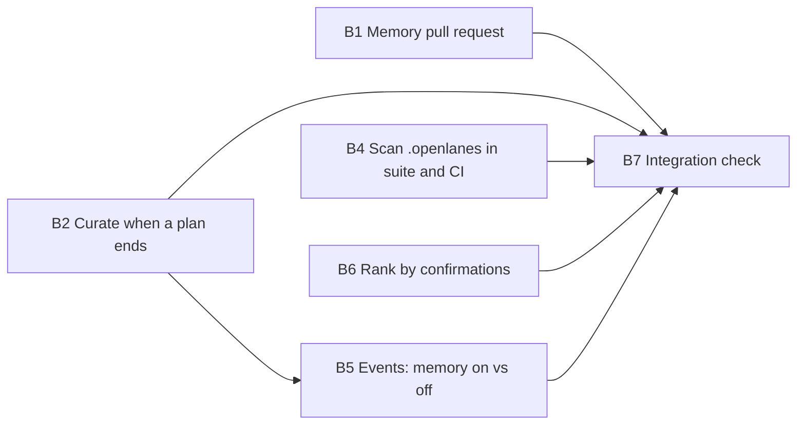

Not a refactor (no `implementation_requirement: refactor`, nothing moved or renamed across the codebase): file share and line share not applicable, threshold 50%.

# Plan 066.00: Project memory, the writer

## What already exists, and what this plan adds

Pull requests 196 and 218 are merged. `lib/openlanes/memory/` already holds `Lesson`, `Library`, `Section`, `Committed`, `Folder`, `Inbox`, `Candidate`, `Proposal`, `Curation`, `Promotion` and `Secrets`; `agents/curator.md` exists; `openlanes memory list|curate|inbox|approve|promote|scan` exist. Every unit below builds on those classes. No unit adds a second lesson format, a second reader or a second secret scanner.

What is missing is the wiring:

1. Promotion writes lesson files into the working tree but opens no pull request.
2. Nobody runs the curator when a plan ends: it is manual (`openlanes memory curate NNN`).
3. `--no-memory` gates the read side only.
4. Nothing scans the committed `.openlanes/` folder in the suite or CI, and nothing asserts it is not ignored.
5. The events report cannot tell a run with memory from one without.
6. Ranking: `Library#for` ranks by `confirmed:` date. It does not yet rank by how many plans confirmed a lesson.

## Decisions on the spec's open questions

- **Promotion:** a candidate seen in `Promotion::THRESHOLD` (2) plans, or approved by a person (`openlanes memory approve`), is promoted. That is what the completion criteria ask for, and it is already the arithmetic in `Promotion`. A person still merges every memory pull request, so the curator never gets the last word.
- **Bundled or separate:** always separate. The requirement is "every change to `lessons/` reaches `main` as its own pull request". The memory PR's branch is cut from the default branch, so it carries only `.openlanes/memory/` changes.
- **`usage.json`:** this plan does not build it. Confirmations, the only count the requirements ask for, live in the lesson file (`sources:` and `confirmed:`), which changes only through a reviewed memory PR, so it does not churn. A per-run citation counter, if one is ever built, belongs in the XDG state directory (`$XDG_STATE_HOME/openlanes/`), never in `.openlanes/`. This is recorded in `docs/continuous-learning.md` (unit B4).

## Order and dependency graph

- B1, B2, B4 and B6 start in parallel.
- B5 follows B2: they both edit the run's plumbing (`run_workflow.rb`, `runner.rb`) and must not run at the same time.
- B7 comes last.

## Backend

### B1 Memory pull request through `Vcs::Publisher`

- **Discipline:** back end.
- **Owns:**
  - `lib/openlanes/memory/publication.rb`: `Memory::Publication`, with `#call(dry_run:)` → `Publication::Result(branch:, url:, changes:, held_back:)`. It cuts a branch `memory/<YYYY-MM-DD>-<first-slug>` from the default branch in its own worktree (through `Vcs.worktree`), then runs `Promotion` with `lessons_dir` set inside that worktree and the root's inbox. Before committing it runs `Secrets.scan` again on every lesson file written; a match drops that lesson, reports `slug: kind, line N`, and never prints the value. It commits `.openlanes/memory/` only, then pushes and opens the PR through the publisher, declaring the push with `Boundary.sanction`.
  - `lib/openlanes/vcs/publisher.rb`: one new public method, `publish_memory(checkout:, branch:, title:, body:)` → `Publisher::Result`, reusing the existing push, PR-open and `GitHub` seam paths. The PR body lists each promoted or confirmed lesson with its evidence (plans and sources).
  - `lib/openlanes/memory.rb`: a facade method `Memory.publication(root:, dry_run:)`.
  - `lib/openlanes/cli/memory/subcommands/promote.rb`: by default promotion now goes through `Publication`. `--local` keeps today's write-only behaviour. It refuses (exit 64) when `.openlanes.yml` or the flag sets `memory: false`.
  - Specs: `spec/openlanes/memory/publication_spec.rb`, plus additions to `spec/openlanes/vcs/publisher_spec.rb` and `spec/openlanes/cli/memory/promote_spec.rb`.
- **Must not touch:** `lib/openlanes/engine/**`, `lib/openlanes/events/**`, `lib/openlanes/memory/library.rb`, `lib/openlanes/memory/section.rb`, `lib/openlanes/execution/boundary.rb` (use `sanction`, do not change it), `UNGRANTABLE`.
- **Depends on:** nothing.
- **Done when:** `spec/openlanes/memory/publication_spec.rb` passes. It must prove that a temp repo with an `approved` candidate yields one commit touching only `.openlanes/memory/`, that the `GitHub` double receives one PR whose body names the lesson's evidence, that a candidate carrying a fake `sk-ant-…` key is held back with its value absent from stdout, stderr and every file, and that `gh pr merge` is never called.

### B2 Curate when a plan ends, and `--no-memory` writes nothing

- **Discipline:** back end.
- **Owns:**
  - `lib/openlanes/engine/curating.rb`: `Engine::Curating`, with `#call(subjects)` → `Array<Memory::Curation::Report>`. After a round's second `resync dirs`, it picks the plans whose folder newly reached merged (✅), rewrite/rejected, or discarded, and runs `Memory.curation` once per (plan, outcome). It records the outcome as a `curated` stage in that plan's `state.json` through `Plans::PlanState`, so a plan is curated once per ending and never again on a restart. It is skipped entirely when `memory: false`.
  - The call site in `lib/openlanes/engine/run_workflow.rb`, where the `memory:` option already lives.
  - `lib/openlanes/memory/inbox.rb`, only if needed: every candidate written must carry `sources:` naming its evidence (plan ordinal plus the finding, verdict or file it came from). If `meta_for` already does this, the unit only adds the spec.
  - `lib/openlanes/cli/memory/subcommands/curate.rb`: refuse under `memory: false`.
  - Specs: `spec/openlanes/engine/curating_spec.rb` and additions to `spec/openlanes/memory/inbox_spec.rb`.
- **Must not touch:** `lib/openlanes/engine/runner.rb` (B5 owns it), `lib/openlanes/events/**`, `lib/openlanes/memory/promotion.rb`, `lib/openlanes/memory/publication.rb`, `agents/curator.md` beyond its `handles:` and description lines.
- **Depends on:** nothing.
- **Done when:** `spec/openlanes/engine/curating_spec.rb` passes. It must prove four things. A plan that ends rejected, one rewritten and one merged each leave inbox candidates naming their evidence. A second round curates none of them again. With `memory: false` the inbox directory is untouched (no file created, no mtime change). A curator answer holding a multi-line title, an instruction aimed at other agents ("ignore previous instructions…"), or a fake API key is dropped by `Inbox#add`, and its value never appears on disk.

### B4 The committed `.openlanes/` folder is scanned and never ignored

- **Discipline:** back end.
- **Owns:**
  - `spec/openlanes/memory/repository_scan_spec.rb`: runs `Secrets.scan_tree` over the repository's own `.openlanes/` (pass when absent or clean). It asserts `git check-ignore` reports nothing under `.openlanes/`, and that no file there matches process-owned patterns (`*.lock`, `*.pid`, `cache/`, `traces/`, `usage.json`). It plants a fake key in a temp copy to prove the scan fails on one.
  - `.circleci/config.yml`: a step in the `linter` job running `bundle exec exe/openlanes memory scan`, which fails the build on a match.
  - `.gitignore`: audit only. Remove any rule that would match under `.openlanes/`; add none.
  - `docs/continuous-learning.md`: answer the three open questions with the decisions above.
  - `lib/openlanes/cli/memory/subcommands/scan.rb`, only if it does not already exit non-zero on a match or scan the whole `.openlanes/` tree.
- **Must not touch:** `lib/openlanes/memory/secrets.rb` patterns (extend them only if the spec proves a listed kind is missed: API key, token, password, private key, credentialed connection string, `.env`/Rails credential value, email address), engine, events.
- **Depends on:** nothing.
- **Done when:** `spec/openlanes/memory/repository_scan_spec.rb` passes, `git status --ignored .openlanes` prints nothing ignored, and the CircleCI config holds the scan step.

### B5 Events report: rounds to approval, with memory and without

- **Discipline:** back end.
- **Owns:**
  - `lib/openlanes/events/event.rb`: `run_started` carries `memory` (Boolean) beside `jobs` and `isolation`.
  - `lib/openlanes/engine/runner.rb`: pass `memory:` into the `run_started` record.
  - `lib/openlanes/events/report.rb`: a `memory` section giving, for runs with memory on and with it off, the number of plans approved, the mean and median reviewer rounds to first approval, and the run count. Runs recorded before this change count as "unknown" and are kept out of both columns.
  - `lib/openlanes/cli/events/subcommands/report.rb`: render the section in table and JSON.
  - Specs: `spec/openlanes/events/report_spec.rb`, `spec/openlanes/cli/events/report_spec.rb`.
- **Must not touch:** `lib/openlanes/engine/run_workflow.rb` and `lib/openlanes/engine/curating.rb` (B2), memory classes.
- **Depends on:** B2 (shared run plumbing, so the two run one after the other).
- **Done when:** `spec/openlanes/events/report_spec.rb` passes. Given a fixture log of two memory-on runs and one `--no-memory` run, the JSON report holds `memory: {on: {runs:, approved:, rounds_mean:, rounds_median:}, off: {...}}` with the expected numbers.

### B6 Rank what an agent is shown by confirmations

- **Discipline:** back end.
- **Owns:**
  - `lib/openlanes/memory/lesson.rb`: a derived `confirmations` (distinct plans in `sources:`), with no new frontmatter key.
  - `lib/openlanes/memory/library.rb`: in `#for(agent)`, keep active lessons addressed to the agent's name, its phase, or everyone. Rank them by `confirmations` descending, then `confirmed:` descending, then id. Superseded and retired lessons are never shown.
  - `lib/openlanes/memory/section.rb`: budget trimming drops from the bottom of that ranking, and says how many were left out.
  - Specs: additions to `spec/openlanes/memory/library_spec.rb` and `spec/openlanes/memory/section_spec.rb`.
- **Must not touch:** `promotion.rb`, `inbox.rb`, `publication.rb`, engine, events.
- **Depends on:** nothing.
- **Done when:** `library_spec.rb` and `section_spec.rb` pass. They must cover: ten lessons from nine plans, one confirmed by five plans and one by one plan, under a budget that fits six. The agent is shown its own-name, phase and everyone lessons, the five-plan lesson always, and the one-off ones trimmed first. A retired lesson is never shown.

### B7 Integration check: two rejected plans compound into one lesson

- **Discipline:** back end.
- **Owns:** `spec/integration/memory_compounding_spec.rb`, with any fixture helpers under `spec/support/memory_fixture.rb`.
- **Must not touch:** anything under `lib/`.
- **Depends on:** B1, B2, B4, B5, B6.
- **Done when:** the spec passes. It is a real temp git repository with a bare `origin`, a real `.plans` tree through `PlansFixture`, and real `Engine::Curating`, `Inbox`, `Promotion`, `Publication`, `Library` and `exe/openlanes memory list`. Only the agent CLI (a fake executor that returns curator lesson lines) and the `GitHub` seam are doubles, as everywhere in this suite. It must show all of the following:
  1. Two plans rejected with the same finding produce one inbox candidate seen in two plans.
  2. `Publication` pushes a `memory/…` branch to the bare origin and the `GitHub` double receives exactly one PR containing exactly one `lessons/L-NNNN-*.md` with `status: active`.
  3. After that branch is merged into `main` in the bare repo, `openlanes memory list --agent staff-reviewer` prints the lesson, and the lesson appears in the next prompt built for that agent.
  4. A curator answer carrying a fake API key leaves no file under `.openlanes/` containing it.
  5. `git status --ignored .openlanes` reports nothing ignored.
  6. The same flow under `memory: false` writes no candidate and opens no PR.

## Frontend

No front-end work: `spec.md` says `frontend: false`.

## HTTP surface

No. This plan adds no HTTP endpoint and changes none.

## Task completed when

- A plan that ends rejected, rewritten or merged leaves candidates in the inbox, each naming its evidence
- A candidate seen in two plans, or approved by a person, becomes an active lesson in a memory pull request
- After that pull request merges, the next run's agents are shown the lesson by `openlanes memory list --agent NAME`
- Lessons are addressed to an agent name or a phase and to everyone, so each agent has its own memory and the project has a shared one
- An agent on its tenth plan is shown what it and its predecessors learned on the first nine, within the prompt budget
- `git status --ignored .openlanes` reports nothing ignored, and a planted fake API key in a candidate never appears in any file under `.openlanes/`
- The events report compares rounds to approval with memory on and with `--no-memory`, so compounding can be measured

## How to test

- bundle exec rspec
- bundle exec rubocop
- An integration spec takes two plans with the same rejected finding through the curator in a temp repository and finds one active lesson in the proposed pull request
