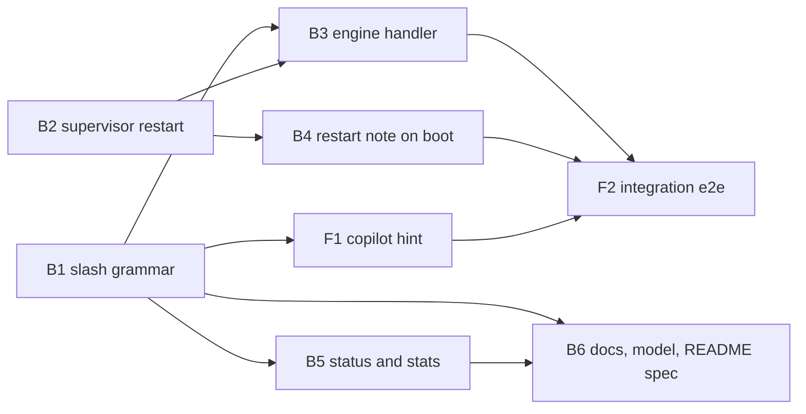

Not a refactor: no `implementation_requirement: refactor`, no move or rename across the codebase. About 20 of 2206 tracked files (under 1%), well under the 50 percent threshold.

# Plan 069.00: `/restart-web` in the copilot, and its command list

## Settled here (the spec's open questions)

1. **Read-only commands:** `/status` (every plan on the board: state, agents, last command and its reply), `/status NNN` (one plan: its workers and the state of each command sent to them), `/stats` (the figures `Engine::Tally#render` prints when a run stops). None of them queues an engine command.
2. **Where `/stats` reads from:** the engine publishes a `Tally` snapshot to a Redis key (named in `Live::Keys`) once a round. The API server reads that key; it never asks the engine.
3. **Engine to supervisor:** `USR2` sent to the supervisor's PID, found through `Supervision::Registration` / `PidDir` and checked with `Probe#verified?`. `USR1` is taken by agents. The trap in `cli/start/start.rb` only sets a flag (as `stop!` does); the next `tick` acts.
4. **No supervisor:** the engine finds no verified supervisor PID, or the supervisor runs with `--no-web`, and refuses with "`/restart-web` needs `openlanes start`; no supervisor is running." (decision D2).
5. **The reply the person sees:** the engine replies "restarting the control room" before it signals, the same way `/stop` replies. The supervisor writes the build outcome to a restart note (`web-restart.json`) in its registration directory. The new web server reads and removes that note on boot, then appends it to the conversation in Redis as a copilot turn. After the page reconnects, the person sees both turns.
6. **Not writable or no Node:** these are build failures under decision D3. The old `web/dist` stays and the server restarts anyway.
7. **Build time limit:** the build runs as a spawned child, polled from `tick`, with a 300-second limit (`WebRebuild::TIMEOUT`). When the limit runs out the child is killed and the restart counts as a build failure.

## Order and dependency graph

B1 and B2 start together. Then B3, B4, B5 and F1 can run side by side. B6 follows B5, and F2 comes last.

Units that share a file run one after the other: B1 then B6 (the comment in `slash.rb` is B1's). B6 is the only unit that edits `README.md` and `agents/copilot.md`.

## Backend

### B1 Slash grammar for `/restart-web`, `/status`, `/stats`

- **Discipline:** back end
- **Owns:** `lib/openlanes/live/copilot/slash.rb`, `lib/openlanes/live/command.rb` (`KINDS` gains `restart_web`, which needs no plan and no agent), `spec/openlanes/live/copilot/slash_spec.rb`, `spec/openlanes/live/command_spec.rb`
- **Must not touch:** `commands.rb`, `copilot.rb`, anything under `supervision/`, README
- **Depends on:** nothing
- **Shape:**
  - `Slash.parse("/restart-web", id:)` returns a `Command` of kind `restart_web`.
  - `Slash.parse("/restart-web 3")` returns `Help`: "takes no arguments".
  - `/status`, `/status NNN` and `/stats` return a new `Slash::Query = Data.define(:kind, :plan)` and never a `Command`.
  - `USAGE` lists every command, and a single table (`Slash::COMMANDS`: name, syntax, summary) is the source that both `USAGE` and the README spec read.
  - The class comment drops "read-only" and says the copilot proposes while the person commands.
- **Done when:** `slash_spec.rb` and `command_spec.rb` pass, including the argument refusals.

### B2 Supervisor stops, rebuilds and restarts the web child

- **Discipline:** back end
- **Owns:** `lib/openlanes/supervision/supervisor.rb`, new `lib/openlanes/supervision/web_rebuild.rb`, `lib/openlanes/supervision/slot.rb` and `crashes.rb` if needed, `lib/openlanes/cli/start/start.rb` (the `USR2` trap), `spec/openlanes/supervision/supervisor_spec.rb`, new `spec/openlanes/supervision/web_rebuild_spec.rb`
- **Must not touch:** `live/`, `engine/`, `web.rb`
- **Depends on:** nothing
- **Shape:**
  - `Supervisor#restart_web!` only sets a flag and is safe to call from a trap.
  - On the next `tick`, the supervisor stops the web slot as a deliberate stop (removes its PID file, so `crashed?` is false and `Crashes` records nothing), then starts `WebRebuild`.
  - `WebRebuild.new(root: Web::GEM_ROOT, host:)`:
    - `#start` spawns `npm run build` in `root/web` through `Host#spawner`;
    - `#poll` returns `nil` while the build runs, otherwise an outcome (`ok`, `no_npm`, `no_sources`, `failed`, `timeout`) with the tail of the output.
  - The tick polls the build and never blocks. When the build finishes, the supervisor writes `web-restart.json` (outcome, message, time) in `registration.dir` and starts the web slot on the same port.
  - A failed build leaves `web/dist` as it was.
  - A restart while one is in progress is ignored.
- **Done when:**
  - `supervisor_spec.rb` shows stop, build and start in that order, a new pid in the slot, four restarts in a row with no give-up, and that a tick does not block on a running build.
  - `web_rebuild_spec.rb` covers a missing `npm`, a missing `web/package.json`, a non-zero exit and the timeout.

### B3 Engine handler that asks the supervisor

- **Discipline:** back end
- **Owns:** `lib/openlanes/live/commands.rb` (a `restart_web` entry in `HANDLERS` and its handler), new `lib/openlanes/supervision/restart_request.rb` (finds the supervisor's verified PID and whether it has a web slot, then sends `USR2` through `Host`), `spec/openlanes/live/commands_spec.rb` (the restart-web examples), new `spec/openlanes/supervision/restart_request_spec.rb`
- **Must not touch:** `slash.rb`, `command.rb`, `supervisor.rb`
- **Depends on:** B1 (the kind) and B2 (the `USR2` contract and the web-slot marker in the registration)
- **Done when:**
  - With a fake supervisor, exactly one request is recorded and the reply says the restart has started.
  - With no supervisor, and with `--no-web`, the reply is exactly the D2 refusal and no signal is sent.

### B4 The new web server reports the build outcome

- **Discipline:** back end
- **Owns:** new `lib/openlanes/live/copilot/restart_note.rb` (reads and removes `web-restart.json`, then appends a copilot turn to the conversation), the one call to it from web boot in `lib/openlanes/web.rb`, new `spec/openlanes/live/copilot/restart_note_spec.rb`
- **Must not touch:** `supervisor.rb`, `copilot.rb`, `commands.rb`
- **Depends on:** B2 (the note's format)
- **Done when:** `restart_note_spec.rb` shows the turn appended once for `ok` and for each failure (with the reason), the note removed, and nothing done when there is no note.

### B5 Read-only `/status`, `/status NNN`, `/stats`

- **Discipline:** back end
- **Owns:**
  - `lib/openlanes/live/copilot.rb` (answer a `Slash::Query` locally, the way `Help` is answered);
  - new `lib/openlanes/live/copilot/report.rb` (renders status from Redis and the plan folders, and stats from the published tally);
  - the publish call in the engine: one line in `lib/openlanes/engine/runner.rb` or `dispatcher.rb`, plus `Tally#to_h` in `engine/tally.rb`;
  - the key in `lib/openlanes/live/keys.rb`;
  - new `spec/openlanes/live/copilot/report_spec.rb`, and additions to `spec/openlanes/live/copilot_spec.rb` and `spec/openlanes/engine/tally_spec.rb`.
- **Must not touch:** `slash.rb`, `commands.rb`, `supervision/`
- **Depends on:** B1 (`Slash::Query`)
- **Done when:**
  - The specs show each query answered with the expected text and nothing appended to the commands stream.
  - `/stats` before the first round says that no figures exist yet.

### B6 Copilot on Sonnet, read-only wording, README command list

- **Discipline:** back end
- **Owns:** `agents/copilot.md` (`model: sonnet`, effort unchanged, description), `README.md` (the agents table row for `copilot` and a new "Copilot commands" section listing every command with its syntax, arguments and exact effect, with a note that Sonnet costs more per message), the read-only comment in `lib/openlanes/live/copilot/operator.rb`, new `spec/openlanes/docs/copilot_commands_doc_spec.rb` (README list equals `Slash::COMMANDS`), the roster and profile specs that name haiku, `.rubocop_todo.yml` entries for touched copilot files
- **Must not touch:** `slash.rb` (B1 owns it)
- **Depends on:** B1, B5
- **Done when:**
  - `copilot_commands_doc_spec.rb` passes.
  - `Agents::Profile.resolve` for copilot returns Sonnet in its spec.
  - `rg "read-only" lib agents README.md` shows only accurate uses.
  - `just lint` and `just test` are green.

## Frontend

### F1 Copilot hint lists the new commands

- **Discipline:** front end
- **Owns:** `web/src/copilot/Copilot.tsx` (`SLASH_COMMANDS`), `web/src/copilot/Copilot.test.tsx`, `web/src/copilot/useCopilot.ts` (only if the conversation fails to reload after the event stream reconnects)
- **Must not touch:** any Ruby file
- **Depends on:** B1 (the names)
- **Done when:** `Copilot.test.tsx` shows `/restart-web`, `/status` and `/stats` in the hint, and that turns written while the stream was down appear after it reconnects.

### F2 Integration check: `/restart-web` end to end

- **Discipline:** front end (test)
- **Owns:** new `web/cypress/e2e/restart-web.cy.ts`, its step in `bin/lanes-e2e`
- **Must not touch:** library code
- **Depends on:** B3, B4, F1
- **Done when:** under a real `openlanes start` (nothing stubbed), typing `/restart-web` in the copilot shows:
  - the "restarting" reply;
  - the server going away and the page reconnecting;
  - the build-outcome turn;
  - a working board afterwards.

  `/stats` answers in the same session. The step passes in `bin/lanes-e2e`.

## HTTP surface

No. The commands travel over the existing copilot message and event streams, and no route is added or changed, so there is no `openapi.yaml`.

## How to test

1. Run the Ruby suite and the linter: `bundle exec rspec` and `bundle exec rubocop`. Both exit 0. The specs for this plan are in `spec/openlanes/live/copilot/slash_spec.rb`, `copilot_spec.rb`, `copilot/restart_note_spec.rb`, `live/commands_spec.rb`, `supervision/web_rebuild_spec.rb`, `supervision/restart_request_spec.rb`, `supervision/supervisor_spec.rb` and `docs/copilot_commands_doc_spec.rb`.
1. Run the page's unit tests: `cd web && npm install && npm test`. `Copilot.test.tsx` shows `/restart-web`, `/status` and `/stats` in the copilot's hint.
1. Build the page and start the factory: `just web-build`, then `openlanes start` in a project with a plan or two. Open the control room and the copilot panel.
1. Type `/restart-web 3`. You see the usage, ending "/restart-web takes no arguments.", and nothing restarts.
1. Type `/restart-web`. You see "done: restarting the control room: supervisor <pid> stops it, rebuilds the page and starts it again; …". The page loses its connection, reconnects within the build time, and the copilot shows "The control room restarted on a rebuilt page." The board works as before and the engine's agents keep running. `openlanes status` shows the same engine pid.
1. Make the build fail, for example with a type error in a `web/src` file, then type `/restart-web` again. The control room still comes back, serves the old page, and the copilot says "The control room restarted on its old page. The build failed (exit N), so the old page stays", followed by the end of the build output. Revert the change.
1. Type `/restart-web` four or more times in a row, waiting for each restart to finish. The control room comes back every time; a deliberate restart never counts toward the three-crashes-in-five-minutes give-up.
1. Stop the factory and start `openlanes start --no-web` with `openlanes web` beside it. Typing `/restart-web` gets "refused: `/restart-web` needs `openlanes start`; no supervisor is running." With no engine at all, the server answers "no engine is running to apply /restart-web".
1. Type `/status`, `/status NNN` (a plan on the board) and `/stats`. Each answers at once, as a copilot turn, with the plans on the board, that plan's agents and what each is doing, and the run's tokens, cost and agents. None of them sends a command to the engine. Before an engine has run, `/stats` says there are no figures yet.
1. Read `README.md`, section "Copilot commands". It lists all six commands with their arguments and effects, and the `copilot` row in the agents table no longer says read-only or haiku. `openlanes agents list` shows copilot on `sonnet/low`.
1. Run the end-to-end check: `bin/lanes-e2e`. `web/cypress/lanes/restart-web.cy.ts` types `/restart-web` into a real `openlanes start`, sees the reply, the reconnect and the build-outcome turn, and gets `/stats` answered. It was not run during the build, because it needs `npm install` and live agents.
