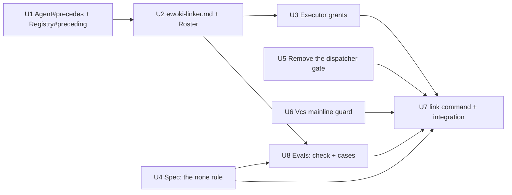

# Plan 008.01: Ewoki Linker

Spec items 6, 8 and 9, plus the `link` command, under the spec's decisions D1–D6. Eight back-end units, no front end, no HTTP surface. One pull request.

## What changed since the last plan

`plan-prior-to-tsort.md` was written before D1–D6 and was built in this worktree (uncommitted). Its U1, U2, U3, U5 and U6 carry over. Its U4 (the per-plan dispatcher gate and the three-attempt limit) is dropped by D1 and is removed here (U5). The `link` command (U6, U7) and the `[none]` rule (U4) are new. The linking PR flow, the `run` pre-pass and tsort ordering are plan 008.03 (D5).

## Order and dependency graph

| Wave | Units          | Why together                                    |
| :--- | :------------- | :---------------------------------------------- |
| 1    | U1, U4, U5, U6 | no dependencies; disjoint files (U1 is built)   |
| 2    | U2             | needs U1                                        |
| 3    | U3, U8         | U3 needs U2; U8 needs U2 and U4; disjoint files |
| 4    | U7             | the integration check, after everything         |

One file is shared: `lib/openlanes/cli.rb` gets one line from U8 (the `evals` alias) and one from U7 (`register "link"`). U7 depends on U8, so the two are sequential. No other file is owned by two units.

## Backend

### U1 `precedes:` on Agent, read only by `Registry#preceding`

- **Discipline:** back end.
- **Owns:** `lib/openlanes/agents/agent.rb` (`precedes`, `precedes?(status)`), `lib/openlanes/agents/registry.rb` (`Registry#preceding(status) -> Array<Agent>`), `spec/openlanes/agents/registry_spec.rb`.
- **Must not touch:** `agents/*.md`, `roster.rb`, `executor.rb`, `dispatcher.rb`, `routing.rb`.
- **Depends on:** nothing. Built in round 1; verify only.
- **Done when:** `spec/openlanes/agents/registry_spec.rb` shows `#preceding(:planned)` and `#preceding(:ready_for_planning)` return an agent with `precedes: [ready_for_planning, planned]`, `#preceding(:building)` does not, and `#for_status` / `#team_for` never do. `rg -n "precedes" lib` finds the key parsed only in `agent.rb` and read only through `Registry#preceding`.

### U2 `agents/ewoki-linker.md` and its Roster line

- **Discipline:** back end.
- **Owns:** `agents/ewoki-linker.md`, `lib/openlanes/agents/roster.rb`, `spec/openlanes/agents/roster_spec.rb`.
- **Must not touch:** `agent.rb`, `registry.rb`, `executor.rb`, `evals/**`.
- **Depends on:** U1. Built in round 1; amend the body for D2: write quoted canonical `"NNN.MM"` strings, or `[none]` when the plan needs nothing (never `[]`); one reason per dependency under its Completed NOTE entry; N7 (shared files are a merge risk, not a dependency) stays.
- **Done when:** `spec/openlanes/agents/roster_spec.rb` renders `ewoki-linker` with `precedes ready_for_planning, planned`, and `./exe/openlanes agents list` shows the same.

### U3 Executor tool grants for a preceding agent

- **Discipline:** back end.
- **Owns:** `lib/openlanes/execution/executor.rb`, `spec/openlanes/execution/executor_spec.rb`.
- **Must not touch:** `agents/*.md`, `registry.rb`, `dispatcher.rb`, `lifecycle/**`.
- **Depends on:** U2. Built in round 1; verify only.
- **Done when:** `spec/openlanes/execution/executor_spec.rb` asserts the argv for `ewoki-linker` grants `Edit` on the plan's `spec.md` only, denies `Write`, `MultiEdit`, `NotebookEdit`, `WebFetch`, `WebSearch`, keeps every `Bash(<cmd>:*)` specifier for `FORBIDDEN_COMMANDS`, and the resumption path carries the same scope.

### U4 The `[none]` rule in `Spec`

- **Discipline:** back end.
- **Owns:** `lib/openlanes/plans/spec.rb` (`depends_on` reads `[none]` as `[]`, no edges, with no problem logged; a new `Spec#linked? -> Boolean`: true for `[none]` or a non-empty list, false for a missing key or `[]`), `spec/openlanes/plans/spec_spec.rb`.
- **Must not touch:** `plans/dependencies.rb` (it keeps reading `Spec#depends_on`), `agents/**`, `lifecycle/**`.
- **Depends on:** nothing.
- **Done when:** `spec/openlanes/plans/spec_spec.rb` shows: missing key → `depends_on` nil, `linked?` false; `[]` → `[]`, false; `[none]` → `[]`, true; `["034.00"]` → `["034.00"]`, true; `[none, "034.00"]` is a logged problem. `spec/openlanes/plans/dependencies_spec.rb` stays green unchanged.

### U5 Remove the per-plan dispatcher gate (D1)

- **Discipline:** back end.
- **Owns:** `lib/openlanes/agents/routing.rb` (drop `Routing.preceding_for`), `lib/openlanes/engine/dispatcher.rb` (drop `LINK_ATTEMPTS`, `#preceding`, `#park_unlinked`), `lib/openlanes/engine/run_workflow.rb` (takers back to `main`'s logic), `spec/openlanes/agents/routing_spec.rb`, `spec/openlanes/engine/dispatcher_spec.rb`, `spec/openlanes/engine/runner_spec.rb`, `spec/openlanes/live/live_context.rb` (drop the `without("ewoki-linker")` amendments), and the deletion of `spec/openlanes/engine/dispatcher_linker_spec.rb`, `spec/openlanes/engine/runner_linker_spec.rb`, `spec/openlanes/cli/run_linker_spec.rb` (all untracked, never committed).
- **Must not touch:** `registry.rb`, `agent.rb`, `executor.rb`, `lifecycle/**`.
- **Depends on:** nothing.
- **Done when:** `git diff origin/main -- lib/openlanes/agents/routing.rb lib/openlanes/engine/` is empty, and `bundle exec rspec spec/openlanes/engine spec/openlanes/agents` is green with ewoki in the default registry (`handles: []` keeps it out of `for_status`).

### U6 `Vcs::Mainline`: primary checkout, on `main`, pulled

- **Discipline:** back end.
- **Owns:** `lib/openlanes/vcs/mainline.rb` (`Mainline.new(root:, branch: "main")` with `#primary?` (git dir equals the common dir, so not a linked worktree), `#on_branch?`, `#refusal -> String | nil` naming which guard failed, `#pull -> Boolean` running `git pull --ff-only` when the branch has an upstream and skipping with a note when it has none), the facade method `Vcs.mainline` in `lib/openlanes/vcs.rb`, `spec/openlanes/vcs/mainline_spec.rb`.
- **Must not touch:** `vcs/worktree.rb`, `vcs/publisher.rb`, `vcs/github.rb`, `cli/**`.
- **Depends on:** nothing.
- **Done when:** `spec/openlanes/vcs/mainline_spec.rb`, on real temp git repos, refuses inside a linked worktree, refuses on a branch other than `main`, passes in the primary checkout on `main`, fast-forwards from a local bare upstream, and reports a failed (diverged) pull as a refusal.

### U7 The `link` command, and the integration check

- **Discipline:** back end.
- **Owns:** `lib/openlanes/lifecycle/linker.rb` (`Linker.new(tree:, registry:, executor:, plans: nil)`, `#candidates -> Array<Subject>`, `#call(dry_run:) -> Result(linked:, unchanged:, failed:)`), the facade method `Lifecycle.link` in `lib/openlanes/lifecycle.rb`, `lib/openlanes/cli/link/link.rb`, its `register "link", Link` line in `lib/openlanes/cli.rb`, `spec/openlanes/lifecycle/linker_spec.rb`, `spec/openlanes/cli/link_spec.rb`.
- **Must not touch:** `vcs/mainline.rb`, `plans/spec.rb`, `executor.rb`, `agents/**`, `engine/**`.
- **Depends on:** U3, U4, U5, U6, U8 (U8 also edits `cli.rb`; U7 goes after it).
- **Rules:** candidates are the non-archived plans whose state `Registry#preceding` answers (📋, ⭐️), narrowed by `--plans NNN[,NNN]`, whose `Spec#linked?` is false. One ewoki invocation per candidate, serial, in the primary tree. The command refuses through `Mainline#refusal`, then pulls, then links. `-n` / `--dry-run` checks the guards, skips the pull and the agents, and prints `would invoke ewoki-linker for NNN.MM` per candidate. A real run ends with `No new links found.` or the list of plans whose key it wrote; it commits nothing, and the branch and PR are 008.03. A failed ewoki is reported and exits non-zero; the next `link` retries it.
- **Done when:** `spec/openlanes/lifecycle/linker_spec.rb` covers candidate selection (missing key and `[]` in, `[none]` and `["034.00"]` out, 🟡 and ✅ out, `--plans` narrows) with a fake executor. The integration check, `spec/openlanes/cli/link_spec.rb`, runs `./exe/openlanes link` as a subprocess, nothing stubbed, in a temp git repo on `main` built with `PlansFixture`, and must show: with 050 at 📋 mentioning 034's parser and no key, and another plan at 📋 with `depends_on: [none]`, `link --dry-run` prints `would invoke ewoki-linker for 050.00` and nothing for the other; the same command inside a linked worktree of that repo exits non-zero naming the worktree guard; on a branch other than `main` it names the branch guard.

### U8 Evals: the `[none]` value, the cases, and the `evals` spelling

- **Discipline:** back end.
- **Owns:** `lib/openlanes/evals/check.rb` (`spec_only` accepts `[none]` and rejects `[]` as ewoki's output), `lib/openlanes/evals/changes.rb`, `lib/openlanes/evals/case.rb`, `spec/openlanes/evals/check_spec.rb`, `spec/openlanes/evals/changes_spec.rb`, `spec/openlanes/evals/corpus_spec.rb`, `evals/cases/ewoki-linker/**` (`none` and `shared-files-only` now expect `[none]`; re-record their `pass/` and `fail/`), and an `aliases: %w[evals]` on the `eval` registration in `lib/openlanes/cli.rb`, so the spec's check runs as written.
- **Must not touch:** `agents/*.md`, `lifecycle/**`, `cli/link/**`.
- **Depends on:** U2, U4.
- **Done when:** `spec/openlanes/evals/check_spec.rb` passes a `spec.md` diff adding `depends_on: ["034.00"]` or `[none]` plus a Completed NOTE entry, and fails one that writes `[]`, edits the body, writes an unquoted `34`, or touches `plan.md`; `./exe/openlanes evals ewoki-linker` passes every case offline.

## Frontend

No front-end work in this plan.

## HTTP surface

No. The plan adds no HTTP API and changes none.

## Decisions

1. Which plans `link` checks is answered by `Registry#preceding` (ewoki's `precedes:`), so 📋 and ⭐️ only; ⚪, blocked, 🟡 and later are not linked. One source of truth, and it matches the spec's open question 1 (grandfathered).
1. Spec open question 2 (three failed attempts, then ⭕️) belonged to the dropped dispatcher gate. Under `link`, a failure is reported, exits non-zero and is retried by the next `link`; 008.03 decides whether the `run` pre-pass needs a limit.
1. How-to-test item 3 cannot hold as written under the spec's own decisions: D1 drops the dispatcher gate (so `run --dry-run` never invokes ewoki in this plan; the `run` pre-pass is 008.03 by D5), and D2 re-checks `[]`. Its intent is verified by U7's integration check, `link --dry-run` with `[none]` standing in for `[]`. The list below is copied verbatim; the reviewer reads item 3 through this decision.
1. How-to-test item 4 spells the command `evals`; the CLI registers `eval`. U8 adds `evals` as an alias rather than editing the author's check.

### B1 (answered) — The suite cannot exit 0 on this machine

`bundle exec rspec` must exit 0. On this machine it reports 30 failures, all in `spec/openlanes/apps/` and `spec/openlanes/cli/app_spec.rb`: every TCP connect to 127.0.0.1 succeeds, even to a port with nothing listening (a host proxy or network filter), so `Apps::Ports` finds no free port. This plan changes nothing under `apps/`. Every other example passes and rubocop is clean.

Options offered: (a) fix or disable the local port answer and rerun the suite (recommended); (b) accept the 30 apps failures as outside this plan and send it to review as is.

### D5 (decision) — Accept the apps failures

Answered:

- 2026-10-20, 18:55
- By kig

The 30 failures in `spec/openlanes/apps/` and `spec/openlanes/cli/app_spec.rb` are accepted as outside this plan. The plan goes to review as is, without fixing the host's local port behaviour. `bundle exec rspec` therefore does not exit 0 on this machine; the rest of the suite and `just lint` are green.

### B2 (answered) — Which pull request carries this plan

This worktree's build was superseded by PR #114. On 2026-10-23 the worktree moved from `kig/008.01-ewoki-linker` to `kig/eval-agent-positional`, and commit `6d04fb82` salvaged one piece of `0398136d Ewoki Linker` into PR #122 (open). That commit says the rest is superseded by PR #114 (`kig/ewoki-linker`, open, titled "008.01 🔗 ewoki-linker"), which implements this plan. Signing Completed here would push `kig/008.01-ewoki-linker` (`0398136d`) and open a second, conflicting pull request for the same plan.

Options offered: (a) adopt PR #114 as this plan's pull request, recording it in `pull-requests.md`, so the plan moves to 🟢 and staff-reviewer reviews #114, leaving `kig/008.01-ewoki-linker` unpublished (recommended); (b) close #114 and publish `0398136d` after switching the worktree back, once PR #122 has merged; (c) mark 008.01 done outside the pipeline and merge #114 by hand.

### D6 (decision) — Adopt PR #114 for this plan

Answered:

- 2026-10-23
- By kig

Option (a). PR #114 (`kig/ewoki-linker`) is this plan's pull request. Record it in `pull-requests.md`, so the plan moves to 🟢 and staff-reviewer reviews #114. Leave `kig/008.01-ewoki-linker` (`0398136d`) unpublished. The worktree stays on `kig/eval-agent-positional` until PR #122 is resolved.

______________________________________________________________________

## Task completed when

- `bundle exec rspec` and `just lint` stay green.
- `./exe/openlanes agents list` shows `ewoki-linker` with `precedes ready_for_planning, planned`.
- In a temp project with two plans at 📋, where 050's spec mentions 034's parser and has no `depends_on:` key, `./exe/openlanes run --dry-run --isolation shared` reports `would invoke ewoki-linker` for 050 and not for a plan whose spec already has `depends_on: []`.
- `./exe/openlanes evals ewoki-linker` (offline scoring) passes every case.

## How to test

- `bundle exec rspec` and `just lint` stay green.
- `./exe/openlanes agents list` shows `ewoki-linker` with `precedes ready_for_planning, planned`.
- In a temp project with two plans at 📋, where 050's spec mentions 034's parser and has no `depends_on:` key, `./exe/openlanes run --dry-run --isolation shared` reports `would invoke ewoki-linker` for 050 and not for a plan whose spec already has `depends_on: []`.
- `./exe/openlanes evals ewoki-linker` (offline scoring) passes every case.
