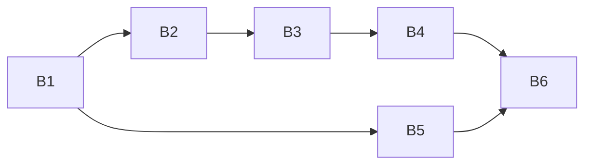

# Plan 002.00: Thin CLI commands over workflow objects

Scope: the whole of `spec.md`, items 1–7. The Zeitwerk boot and the domain namespaces the folder's name refers to shipped in PR #40; `spec.md` and `decisions.md` (D4) record that, and nothing here re-does them.

Evidence that the first two tasks are done, measured on `origin/main` at `b2b5176`:

- `lib/openlanes.rb` builds a `Zeitwerk::Loader`, collapses `support/` and every `cli/<command>/`, and `spec/openlanes/load_spec.rb` loads the entrypoint in a clean process.
- `lib/openlanes/` holds `plans/`, `lifecycle/`, `agents/`, `adapters/`, `engine/`, `execution/`, `vcs/`, `presentation/`, `support/`, `skills/` and `linear/`, each with its facade module.
- Baseline suite: `2214 examples, 0 failures`.

## Units

| Id | Unit | Discipline | Depends on |
| --- | --- | --- | --- |
| B1 | `OpenLanes::Refusal`, `Base#unwrap`, `Execution.credentials_notice` | back end | nothing |
| B2 | `resync prs`: `Lifecycle.retitle_prs` and `Presentation::PrChanges` | back end | B1 |
| B3 | `unblock`: `Lifecycle::UnblockWorkflow` | back end | B1, B2 (facade file) |
| B4 | `create`: `Lifecycle::CreateWorkflow` | back end | B1, B3 (facade file) |
| B5 | `run` and `start`: `Engine::RunWorkflow`, `Engine::StartWorkflow` | back end | B1 |
| B6 | Integration check: the real `exe/openlanes` over a fixture tree | back end | B2–B5 |

Details per unit: `plan-backend.md`. There is no front end (`plan-frontend.md` says so).

## Order and graph

- B1 first: every workflow returns `Failure(Refusal)` and every command unwraps it through `Base#unwrap`.
- B2, B3 and B4 are sequential: each adds one method to the `Lifecycle` facade (`lib/openlanes/lifecycle.rb`).
- B5 shares no file with B2–B4 and can run beside them.
- B6 last. It owns only its own spec file.

## Shared-file rule

`lib/openlanes/lifecycle.rb` is written by B2, B3 and B4 in that order. `lib/openlanes/presentation.rb` only by B2, `lib/openlanes/engine.rb` only by B5, `lib/openlanes/cli/base.rb` and `lib/openlanes/execution.rb` only by B1.

## Decisions this plan takes

The spec leaves these open; each is the smallest choice that satisfies it.

1. **Failure value.** One `OpenLanes::Refusal = Data.define(:message, :status)` for all four workflows, so `Failure(Refusal)` carries the sysexits status the command exits with. `Base#unwrap(result)` returns the success value or refuses.
2. **Progress stays where it happens.** A workflow that runs an agent draws its spinner row and its warning boxes on STDERR through `UI`, as `Runner` and `Executor` already do. The command prints the deliverable and exits; the workflow never calls `exit`.
3. **Names.** `Lifecycle::CreateWorkflow`, `Lifecycle::UnblockWorkflow`, `Engine::RunWorkflow`, `Engine::StartWorkflow`; facade methods `Lifecycle.create_plan`, `Lifecycle.unblock`, `Lifecycle.retitle_prs`, `Engine.run`, `Engine.start`. `Lifecycle.create` keeps its meaning (the bare `Creator`).
4. **`start`.** `CLI::Start` subclasses `CLI::Run`, and overrides five of its private methods. Those overrides move with them: `Engine::StartWorkflow < Engine::RunWorkflow`, and `CLI::Start` only validates `--rescan` and names its workflow.
5. **What stays in a command.** `create` keeps `open_spec` and `macos?`: opening an editor is output, and `create_spec.rb` stubs both on the command. The workflow says which file to open.
6. **The one CLI spec that changes beyond constants.** `run_spec.rb` "the publisher" calls the private `publisher_for` on the command. It moves to `spec/openlanes/engine/run_workflow_spec.rb` unchanged in what it asserts, because the method moved.

> [!NOTE]
> luthen-rael-planner, round 2, 2026-10-14: Completed. Six units, all back end.
