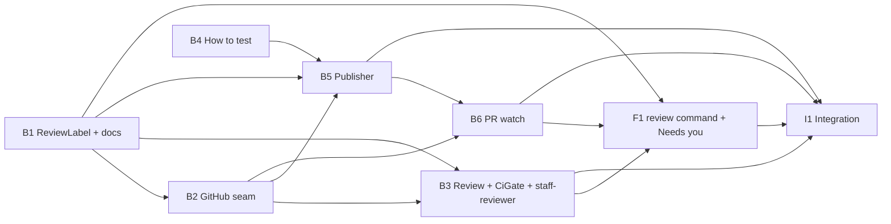

# 005.00 Review State Labels: plan

One pull request, eight units: seven back end (`plan-backend.md`), one front end (`plan-frontend.md`). Each unit's owns, must-not-touch, depends-on and done-when are in those files.

## Units

| Id | Unit | Discipline | Depends on |
| --- | --- | --- | --- |
| B1 | Review label vocabulary (`Plans::ReviewLabel`) and its `openlanes docs` table | back end | nothing |
| B2 | `Vcs::GitHub`: `ensure_label`, `swap_label`, `checks`, `review_comments`, `labels:` on `pulls` | back end | B1 |
| B3 | `Vcs::Review` and `CiGate`; staff-reviewer's `may:` and instructions | back end | B1, B2 |
| B4 | `## How to tell it's working?` → `## How to test` in `plan.md` | back end | nothing |
| B5 | Publisher applies `ready-for-review`, refuses a PR without `## How to test` | back end | B1, B2, B4 |
| B6 | Human-mode PR watch in the engine (15 s, `start` only) | back end | B2, B5 |
| F1 | `openlanes review` command and `waiting on you: PR #N` | front end | B1, B3, B6 |
| I1 | Integration check, end to end through a fake `gh` | back end | B3, B5, B6, F1 |

## Order

1. B1 and B4, in parallel.
1. B2.
1. B3 and B5, in parallel.
1. B6.
1. F1.
1. I1, last.

## Dependency graph

## Shared files, made sequential

- `lib/openlanes/engine/dispatcher.rb`: B6 only. B5 returns `label_error` on its result instead of writing the attempt note itself.
- `lib/openlanes/vcs/github.rb`: B2 only. B3, B5 and B6 call it.
- `lib/openlanes/cli.rb`: F1 only (one `register` line).
- `spec/openlanes/agents/registry_spec.rb`: B3 only.
- No file is owned by two units; the parallel pairs (B1 ∥ B4, B3 ∥ B5) share none.

## Integration check

I1 owns it: `spec/integration/review_labels_spec.rb`, a real `.plans` tree, the real `exe/openlanes`, and a fake `gh` first on `PATH` (the only stand-in, since nothing may reach GitHub). It must show a PR going `ready-for-review` → `review-in-progress` → a refused `ready-to-merge` over a failing check → `review-rejected`, the engine moving that plan to 🔴 with mail for backend-coder and frontend-coder, a merged PR moving a plan to ✅, and `waiting on you: PR #N` for one still open.

## Assumptions taken from the spec's open questions

1. The watch runs under `openlanes start` only; plain `run` exits and logs unpolled PRs.
1. Zero checks counts as green, with a warning.
1. `how-to-verify:` is still read when the heading is missing, until plan 007.
1. A failed `ready-for-review` does not stop the PR; it lands in the attempt note.
1. Unknown CI buckets count as red.
1. A failed `--remove-label` for an absent label is tolerated.
1. A stale `review-in-progress` is replaced by the next swap.
1. `merge.by` is read from `.openlanes.yml` with `human` as the default; `init` asking it (M4) is not in this plan.

## Risks for the reviewer

- M4 puts "waiting on you" in Needs you, which today exists only in the web UI (`web/src/board/model.ts`). The spec limits this plan to the terminal reporter; the web card is follow-up work.
- `dispatcher.rb` is edited by other plans; keep B6's hunk small by putting the logic in `pr_watch.rb`.
- Plan 007 edits the same `how-to-verify` reads as B4; whichever merges second rebases.
- Plan 014 depends on `ReviewLabel` and `openlanes review` names; treat them as an interface.

## How to test

- Open a PR through the harness: it carries `ready-for-review`. Run `openlanes review <n> review-in-progress`, then a verdict: exactly one review label remains on GitHub.
- With a failing check, `openlanes review <n> ready-to-merge` is refused and `review-rejected` is accepted.
- Under `openlanes start`, add `review-rejected` and a comment on GitHub: within about 15 s the plan folder shows 🔴 and backend-coder and frontend-coder have mail. Merge another PR: its plan shows ✅.
- Remove `## How to test` from a `plan.md`: the publisher refuses to open its PR.
