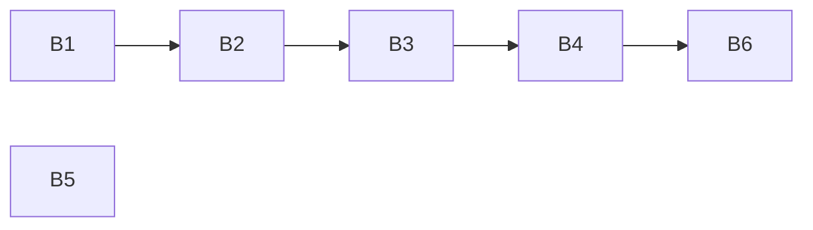

# Plan 013.00: Coverage Gate

Scope: every "In scope" item of `spec.md` (1–10), built as framing 2 (the merge gate) with framing 1 (the parsers) as its first units. Nothing on `main` applies `ok-to-merge` yet (spec open question 7), so this plan ships the gate as a callable with a stated interface plus a command, and leaves the label call to whichever lands second of plan 005 (PR #26) and plan 014 (`chewie-verifier`).

## Units

| Id | Unit | Discipline | Depends on |
| --- | --- | --- | --- |
| B1 | `Coverage::Config`: the `.openlanes.coverage.yml` loader, `Coverage::Invalid`, the facade | back end | nothing |
| B2 | `Coverage::Report`: the four parsers, the missing/empty/malformed rules, fixtures | back end | B1 |
| B3 | `Engine::CoverageGate`: runs `command` in a clean checkout, reads, compares, returns a `Verdict` | back end | B2 |
| B4 | `openlanes coverage PLAN`: the figure, the minimum and the verdict on STDOUT, exit 1 when withheld | back end | B3 |
| B5 | hansolo: agent text and eval case "a diff that lowers `minimum` is rejected" | back end | nothing |
| B6 | Integration check: a real git repo, a real command, through `exe/openlanes coverage` | back end | B4 |

Details per unit: `plan-backend.md`. `plan-frontend.md` has no units: the only interface is CLI output, which B4 owns (spec, "Back end / front end": the Reporter row is luke's, and open question 6 is answered no).

## Order and graph

- B1, then B2: both write the facade `lib/openlanes/coverage.rb` (B1 adds `config`, B2 adds `read`), so they are sequential.
- B5 runs at the same time as any of them: it shares no file.
- B3 after B2, B4 after B3, B6 last. B6 owns only its own spec file.

## Shared-file rule

`lib/openlanes/coverage.rb` is written by B1 and then B2, in that order. No other file is owned by two units.

## Decisions this plan takes from the spec's recommendations

The spec lists these as open with a default. The plan builds the default.

1. **Lines, for all four formats** (Q1). Istanbul's `statements` is ignored.
1. **An empty report is 0%** (Q2), fail closed, like a missing one.
1. **simplecov reads `coverage/.resultset.json`** (Q3), with every command's run merged line by line (a line hit by any run is covered) and covered/relevant computed from the counts, never from `.last_run.json`'s truncated figure. `:nocov:` blocks are not subtracted, since `.resultset.json` does not record them; the gate can read lower than SimpleCov, never higher.
1. **No change to the web project** (Q4): its declaration would say `format: lcov`, `report: coverage/lcov.info`.
1. **No branch figure** (Q5) and **no web display** (Q6).
1. **The gate's home** (Q7): `Engine::CoverageGate`, reached through `Engine.coverage_gate`, returning a `Verdict`. Config and parsers are `OpenLanes::Coverage`, a pure namespace like `Plans`: no processes. The gate spawns through `Execution::Child`, as the executor does.
1. **Cobertura**: `lines-covered / lines-valid`, else `line-rate * 100` (Q8). Nothing else.
1. **A non-zero exit is 0%** (Q9), whatever the report says. So is a timeout (default 30 minutes), and so is a report whose mtime is older than the run (stale: the command did not write it).
1. **No `.openlanes.coverage.yml` withholds** `ok-to-merge`, with a reason naming M15. M15 makes the file luke's to write; a project without it has declared nothing the gate can check, and a gate that passes what it cannot check is the prompt this plan replaces.
1. **A dirty checkout withholds** without running the command: the spec's "clean checkout" is checked, not assumed.
1. **The config is read from the checkout**, not the main tree: the minimum that counts is the one in the PR, and hansolo rejects a PR that lowers it (B5).
1. **The figure is surfaced by `openlanes coverage`**, not as a `list-plans` column: there is no stored verdict to show until plan 014 runs the gate, and `presentation/reporter.rb` stays untouched.

## Interfaces plan 014 and PR #26 call

Stated here so `chewie-verifier` (014) builds against them without reading this plan's code. Full shapes in `implementation-plan.md`.

- `OpenLanes::Engine.coverage_gate(**options)` → `Engine::CoverageGate`; `#call(checkout:)` → `Engine::CoverageGate::Verdict`, where `checkout` responds to `path` and `dirty?` (a `Vcs::Worktree::Checkout`).
- `Verdict#passed?`, `#percent`, `#minimum`, `#reason`, `#to_s`.
- Wiring, for whichever of #26 and 014 lands after this: `Vcs::Review#refusal` refuses `ok-to-merge` when `Engine.coverage_gate.call(checkout:)` is not `passed?`, with `verdict.reason` as the refusal.

## Integration check (B6) must show

In a temp git repository with a committed `.openlanes.coverage.yml` and a `command` that writes an `lcov` report, nothing stubbed but the worktree seeder:

- `exe/openlanes coverage 001` at 95.00% with `minimum: 95` exits 0 and prints the figure and the minimum.
- The same at 94.99% exits 1 and prints the figure and the minimum.
- A command that writes no report exits 1 naming the missing report as 0%.
- The command ran in the plan's worktree: the report exists there and not in the main tree.

## How to test

- `bundle exec rspec spec/openlanes/coverage spec/openlanes/engine/coverage_gate_spec.rb spec/openlanes/cli/coverage_spec.rb spec/openlanes/integration/coverage_gate_spec.rb`
- `bundle exec rspec spec/openlanes/evals/corpus_spec.rb` scores the new hansolo case's pass and fail recordings.
- By hand: in a project with a `.openlanes.coverage.yml`, `openlanes coverage NNN` prints the figure and exits 1 below the minimum.
