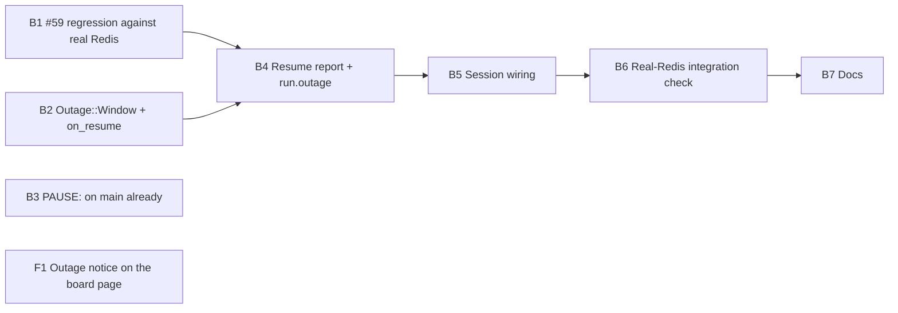

# Plan 022.00: Redis Outage Resilience

Spec: `spec.md` (framing 1, gated by 2). One pull request, eight units: seven back end, one front end.

amended (round 4, after hansolo's rejection): this plan was written against `7186635`. Before the branch was rebuilt onto `origin/main`, main landed two commits that already do much of what the units below first described:

- `ec5b95eb` (2026-10-18) "Pause agents while Redis is unreachable": `Live::Outage` with a 10 s grace, `PAUSE` and `RESUME` in `Execution::Control`, Fibonacci probes (1, 1, 2, 3, 5, 8 … s), and the `redis_outage_hours` give-up limit.
- `14a7f439` (2026-10-18) "Keep the engine up when Redis restarts empty": `Store#xreadgroup` maps `NOGROUP` to `GroupMissing`, and `Commands` makes its group again. This is the #59 crash.

Each unit below now says what this branch built on top of that, and what it did not build. The earlier text claimed a `Live::Backoff`, `Config#backoff`, `redis.backoff.*` keys, `Dispatcher#unavailable!` and `#probe_live`, and `Publisher#on_unavailable`. None of them exist, and none are built here.

Defaults taken from the spec's open questions:

- Backoff (open question 1): amended (round 5, hansolo 2/2): built in `Live::Outage` itself, not as a second schedule. Main's Fibonacci gaps are scaled by `redis_backoff.initial` (1 s), capped at `redis_backoff.cap` (30 s, `Outage::MAX_GAP`) and drawn with full jitter (`redis_backoff.jitter: true`), all three set in `.openlanes.yml`. In scope 5 is met.
- Give-up timeout (open question 6): main's `redis_outage_hours`, one hour by default, replaces "pause forever".
- Outage length: `nodes[].heartbeat_at` when Redis still holds it, else the engine's own monotonic clock (open question 4).
- The page infers an outage from a stale snapshot; after recovery it reads `run.outage` (open question 5).

## Order and dependencies



### Wire shape shared by B4 and F1

Additive field on the snapshot's `run` object (`Live::Snapshot#run`, `web/src/api/types.ts`), set only after an outage this run has recovered from, `null` otherwise:

```json
"outage": {
  "started_at": "2026-10-16T18:40:00Z",
  "ended_at": "2026-10-16T18:41:12Z",
  "seconds": 72,
  "measured_by": "heartbeat | clock",
  "reconciled_from": "redis | file | null"
}
```

Field names are fixed here, so `luke-backend` and `rey-frontend` need not pair on them again. A change goes through mail to both sides.

## Backend

### B1 #59 regression against real Redis

- **Discipline:** back end.
- **Built:** `spec/openlanes/engine/redis_outage_spec.rb`, 1 example. A real `redis-server` is stopped, wiped and restarted between two ticks of a real `Dispatcher` and `Session`; the spec asserts the ticks do not raise and the commands group exists again.
- **What it is not:** a failing-then-passing reproduction. The fix it covers is main's `14a7f439`, so the spec passes on `main` without this branch. It is a regression test, against real Redis, for a fix that landed elsewhere. See `## Reproduction`.

### B2 Outage window and resume hook

- **Discipline:** back end.
- **Built:** in main's `lib/openlanes/live/outage.rb`, `Outage::Window` (`started_at`, `ended_at`, `seconds` by the monotonic clock), `#window` (the last outage that ended in Redis answering), and `#on_resume { |window| }`, run after `Control.resume!`. `spec/openlanes/live/outage_spec.rb` gains 1 example, "hands the ended outage to every on_resume hook".
- **Not built:** `Live::Backoff`, `backoff_spec.rb`, `#trip!`, `#due?`, `#probe!`. Main's `Outage` already tripped, probed and paused; see the amendment at the top.

### B3 `PAUSE` control word

- **Discipline:** back end.
- **Built here:** nothing. `Control::PAUSE`, `Control::RESUME`, their broadcast and the prompt paragraph came with main's `ec5b95eb`.

### B4 Resume report and `run.outage`

- **Discipline:** back end.
- **Built:**
  - `RunRecord#reconcile` returns `:redis`, `:file` or `nil`, naming the side with the higher `seq`; it shares `newest` with `restore` rather than copying the comparison.
  - `Live::OutageReport.new(store:, keys:, node:, window:, reconciled_from:)` with `#to_h` (the wire shape above) and `#line`. Duration uses this node's `nodes[].heartbeat_at` when it is within 15 s before the first failure, otherwise the window's monotonic seconds; `measured_by` says which.
  - `Snapshot#run` gains `outage:`, `nil` by default.
- **Specs:** `outage_report_spec.rb` (6 examples), plus new examples in `run_record_spec.rb` and `snapshot_spec.rb`.

### B5 Session wiring

- **Discipline:** back end.
- **Built:** `Session.new` takes an `outage:` keyword (a spec hands in one on its own clock); `Session#attach` registers `outage.on_resume { recover(it) }`; `Session#recover(window)` builds an `OutageReport`, logs its line and sets `Publisher#outage`, which the next snapshot publishes as `run.outage`. `spec/openlanes/engine/dispatcher_outage_spec.rb` gains 2 examples.
- **Not built:** `Dispatcher#unavailable!`, `#paused?`, `#probe_live`, `backoff:`, `Publisher#on_unavailable`. `dispatcher.rb` is not in this diff: main's `Outage` already runs first in the dispatcher's before-tick hooks and holds assignment while paused.

### B6 Real-Redis integration check

- **Discipline:** back end.
- **Built:** `spec/openlanes/live/redis_outage_integration_spec.rb` (3 examples) and `spec/support/redis_server.rb` (a throwaway `redis-server` on an ephemeral port in a temp dir). Nothing stubbed between the engine and Redis:
  1. a snapshot published to the real Redis before anything goes wrong;
  1. Redis killed, then restarted on the same port: `PAUSE` while it is gone, then cleared, and the snapshot read back from Redis carries `run.outage` with `measured_by: "heartbeat"`, `reconciled_from: "redis"` and positive `seconds`;
  1. Redis restarted with its data dir wiped: the read-back snapshot has `reconciled_from: "file"`.
- Skipped with a stated reason when no `redis-server` is on `PATH`.

### B7 Docs

- **Discipline:** back end.
- **Built:** README's existing "A lost Redis" paragraph gains the resume line, `run.outage`, the page's stale warning and the restarted-empty case. The duplicate "When Redis goes away" section is folded into it.
- **Built (round 5):** `redis_backoff:` in `.openlanes.yml` (`initial`, `cap`, `jitter`), checked key by key in `Config`, documented in its header and README, and handed to `Live::Outage` by `Session`. Specs: `config_spec.rb` "redis_backoff", `outage_spec.rb` "with redis_backoff settings" and "with full jitter".
- **Not built:** `Config#backoff`, `Runner.new(backoff:)`, `config_backoff_spec.rb`, under those names.

## Frontend

### F1 Outage notice on the board page

- **Discipline:** front end.
- **Owns:** `web/src/api/types.ts` (the `outage` field on the run type), `web/src/shell/Header.tsx`, `web/src/shell/Header.test.tsx`, `web/src/api/fixtures/snapshot.json` (adds `run.outage: null`), one new fixture `web/src/api/fixtures/snapshot-outage.json`.
- **Must not touch:** anything under `lib/` or `spec/`; other web files.
- **Depends on:** nothing beyond the wire shape fixed above.
- **Shape:** two header states.
  - Stale: the snapshot's `at` is older than a threshold (about 15 s) while the page is open: "Engine not publishing for N s, Redis may be down". The engine cannot publish while Redis is gone (spec, open question 5), so staleness is the only live signal.
  - Recovered: `run.outage` is set: "Redis was down N s (by heartbeat|clock), run state from redis|file".
- **Done when:** `Header.test.tsx` renders both states from fixtures, and neither when `run.outage` is `null` and the snapshot is fresh; the web lint and unit suite are green. B6's read-back proves the field arrives from a real engine.

## HTTP surface

Yes, additively. No route is added or changed; the `GET /api/board` response and the `event: board` stream gain the optional `run.outage` object above. `luke-backend` writes `openapi.yaml` beside `contract.md` describing the snapshot's `run` object with the new field, so `openlanes api docs` lists it.

## Reproduction

_Written by B1 (luke-backend, round 2); amended round 4._

- **How.** Not through the `openlanes run` CLI. It ran through a real `Dispatcher`, `Session` and `Live::Store` over a `PlansFixture` tree, against a throwaway `redis-server` on an ephemeral port (`spec/support/redis_server.rb`). Between two ticks the server was stopped, its `dump.rdb` deleted, and started again on the same port.
- **What raised, on `7186635`.** `RedisClient::CommandError: NOGROUP No such key '…:commands' or consumer group 'engine' in XREADGROUP with GROUP option`, from the commands stream read in the dispatcher's before-tick hooks. The tick raised, so the run ended.
- **Why.** A Redis that comes back empty (no AOF, or an RDB snapshot older than the group) has no consumer group. The client reconnects without a connection error, so no outage trips, and nothing in the tick caught a `CommandError`.
- **Fix.** Not in this pull request. amended: earlier text said "`Commands#call` rescues `NOGROUP`" here; that rescue does not exist. The fix is main's `14a7f439`: `Store#xreadgroup` raises `GroupMissing` on `NOGROUP`, and `Commands` makes the group again.
- **Proof.** `spec/openlanes/engine/redis_outage_spec.rb`, 1 example (earlier text said 2). It passes on `main` without this branch, because `14a7f439` is already there; on this branch it is a real-Redis regression test for that fix, not a proof of a fix made here.
- **Exit status of a real `openlanes run`.** Not recorded; the spec drives the same tick.

## How to test

Run from the repository root, with `eval "$(rbenv init -)"` first. The Redis specs need `redis-server` on `PATH`; without it they skip and say why.

- `bundle exec rspec`: the whole suite, 0 failures.
- `bundle exec rubocop`: no offenses.
- #59 regression (B1): `bundle exec rspec spec/openlanes/engine/redis_outage_spec.rb` gives 1 example, 0 failures. The fix it covers is main's `14a7f439`.
- Outage window, resume hook and probe schedule (B2): `bundle exec rspec spec/openlanes/live/outage_spec.rb` gives 14 examples, 0 failures, including "hands the ended outage to every on_resume hook", "never waits more than 30 seconds between asks", "resumes within 30 seconds of Redis coming back after 17 minutes", "with redis_backoff settings" and "with full jitter" (an injected clock and random source).
- Backoff settings (B7): `bundle exec rspec spec/openlanes/config_spec.rb -e redis_backoff` passes: the section is read, written back, and a list, an unknown key, a zero cap or a word for `jitter` is refused.
- Resume report and `run.outage` (B4): `bundle exec rspec spec/openlanes/live/outage_report_spec.rb spec/openlanes/live/run_record_spec.rb spec/openlanes/live/snapshot_spec.rb` passes, covering both the heartbeat case and the clock-plus-file case.
- Session wiring (B5): `bundle exec rspec spec/openlanes/engine/dispatcher_outage_spec.rb` passes: `Session#recover` logs the line and publishes `run.outage`, and the outage's resume hook calls it.
- Integration check against real Redis (B6): `bundle exec rspec spec/openlanes/live/redis_outage_integration_spec.rb` gives 3 examples, 0 failures. Redis is killed (pause, `PAUSE`), restarted (`run.outage` read back), then restarted with its data wiped (`reconciled_from: "file"`).
- Docs (B7): README, "A lost Redis", describes the pause, the probes and their `redis_backoff` settings, the resume line, `run.outage` and the restarted-empty case, once.
- Outage notice on the page (F1): `just web-test` passes lint, type-check and the unit suite. `Header.test.tsx`, "Redis outage notice", shows the stale alert when the snapshot is more than 15 s old, the "Redis was down N s" line when `run.outage` is set, and nothing when the snapshot is fresh and `run.outage` is `null`.
- End to end: `just web-build && just web-e2e` runs the Cypress specs, all passing.
- By hand: start `openlanes run` against a local Redis, then stop Redis mid-run with `redis-cli shutdown nosave`. After 10 s the run keeps going, assigns nothing, and running agents' control files read `PAUSE`. Start Redis again on the same port: the log prints `Redis is back after Ns (by heartbeat|clock), run state from redis|file; resuming`, and the control files read `RESUME`.
