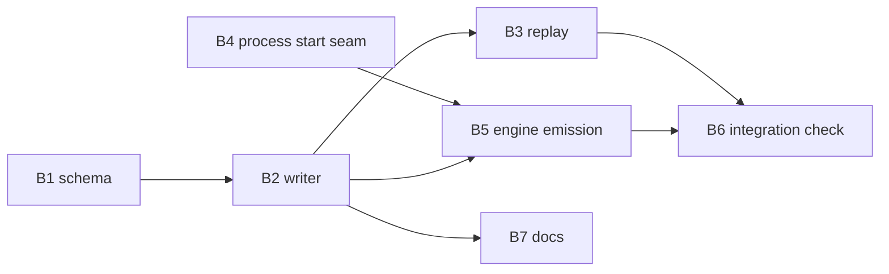

# Plan 039.00: Progress Journal

Spec: `spec.md` (framing A: the journal is the event record; `StateFile` untouched). Open-question defaults from the spec are adopted as stated: fsync per event, no rotation (one file per run), journal beside `openlanes-state.json`, start time through an injectable seam, `session_id` persisted in the journal only, location under XDG `Runtime.dir`, offset is a byte offset into the agent's trace file.

## Order and dependency graph

Sequence: B1 and B4 in parallel; then B2; then B3, B5 and B7 in parallel (disjoint files); B6 last. No file is owned by two units.

## Backend

### B1 Event schema

- **Discipline:** back end
- **Owns:** `schemas/journal-event.schema.json`, `spec/openlanes/engine/event_journal_schema_spec.rb`
- **Must not touch:** `schemas/plan-state.schema.json`, anything under `lib/`
- **Depends on:** nothing
- **Done when:** `spec/openlanes/engine/event_journal_schema_spec.rb` loads the schema with `JSONSchemer` (pattern of `spec/openlanes/plans/plan_state_journal_spec.rb:15`), accepts one sample of every kind and rejects a line missing `v`, a line with an unknown `kind`, and an `agent_started` without `pid`.

Shape: every line is an object with `v` (integer, starts at 1), `seq` (monotonic per file), `at` (ISO 8601), `node`, `run_id`, `kind`, plus kind-specific fields. Kinds: `run_started`, `run_ended`, `plan_assigned`, `agent_started` (`plan`, `agent`, `round`, `pid`, `started_at` nullable, `session_id` nullable, `output_file`), `agent_session` (`session_id`), `agent_offset` (`plan`, `agent`, `offset`), `agent_ended` (`plan`, `agent`, `exit`), `transition` (`plan`, `from`, `to`, `event`), `extension` (`plan`, `agent`, `seconds`), `question` (`plan`, `agent`, `note`).

### B2 Journal writer

- **Discipline:** back end
- **Owns:** `lib/openlanes/engine/event_journal.rb`, `lib/openlanes/support/runtime.rb` (adds `journal_dir(root:)`), `lib/openlanes/live/keys.rb` (adds a `journal` channel), `spec/openlanes/engine/event_journal_spec.rb`, `spec/openlanes/support/runtime_spec.rb` additions
- **Must not touch:** `dispatcher.rb`, `runner.rb`, `state_file.rb`, `lib/openlanes/plans/journal.rb`
- **Depends on:** B1
- **Done when:** `spec/openlanes/engine/event_journal_spec.rb` shows: each `append` writes one line, flushes and calls `File#fsync` (spy), lines parse back and validate against B1's schema; `seq` increases under concurrent appends from threads (mutex, single `write` per line, `O_APPEND`); a bus whose `publish` raises leaves the line on disk and reports once; the file lands at `Runtime.journal_dir(root:)/<run_id>.ndjson`, outside `.plans`.

Interface: `Engine::EventJournal.new(root:, run_id:, node:, bus: nil, clock: Time)` with `#append(kind, **fields) -> Hash` (the event written), `#path -> String`, `#close`. Named `EventJournal`, never `Journal`, so it cannot be confused with `Plans::Journal`. The bus is a `Live::EventBus::Base`; the mirror publishes the same JSON on `Keys#journal` after the fsync.

### B3 Replay

- **Discipline:** back end
- **Owns:** `lib/openlanes/engine/event_journal/replay.rb`, `spec/openlanes/engine/event_journal/replay_spec.rb`
- **Must not touch:** `event_journal.rb` (B2), the dispatcher
- **Depends on:** B2
- **Done when:** `spec/openlanes/engine/event_journal/replay_spec.rb` writes events with B2's writer, truncates the file mid-line, replays, and gets the expected picture; a line whose `v` is newer than the reader's is reported, not crashed on; an ended agent drops out of the in-flight set.

Interface: `EventJournal::Replay.call(path) -> InFlight`, a `Data.define(:run, :plans, :agents, :torn)`, where each agent carries `plan`, `agent`, `pid`, `started_at`, `session_id`, `output_file`, `offset`. `EventJournal.latest(root:)` returns the newest file's path.

### B4 Process start time seam

- **Discipline:** back end
- **Owns:** `lib/openlanes/execution/process_start.rb`, `spec/openlanes/execution/process_start_spec.rb`
- **Must not touch:** `executor.rb`, `child.rb`
- **Depends on:** nothing
- **Done when:** `spec/openlanes/execution/process_start_spec.rb` covers the `/proc/<pid>/stat` path on a fixture file, the `ps -o lstart= -p <pid>` path through an injected runner, and `nil` for a dead pid or a failing command; one example reads its own `Process.pid` on the real host.

Interface: `Execution::ProcessStart.of(pid, proc_root: "/proc", runner: Open3) -> Time | nil`. The engine process runs it, never an agent, so the autonomy boundary does not apply.

### B5 Engine emission

- **Discipline:** back end
- **Owns:** `lib/openlanes/engine/dispatcher.rb`, `lib/openlanes/engine/runner.rb`, `lib/openlanes/execution/transcript.rb` (a public `session_id` reader), `lib/openlanes/cli/run/run.rb` (builds the journal), `spec/openlanes/engine/dispatcher_event_journal_spec.rb`
- **Must not touch:** `state_file.rb`, `event_journal.rb`, `replay.rb`, `schemas/`
- **Depends on:** B2, B4
- **Done when:** `spec/openlanes/engine/dispatcher_event_journal_spec.rb` drives a dispatcher with a fake agent and finds one schema-valid event of each kind in the file, in order; `agent_session` appears once the transcript reports a session id (`transcript.rb:543`); `agent_offset` is emitted at the persist point (`dispatcher.rb:2233-2238`) only when the trace file grew; the existing suite stays green.

The journal is injected into `Runner` and `Dispatcher` as an optional `journal:` (nil writes nothing), so every existing spec keeps its shape.

### B6 Integration check: kill and replay

- **Discipline:** back end
- **Owns:** `spec/integration/event_journal_kill_spec.rb`
- **Must not touch:** every `lib/` file
- **Depends on:** B3, B5
- **Done when:** `spec/integration/event_journal_kill_spec.rb` passes.

This is the plan's integration check. Nothing is stubbed past the agent binary: a real `Runner` round over a `PlansFixture` tree, the real `Executor` and `Dispatcher`, and a fake agent executable that prints stream-json and sleeps. The spec forks the engine, waits for the `agent_started` line and at least one `agent_offset` line, sends `SIGKILL`, then must show:

1. every event the child reported as appended before the kill is in the file (no event lost);
2. `Replay.call` returns the plan as in flight with the agent's pid, session id, output file and last offset;
3. `Dir.glob(".plans/**/*")` holds no `*.ndjson`, lock, `*.tmp` or `openlanes-state.json`.

### B7 Docs

- **Discipline:** back end
- **Owns:** `docs/decisions/decisions-on-progress-journal.md`, `docs/decisions/decisions-on-distributed-engine-and-solid-refactor.md` (fix the stale `.openlanes/journal/` at line 75), `README.md` (journal location and the `jq` line to read it)
- **Must not touch:** `lib/`, `spec/`
- **Depends on:** B2
- **Done when:** `rg -n 'journal' docs README.md` shows the XDG location, `rg -n '\.openlanes/journal' docs` prints nothing, and the decision doc records the seven open-question defaults above.

## Frontend

No front-end work in this plan: no UI or HTTP change. The journal file and the `EventBus` channel are the interface later UI plans consume.

## HTTP surface

No. The plan adds no HTTP API and changes none, so there is no `openapi.yaml`.

## Task completed when

- [ ] Every unit's done-when spec above passes.
- [ ] `just lint` reports zero offenses and `bundle exec rspec` reports zero failures.
- [ ] Killing the engine mid-run loses no event, and a replay rebuilds the in-flight picture.
- [ ] The JSON schema lives in `schemas/` and is validated in specs.
- [ ] Runtime files no longer live under `.plans/`.

## How to test

- Killing the engine mid-run loses no event, and a replay rebuilds the in-flight picture.
- The JSON schema lives in `schemas/` and is validated in specs.
- Runtime files no longer live under `.plans/`.

## Build notes (backend-coder, round 1)

- Baseline before any change: `bundle exec rspec` at 4075 examples, 0 failures in researcher's run; my own baseline run loaded `event_journal.rb` mid-run and failed `thread_safety_inventory_spec.rb:18` on it, fixed by its row in `docs/thread-safety.md`.
- Frontend: none, so no `contract.md` and no frontend-coder; backend-coder owns the plan.
- B5 also adds `Executor::Handle#trace` (one attribute, set where the trace path is chosen) because `trace_path` is private and random-named; the journal needs the file to name it and read its offset.
- B6 forks a process that appends through `EventJournal` and SIGKILLs it; the full-Runner round with the journal is covered by `spec/openlanes/engine/dispatcher_event_journal_spec.rb` instead of a forked Runner.
