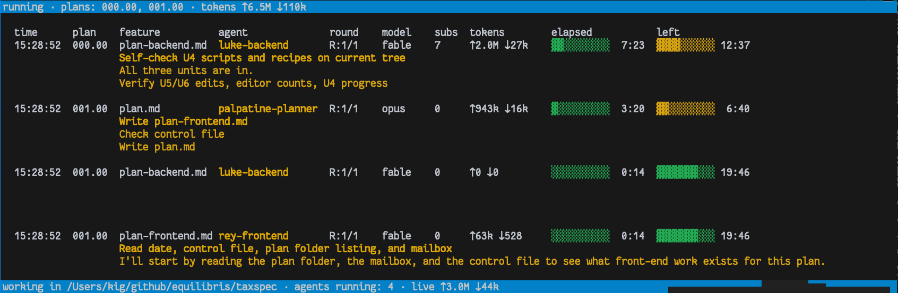
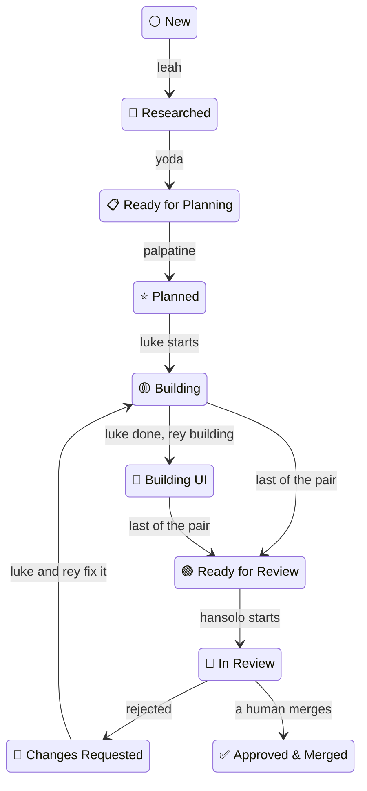

# Open Lanes Depot

[](https://dl.circleci.com/status-badge/redirect/gh/kigster/openlanes/tree/main) 


#### What is this?

This repo is a collection of installers (BASH and Ruby) which ensure a consistent vendor-neutral agentic setup on your computer, coupled with an agentic software team that diligently creates your feature specs in collaboration with you, and then works on them until they become reviewed, CI-passing PRs that you get to merge.

Here is a screenshot of agents working on two plans at the same time, but on two different phases of the process:



> [!NOTE]
>
> 1. [`openlanes`](<>) (also known as `openlanes` executable) is the Ruby Gem, which is a CLI tool that creates and manages the `.plans` folder, and comes with eight or so specialized agents that take a spec.md file and work through it until it's a set of PRs open, reviewed, and passing on your CI. It does not automatically merge anything.
> 1. [`agentilda-ai-setup`](https://kigster/agentilda-ai-setup) is the GitHub repo that's a mixture of BASH and Ruby installers. It's comes with the [`configuration.yml`](https://github.com/kigster/agentilda-ai-setup/blob/main/configuration.example.yml) file, which lists the installation commands for the coding agents you'd like to install locally, any other executables you might want (for instance, it installs `bt` — braintrust's CLI utility), and then you can list any number of Github Repos and use them to install skills, plugins, commands from them, specifying exactly which you want to install and which you want to exclude. Moreover you can specify a sub-directory of a github repo to install from.
> 1. The final piece of the puzzle is the locking gem **[`agent-lock`](https://github.com/kigster/agent-lock)**. This flexible gem comes with the executable `alock` and a skill teaching agents how to use it. Using `alock` agents can work in parallel in the same worktree but on different files, sub-folders, and so on. The gem uses locally running Redis as the default backend, and if that's not available, it uses the file system. The choice of the backend happens once and is saved in the git-ignored file in your local working repo.
>
> Together, the three repos, after installation provide you with the consistent way to replicate your `~/.agents` and `~/.claude` folders on multiple computers, and to enable a consistent agentic software team workflow across any number of many projects.

OpenLanes turns a short feature description into a reviewed pull request. You write the brief; a team of seven Claude Code agents researches it, specifies it, plans it, builds it and reviews it. You merge.

## Install

```bash
gem install openlanes agent-lock -N
hash -r
openlanes --help
```

`agent-lock` (the `alock` command) stops agents sharing a checkout from overwriting each other's files.

Both commands have tab completion. Add this to `~/.zshrc` (or use `bash` in `~/.bashrc`):

```bash
eval "$(openlanes completion zsh)"
eval "$(alock completion zsh)"
```

To give your coding agents the bundled `openlanes` skills, copy them into the shared skill store. There are seven: `openlanes` (how the factory works, and which of the others to load), `openlanes-setup` (put a project on openlanes), `openlanes-spec` (create a plan and write its spec), `openlanes-documents` (the files in a plan folder and the formats openlanes parses), `openlanes-run` (`openlanes start` and `openlanes run`, clear blocks), `openlanes-status` (where plans stand, the control room) and `openlanes-sync` (folder names, PR titles, Linear).

```bash
openlanes skills install          # copies skills/* into ~/.agents/skills; -h lists them
openlanes skills install -n       # what it would install, keep or replace
```

It copies rather than links, so re-run it with `--overwrite` after upgrading the gem.


## Quick start

Run these anywhere inside your project:

```bash
openlanes init                  # writes .openlanes.yml and creates .plans/; asks on a terminal, -y asks nothing
openlanes create tax rule dsl   # creates .plans/000.00-⚪️ → tax-rule-dsl/spec.md and opens it
                            # finish the brief in spec.md, then save it
openlanes run -n                # dry run: shows which agent would take which plan
openlanes start                 # the factory and its control room, up until Stop All Local or Ctrl-C

openlanes list-plans            # every plan, its state and its pull requests
```

The agents stop at an approved pull request. Merging it is up to you.

### Project settings: `.openlanes.yml`

Every command that reads or writes plans first finds the project root and works from there, so it does not matter which subdirectory you type it in. The root is the nearest directory above you holding `.openlanes.yml` or `.plans/`; failing that, the nearest holding `.git`. Your home directory counts only if it holds `.openlanes.yml`, so a dotfiles repository there cannot capture every project under it. When the root is not where you are, one line on STDERR says so (`-q` silences it); when there is none, the command exits 66. `-D` and `PLANS_DIR` resolve against the root. `version`, `states`, `docs`, `agents`, `describe`, `completion`, `eval` and `skills` need no project and skip the search.

`openlanes init` writes `.openlanes.yml` at the nearest `.git` (else the current directory) and creates `.plans/`. It takes `--project`, `--lane`, `--[no-]frontend` and `--jobs`, asks on a terminal for whatever no flag gave, and confirms before writing. `-y` asks nothing, `-n` prints the file instead, and an existing file is kept unless `--overwrite`.

```yaml
project: Equilibris App   # heading for INDEX.md; default: the root's directory name
lane: full                # default lane for `openlanes create`: full | plan | quick
frontend: false           # a spec's `frontend:` when spec.md says nothing; omit to let each plan decide
jobs: 4                   # how many plans `openlanes run` works on at once
commands:                 # option defaults for any command, by the name you type it as
  run:
    timeout: 1800
  resync prs:
    adopt: false
```

A typed flag beats the plan's `spec.md` frontmatter, which beats `.openlanes.yml`, which beats the built-in default. `jobs`, `lane` and `project` are the same settings as `commands.run.jobs`, `commands.create.lane` and `commands.index.project`; set either spelling, not both. An unknown key, a bad value, or an option the command does not take is an error naming the file (exit 65): a setting silently ignored is a timeout that stops applying with no signal. `dry_run` cannot be a default. `~/.local/config/openlanes.json` is no longer read; move its `run` section under `commands:`.

## How it works

### The folder name is the state

Every feature is one folder under `.plans/`, named `NNN.MM-<emoji> → <slug>`:

```text
.plans/000.00-✅ → dev-foundation
       001.00-🟡 → tenancy-households
       001.01-🕰️ → schedule-k1-backfill      # shipped first, documented afterwards
       002.00-⚪️ → tax-rule-dsl
```

- **The number** is set once and never changes. Branches, pull request titles and `pull-requests.md` all join on it. `MM` is `00` for a normal plan; `01` to `99` marks a retroactive plan slotted in after the fact.
- **The emoji** is the state. A folder may only claim a state its files prove, such as `spec.md`, `plan.md` or `pull-requests.md`, and the tool refuses any other move.
- **The name** contains spaces and emoji, so quote it in a shell.

`openlanes states` draws every state and transition. [`docs/WORKFLOW.md`](docs/WORKFLOW.md), generated by `openlanes docs`, is the full reference.

### The lifecycle



A plan can also leave the main path. It stops at ⭕️ Technical Block or 🅱️ Product Block when a human has to decide something. It ends at 💩 Scrapped by Review, ☢️ Deferred or ❌ Discarded when it won't be built.

### The agents

| Agent               | Takes plans at | Moves them to       | Writes                                 | Job                                                                                      |
| :------------------ | :------------- | :------------------ | :------------------------------------- | :--------------------------------------------------------------------------------------- |
| `leah-researcher`   | ⚪️             | 🔎                  | `spec.md`                              | Researches the brief in parallel and appends a `## Research` chapter                     |
| `yoda-writer`       | 🔎, 🕰️         | 📋                  | `spec.md`                              | Writes the full spec (goals, non-goals, scope), or `blocked.md` when a human must answer |
| `palpatine-planner` | 📋             | ⭐️                  | `plan.md`                              | Splits the spec into independent work units, one plan each for back end and front end    |
| `luke-backend`      | ⭐️, 🟡, 🔴     | 🟢                  | `plan-backend.md`, `pull-requests.md`  | Builds the data, domain, API and tests                                                   |
| `rey-frontend`      | ⭐️, 🟡, 🎨, 🔴 | 🟢                  | `plan-frontend.md`, `pull-requests.md` | Builds the interface against Luke's API and proves the two halves work together          |
| `hansolo-reviewer`  | 🟢, 👀         | 👀 approved, 🔴, 💩 | `pull-requests.md`                     | Reviews the diff against the plan; rejects at most twice; never merges                   |
| `lando-broker`      | ⭕️, 🅱️         | ⭐️                  | `plan.md`                              | Folds your answers from `blocked.md` back into the spec and plan                         |
| `r2d2-mechanic`     | ⭐️, 🟡, 🔴     | 🟢                  | `plan.md`, `pull-requests.md`          | Quick lane only: does one short mechanical task straight from `spec.md`                  |

Luke and Rey work at the same time, in the same worktree, toward one pull request. They talk through `openlanes mail send` and `openlanes mail read`. Rey only starts when `plan-frontend.md` has work units, so a back-end-only plan costs one builder, not two.

| Agent               | Model / effort | Why                                    |
| :------------------ | :------------- | :------------------------------------- |
| `leah-researcher`   | haiku / medium | lookups, fanned out                    |
| `yoda-writer`       | sonnet / medium| prose                                  |
| `palpatine-planner` | opus / high    | the one place depth pays               |
| `luke-backend`      | opus / high    | builds; Opus is the ceiling            |
| `rey-frontend`      | sonnet / medium| narrower work                          |
| `hansolo-reviewer`  | sonnet / high  | review                                 |
| `lando-broker`      | haiku / low    | clerical                               |
| `r2d2-mechanic`     | haiku / medium | short mechanical tasks                 |

No agent runs above Opus: the Claude adapter clamps Fable and anything costlier to Opus. Agents start without your personal plugins, skills, hooks and MCP servers, which on a typical setup cuts a quarter of every turn's context and half the start-up time. `openlanes run --user-config` lets them back in.

### Lanes, and what spec.md can ask for

The frontmatter of `spec.md` steers how the plan is worked. Every key is optional:

```yaml
---
lane: quick          # full (default) | plan | quick
frontend: false      # true forces rey-frontend; false keeps it out
depth: fast          # fast | medium | deep: the default effort for every phase
phases:              # per-phase overrides: research, specification, planning,
  build:             # build, frontend, review, unblock
    adapter: codex   # claude (default) | codex | pi
    model: gpt-5-codex
    effort: medium   # low | medium | high | xhigh | max
  review: { model: opus }
implementation_suggestions:   # text or a list: language, libraries, an approach
  - Ruby, with dry-cli for the command line
implementation_requirements:  # text or a list: binding, exactly as written
  - The database is PG-strict
task-completed-when:          # what must be true for the task to be finished
  - "`openlanes create` opens an editor and writes no draft"
how-to-verify:                # the commands or checks that show it
  - bundle exec rspec spec/openlanes/cli/create_spec.rb
---
```

`implementation_suggestions` is advice, not a requirement. Every agent is shown it as "suggestions from the spec's author", prefers it when it fits, and may take a better route as long as it writes why in the document it owns.

`implementation_requirements` is the opposite: every agent is told to do exactly what each item says. An agent that cannot meet one signs `Blocked` instead of substituting its own, and `hansolo-reviewer` rejects work that does not meet them. Agents start without your personal skills (`run --user-config` restores them), so write the rule itself, not just the name of a skill that holds it.

`task-completed-when` and `how-to-verify` are copied into `plan.md` under `## Task completed when` and `## How to verify`. Agents are asked to copy them verbatim; after a planner signs, the harness appends whichever section is missing and never touches one that is there. Every agent is told not to sign `Completed` until the first holds and to run each check in the second, and the reviewer rejects work that fails one.

| Lane    | Route                                                        | For                                              |
| :------ | :----------------------------------------------------------- | :----------------------------------------------- |
| `full`  | leah → yoda → palpatine → luke (+ rey) → han                 | features you want researched and specified        |
| `plan`  | palpatine → luke (+ rey) → han                               | a spec you already trust; skip research and rewrite |
| `quick` | r2d2-mechanic → han                                          | "split the big migration into smaller ones"       |

`openlanes create --lane quick split big migration` writes the frontmatter for you. Precedence for model and effort, highest first: `run --model`, then `phases.<phase>`, then `depth`, then the agent's own definition.

Run `openlanes agents list` for the same table, or `openlanes describe <agent>` to read one agent's prompt.

### Unblocking a plan

The loop never assigns a blocked plan (⭕️ or 🅱️) to an agent. Write your answers into the plan's `blocked.md`, then:

```bash
openlanes unblock 003 -n         # what is 003 still waiting on?
openlanes unblock 003            # fold the answered questions into spec.md and plan.md
```

Partial answers are fine. The plan stays blocked until the last question is answered.

## Commands

```bash
openlanes init                             # .openlanes.yml and .plans/ at the project root
openlanes create tax rule dsl              # a new plan: 003.00-⚪️ → tax-rule-dsl
openlanes create --lane quick split big migration  # one agent, straight to a pull request
openlanes create --from notes/dsl.md       # a new plan named by the file's frontmatter title
openlanes create --after 002 k1 sync       # a retroactive plan: 002.01-🕰️ → k1-sync
openlanes list-plans                       # every plan, its state and its pull requests
openlanes index                            # write .plans/INDEX.md
openlanes states                           # the state machine, as a diagram
openlanes docs -o docs/WORKFLOW.md         # regenerate the conventions from the code
openlanes start                            # the factory as a service: agents plus the control room, until Stop All Local
openlanes run --until-settled --plan 003   # run the agents on specific plans, until no plan changes state
openlanes unblock 003                      # fold answered blocks back in
openlanes worktree 003                     # create and seed a worktree for one plan
openlanes resync dirs                      # rename folders whose emoji their contents contradict
openlanes resync prs                       # add missing [NNN.MM] prefixes to pull request titles
openlanes linear import TAX -p 'Tax DSL'   # mirror the plans into Linear
openlanes skills install                   # copy the bundled skills into ~/.agents/skills
```

> [!IMPORTANT]
> **Every command does the work it is named for.** Add `-n` / `--dry-run` to `run`, `unblock`, `resync dirs`, `resync prs` or `linear import` to see what it would do first, with nothing changed.

## Running the agents

### `openlanes start`: the factory with its control room

```bash
openlanes start                                # engine plus control room on http://127.0.0.1:11000
openlanes start --no-open --port 4848          # print the URL instead of opening it, on another port
openlanes start --rescan 10                    # look for new or hand-edited plans every 10 s while idle
```

`openlanes start` is `openlanes run` that does not stop at a fixed point. When a plan blocks, it idles, puts the questions in **Needs You** on the page, takes your answer from there, folds it in and hands the plan back to its agent, with no restart. Plans created on the page, by `openlanes create` in another terminal, or edited by hand are picked up on the next rescan (every 5 s, or at once after anything you do on the page).

Every decision goes through the page: answers, hold, wrap up and stop on an agent, model changes, new plans. **Stop All Local** stops this machine's agents, then its engine and the page. The terminal only prints the URL and the progress log.

It never ends on its own, not even once every plan is finished, since the page can create the next one. A project with no plans waits for the first. Stop All Local, Ctrl-C or `SIGTERM` ends it, with exit 0 and the same graceful stop as `run`. It takes `run`'s flags except `-n`, `--no-web` and `--until-settled`, and needs Redis: without it, it refuses (exit 69) rather than going headless.

### `openlanes run`: headless, or to a fixed point

`openlanes run` serves the control room too when Redis answers, and then stays up exactly like `start`. Pass `--until-settled` (CI, scripts, agents) to end at the first fixed point anyway, or `--no-web` to run headless, which always ends there.

```bash
openlanes run -n                               # dry run: who would take what
openlanes run                                  # the whole tree, one worktree per plan, in parallel
openlanes run -j 4                             # at most four agents at once
openlanes run --plan 003,005.01                # only these plans
openlanes run --agent yoda-writer --prompt "Rework the risks section first"
openlanes run --skip hansolo-reviewer          # everyone but the reviewer; its plans wait
openlanes run --model opus                     # one model for every agent
openlanes run --user-config                    # agents load your personal plugins and skills too
openlanes run --timeout 600                    # at most ten minutes per agent
openlanes run --agent luke-backend --prompt steer.md  # a short --prompt naming a file is read
openlanes run --rounds 1                       # at most one round per agent per plan
openlanes run --max-tokens 200000              # token budget per agent invocation
openlanes run --isolation shared               # one checkout, one agent at a time, no git needed
```

If you just created several plans, run them with a single `--plan` list. Separate bare `run` calls each loop over the whole tree, so their worktrees would overlap.

Below is the screenshot of multiple agents running, working on two separate plans. The fist plan has both Luke and Rey (backend and frontend developers) runnign, while the second plan is only at the research phase with Leah.


The loop stops when a full round changes no plan's state. It also stops when every plan in scope is done, blocked, or out of rounds.

### Safety rails

- **Isolation.** By default every plan gets its own git worktree and branch, `<user>/NNN.MM-slug`, so agents on different plans share nothing. Parallel runs require it: `--isolation shared` runs one agent at a time.
- **Agents cannot publish.** They may write source, tests and their plan's documents, but may not commit, push or touch a pull request. The tool enforces this twice: it withholds those commands from the agent, and afterwards checks that `HEAD` did not move.
- **The harness publishes.** When a plan finishes, the harness commits the branch, pushes it and opens a pull request titled like `[002.00](A) Tenancy Households`. Pass `--no-git-push` to leave the work uncommitted in its worktree.
- **The plan travels with its pull request.** Before each commit, the publisher copies the plan folder (spec, plan, `state.json`) from the main checkout into the worktree under its current name, replacing any older copy. The main checkout's folder stays the only one the tool reads or writes.
- **Nothing merges automatically.** An approval leaves the plan at 👀 until you merge.
- **Disk over claims.** A plan moves only when the files its new state requires exist. If an agent reports success but wrote nothing, the tool records it as interrupted.

### Limits

| Limit  | Declared by the agent         | Flag           | Default     |
| :----- | :---------------------------- | :------------- | :---------- |
| Clock  | `timeout:` in its frontmatter | `--timeout`    | 900 seconds |
| Rounds | `rounds:` (at most 5)         | `--rounds`     | 1           |
| Tokens | none                          | `--max-tokens` | unmetered   |

Flags can only tighten what an agent declares, never loosen it. Each agent is told its clock and its token budget in its prompt.

As its time runs out, the agent is warned at 10, 5 and 1 minute left, then asked to stop. If it is still running 60 seconds after that, it is killed. A token budget works the same way: the agent is told the number, and the tool aborts it once it goes over.

Defaults for `run` live in the project's `.openlanes.yml`, under `jobs` and `commands.run` (see [Project settings](#project-settings-openlanesyml)). A typed flag beats the file, and the file beats the built-in default.

### Following a run, and stopping it

`unblock` and `create` show each agent as a spinner line on STDERR on a terminal. `run` and `start` draw no live board in the terminal: they print one appended line per event on STDERR (an agent started or finished, a plan changed state, a command came from the page, the reason the engine idles, said once per change), the same on a terminal as in a pipe, and `--quiet` silences them. Every command that runs agents also writes its progress to its log. When Redis answers, `run` also serves a web control room on `http://127.0.0.1:11000` and opens it, from which a person can watch the board and message, interrupt, kill or extend an agent (`--no-web`, `--no-open`, `--port`, `--redis-url`). Without Redis the run goes on headless. `openlanes web` serves the page on its own, and `openlanes web --demo` shows a sample run.

Ctrl-C once asks each running agent to write a `RESUME:` note into its plan's `mailbox.md` and sign `Interrupted`; every agent reads its mail before it starts, so a later run picks up where this one stopped instead of redoing the work. A second press aborts immediately. It works through a `SIGINT` handler.

### How agents hand off

An agent never renames its plan folder. Instead, it signs the plan's `state.json`, and the harness moves the folder based on the signature:

```bash
openlanes state sign --plan 003 --agent leah-researcher --round 1 --status Started
openlanes state sign --plan 003 --agent leah-researcher --round 1 --status Completed --next yoda-writer
openlanes state show --plan 003 | jq '.stages[] | {agent, round, status, model, seconds}'
```

`state.json` lives in every plan folder and is committed with it. It holds the harness's record of each round (adapter, model, effort, tokens, seconds), the agents' signatures, and the messages between them (`openlanes mail`). Its shape is `schemas/plan-state.schema.json`. Writes go through a lock, so two agents on one plan cannot overwrite each other. Signatures written the old way, as `> [!NOTE]` lines in the markdown, are still read.

| Status                            | What the harness does                                               |
| :-------------------------------- | :------------------------------------------------------------------ |
| `Completed`                       | moves the folder on, if the files the next state requires are there |
| `Blocked`                         | parks the folder at ⭕️, or at 🅱️ when the note says `product`       |
| `Almost completed`, `Interrupted` | gives the agent another round, up to its limit                      |

Suppose an agent stops without signing, because it crashed, timed out or was killed. The harness signs `Interrupted` for it. If the work is on disk anyway, the harness also signs `Completed` for it. A round left `Started` by a harness that has since died is found in `state.json` (and in the run's own gitignored `.plans/openlanes-state.json`), marked `Interrupted`, and picked up by the next run.

## GitHub and Linear

- **`resync dirs`** renames folders whose emoji their contents contradict. For example, a ⚪️ with a `plan.md` becomes ⭐️. It is safe to run repeatedly.
- **`resync prs`** adds the `[NNN.MM]` prefix to pull request titles. It works from the branch name first, then from the diff. It reports anything ambiguous and never changes it. It needs `gh`.
- **`linear import TEAM`** works out one Linear issue per plan and one child issue per work unit, and lists what would be created or updated. It only goes one way: nothing edited in Linear comes back. `--format json` hands the same data to the Linear MCP server, which applies it. `--update-unchanged` includes plans that have not changed since the last import.

## From Claude Code

The `/plan-create`, `/plan-run`, `/plan-status` and other `/plan-*` slash commands wrap this same binary. They also add checks, such as previewing the scope with `-n` before a run. They ship with [agentilda-ai-setup](https://github.com/kigster/agentilda-ai-setup). Use them inside a Claude Code session, and the binary everywhere else.

## Development

```bash
just test         # rspec
just lint         # rubocop
just format       # rubocop -a, then mdformat
just ci           # lint, then tests with coverage
just update-workflow   # regenerate docs/WORKFLOW.md
```

The executables in `exe/` find their own `Gemfile`, so they behave the same whether they are run from `PATH` or from another project's root.

### Factory integration test

`just factory-e2e` proves the whole factory through the page. It makes a throwaway git repository with no remote, runs `openlanes init` and `openlanes start --isolation shared` there (port 4777, Redis db 11), and Cypress (`web/cypress/factory/`) then:

1. types a tic-tac-toe idea into the New idea dialog, in the quick lane at depth fast, with no front end;
1. watches the board, answering any question under Needs you from a canned list;
1. waits for `r2d2-mechanic` to finish the build. With no remote there is no pull request, so the plan stays at 🟡 Building, done for the run: 🟢 needs an open pull request, and 👀 and ✅ need a person;
1. serves the `index.html` the agent wrote, plays a game X wins, checks the win is announced, and checks Restart clears the board.

It runs real `claude` agents, so it costs tokens: one Haiku build, about a cent and under a minute of agent time. It refuses to run without `OPENLANES_FACTORY_E2E=1`, and nothing in `just test`, `just web-e2e` or CircleCI runs it:

```bash
OPENLANES_FACTORY_E2E=1 just factory-e2e
```

`FACTORY_PORT`, `FACTORY_REDIS_URL`, `FACTORY_MODEL` (default `haiku`), `FACTORY_TIMEOUT` (seconds per agent, default 600) and `FACTORY_MINUTES` (the wait for the build, default 15) override the defaults. A port already in use is refused, never taken over. The temp repository and the `openlanes start` it launched are removed on every exit, and what is worth reading afterwards (the board, each plan's `state.json`, the progress log, the built page and the tail of each agent's trace) is kept in `log/factory-e2e/`.

______________________________________________________________________

© 2026 Konstantin Gredeskoul
