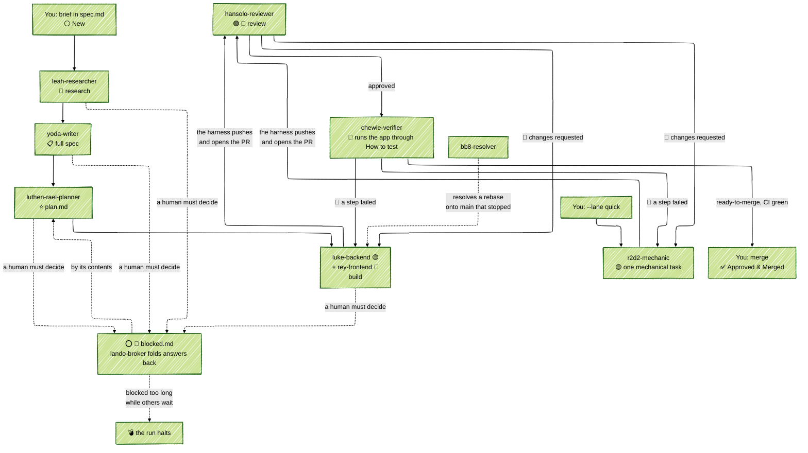

# Open Lanes Depot

[](https://dl.circleci.com/status-badge/redirect/gh/kigster/openlanes/tree/main)  [](https://github.com/kigster/openlanes/actions/workflows/agents/copilot-pull-request-reviewer) [](https://github.com/kigster/openlanes/actions/workflows/dependabot/dependabot-updates)

`openlanes` is a CLI software factory. You write a short feature brief; a team of specialist coding agents researches it, specifies it, plans it, builds it and reviews it, until it is a set of reviewed, CI-passing pull requests. You merge. Every feature is a folder under `.plans/`, and the folder's name is its state. The gem installs three names for the same executable: `openlanes`, `lanes` and `ol`.

## Picture is worth a few words ;) 

Here is the screenshot of the web component of open lanes. When you run `lanes start` locally, this web UI automatcally opens and you can add your specifications here, or add existing plans to be executed in parallel with other plans.

The software uses distributed locking using redis, so `$REDIS_URL`  is the only thing you need to configure.

Each open control-room tab holds one Redis connection of its own, its subscription to board updates. On a shared or hosted Redis with a connection cap (`maxclients`, or a paid plan's limit), count one connection per open tab on top of the engine's own. A Redis user whose ACL forbids `SUBSCRIBE` still gets a working board: the page falls back to polling every 250 ms.

Once you boot the web UI, you may notice swim lanes (those are plans that existed already in the `.plans` folder, or you created via "Action -> New Idea" menu.)

One of the coolest parts of this, is if you have another laptop or a desktop, you can git clone your project there too, and start `openlanes` there as well. As long as `$REDIS_URL` is same as the first instance, and the github URL of the project matches, the two instances will cooperate and a single web UI will show remote nodes in a read-only mode.

Shortly we'll provide a video of this in action.

## Quick Walkthrough the UI

It might help explain what various parts are.
Starting top left and going clockwise: 

### Top Nav

* OpenLanes logo
* The project being worked on (minesweeper) and it's URL and the node/machine
* How long this particular UI has been running, and how many agents are working
* Next it shows you the total number of tokens up and down, and the estimated price in USD, but this is assuming you pay by token. If you are on a Claude subscription this does count towards it, but it doesn't represent the actual cost you are paying (it might represent the cost Anthropic is paying though)
* Next is the button: "All Machines" → if other nodes join your project, there user@hostname
  * Action button that offers you to create a "New Idea" which it turns into a `.plans/<idea-folder>`  or to select from existing plans not already taken by remote nodes.
* Further is the dark/light switch.
* The button "Stop All Local"  terminates local openlanes instance and the web. It's a "oh-shit" button. Finally, a small circled ? pops up a bit of help to provide the context for what you are seeing.

### Secondary Nav

Where you see the "Board" (our agents) and "Logs", and where to the right of the screen you'd see remote machines connected and working on other plans represented by small buttons/pills.

### Main Swim Lanes Area

The swim lanes is the core of the "what's going on" feature of OpenLanes. Each represents a single plan, and you can see that in the screenshot only a single plan is being worked on — 001, and it's purpose is to "Create a Web Based Minesweeper Game".

Depending on how you setup your project with `lanes init` command, the `new` and `researhed` stages may or may  not be part of the flow.  OpenLanes offers three levels of feature investigation:

1. Full — this engages all of the agents, starts with the spec, performs research, rewrites it using copywriting skills, and when done, hands it off to the planning agent, luthen-rael. luthen-rael's job is to read the `spec.md` and write `plan.md` breaking it into executable tasks by the backend engineer (Luke) and a frontend-engineer (Rey). Once the plan is written, the control is passed to the two implementing engineers who remain in communications by means of a shared state JSON file. They can send messages to each other and divide and conquer the work. Once they are done, the  report back to the dispatcher AI agent (the main thread that watches over everyone), which then creates a PR, and passes control over to the reviewer agent "hansolo". Hans can reject the PR twice, after which another agent with the goal of breaking deadlocks and ties, named "obi-wan-kenobi", makes a final call if this PR is good to go.
2. Plan – a simplified pipeline that assumes spec.md is already written by you. It invokes luthen-rael → luke (+ rey) → hansolo, for a spec you already trust.
3. Quick — is a short mechanical tasks executed by a faster/simpler `r2d2-mechanic` → `hansolo`.

While the project select the default, each plan can override this on a case by case basis.

### Right Drawer Area

This is where you can communicate with the agents if they get stuck. You can also pop out a copilot window that allows you to chat with the main dispatcher AI.

### More Features

Are coming soon!


## What it is

**OpenLanes®** is an open source software factory written in Ruby. Its agents run on Claude Code by default, through `claude -p`, which skips loading your own configuration, skills and plugins; `codex` and `pi` can stand in per phase.

For each feature it creates a folder under `.plans`, and a series of specialized AI agents turn it into a finished feature. The harness opens the pull request, hansolo-reviewer reviews it, and chewie-verifier runs the app through the plan's How to test before you merge.

The state diagram looks something like this:




Agents may write code, tests and plan documents, but never commit, push or merge. The harness checks that, then publishes the branch and opens the pull request itself.

## Install

Requirements:

| Need                                                           | Why                                                                             |
| :------------------------------------------------------------- | :------------------------------------------------------------------------------ |
| Ruby 3 or newer                                                | the gem; this repository is developed on Ruby 4                                 |
| [`claude`](https://docs.anthropic.com/en/docs/claude-code) CLI | the default agent adapter; `codex` and `pi` are optional alternatives per phase |
| `git`                                                          | one worktree and branch per plan (`--isolation shared` needs no git)            |
| [`gh`](https://cli.github.com/), signed in                     | pushing branches, opening pull requests, `resync prs`                           |
| Redis                                                          | the control room (`start`, `web`); `run` falls back to headless without it      |

```bash
gem install openlanes agent-lock -N
openlanes --help
openlanes skills install            # copy the bundled skills into ~/.agents/skills (-n to preview)
eval "$(openlanes completion zsh)"  # or bash; add to your shell rc
```

[`agent-lock`](https://github.com/kigster/agent-lock) (`alock`) lets several agents share one checkout without overwriting each other's files. `skills install` copies rather than links, so re-run it with `--overwrite` after upgrading the gem.

## Quick start

Run these anywhere inside your project:

```bash
openlanes init                    # .openlanes.yml and .plans/ at the project root; -y asks nothing
openlanes create tax rule dsl     # .plans/000.00━━⚪━━❯tax-rule-dsl/spec.md, drafted and opened
                                  # finish the brief in spec.md and save it
openlanes run -n                  # dry run: which agent would take which plan
openlanes start                   # engine plus control room on http://127.0.0.1:11000
openlanes list-plans              # every open plan, its state and its pull requests; --all adds archived ones
```

`openlanes start` runs until you press **Stop All Local** on the page or Ctrl-C. Answer the agents' questions under **Needs You**, create new plans, and watch the board. For scripts and CI, `openlanes run --until-settled` (or `--no-web`) stops at the first round in which no plan changed state.

For a small mechanical task, skip research and planning:

```bash
openlanes create --lane quick split big migration
```

## Core concepts

### Plan folders

Every feature is one folder under `.plans/` (override with `PLANS_DIR`), named `NNN.MM━━<emoji>━━❯<slug>`:

```text
.plans/000.00━━✅━━❯dev-foundation
.plans/001.00━━🟡━━❯tenancy-households
.plans/001.01━━⏪━━❯schedule-k1-backfill     # shipped first, documented afterwards
.plans/002.00━━⚪━━❯tax-rule-dsl
```

- **`NNN.MM`** is set once and never changes. Branches (`<user>/NNN.MM-slug`), pull request titles (`[NNN.MM] ...`) and `pull-requests.md` all join on it. `MM` is `00` for a normal plan; `01` to `99` marks a retroactive plan (`openlanes create --after 001`).
- **The emoji** is the state. A transition renames the folder (through `git mv`), and a folder may only claim a state its files prove.
- **The name has no spaces**, so Tab completion works and nothing needs quoting. Each state emoji is a single code point that terminals draw two cells wide; in iTerm, turn on Unicode version 9+ widths so the columns line up.
- **`openlanes resync dirs`** renames any folder whose name its contents contradict. It also migrates folders named before this convention (`NNN.MM-<emoji> → <slug>`, or with the older emoji ⚪️ ⭐️ ⭕️ 🅱️ ☢️ 🕰️), which are still read, and moves finished, deferred and discarded plans into their subfolders. Preview it with `-n`.

A plan that is no longer active moves into a subfolder, with the date it moved inserted before the slug:

```text
.plans/archive/002.00━━✅━━❯[2026-10-13]━━dev-foundation       # ✅ and 😎
.plans/deferred/018.00━━💤━━❯[2026-10-13]━━deploy-observability # 💤
.plans/abandoned/024.00━━❌━━❯[2026-10-13]━━external-resources   # ❌
```

`.plans/` itself then lists only the work still open. Plan numbers count every folder, so a number is never reused. Reviving a plan moves it back into `.plans/` and drops the date.

While an agent works on a plan, its lock (process id, host and start time) sits in the runtime state directory, `${XDG_STATE_HOME:-~/.local/state}/openlanes/<project>-<hash>/locks/<ordinal>.lock`, beside the run's `openlanes-state.json`. Nothing runtime is written under `.plans/`, and the folder name never changes for a lock. `list-plans` and the control room show the plan with 🔑, adding the host for a lock taken on another machine, which is never cleared automatically. `resync dirs` removes a lock whose process is gone on this host. A legacy `locked-by.pid` or `.plans/openlanes-state.json` from an older release is still read, for one release. See `docs/decisions/decisions-on-runtime-state.md`.

See [`docs/decisions/decisions-on-plan-folder-naming.md`](docs/decisions/decisions-on-plan-folder-naming.md) for the decisions behind it.

### States

Generated by `openlanes docs`; `openlanes states` draws every transition.

| Symbol | Meaning | Files required |
| :----: | :------ | :------------- |
| ⚪ | New | `spec.md` |
| 🔎 | Researched | `spec.md` |
| 📋 | Ready for Planning | `spec.md`, `plan.md` |
| ⭐ | Planned | `spec.md`, `plan.md` |
| 🟡 | Building | `spec.md`, `plan.md` |
| 🎨 | Building UI | `spec.md`, `plan.md` |
| 🟢 | Ready for Review | `spec.md`, `plan.md`, `pull-requests.md` |
| 👀 | In Review | `spec.md`, `plan.md`, `pull-requests.md` |
| 🧪 | Verifying | `spec.md`, `plan.md`, `pull-requests.md` |
| 🔴 | Changes Requested | `spec.md`, `plan.md`, `pull-requests.md` |
| ✅ | Approved & Merged | `pull-requests.md` |
| 😎 | Deployed | `deployed.md` |
| 😱 | Rolled Back | `rollback.md` |
| 💩 | Scrapped by Review | `rewrite.md` |
| ⭕ | Technical Block | `blocked.md` |
| 🛑 | Product Block | `blocked.md` |
| 💣 | Bomb | `blocked.md` |
| 💤 | Deferred | `delayed.md` |
| ⏪ | Retroactive | none |
| ❌ | Discarded | `discarded.md` |

🧪 sits between review and merge: chewie-verifier starts the app the way `.openlanes.yml` says and walks the plan's How to test. 💣 is a ⭕ or 🛑 left too long while other plans depend on it; the run halts until someone answers.

Besides those, each plan folder holds `state.json` (each round's agent, model, tokens and time, the agents' signatures, their journals, and the messages between them) and, while building, `implementation-plan.md`, `plan-backend.md` and `plan-frontend.md`.

### Agents

From `openlanes agents list`; read one with `openlanes describe <name>`.

| Agent               | Handles                                           | Advances to                     | Runs on       | Lanes      |
| :------------------ | :------------------------------------------------ | :------------------------------ | :------------ | :--------- |
| `leah-researcher`   | New                                               | Researched                      | haiku/medium  | full       |
| `yoda-writer`       | Researched, Retroactive                           | Ready for Planning              | sonnet/medium | full       |
| `luthen-rael-planner` | Ready for Planning                                | Planned                         | opus/high     | full, plan |
| `luke-backend`      | Planned, Building, Changes Requested              | Ready for Review                | opus/high     | full, plan |
| `rey-frontend`      | Planned, Building, Building UI, Changes Requested | Ready for Review                | sonnet/medium | full, plan |
| `r2d2-mechanic`     | Planned, Building, Changes Requested              | Ready for Review                | haiku/medium  | quick      |
| `hansolo-reviewer`  | Ready for Review, In Review                       | Verifying, or Approved & Merged | sonnet/high   | all        |
| `chewie-verifier`   | Verifying                                         | Approved & Merged               | sonnet/medium | all        |
| `lando-broker`      | Technical Block, Product Block, Bomb              | by contents                     | haiku/low     | all        |
| `bb8-resolver`      | stopped rebases, from the harness                 | stages, never moves a plan      | sonnet/high   | all        |
| `c3po-operator`     | none: the control room's read-only copilot        | read-only                       | haiku/low     | all        |

Agent definitions are Markdown files with frontmatter in [`agents/`](agents/). A plan's `spec.md` frontmatter can change the adapter, model and effort per phase.

### Lanes

| Lane             | Route                                                            |
| :--------------- | :--------------------------------------------------------------- |
| `full` (default) | leah → yoda → luthen-rael → luke (+ rey) → hansolo → chewie                 |
| `plan`           | luthen-rael → luke (+ rey) → hansolo → chewie, for a spec you already trust |
| `quick`          | r2d2-mechanic → hansolo → chewie, for one short mechanical task           |

### Blocks

When an agent hits a question that is not its to answer, it writes numbered questions (`B1`, `B2`, ...) into `blocked.md` and the plan stops at ⭕ (technical) or 🛑 (product). The loop never assigns a blocked plan. Answer on the control room page, or write answers into `blocked.md` and run `openlanes unblock NNN`.

### The autonomy boundary

- Agents never run `git commit`, `git push`, `gh pr create`, `gh pr merge` and friends; web access is off unless an agent declares `network: true`.
- After every agent, the harness verifies `HEAD` did not move and no remote-tracking ref was moved by a push.
- The harness, not the agent, commits, pushes and opens the pull request. `--no-git-push` turns that off.
- Nothing merges automatically. chewie-verifier labels a pull request `ready-to-merge` once the app passes its How to test and CI is green; merging and deploying stay manual.

## Commands

Run `openlanes <command> --help` for flags and examples. Anything that writes to disk, GitHub or Linear previews with `-n` / `--dry-run` where it makes sense.

| Command                                       | What it does                                                                               |
| :-------------------------------------------- | :----------------------------------------------------------------------------------------- |
| `init`                                        | write `.openlanes.yml` at the project root and create `.plans/`                            |
| `start`                                       | the engine plus its control room, until Stop All Local or Ctrl-C                           |
| `web`                                         | serve the control room alone; `--demo` replays a sample run                                |
| `create` (`new`, `c`)                         | create the next numbered plan folder and its `spec.md`                                     |
| `run`                                         | run the agents over the plans; `-n` to preview, `--until-settled` to stop at a fixed point |
| `list-plans` (`status`, `st`)                 | open plans, their states and pull requests (`--all`: archived too)                         |
| `index` (`idx`)                               | write `.plans/INDEX.md`                                                                    |
| `unblock`                                     | fold answered questions from `blocked.md` back into the plan                               |
| `worktree`                                    | create and seed a worktree for one plan                                                    |
| `resync dirs` / `resync prs`                  | fix folder names; add `[NNN.MM]` prefixes to pull request titles                           |
| `agents list` / `agents describe`, `describe` | the agent roster; one agent's definition                                                   |
| `mail send` / `mail read`                     | messages between agents on one plan                                                        |
| `state sign` / `state show`                   | an agent's signature in `state.json`; print it                                             |
| `eval`                                        | score agents against `evals/cases`; `--live` runs them for real                            |
| `docs`                                        | generate the conventions document from the state machine                                   |
| `states` (`diagram`)                          | draw every state and transition                                                            |
| `linear import` / `linear projects`           | export plans to Linear, one way                                                            |
| `skills install`                              | copy the bundled skills into `~/.agents/skills`                                            |
| `completion`                                  | print a bash or zsh completion script                                                      |
| `version`                                     | print the version                                                                          |

Global flag: `-C, --no-color`.

## Configuration

- **`.openlanes.yml`** at the project root: `project`, `lane`, `frontend`, `jobs`, `redis_url`, `redis_outage_hours`, and per-command defaults under `commands:`. A typed flag beats `spec.md` frontmatter, which beats `.openlanes.yml`, which beats the built-in default. Unknown keys are an error.
- **`spec.md` frontmatter**: `lane`, `frontend`, `depth`, per-phase `adapter` / `model` / `effort`, `implementation_suggestions`, `implementation_requirements`, `task-completed-when`, `how-to-verify`.
- **`PLANS_DIR`**: the plans directory, `.plans` by default.
- **A lost Redis** does not stop the run. After 10 seconds without an answer every agent is paused through its control file (its clock stands still), nothing new starts, and the outage is recorded in `.plans/openlanes-state.json`. Redis is asked again after 1, 1, 2, 3, 5, 8 … seconds; when it answers, the agents resume. If it has not answered within `redis_outage_hours` (1 by default, any positive number), the run shuts down the way `q` does.

### When Redis goes away

A run that loses Redis mid-way pauses rather than ending:

- **Pause.** After 10 seconds without an answer no new plan is assigned. Agents already at work read `PAUSE` in their control file, finish the write they are in and wait, their clocks standing still. Ctrl-C, `q` and a local `STOP` keep working.
- **Probe.** Redis is asked again after 1, 1, 2, 3, 5, 8 … seconds. If it has not answered within `redis_outage_hours`, the run shuts down the way `q` does.
- **Resume.** The agents read `RESUME`, assignment resumes, and one line is logged: `Redis is back after 72s (by heartbeat), run state from file; resuming`. The duration is measured from this node's last heartbeat in Redis, or by the engine's own clock when Redis came back without one. The run state is taken from whichever of Redis and `.plans/openlanes-state.json` has the higher `seq`. The page shows the same as `run.outage`.
- **Restarted empty.** A Redis that comes back without its data (no AOF, an old RDB snapshot) is handled too: the engine makes its commands group again rather than failing (issue #59).

## Further reading

- [`docs/USAGE.md`](docs/USAGE.md): settings, spec frontmatter, running and limits, handoffs, safety rails, GitHub and Linear, the factory integration test.
- [`docs/WORKFLOW.md`](docs/WORKFLOW.md): states, transitions, numbering and plan files, generated by `openlanes docs`.
- [`docs/decisions/`](docs/decisions/): design decisions, including ones not built yet.
- [`docs/software-factory-proposal.md`](docs/software-factory-proposal.md): a proposed next architecture.

Related projects: [`agentilda-ai-setup`](https://github.com/kigster/agentilda-ai-setup) installs coding agents, skills and plugins from one `configuration.yml`, and ships the `/plan-*` slash commands that wrap this CLI; [`agent-lock`](https://github.com/kigster/agent-lock) coordinates agents writing in one checkout.

## Development

```bash
bin/setup               # or: just install
just test               # rspec
just lint               # rubocop, kept at zero offenses
just ci                 # lint, then tests with coverage
just format             # rubocop -a, then mdformat
just update-workflow    # regenerate docs/WORKFLOW.md
just web-build          # build web/dist, which the gem ships
just web-test           # the page: eslint, typecheck, vitest with coverage
just web-e2e            # Cypress against `openlanes web --demo`
```

`OPENLANES_FACTORY_E2E=1 just factory-e2e` runs real agents end to end and spends tokens; see [`docs/USAGE.md`](docs/USAGE.md#factory-integration-test). The executables in `exe/` find their own `Gemfile`, so they behave the same from `PATH` or another project's root. Code layout and conventions are in [`CLAUDE.md`](CLAUDE.md).

______________________________________________________________________

© 2026 Konstantin Gredeskoul
