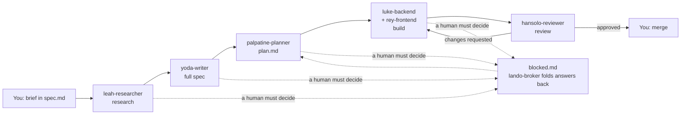

# Open Lanes Depot

[](https://dl.circleci.com/status-badge/redirect/gh/kigster/openlanes/tree/main)  [](https://github.com/kigster/openlanes/actions/workflows/agents/copilot-pull-request-reviewer) [](https://github.com/kigster/openlanes/actions/workflows/dependabot/dependabot-updates)

`openlanes` is a CLI software factory. You write a short feature brief; a team of specialist coding agents researches it, specifies it, plans it, builds it and reviews it, until it is a set of reviewed, CI-passing pull requests. You merge. Every feature is a folder under `.plans/`, and the folder's name is its state. The gem installs three names for the same executable: `openlanes`, `lanes` and `depot`.




Agents may write code, tests and plan documents, but never commit, push or merge. The harness checks that, then publishes the branch and opens the pull request itself.

## Install

Requirements:

| Need                                                           | Why                                                                             |
| :------------------------------------------------------------- | :------------------------------------------------------------------------------ |
| Ruby 3 or newer                                                | the gem; this repository is developed on Ruby 4                                 |
| [`claude`](https://docs.anthropic.com/en/docs/claude-code) CLI | the default agent adapter; `codex` and `pi` are optional alternatives per phase |
| `git`                                                          | one worktree and branch per plan (`--isolation shared` needs no git)            |
| [`gh`](https://cli.github.com/), signed in                     | pushing branches, opening pull requests, `resync prs`                           |
| Redis                                                          | the control room (`start`, `web`); `run` falls back to headless without it      |

```bash
gem install openlanes agent-lock -N
openlanes --help
openlanes skills install            # copy the bundled skills into ~/.agents/skills (-n to preview)
eval "$(openlanes completion zsh)"  # or bash; add to your shell rc
```

[`agent-lock`](https://github.com/kigster/agent-lock) (`alock`) lets several agents share one checkout without overwriting each other's files. `skills install` copies rather than links, so re-run it with `--overwrite` after upgrading the gem.

## Quick start

Run these anywhere inside your project:

```bash
openlanes init                    # .openlanes.yml and .plans/ at the project root; -y asks nothing
openlanes create tax rule dsl     # .plans/000.00-⚪️ → tax-rule-dsl/spec.md, drafted and opened
                                  # finish the brief in spec.md and save it
openlanes run -n                  # dry run: which agent would take which plan
openlanes start                   # engine plus control room on http://127.0.0.1:11000
openlanes list-plans              # every plan, its state and its pull requests
```

`openlanes start` runs until you press **Stop All Local** on the page or Ctrl-C. Answer the agents' questions under **Needs You**, create new plans, and watch the board. For scripts and CI, `openlanes run --until-settled` (or `--no-web`) stops at the first round in which no plan changed state.

For a small mechanical task, skip research and planning:

```bash
openlanes create --lane quick split big migration
```

## Core concepts

### Plan folders

Every feature is one folder under `.plans/` (override with `PLANS_DIR`), named `NNN.MM-<emoji> → <slug>`:

```text
.plans/000.00-✅ → dev-foundation
.plans/001.00-🟡 → tenancy-households
.plans/001.01-🕰️ → schedule-k1-backfill     # shipped first, documented afterwards
.plans/002.00-⚪️ → tax-rule-dsl
```

- **`NNN.MM`** is set once and never changes. Branches (`<user>/NNN.MM-slug`), pull request titles (`[NNN.MM] ...`) and `pull-requests.md` all join on it. `MM` is `00` for a normal plan; `01` to `99` marks a retroactive plan (`openlanes create --after 001`).
- **The emoji** is the state. A transition renames the folder (through `git mv`), and a folder may only claim a state its files prove.
- **`openlanes resync dirs`** renames any folder whose name its contents contradict.

A new folder naming scheme without spaces is agreed but not built yet; see [`docs/decisions/decisions-on-plan-folder-naming.md`](docs/decisions/decisions-on-plan-folder-naming.md).

### States

Generated by `openlanes docs`; `openlanes states` draws every transition.

| Symbol | Meaning            | Files required                           |
| :----: | :----------------- | :--------------------------------------- |
|   ⚪️   | New                | `spec.md`                                |
|   🔎   | Researched         | `spec.md`                                |
|   📋   | Ready for Planning | `spec.md`, `plan.md`                     |
|   ⭐️   | Planned            | `spec.md`, `plan.md`                     |
|   🟡   | Building           | `spec.md`, `plan.md`                     |
|   🎨   | Building UI        | `spec.md`, `plan.md`                     |
|   🟢   | Ready for Review   | `spec.md`, `plan.md`, `pull-requests.md` |
|   👀   | In Review          | `spec.md`, `plan.md`, `pull-requests.md` |
|   🔴   | Changes Requested  | `spec.md`, `plan.md`, `pull-requests.md` |
|   ✅   | Approved & Merged  | `pull-requests.md`                       |
|   😎   | Deployed           | `deployed.md`                            |
|   😱   | Rolled Back        | `rollback.md`                            |
|   💩   | Scrapped by Review | `rewrite.md`                             |
|   ⭕️   | Technical Block    | `blocked.md`                             |
|   🅱️   | Product Block      | `blocked.md`                             |
|   ☢️   | Deferred           | `delayed.md`                             |
|   🕰️   | Retroactive        | none                                     |
|   ❌   | Discarded          | `discarded.md`                           |

Besides those, each plan folder holds `state.json` (each round's agent, model, tokens and time, the agents' signatures, and the messages between them) and, while building, `implementation-plan.md`, `plan-backend.md` and `plan-frontend.md`.

### Agents

From `openlanes agents list`; read one with `openlanes describe <name>`.

| Agent               | Handles                                           | Advances to        | Runs on       | Lanes      |
| :------------------ | :------------------------------------------------ | :----------------- | :------------ | :--------- |
| `leah-researcher`   | New                                               | Researched         | haiku/medium  | full       |
| `yoda-writer`       | Researched, Retroactive                           | Ready for Planning | sonnet/medium | full       |
| `palpatine-planner` | Ready for Planning                                | Planned            | opus/high     | full, plan |
| `luke-backend`      | Planned, Building, Changes Requested              | Ready for Review   | opus/high     | full, plan |
| `rey-frontend`      | Planned, Building, Building UI, Changes Requested | Ready for Review   | sonnet/medium | full, plan |
| `r2d2-mechanic`     | Planned, Building, Changes Requested              | Ready for Review   | haiku/medium  | quick      |
| `hansolo-reviewer`  | Ready for Review, In Review                       | Approved & Merged  | sonnet/high   | all        |
| `lando-broker`      | Technical Block, Product Block                    | by contents        | haiku/low     | all        |
| `c3po-operator`     | none: the control room's read-only copilot        | read-only          | haiku/low     | all        |

Agent definitions are Markdown files with frontmatter in [`agents/`](agents/). A plan's `spec.md` frontmatter can change the adapter, model and effort per phase.

### Lanes

| Lane             | Route                                                            |
| :--------------- | :--------------------------------------------------------------- |
| `full` (default) | leah → yoda → palpatine → luke (+ rey) → hansolo                 |
| `plan`           | palpatine → luke (+ rey) → hansolo, for a spec you already trust |
| `quick`          | r2d2-mechanic → hansolo, for one short mechanical task           |

### Blocks

When an agent hits a question that is not its to answer, it writes numbered questions (`B1`, `B2`, ...) into `blocked.md` and the plan stops at ⭕️ (technical) or 🅱️ (product). The loop never assigns a blocked plan. Answer on the control room page, or write answers into `blocked.md` and run `openlanes unblock NNN`.

### The autonomy boundary

- Agents never run `git commit`, `git push`, `gh pr create`, `gh pr merge` and friends; web access is off unless an agent declares `network: true`.
- After every agent, the harness verifies `HEAD` did not move and no new remote ref appeared.
- The harness, not the agent, commits, pushes and opens the pull request. `--no-git-push` turns that off.
- Nothing merges automatically. Merging and deploying stay manual.

## Commands

Run `openlanes <command> --help` for flags and examples. Anything that writes to disk, GitHub or Linear previews with `-n` / `--dry-run` where it makes sense.

| Command                                       | What it does                                                                               |
| :-------------------------------------------- | :----------------------------------------------------------------------------------------- |
| `init`                                        | write `.openlanes.yml` at the project root and create `.plans/`                            |
| `start`                                       | the engine plus its control room, until Stop All Local or Ctrl-C                           |
| `web`                                         | serve the control room alone; `--demo` replays a sample run                                |
| `create` (`new`, `c`)                         | create the next numbered plan folder and its `spec.md`                                     |
| `run`                                         | run the agents over the plans; `-n` to preview, `--until-settled` to stop at a fixed point |
| `list-plans` (`status`, `st`)                 | every plan, its state and its pull requests                                                |
| `index` (`idx`)                               | write `.plans/INDEX.md`                                                                    |
| `unblock`                                     | fold answered questions from `blocked.md` back into the plan                               |
| `worktree`                                    | create and seed a worktree for one plan                                                    |
| `resync dirs` / `resync prs`                  | fix folder names; add `[NNN.MM]` prefixes to pull request titles                           |
| `agents list` / `agents describe`, `describe` | the agent roster; one agent's definition                                                   |
| `mail send` / `mail read`                     | messages between agents on one plan                                                        |
| `state sign` / `state show`                   | an agent's signature in `state.json`; print it                                             |
| `eval`                                        | score agents against `evals/cases`; `--live` runs them for real                            |
| `docs`                                        | generate the conventions document from the state machine                                   |
| `states` (`diagram`)                          | draw every state and transition                                                            |
| `linear import` / `linear projects`           | export plans to Linear, one way                                                            |
| `skills install`                              | copy the bundled skills into `~/.agents/skills`                                            |
| `completion`                                  | print a bash or zsh completion script                                                      |
| `version`                                     | print the version                                                                          |

Global flag: `-C, --no-color`.

## Configuration

- **`.openlanes.yml`** at the project root: `project`, `lane`, `frontend`, `jobs`, `redis_url`, and per-command defaults under `commands:`. A typed flag beats `spec.md` frontmatter, which beats `.openlanes.yml`, which beats the built-in default. Unknown keys are an error.
- **`spec.md` frontmatter**: `lane`, `frontend`, `depth`, per-phase `adapter` / `model` / `effort`, `implementation_suggestions`, `implementation_requirements`, `task-completed-when`, `how-to-verify`.
- **`PLANS_DIR`**: the plans directory, `.plans` by default.

## Further reading

- [`docs/USAGE.md`](docs/USAGE.md): settings, spec frontmatter, running and limits, handoffs, safety rails, GitHub and Linear, the factory integration test.
- [`docs/WORKFLOW.md`](docs/WORKFLOW.md): states, transitions, numbering and plan files, generated by `openlanes docs`.
- [`docs/decisions/`](docs/decisions/): design decisions, including ones not built yet.
- [`docs/software-factory-proposal.md`](docs/software-factory-proposal.md): a proposed next architecture.

Related projects: [`agentilda-ai-setup`](https://github.com/kigster/agentilda-ai-setup) installs coding agents, skills and plugins from one `configuration.yml`, and ships the `/plan-*` slash commands that wrap this CLI; [`agent-lock`](https://github.com/kigster/agent-lock) coordinates agents writing in one checkout.

## Development

```bash
bin/setup               # or: just install
just test               # rspec
just lint               # rubocop, kept at zero offenses
just ci                 # lint, then tests with coverage
just format             # rubocop -a, then mdformat
just update-workflow    # regenerate docs/WORKFLOW.md
just web-build          # build web/dist, which the gem ships
just web-test           # the page: eslint, typecheck, vitest with coverage
just web-e2e            # Cypress against `openlanes web --demo`
```

`OPENLANES_FACTORY_E2E=1 just factory-e2e` runs real agents end to end and spends tokens; see [`docs/USAGE.md`](docs/USAGE.md#factory-integration-test). The executables in `exe/` find their own `Gemfile`, so they behave the same from `PATH` or another project's root. Code layout and conventions are in [`CLAUDE.md`](CLAUDE.md).

______________________________________________________________________

© 2026 Konstantin Gredeskoul
