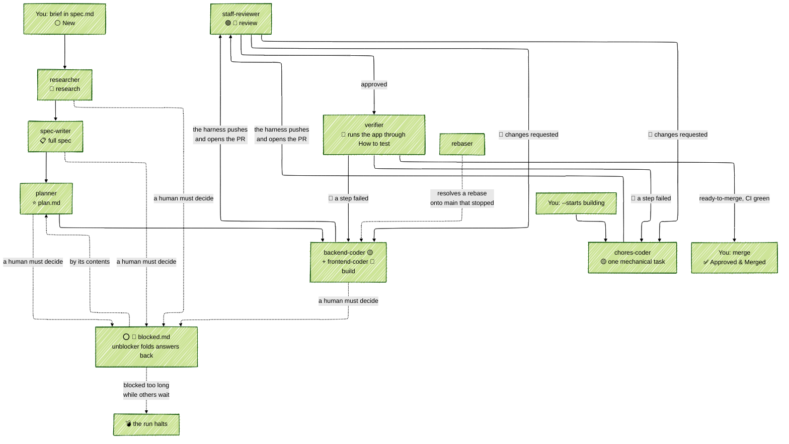

# Open Lanes: AI Software Factory

[](https://dl.circleci.com/status-badge/redirect/gh/kigster/openlanes/tree/main)  [](https://github.com/kigster/openlanes/actions/workflows/agents/copilot-pull-request-reviewer) [](https://github.com/kigster/openlanes/actions/workflows/dependabot/dependabot-updates)

> [!IMPORTANT]
>
> OpenLanes is one of few factories that can autonomously execute and implement features and merge them autonomously as well. This is configurable, and if turned on a dedicated agent provides risk assessment of whether or not this plan is safe to merge without human oversight. 

**OpenLanes®**  is an open source CLI software factory written in Ruby (but can build products in any language), that runs inside your project repo. It can help create specifications for new features (from CLI or the Web UI), and it manages the various states of development of this feature, passing it from one specialized agent to the next.

In a very brief and simplified way, creating a new feature creates it's `.plans` folder and the `spec.md` file, which is then populated by an initial agent based on the title, the spec.md is then opened in your system editor to allow you to define additional details, then a researcher agent adds some amount of research (based on both your existing codebase and external web searches), the writer then polishes the spec, before it is passeed to another agent that determines any interdependencies between plans and records it. 

Next phase is the planning phase, performed by a single agent who creates `plan.md`, with backend and front-end features split as there is a dedicated agent for each.

After the planner is finished, builders pick it up and when they are done in their worktree, the harness (ruby dispatcher) submits a pull request and invokes several agents to perform PR review. There are three types of reviewers who all use different models, and one specializes on security.  The reviewers are able to create and attach the PR labels used in this process. They can reject the PR (and almost always do), which returns it to the builders who address the feedback and re-submit the PR. The number of times this may occur is defined by "rounds" and in most cases the builders fix the PR to reviewer satisfaction.

A currently planned but not yet implemented feature is once the PR has `review-approved` label, another agent determines the risk surface area and depending on what it finds attaches one of two labels: `auto-merge` or `human-should-merge` etc.

`.plans/001.00-<emoji>-plan-title/{spec.md,plan.md,....}`

Additional files are created in the plan's folder, and when the plan is finished it's moved into `.plans/archive` folder.

## The Tech Stack

The harness and the Engine is written in Ruby, and uses deterministic state machine to move plans from one state to the next. 

The engine & backend use redis (defined by `$REDIS_URL`) for coordination and resource locking, and AASM gem for state machine transitions.

The web control room uses - React 19 and TypeScript 5.8, built with Vite 6, Tailwind CSS 4 and Radix UI, TanStack Query fetches data; @microsoft/fetch-event-source receives the server's event stream.

CodeMirror 6 edits Markdown. marked and DOMPurify render it, and highlight.js colors code blocks.

## Quick Start

```bash
brew tap kigster/tap
brew install openlanes

# cd into your project directory, which can be nearly blank or can be an established codebase
ol setup      # downloads dependencies, ensures your `gh` is authenticated or runs `gh auth login -w`
ol init       # interactively creates the configuration file .openlanes.yml for project specific settings
ol start -j 8 # number of concurrent processes allowed
```

New project, or starting from an example app? [`docs/STARTING-AN-APP.md`](docs/STARTING-AN-APP.md) walks through every step, including `.plans/APPLICATION.md`.

This starts all the parts, and it's recommended to start this inside a `screen` or a `tmux` session that survives your terminal disconnecting.

## Running OpenLanes via mprocs

If you want to see how OpenLanes runs and what it logs, you can drop this `mprocs.yml` file in the root of your repo, and use `mprocs` command to start OpenLanes. The Ruby Gem sources comes with one, but it's not distributed as part of the gem package. The gem souces are available [on Guthub](https://github.com/kigster/openlanes).

```yaml
---
# `just start`: the engine, its API server and the page, all from this
# checkout. The page is Vite's dev server on 5173, not the built web/dist,
# so an edit to a .tsx or .css file is recompiled and pushed to the open
# page at once; Vite proxies /api to the API server on 11000.
#
# Everything lands in log/development.log: the engine and the API server
# through SemanticLogger, in colour here though the gem's default is plain,
# and bin/ol-tee adds Vite and what the API server prints itself. The
# engine is not piped, so its pane keeps its live board.
procs:
  engine: ol start -j 4 --no-web --log-format color
  api: bin/ol-tee api bundle exec exe/openlanes web --no-open --log-format color
  # npm ci again whenever package-lock.json is newer than what is installed.
  web: bin/ol-web
  logs: tail -F log/development.log
```


You write a short feature brief; a team of specialist coding agents researches it, specifies it, plans it, builds it and reviews it, until it is a set of reviewed, CI-passing pull requests. You merge. Every feature is a folder under `.plans/`, and the folder's name is its state. The gem installs three names for the same executable: `openlanes`, `lanes` and `ol`.


## Picture is worth a few words ;) 

Above is the screenshot of the web component of open lanes. When you run `ol start` locally, this web UI automatcally opens and you can add your specifications via the UI, or you can execute `ol create` command on the CLI at the root of your project.

The software uses distributed locking using redis, so `$REDIS_URL`  is the only thing you need to configure.

Each open control-room tab holds one Redis connection of its own, its subscription to board updates. On a shared or hosted Redis with a connection cap (`maxclients`, or a paid plan's limit), count one connection per open tab on top of the engine's own. A Redis user whose ACL forbids `SUBSCRIBE` still gets a working board: the page falls back to polling every 250 ms.

Once you boot the web UI, you may notice swim lanes (those are plans that existed already in the `.plans` folder, or you created via "Action -> New Idea" menu.)

One of the coolest parts of this, is if you have another laptop or a desktop, you can git clone your project there too, and start `openlanes` there as well. As long as `$REDIS_URL` is same as the first instance, and the github URL of the project matches, the two instances will cooperate and a single web UI will show remote nodes in a read-only mode.

Shortly we'll provide a video of this in action.

## Quick Walkthrough the UI

It might help explain what various parts are.
Starting top left and going clockwise: 

### Top Nav

* OpenLanes logo
* The project being worked on (minesweeper) and it's URL and the node/machine
* How long this particular UI has been running, and how many agents are working
* Next it shows you the total number of tokens up and down, and the estimated price in USD, but this is assuming you pay by token. If you are on a Claude subscription this does count towards it, but it doesn't represent the actual cost you are paying (it might represent the cost Anthropic is paying though)
* Next is the button: "All Machines" → if other nodes join your project, there user@hostname
  * Action button that offers you to create a "New Idea" which it turns into a `.plans/<idea-folder>`  or to select from existing plans not already taken by remote nodes.
* Further is the dark/light switch.
* The button "Stop All Local"  terminates local openlanes instance and the web. It's a "oh-shit" button. Finally, a small circled ? pops up a bit of help to provide the context for what you are seeing.

### Secondary Nav

Where you see the "Board" (our agents) and "Logs", and where to the right of the screen you'd see remote machines connected and working on other plans represented by small buttons/pills.

### Main Swim Lanes Area

The swim lanes is the core of the "what's going on" feature of OpenLanes. Each represents a single plan, and you can see that in the screenshot only a single plan is being worked on — 001, and it's purpose is to "Create a Web Based Minesweeper Game".

Depending on how you setup your project with `lanes init` command, the `new` and `researhed` stages may or may  not be part of the flow.  OpenLanes offers three levels of feature investigation:

1. Full — this engages all of the agents, starts with the spec, performs research, rewrites it using copywriting skills, and when done, hands it off to the planning agent, planner. planner's job is to read the `spec.md` and write `plan.md` breaking it into executable tasks by the backend engineer (backend-coder) and a frontend-engineer (frontend-coder). Once the plan is written, the control is passed to the two implementing engineers who remain in communications by means of a shared state JSON file. They can send messages to each other and divide and conquer the work. Once they are done, the  report back to the dispatcher AI agent (the main thread that watches over everyone), which then creates a PR, and passes control over to three reviewers: "staff-reviewer" for correctness, "security-reviewer" for vulnerabilities and "design-reviewer" for code organisation. Together they can reject the PR twice, after which another agent with the goal of breaking deadlocks and ties, named "arbitrator", makes a final call if this PR is good to go.
2. Plan – a simplified pipeline that assumes spec.md is already written by you. It invokes planner → backend-coder (+ frontend-coder) → staff-reviewer (+ security-reviewer, design-reviewer), for a spec you already trust.
3. Quick — is a short mechanical tasks executed by a faster/simpler `chores-coder` → `staff-reviewer`.

While the project select the default, each plan can override this on a case by case basis.

### Right Drawer Area

This is where you can communicate with the agents if they get stuck. You can also pop out a copilot window that allows you to chat with the main dispatcher AI.

## What it is

**OpenLanes®** is an open source software factory written in Ruby. Its agents run on Claude Code by default, through `claude -p`, which skips loading your own configuration, skills and plugins; `codex`, `pi`, `grok` and `gemini` can stand in per phase.

For each feature it creates a folder under `.plans`, and a series of specialized AI agents turn it into a finished feature. The harness opens the pull request, staff-reviewer reviews it, and verifier runs the app through the plan's How to test before you merge.

The state diagram looks something like this:




Agents may write code, tests and plan documents, but never commit, push or merge. The harness checks that, then publishes the branch and opens the pull request itself.

## Manual Install

Requirements:

| Need                                                           | Why                                                                             |
| :------------------------------------------------------------- | :------------------------------------------------------------------------------ |
| Ruby 3 or newer                                                | the gem; this repository is developed on Ruby 4                                 |
| [`claude`](https://docs.anthropic.com/en/docs/claude-code) CLI | the default agent adapter; `codex`, `pi`, `grok` and `gemini` are optional alternatives per phase |
| `git`                                                          | one worktree and branch per plan (`--isolation shared` needs no git)            |
| [`gh`](https://cli.github.com/), signed in                     | pushing branches, opening pull requests, `resync prs`                           |
| Redis                                                          | the control room (`start`, `web`); `run` falls back to headless without it      |

```bash
gem install openlanes agent-lock agent-evals -N
ol --help
ol skills install    # copy the bundled skills into ~/.agents/skills (-n to preview)
echo 'eval "$(ol completion zsh)"'  >> ~/.zshrc  # or bash; add to your shell rc
echo 'eval "$(ol completion bash)"' >> ~/.bashrc # for bash; add to your shell rc
```

[`agent-lock`](https://github.com/kigster/agent-lock) (`alock`) lets several agents share one checkout without overwriting each other's files.

`skills install` copies rather than links, so re-run it with `--overwrite` after upgrading the gem.

## Usage

Run these anywhere inside your project:

```bash
ol setup
ol init                    # .openlanes.yml and .plans/ at the project root; -y asks nothing
ol create tax rule dsl     # .plans/000.00━━⚪━━❯tax-rule-dsl/spec.md, drafted and opened
                                  # finish the brief in spec.md and save it
openlanes run 001 -n              # dry run: which agent would take plan 001
openlanes start                   # engine plus control room on http://127.0.0.1:11000
openlanes status                  # what is up; `openlanes stop` stops it, `start --background` detaches it
openlanes plans              # every open plan, its state and its pull requests; --all adds archived ones
```

`openlanes start` runs until you press **Stop All Local** on the page, Ctrl-C, or run `openlanes stop`; it restarts the engine or the page if either crashes. Answer the agents' questions under **Needs You**, create new plans, and watch the board. For scripts and CI, `openlanes run 001,002` works just those plans, headless, and stops at the first round in which none of them changed state; `--until planned` stops them earlier.

`init` scans the repository, then asks about what it holds now and what you want it to become, with what it found preselected and yours to change. The first question is how much detail you want to give: low, medium or high ask about 10, 15 or 21 topics, from layout, languages, task runner, how the app starts and how development secrets are kept, down to search and observability. Most questions take several answers. It then asks who merges a reviewed pull request (`human` or `auto`) and the desired codebase quality (`high` or `mvp`). The answers are written under `architecture_decisions:` in `.openlanes.yml`, the agents read them from there, and CI you asked for and the folder lacks is scaffolded. The stack is also written to `docs/decisions/stack.md`.

If something can read it, `init` also asks you to describe the app, and preselects what the description states. It tells you where the description goes before asking. It uses the first of: `ANTHROPIC_API_KEY`, `OPENAI_API_KEY`, `XAI_API_KEY`, `GEMINI_API_KEY` or `OPENROUTER_API_KEY`; a local Ollama; a signed-in `claude`, `codex`, `grok` or `gemini` CLI. With none of them it asks every question. `OPENLANES_EXTRACTION_MODEL` picks the model.

The form is an [Inquirex](https://github.com/inquirex/inquirex) definition in `lib/openlanes/setup/project_form/dsl.rb`, so the same questions can be generated as JSON for `inquirex-webui` and `inquirex-widget`.

```bash
openlanes init -y --ci github_actions --merge-by auto --quality mvp   # ask nothing, no network
openlanes init --reconfigure      # ask again with the current answers as defaults; shows the diff first
openlanes init --reconfigure -n   # the diff only, nothing written
```

Under `-y` it records what the scan found, never a recommendation; the defaults are `--merge-by human` and no `desired_codebase_quality` (the first review-passed review asks it). A folder with two languages gets no `docs/decisions/stack.md`.

> [!NOTE]
>
> `.openlanes.yml` files written by this release can hold `architecture_decisions:`. An older openlanes refuses that key as unknown, so upgrade every machine that reads the file. A file with `ci:` or `stack:` still reads, and `init --reconfigure` moves them over.

For a small mechanical task, skip research and planning:

```bash
openlanes create --starts building split big migration
```

## Core concepts

### Plan folders

Every feature is one folder under `.plans/` (override with `PLANS_DIR`), named `NNN.MM━━<emoji>━━❯<slug>`:

```text
.plans/000.00━━✅━━❯dev-foundation
.plans/001.00━━🟡━━❯tenancy-households
.plans/001.01━━⏪━━❯schedule-k1-backfill     # shipped first, documented afterwards
.plans/002.00━━⚪━━❯tax-rule-dsl
```

- **`NNN.MM`** is set once and never changes. Branches (`<user>/NNN.MM-slug`), pull request titles (`[NNN.MM] ...`) and `pull-requests.md` all join on it. `MM` is `00` for a normal plan; `01` to `99` marks a retroactive plan (`openlanes create --after 001`).
- **The emoji** is the state. A transition renames the folder (through `git mv`), and a folder may only claim a state its files prove.
- **The name has no spaces**, so Tab completion works and nothing needs quoting. Each state emoji is a single code point that terminals draw two cells wide; in iTerm, turn on Unicode version 9+ widths so the columns line up.
- **`openlanes resync dirs`** renames any folder whose name its contents contradict. It also migrates folders named before this convention (`NNN.MM-<emoji> → <slug>`, or with the older emoji ⚪️ ⭐️ ⭕️ 🅱️ ☢️ 🕰️), which are still read, and moves finished, deferred and discarded plans into their subfolders. Preview it with `-n`.

A plan that is no longer active moves into a subfolder, with the date it moved inserted before the slug:

```text
.plans/archive/002.00━━✅━━❯[2026-10-13]━━dev-foundation       # ✅ and 😎
.plans/deferred/018.00━━💤━━❯[2026-10-13]━━deploy-observability # 💤
.plans/abandoned/024.00━━❌━━❯[2026-10-13]━━external-resources   # ❌
```

`.plans/` itself then lists only the work still open. Plan numbers count every folder, so a number is never reused. Reviving a plan moves it back into `.plans/` and drops the date.

While an agent works on a plan, its lock (process id, host and start time) sits in the runtime state directory, `${XDG_STATE_HOME:-~/.local/state}/openlanes/<project>-<hash>/locks/<ordinal>.lock`, beside the run's `openlanes-state.json`. Nothing runtime is written under `.plans/`, and the folder name never changes for a lock. `plans` and the control room show the plan with 🔑, adding the host for a lock taken on another machine, which is never cleared automatically. `resync dirs` removes a lock whose process is gone on this host. A legacy `locked-by.pid` or `.plans/openlanes-state.json` from an older release is still read, for one release. See `docs/decisions/decisions-on-runtime-state.md`.

Each run also appends a progress journal beside it, `${XDG_STATE_HOME:-~/.local/state}/openlanes/<project>-<hash>/journal/<run id>.ndjson`: one fsync'd, schema-versioned JSON line per engine event (run, assignment, agent pid, start time, session id, trace file and offset, transitions, extensions, questions), validated by `schemas/journal-event.schema.json` and mirrored to Redis on `openlanes:<repo>:<node>:journal`. The file, not Redis, is the record that survives a killed engine. Read the agents still in flight with `jq -c 'select(.kind | startswith("agent_"))' <file>`, or in Ruby with `OpenLanes::Engine::EventJournal::Replay.call(path)`. See `docs/decisions/decisions-on-progress-journal.md`.

See [`docs/decisions/decisions-on-plan-folder-naming.md`](docs/decisions/decisions-on-plan-folder-naming.md) for the decisions behind it.

### States

Generated by `openlanes docs`; `openlanes states` draws every transition.

| Symbol | Meaning | Files required |
| :----: | :------ | :------------- |
| ⚪ | New | `spec.md` |
| 🔎 | Researched | `spec.md` |
| 📋 | Ready for Planning | `spec.md`, `plan.md` |
| ⭐ | Planned | `spec.md`, `plan.md` |
| 🟡 | Building | `spec.md`, `plan.md` |
| 🎨 | Building UI | `spec.md`, `plan.md` |
| 🟢 | Ready for Review | `spec.md`, `plan.md`, `pull-requests.md` |
| 👀 | In Review | `spec.md`, `plan.md`, `pull-requests.md` |
| 🧪 | Verifying | `spec.md`, `plan.md`, `pull-requests.md` |
| 🔴 | Changes Requested | `spec.md`, `plan.md`, `pull-requests.md` |
| ✅ | Approved & Merged | `pull-requests.md` |
| 😎 | Deployed | `deployed.md` |
| 😱 | Rolled Back | `rollback.md` |
| 🚫 | Scrapped by Review | `rewrite.md` |
| ⭕ | Technical Block | `blocked.md` |
| 🛑 | Product Block | `blocked.md` |
| 💣 | Bomb | `blocked.md` |
| 💤 | Deferred | `delayed.md` |
| ⏪ | Retroactive | none |
| ❌ | Discarded | `discarded.md` |

🧪 sits between review and merge: verifier starts the app the way `.openlanes.yml` says and walks the plan's How to test. 💣 is a ⭕ or 🛑 left too long while other plans depend on it; the run halts until someone answers.

Besides those, each plan folder holds `state.json` (each round's agent, model, tokens and time, the agents' signatures, their journals, and the messages between them) and, while building, `implementation-plan.md`, `plan-backend.md` and `plan-frontend.md`.

### Agents

From `openlanes agents list`; read one with `openlanes describe <name>`.

| Agent               | Handles                                           | Advances to                     | Runs on       | Lanes      |
| :------------------ | :------------------------------------------------ | :------------------------------ | :------------ | :--------- |
| `researcher`   | New                                               | Researched                      | haiku/medium  | full       |
| `spec-writer`       | Researched, Retroactive                           | Ready for Planning              | sonnet/medium | full       |
| `planner` | Ready for Planning                                | Planned                         | opus/high     | full, plan |
| `backend-coder`      | Planned, Building, Changes Requested              | Ready for Review                | opus/high     | full, plan |
| `frontend-coder`      | Planned, Building, Building UI, Changes Requested | Ready for Review                | sonnet/medium | full, plan |
| `chores-coder`     | Planned, Building, Changes Requested              | Ready for Review                | haiku/medium  | quick      |
| `staff-reviewer`  | Ready for Review, In Review                       | Verifying, or Approved & Merged | opus/high     | all        |
| `security-reviewer` | Ready for Review, In Review                     | Verifying, or Approved & Merged | sonnet/high   | full, plan |
| `design-reviewer` | Ready for Review, In Review                       | Verifying, or Approved & Merged | sonnet/high   | full, plan |
| `verifier`   | Verifying                                         | Approved & Merged               | sonnet/medium | all        |
| `unblocker`      | Technical Block, Product Block, Bomb              | by contents                     | haiku/low     | all        |
| `rebaser`      | stopped rebases, from the harness                 | stages, never moves a plan      | sonnet/high   | all        |
| `copilot`     | none: the control room's read-only copilot        | read-only                       | haiku/low     | all        |

Agent definitions are Markdown files with frontmatter in [`agents/`](agents/). A plan's `spec.md` frontmatter can change the adapter, model and effort per phase.

### Lanes

| Lane             | Route                                                            |
| :--------------- | :--------------------------------------------------------------- |
| `full` (default) | researcher → spec-writer → planner → backend-coder (+ frontend-coder) → staff-reviewer (+ security-reviewer, design-reviewer) → verifier                 |
| `plan`           | planner → backend-coder (+ frontend-coder) → staff-reviewer (+ security-reviewer, design-reviewer) → verifier, for a spec you already trust |
| `quick`          | chores-coder → staff-reviewer → verifier, for one short mechanical task           |

### Blocks

When an agent hits a question that is not its to answer, it writes numbered questions (`B1`, `B2`, ...) into `blocked.md` and the plan stops at ⭕ (technical) or 🛑 (product). The loop never assigns a blocked plan. Answer on the control room page, or write answers into `blocked.md` and run `openlanes unblock NNN`.

### The autonomy boundary

- Agents never run `git commit`, `git push`, `gh pr create`, `gh pr merge` and friends; web access is off unless an agent declares `network: true`.
- After every agent, the harness verifies `HEAD` did not move and no remote-tracking ref was moved by a push.
- The harness, not the agent, commits, pushes and opens the pull request. `--no-git-push` turns that off.
- Nothing merges automatically. verifier labels a pull request `ready-to-merge` once the app passes its How to test and CI is green; merging and deploying stay manual.

## Commands

Run `openlanes <command> --help` for flags and examples. Anything that writes to disk, GitHub or Linear previews with `-n` / `--dry-run` where it makes sense.

| Command                                       | What it does                                                 |
| :-------------------------------------------- | :----------------------------------------------------------- |
| `init`                                        | write `.openlanes.yml` at the project root and create `.plans/` |
| `start`                                       | the engine plus its control room, until Stop All Local or Ctrl-C |
| `web --demo`                                  | replay a sample run in the control room; otherwise `start` serves the page |
| `project` (`preview`)                         | `start`, `status`, `stop` the app being built, from `.openlanes.yml` `app:` |
| `create` (`new`, `c`)                         | create the next numbered plan folder and its `spec.md`       |
| `run`                                         | run the agents over the plans named, headless, to a fixed point; `-n` to preview, `--until` to stop early |
| `plans`                                       | open plans, their states and pull requests (`--all`: archived too) |
| `index` (`idx`)                               | write `.plans/INDEX.md`                                      |
| `unblock`                                     | fold answered questions from `blocked.md` back into the plan |
| `worktree`                                    | create and seed a worktree for one plan                      |
| `resync dirs` / `resync prs`                  | fix folder names; add `[NNN.MM]` prefixes to pull request titles |
| `agents list` / `agents describe`, `describe` | the agent roster; one agent's definition                     |
| `mail send` / `mail read`                     | messages between agents on one plan                          |
| `state sign` / `state show`                   | an agent's signature in `state.json`; print it               |
| `eval`                                        | score agents against `evals/cases`; `--live` runs them for real |
| `docs`                                        | generate the conventions document from the state machine     |
| `states` (`diagram`)                          | draw every state and transition                              |
| `uml` / `uml self`                            | Mermaid class diagrams of the project's Ruby source, or of OpenLanes |
| `linear import` / `linear projects`           | export plans to Linear, one way                              |
| `skills install`                              | copy the bundled skills into `~/.agents/skills`              |
| `completion`                                  | print a bash or zsh completion script                        |
| `version`                                     | print the version                                            |

Global flag: `-C, --no-color`.

## Configuration

- **`.openlanes.yml`** at the project root: `project`, `lane`, `frontend`, `jobs`, `redis_url`, `redis_outage_hours`, `desired_codebase_quality`, `merge`, `ci`, `stack`, and per-command defaults under `commands:`. A typed flag beats `spec.md` frontmatter, which beats `.openlanes.yml`, which beats the built-in default. Unknown keys are an error.
- **`spec.md` frontmatter**: `lane`, `frontend`, `depth`, per-phase `adapter` / `model` / `effort`, `implementation_suggestions`, `implementation_requirements`, `task-completed-when`, `how-to-verify`.
- **`PLANS_DIR`**: the plans directory, `.plans` by default.
- **A lost Redis** does not stop the run. After 10 seconds without an answer every agent is paused through its control file (its clock stands still), nothing new starts, and the outage is recorded in `.plans/openlanes-state.json`. Redis is asked again after 1, 1, 2, 3, 5, 8 … seconds, never more than 30 seconds apart, each gap drawn at random below that (full jitter) so engines sharing one Redis do not ask in step; `redis_backoff:` in `.openlanes.yml` changes the three (`initial: 1`, `cap: 30`, `jitter: true`). When it answers, the agents resume. If it has not answered within `redis_outage_hours` (1 by default, any positive number), the run shuts down the way `q` does. On resume the log says how long Redis was gone and which copy of the run state won, e.g. `Redis is back after 72s (by heartbeat), run state from file; resuming`: the length comes from this node's last heartbeat in Redis, or from the engine's own clock when Redis came back without one, and the run state from whichever of Redis and `.plans/openlanes-state.json` has the higher `seq`. The board page shows the same as `run.outage`, and warns while the engine has not published for more than 15 seconds. A Redis that restarts empty (no AOF, an old RDB snapshot) does not stop the run either: the engine makes its commands group again (issue #59).
- **`events:`** in `.openlanes.yml`: `enabled` and `dir` for the opt-in durable run log, read back with `openlanes events report`. See [`docs/events.md`](docs/events.md).

## Further reading

- [`docs/STARTING-AN-APP.md`](docs/STARTING-AN-APP.md): from an empty directory or an example to `ol start`; [`docs/application-template.md`](docs/application-template.md) is the `APPLICATION.md` template.
- [`docs/USAGE.md`](docs/USAGE.md): settings, spec frontmatter, running and limits, handoffs, safety rails, GitHub and Linear, the factory integration test.
- [`docs/REVIEWING.md`](docs/REVIEWING.md): how to review a pull request, what each reviewer looks for, and every label, for reviewers inside openlanes or not.
- [`docs/WORKFLOW.md`](docs/WORKFLOW.md): states, transitions, numbering and plan files, generated by `openlanes docs`.
- [`docs/architecture/`](docs/architecture/README.md): class diagrams of `lib/`, generated by `openlanes uml self`; `before/` is the frozen picture from before the 4.0 refactor.
- [`docs/decisions/`](docs/decisions/): design decisions, including ones not built yet.
- [`docs/software-factory-proposal.md`](docs/software-factory-proposal.md): a proposed next architecture.

Related projects: [`agentilda-ai-setup`](https://github.com/kigster/agentilda-ai-setup) installs coding agents, skills and plugins from one `configuration.yml`, and ships the `/plan-*` slash commands that wrap this CLI; [`agent-lock`](https://github.com/kigster/agent-lock) coordinates agents writing in one checkout.

## Development

```bash
bin/setup               # or: just install
just test               # rspec
just lint               # rubocop, kept at zero offenses
just ci                 # lint, then tests with coverage
just format             # rubocop -a, then mdformat
just update-workflow    # regenerate docs/WORKFLOW.md
just update-architecture # regenerate docs/architecture/
just web-build          # build web/dist, which the gem ships
just web-test           # the page: eslint, typecheck, vitest with coverage
just web-e2e            # Cypress against `openlanes web --demo`
```

`OPENLANES_FACTORY_E2E=1 just factory-e2e` runs real agents end to end and spends tokens; see [`docs/USAGE.md`](docs/USAGE.md#factory-integration-test). The executables in `exe/` find their own `Gemfile`, so they behave the same from `PATH` or another project's root. Code layout and conventions are in [`CLAUDE.md`](CLAUDE.md).

______________________________________________________________________

© 2026 Konstantin Gredeskoul
