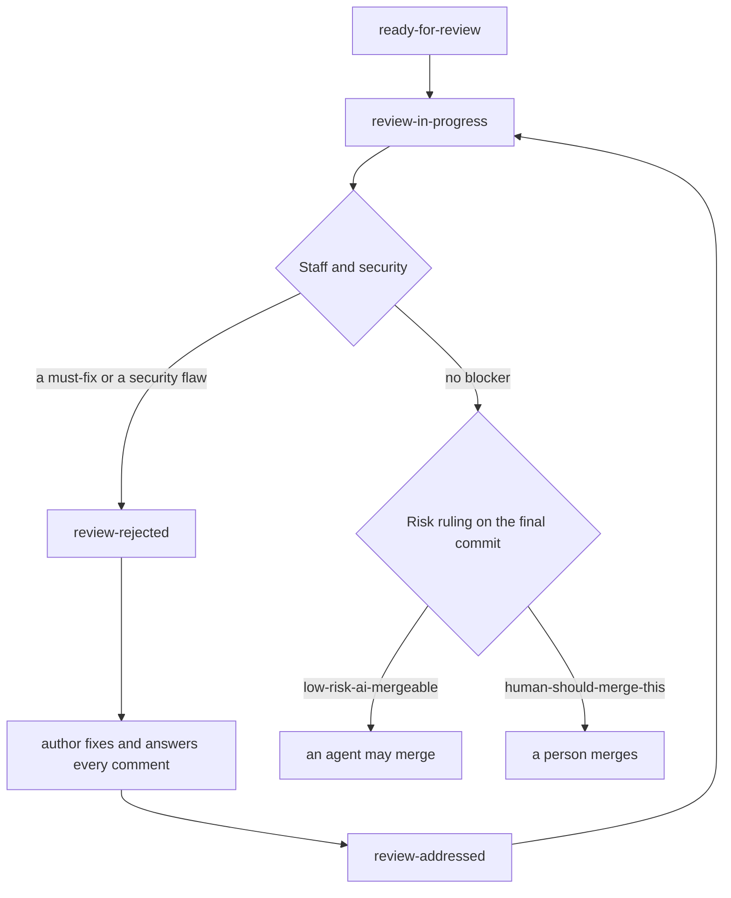

# Reviewing a pull request

How to review a pull request here, what to look for, and which label says what. It applies to every reviewer, person or agent, whether or not openlanes started them.

## At a glance

Every pull request gets three reviews, and each answers one question:

| Reviewer          | How many  | The question                                         | Sets               |
| :---------------- | :-------- | :--------------------------------------------------- | :----------------- |
| Staff engineer    | 1 or more | Is this correct, well designed and properly tested?  | the verdict label  |
| Security reviewer | 1         | Can an attacker use this?                            | the security label |
| Risk assessor     | 1         | If this is wrong, can it merge with nobody watching? | the risk label     |

A pull request is ready when it carries one label from each of those three reviews, and none of them blocks. See [When it may merge](#when-it-may-merge).

## How every reviewer works

- Review the diff (`gh pr diff <n>`). Code the diff does not touch is out of scope unless the diff breaks it.
- Stay in your own lane. The others cover theirs.
- Judge the code, not the conversation already on the pull request.
- Leave your review as a comment (`gh pr comment <n>`), never as a GitHub approval or request for changes: the same account often opened the pull request.
- A finding needs a scenario: the input, what was expected, what happens. Without one it is an opinion, so drop it.

### The comment

Open with who reviewed it and on what:

```text
Reviewed by staff-reviewer using Opus 5.5 by Anthropic at 2026/10/30 @ 12:34pm.
```

Then one entry per point, each opening with its emoji and word, then the details, and a suggested change where one helps:

| Emoji | Word             | Who           | Means                                                                                                                     | Blocks the merge |
| :---- | :--------------- | :------------ | :------------------------------------------------------------------------------------------------------------------------ | :--------------- |
| ✅    | Great!           | anyone        | A particularly good solution, roughly the top 20% of the code, not every function.                                        | no               |
| 🤔    | Hmmm...          | anyone        | Worth thinking about: a question, a change to consider, a modest optimisation.                                            | no               |
| ⛔️    | Must Fix         | anyone        | Will break production: a fatal error such as an unchecked nil call, or a performance bug more than 10x off on large data. | yes              |
| 💣    | Security Flaw    | security only | An exploitable hole, including a dependency with a known, already-fixed vulnerability.                                    | yes              |
| 🔓    | Security Concern | security only | Not exploitable now, but could become a vulnerability if misread later. Rare.                                             | no               |

⛔️ and 💣 are the critical findings. Everything else is advice.

## Staff engineer

Try to refute the change rather than confirm it: start from "this does not hold" and let the evidence change your mind. There may be several staff engineers on one pull request, and each reviews all of this.

**Correctness**

1. The diff does what was asked, and nothing that was not. Silent scope creep is the most common defect.
1. Nothing fails at runtime on an input it will meet: a nil, an empty list, a missing file, a timeout.
1. Nothing is more than 10x slower than it needs to be on data that can be large.

**Systems design**

1. Classes are small and easy to understand. Each new class or module has one responsibility, and its name says what it is. SOLID is the rule, not a religion: an exception is fine when the diff says why.
1. Collaborators are injected, not reached for, so a test can supply a mock and an implementation can be swapped without editing its callers.
1. New behaviour goes into a class of its own, not into an already large one. Growing a large class is a finding, even when the code it adds is correct.
1. No fact is written down twice. A constant, table or rule the diff adds is not already derived somewhere else.
1. Files and methods stay small. A file the diff grows past a few hundred lines, or a method past a screen, needs a reason.
1. The diff follows the patterns around it rather than adding a second way to do the same thing.

A design finding is ⛔️ only when it will make the next change wrong, not merely harder.

**Tests**

1. Every changed file is covered above the project's minimum, 95% unless it says otherwise. A diff that lowers the minimum is a finding, whatever the reason given.
1. The tests can fail. Try to construct an input that breaks the code and no test covers.
1. A test deleted, skipped or loosened, especially in a fix round, gets an explanation or a ⛔️.

Then pick one verdict:

| Your verdict | When                                                          | Label             |
| :----------- | :------------------------------------------------------------ | :---------------- |
| Great        | No findings, and the code is a pleasure to read.              | `review-approved` |
| Passed       | Only 🤔, or nothing to admire. No major bugs, coverage holds. | `review-passed`   |
| Rejected     | At least one ⛔️.                                              | `review-rejected` |
| Rewrite      | The code is missing, not working, untested or off-spec.       | `review-rejected` |

Several staff engineers share one verdict label. Any rejection rejects. Otherwise it is `review-approved` when more than half said great, and `review-passed` when not. Whoever finishes last works it out from all the verdicts.

## Security reviewer

Assume an attacker reads the diff too, and look for what they would use. Review for this and nothing else.

1. Every input from outside (a request, a file, an environment variable, a command's output, a model's reply) is validated before it is used.
1. Nothing builds SQL, a shell command, a path, HTML or a regular expression from such input without escaping it, or without the API that does.
1. No secret, token or password is written into code, a log, a prompt, an error message or a test fixture.
1. Authentication and authorisation are checked wherever the diff adds a way in, and a failure denies rather than allows.
1. Every dependency added or bumped is free of a known, already-fixed vulnerability (`bundle audit`, `npm audit` or the ecosystem's own).
1. Files, temporary directories and sockets the diff creates are not world-writable, and are not opened through a path an attacker can swap.

| Your finding        | Label                                        |
| :------------------ | :------------------------------------------- |
| Nothing, or only 🔓 | `review-opsec-ok`                            |
| At least one 💣     | `review-vulnerability` and `review-rejected` |

`review-vulnerability` is the one label that sits beside `review-rejected`. It replaces whatever verdict label the pull request carried.

## Risk assessor

Your job is not to find bugs. It is to answer two questions: if this change is wrong, how bad is it and how fast can we undo it? And how much should we trust the evidence that it is right?

The cost is lopsided. A wrong "AI may merge" can ship an outage or lose data. A wrong "human merges" costs a person ten minutes. **When in doubt, a human merges.**

| Your ruling    | When                                                                          | Label                     |
| :------------- | :---------------------------------------------------------------------------- | :------------------------ |
| AI may merge   | No hard trigger, fewer than two strong soft signals, a two-sentence rollback. | `low-risk-ai-mergeable`   |
| A human merges | Anything else.                                                                | `human-should-merge-this` |

**Hard triggers.** Any one means a human merges. Name every one you saw.

- **Schema and data.** A migration that drops or renames a column or table, changes a type, adds `NOT NULL` without a default, rewrites rows, or builds an index on a large table without doing it concurrently. Also any migration the old code cannot run against.
- **Destructive or external side effects.** Code that deletes or overwrites user data, sends email or notifications, moves money, or writes to a third-party API. A revert does not unsend an email.
- **Security.** Authentication, authorisation, sessions, tokens, secrets, encryption, permission checks, CORS, CSP, input sanitising, file uploads.
- **Breaking interface.** A removed or renamed field, route, CLI flag or response shape, or a public API change without a version bump.
- **Deploy and infrastructure.** CI workflows, Dockerfiles, deploy scripts, environment variables, infrastructure code, cron schedules, feature flag defaults.
- **Dependencies.** A new runtime dependency, a major version bump, or a lockfile change much larger than the pull request needs.
- **Weakened tests.** A test deleted, skipped, marked pending or flaky, or an assertion loosened. A fix that passes by changing the test is a red flag.
- **The factory itself.** Agent definitions, the dispatcher, merge rules, or anything else that decides what merges next.

**Soft signals.** Each one alone is fine. Two or more strong ones mean a human merges.

- **Review history.** Three or more rejection rounds, or the same issue reopened after being marked fixed.
- **Late changes.** Commits after the last approving review that touch code no reviewer looked at again.
- **Size.** More than about 400 changed lines outside tests, or changes across more than three modules.
- **Shared code.** Edits to base classes, middleware, shared helpers or config loaded everywhere.
- **Hard-to-test behaviour.** Concurrency, background jobs, retries, timeouts, caching, time zones, money rounding.
- **Thin evidence.** New behaviour with no new test, end-to-end runs that never hit the changed path, or CI that went green only after a rerun.
- **No off switch.** Behaviour that changes for every user at once with no feature flag.

What lowers risk: a feature flag that defaults off, a change `git revert` fully undoes, a migration that only adds, a change confined to one module with direct tests, a short clean review history.

Your comment says:

```markdown
**Ruling:** low-risk-ai-mergeable | human-should-merge-this

**Triggers:** each hard trigger hit, with file and line, or `none`.

**Signals:** each soft signal present, one line each, with the commit or file.

**Rollback:** how to undo this in production, in two sentences or fewer.

**For the human:** only when a human merges. What to look at first and why, in three bullets at most.
```

Every reason cites a file, a line, a commit or a CI run. "Seems risky" is not a reason. Do not fix code, re-argue what other reviewers accepted, or wait on a question: if you would need to ask, a human merges, and the question goes in your reasons.

Rule again on every round, since a fix can change the risk. Only the ruling on the final commit counts.

## Every state and its label

A pull request carries one label from each group that applies. Setting a new one in a group takes the old one off.

### Where the review stands

| State                                                      | Label                | Set by             |
| :--------------------------------------------------------- | :------------------- | :----------------- |
| Finished by its author, waiting for review                 | `ready-for-review`   | the author         |
| Being reviewed                                             | `review-in-progress` | the first reviewer |
| Fixes pushed after a rejection, waiting for another review | `review-addressed`   | the author         |

### Staff verdict

| State                                                             | Label             | Blocks the merge |
| :---------------------------------------------------------------- | :---------------- | :--------------- |
| Most staff engineers called it great                              | `review-approved` | no               |
| Nobody rejected it, most did not call it great                    | `review-passed`   | no               |
| A staff engineer rejected it, or the security reviewer found a 💣 | `review-rejected` | yes              |

### Security

| State               | Label                  | Blocks the merge |
| :------------------ | :--------------------- | :--------------- |
| No exploitable hole | `review-opsec-ok`      | no               |
| An exploitable hole | `review-vulnerability` | yes              |

### Merge risk

| State                              | Label                     | Blocks the merge |
| :--------------------------------- | :------------------------ | :--------------- |
| AI may merge once the reviews pass | `low-risk-ai-mergeable`   | no               |
| A person must merge it             | `human-should-merge-this` | an agent, yes    |

### Set by the engine or the author, never by a reviewer

| State                                               | Label                |
| :-------------------------------------------------- | :------------------- |
| openlanes' verifier ran it and its E2E tests passed | `ready-to-merge`     |
| The engine merged it on its own                     | `auto-merged`        |
| The engine left it for a person to merge            | `merge-manually`     |
| It no longer merges clean onto `main`               | `conflicts`          |
| The conflict was resolved and pushed                | `conflicts-resolved` |
| openlanes opened it from a plan                     | `openlanes`          |

### Do not use these any more

Older pull requests may still carry them.

| Old label               | Use instead            |
| :---------------------- | :--------------------- |
| `review-ok-not-perfect` | `review-passed`        |
| `review-passable`       | `review-passed`        |
| `review-opsec-issue`    | `review-vulnerability` |
| `ready-for-merge`       | the three labels above |
| `ready for merge`       | the three labels above |
| `do not merge`          | `review-rejected`      |
| `ok-to-merge`           | `ready-to-merge`       |

## How a pull request moves



## When it may merge

All of these hold on the final commit:

- [ ] CI is green.
- [ ] At least one staff engineer has reviewed, and the label is `review-approved` or `review-passed`.
- [ ] The label `review-opsec-ok` is on it.
- [ ] A risk label is on it.
- [ ] Every ⛔️ and 💣 is fixed, and no comment is left unanswered.

Then the risk label decides who merges. `low-risk-ai-mergeable`: an agent may. `human-should-merge-this`: only a person.

> [!CAUTION]
>
> No labels means no review, not a clean one. Green checks alone never make a pull request ready to merge.

## For the author

- Tell the reviewers when the pull request is ready, and link it.
- Answer every review comment in its own thread. Agree: fix it, push, and reply "Fixed in `<short sha>`". Disagree: change nothing, reply with the evidence, and leave the thread for a person to resolve.
- After a rejection, once every comment is answered and the fixes are pushed, replace `review-rejected` with `review-addressed` and ask for another review.

## Setting labels

A reviewer outside openlanes sets its own, and creates one the repository lacks:

```bash
gh pr edit <n> --remove-label "review-in-progress" --add-label "review-approved"
gh label create "review-opsec-ok" --color 79f2ab
```

| Label                     | Colour   |
| :------------------------ | :------- |
| `ready-for-review`        | `c2e0c6` |
| `review-in-progress`      | `FFBE20` |
| `review-approved`         | `109a10` |
| `review-passed`           | `E8E890` |
| `review-rejected`         | `F90000` |
| `review-addressed`        | `A2FF02` |
| `review-opsec-ok`         | `79f2ab` |
| `review-vulnerability`    | `FF0050` |
| `low-risk-ai-mergeable`   | `0e8a16` |
| `human-should-merge-this` | `d93f0b` |

## Inside openlanes

The labels mean the same, but a few things run differently:

- A reviewer openlanes started never labels. It reports its verdict, and the engine sets the label once every reviewer has reported, so no two reviewers race.
- `security-reviewer` also votes on the verdict label, and `design-reviewer` takes the systems design checks above. A plan that starts at `building` gets `staff-reviewer` alone.
- Not built yet (plan 031, PR 6): the engine does not set `review-opsec-ok`, `low-risk-ai-mergeable` or `human-should-merge-this`, and `deploy-assessor` still runs after verification rather than beside the reviewers. Until then, reviewers outside openlanes set those three.
