<!-- Generated by `openlanes uml`. Do not edit; run `just update-architecture`. -->

# OpenLanes namespaces

```mermaid
classDiagram
  class OpenLanes["OpenLanes"]
  class OpenLanes__Adapters["OpenLanes::Adapters"]
  class OpenLanes__Agents["OpenLanes::Agents"]
  class OpenLanes__Apps["OpenLanes::Apps"]
  class OpenLanes__Arbitration["OpenLanes::Arbitration"]
  class OpenLanes__CLI["OpenLanes::CLI"]
  class OpenLanes__Clock["OpenLanes::Clock"]
  class OpenLanes__Container["OpenLanes::Container"]
  class OpenLanes__Coverage["OpenLanes::Coverage"]
  class OpenLanes__Engine["OpenLanes::Engine"]
  class OpenLanes__Evals["OpenLanes::Evals"]
  class OpenLanes__Events["OpenLanes::Events"]
  class OpenLanes__Execution["OpenLanes::Execution"]
  class OpenLanes__Lifecycle["OpenLanes::Lifecycle"]
  class OpenLanes__Linear["OpenLanes::Linear"]
  class OpenLanes__Live["OpenLanes::Live"]
  class OpenLanes__Log["OpenLanes::Log"]
  class OpenLanes__Plans["OpenLanes::Plans"]
  class OpenLanes__Presentation["OpenLanes::Presentation"]
  class OpenLanes__Setup["OpenLanes::Setup"]
  class OpenLanes__Skills["OpenLanes::Skills"]
  class OpenLanes__Spawner["OpenLanes::Spawner"]
  class OpenLanes__Supervision["OpenLanes::Supervision"]
  class OpenLanes__UI["OpenLanes::UI"]
  class OpenLanes__Uml["OpenLanes::Uml"]
  class OpenLanes__Vcs["OpenLanes::Vcs"]
  class OpenLanes__Web["OpenLanes::Web"]
  OpenLanes ..> OpenLanes__Agents : 1
  OpenLanes ..> OpenLanes__Apps : 1
  OpenLanes ..> OpenLanes__CLI : 1
  OpenLanes ..> OpenLanes__Container : 1
  OpenLanes ..> OpenLanes__Coverage : 1
  OpenLanes ..> OpenLanes__Live : 1
  OpenLanes ..> OpenLanes__Plans : 4
  OpenLanes ..> OpenLanes__UI : 1
  OpenLanes__Adapters ..> OpenLanes : 1
  OpenLanes__Adapters ..> OpenLanes__Execution : 2
  OpenLanes__Adapters ..> OpenLanes__Plans : 1
  OpenLanes__Agents ..> OpenLanes : 3
  OpenLanes__Agents ..> OpenLanes__Adapters : 3
  OpenLanes__Agents ..> OpenLanes__Engine : 1
  OpenLanes__Agents ..> OpenLanes__Plans : 5
  OpenLanes__Agents ..> OpenLanes__UI : 1
  OpenLanes__Apps ..> OpenLanes : 6
  OpenLanes__Apps ..> OpenLanes__Execution : 1
  OpenLanes__Apps ..> OpenLanes__Live : 2
  OpenLanes__Apps ..> OpenLanes__UI : 1
  OpenLanes__Arbitration ..> OpenLanes : 5
  OpenLanes__Arbitration ..> OpenLanes__Agents : 3
  OpenLanes__Arbitration ..> OpenLanes__Plans : 10
  OpenLanes__Arbitration ..> OpenLanes__Vcs : 2
  OpenLanes__CLI ..> OpenLanes : 32
  OpenLanes__CLI ..> OpenLanes__Agents : 10
  OpenLanes__CLI ..> OpenLanes__Apps : 5
  OpenLanes__CLI ..> OpenLanes__Coverage : 3
  OpenLanes__CLI ..> OpenLanes__Engine : 7
  OpenLanes__CLI ..> OpenLanes__Evals : 4
  OpenLanes__CLI ..> OpenLanes__Events : 1
  OpenLanes__CLI ..> OpenLanes__Execution : 1
  OpenLanes__CLI ..> OpenLanes__Lifecycle : 5
  OpenLanes__CLI ..> OpenLanes__Linear : 6
  OpenLanes__CLI ..> OpenLanes__Live : 13
  OpenLanes__CLI ..> OpenLanes__Log : 7
  OpenLanes__CLI ..> OpenLanes__Plans : 25
  OpenLanes__CLI ..> OpenLanes__Presentation : 8
  OpenLanes__CLI ..> OpenLanes__Setup : 5
  OpenLanes__CLI ..> OpenLanes__Skills : 1
  OpenLanes__CLI ..> OpenLanes__Supervision : 12
  OpenLanes__CLI ..> OpenLanes__UI : 19
  OpenLanes__CLI ..> OpenLanes__Uml : 2
  OpenLanes__CLI ..> OpenLanes__Vcs : 7
  OpenLanes__CLI ..> OpenLanes__Web : 14
  OpenLanes__Coverage ..> OpenLanes : 5
  OpenLanes__Coverage ..> OpenLanes__UI : 1
  OpenLanes__Engine ..> OpenLanes : 33
  OpenLanes__Engine ..> OpenLanes__Adapters : 1
  OpenLanes__Engine ..> OpenLanes__Agents : 13
  OpenLanes__Engine ..> OpenLanes__Apps : 4
  OpenLanes__Engine ..> OpenLanes__Arbitration : 5
  OpenLanes__Engine ..> OpenLanes__Clock : 10
  OpenLanes__Engine ..> OpenLanes__Container : 1
  OpenLanes__Engine ..> OpenLanes__Coverage : 4
  OpenLanes__Engine ..> OpenLanes__Events : 5
  OpenLanes__Engine ..> OpenLanes__Execution : 11
  OpenLanes__Engine ..> OpenLanes__Lifecycle : 8
  OpenLanes__Engine ..> OpenLanes__Live : 11
  OpenLanes__Engine ..> OpenLanes__Log : 3
  OpenLanes__Engine ..> OpenLanes__Plans : 73
  OpenLanes__Engine ..> OpenLanes__UI : 24
  OpenLanes__Engine ..> OpenLanes__Vcs : 9
  OpenLanes__Engine ..> OpenLanes__Web : 2
  OpenLanes__Evals ..> OpenLanes : 6
  OpenLanes__Evals ..> OpenLanes__Agents : 3
  OpenLanes__Evals ..> OpenLanes__Execution : 1
  OpenLanes__Evals ..> OpenLanes__Lifecycle : 1
  OpenLanes__Evals ..> OpenLanes__Plans : 11
  OpenLanes__Events ..> OpenLanes : 1
  OpenLanes__Events ..> OpenLanes__Adapters : 1
  OpenLanes__Events ..> OpenLanes__Live : 1
  OpenLanes__Execution ..> OpenLanes : 2
  OpenLanes__Execution ..> OpenLanes__Adapters : 1
  OpenLanes__Execution ..> OpenLanes__Agents : 1
  OpenLanes__Execution ..> OpenLanes__Lifecycle : 1
  OpenLanes__Execution ..> OpenLanes__Plans : 5
  OpenLanes__Execution ..> OpenLanes__Spawner : 1
  OpenLanes__Execution ..> OpenLanes__UI : 4
  OpenLanes__Lifecycle ..> OpenLanes : 20
  OpenLanes__Lifecycle ..> OpenLanes__Adapters : 1
  OpenLanes__Lifecycle ..> OpenLanes__Agents : 5
  OpenLanes__Lifecycle ..> OpenLanes__Events : 1
  OpenLanes__Lifecycle ..> OpenLanes__Execution : 3
  OpenLanes__Lifecycle ..> OpenLanes__Plans : 29
  OpenLanes__Lifecycle ..> OpenLanes__UI : 7
  OpenLanes__Lifecycle ..> OpenLanes__Vcs : 5
  OpenLanes__Linear ..> OpenLanes : 6
  OpenLanes__Linear ..> OpenLanes__Plans : 1
  OpenLanes__Live ..> OpenLanes : 23
  OpenLanes__Live ..> OpenLanes__Adapters : 3
  OpenLanes__Live ..> OpenLanes__Agents : 5
  OpenLanes__Live ..> OpenLanes__Arbitration : 1
  OpenLanes__Live ..> OpenLanes__Engine : 4
  OpenLanes__Live ..> OpenLanes__Execution : 4
  OpenLanes__Live ..> OpenLanes__Lifecycle : 5
  OpenLanes__Live ..> OpenLanes__Plans : 18
  OpenLanes__Live ..> OpenLanes__UI : 7
  OpenLanes__Plans ..> OpenLanes : 20
  OpenLanes__Plans ..> OpenLanes__Adapters : 1
  OpenLanes__Plans ..> OpenLanes__Agents : 3
  OpenLanes__Plans ..> OpenLanes__UI : 2
  OpenLanes__Presentation ..> OpenLanes : 4
  OpenLanes__Presentation ..> OpenLanes__Agents : 2
  OpenLanes__Presentation ..> OpenLanes__Engine : 1
  OpenLanes__Presentation ..> OpenLanes__Lifecycle : 2
  OpenLanes__Presentation ..> OpenLanes__Plans : 12
  OpenLanes__Presentation ..> OpenLanes__UI : 3
  OpenLanes__Setup ..> OpenLanes : 6
  OpenLanes__Setup ..> OpenLanes__Engine : 1
  OpenLanes__Setup ..> OpenLanes__Live : 2
  OpenLanes__Setup ..> OpenLanes__Plans : 1
  OpenLanes__Setup ..> OpenLanes__UI : 2
  OpenLanes__Skills ..> OpenLanes : 1
  OpenLanes__Supervision ..> OpenLanes : 2
  OpenLanes__Supervision ..> OpenLanes__Clock : 2
  OpenLanes__Supervision ..> OpenLanes__Execution : 1
  OpenLanes__Supervision ..> OpenLanes__Log : 1
  OpenLanes__Supervision ..> OpenLanes__Spawner : 1
  OpenLanes__Supervision ..> OpenLanes__Web : 1
  OpenLanes__UI ..> OpenLanes__Log : 1
  OpenLanes__Vcs ..> OpenLanes : 5
  OpenLanes__Vcs ..> OpenLanes__Events : 1
  OpenLanes__Vcs ..> OpenLanes__Execution : 1
  OpenLanes__Vcs ..> OpenLanes__Lifecycle : 1
  OpenLanes__Vcs ..> OpenLanes__Plans : 7
  OpenLanes__Vcs ..> OpenLanes__Spawner : 1
  OpenLanes__Vcs ..> OpenLanes__UI : 4
  OpenLanes__Web ..> OpenLanes : 10
  OpenLanes__Web ..> OpenLanes__Agents : 2
  OpenLanes__Web ..> OpenLanes__Apps : 3
  OpenLanes__Web ..> OpenLanes__Engine : 1
  OpenLanes__Web ..> OpenLanes__Live : 28
  OpenLanes__Web ..> OpenLanes__Log : 2
  OpenLanes__Web ..> OpenLanes__Plans : 4
  OpenLanes__Web ..> OpenLanes__Spawner : 1
  OpenLanes__Web ..> OpenLanes__UI : 2
```

- [openlanes](openlanes.md)
- [openlanes-adapters](openlanes-adapters.md)
- [openlanes-agents](openlanes-agents.md)
- [openlanes-apps](openlanes-apps.md)
- [openlanes-arbitration](openlanes-arbitration.md)
- [openlanes-cli](openlanes-cli.md)
- [openlanes-clock](openlanes-clock.md)
- [openlanes-container](openlanes-container.md)
- [openlanes-coverage](openlanes-coverage.md)
- [openlanes-engine](openlanes-engine.md)
- [openlanes-evals](openlanes-evals.md)
- [openlanes-events](openlanes-events.md)
- [openlanes-execution](openlanes-execution.md)
- [openlanes-lifecycle](openlanes-lifecycle.md)
- [openlanes-linear](openlanes-linear.md)
- [openlanes-live](openlanes-live.md)
- [openlanes-log](openlanes-log.md)
- [openlanes-plans](openlanes-plans.md)
- [openlanes-presentation](openlanes-presentation.md)
- [openlanes-setup](openlanes-setup.md)
- [openlanes-skills](openlanes-skills.md)
- [openlanes-spawner](openlanes-spawner.md)
- [openlanes-supervision](openlanes-supervision.md)
- [openlanes-ui](openlanes-ui.md)
- [openlanes-uml](openlanes-uml.md)
- [openlanes-vcs](openlanes-vcs.md)
- [openlanes-web](openlanes-web.md)
