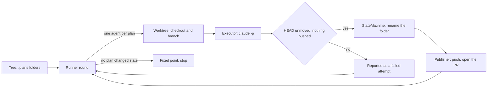

<!-- generated-by: bin/wiki-gen -->

# Architecture

_How the gem is put together, from the state machine to the run loop, with a class diagram per namespace._

**In this section:** [Namespace Map](Namespace-Map.md) · [Plan Model](Plan-Model.md) · [Agents and Execution](Agents-and-Execution.md) · [Engine and Runtime](Engine-and-Runtime.md) · [Integrations](Integrations.md) · [Developer Tooling](Developer-Tooling.md) · [Durable Run Events](Durable-Run-Events.md) · [Thread Safety](Thread-Safety.md)

______________________________________________________________________

## The folder name is the state

`.plans/003.00-⭐️--tax-rule-dsl` is plan `003.00`, state Planned, slug `tax-rule-dsl`. There is no database and no status column. A transition renames a directory through `OpenLanes.move_directory`, which prefers `git mv` so the folder's history follows it.

Two consequences shape most of the code:

- A `Status` declares the files it cannot be honest without (`requires`) plus an `invariant` lambda. That one lambda is asked in both directions: `StateMachine` asks it of a destination before moving there, and `resync dirs` asks it of the state a folder currently claims. Adding a second definition for either direction is how the two would disagree.
- Firing an event is a real side effect on disk, so asking a question about a folder must never fire one.

<sub>Lifted verbatim from [`CLAUDE.md`](https://github.com/kigster/openlanes/blob/main/CLAUDE.md).</sub>

## Nothing is written down twice

The code repeatedly explains, in comments, which duplicated table burned it. Before adding a constant, check whether the fact is already derived from one of these:

| Fact                                                 | Source of truth                                | Read back by                                                                      |
| ---------------------------------------------------- | ---------------------------------------------- | --------------------------------------------------------------------------------- |
| Status vocabulary, emoji, required files, invariants | `lib/openlanes/plans/status.rb`, `STATUSES`    | `documentation.rb`, `diagram.rb`, `reporter.rb`, `index.rb`                       |
| Which transitions are legal                          | `lib/openlanes/plans/state_machine.rb`, `aasm` | `StateMachine.inbound`, `.outbound`, `.edge?`, `Status#terminal?`, both renderers |
| Numbering rules                                      | `lib/openlanes/plans/ordinal.rb`               | `documentation.rb`, `creator.rb`                                                  |
| Which agent handles which state                      | `agents/*.md` frontmatter                      | `Agents::Registry`, `Roster`, `Runner` routing, `Executor` tool grants            |

`just update-architecture` regenerates `docs/architecture/` from `lib/`, and `spec/openlanes/docs/architecture_doc_spec.rb` fails when it is stale; `docs/architecture/before/` is frozen. `openlanes docs` regenerates the whole conventions document from the first three; `just update-workflow` writes it to `docs/WORKFLOW.md`. Hand-writing any of those tables reintroduces the bug the derivation exists to kill.

A status answers to its key and its emoji, and to nothing else. The synonym table that used to sit in `status.rb` went stale pointing six words at a state that no longer existed, so there is deliberately no alias map.

<sub>Lifted verbatim from [`CLAUDE.md`](https://github.com/kigster/openlanes/blob/main/CLAUDE.md).</sub>

## The run loop



`Runner#call` stops at a fixed point, a round in which no plan changed state, or when nothing is left that an agent may touch. Blocked plans (⭕️ and 🅱️) are stepped around, never assigned. Plans joined by an unfinished `depends_on:` edge form a group, and a group works on one plan at a time: the first in topological order that may start, preferring one whose build is under way (`Plans::Dependencies#head`). The rest are held as "queued behind NNN.MM", and separate groups run side by side. `--isolation worktree` gives each plan its own checkout and runs `jobs` agents at once; `--isolation shared` is one tree, serial, and needs no git. Each round runs `resync dirs` twice on the main tree, serially: once before agents are assigned, so a folder whose name lags its contents goes to the right agent under the right name, and once after every agent has been joined, so what the round reports is what is on disk. A chain hands a plan to one agent at a time and stops short of a state two agents handle as a pair; the next round starts the pair together.

<sub>Lifted verbatim from [`CLAUDE.md`](https://github.com/kigster/openlanes/blob/main/CLAUDE.md).</sub>

## Layout

Every directory under `lib/openlanes/` is a namespace with a module file of the same name. That file is the facade: a few module methods (`Plans.tree`, `Lifecycle.create`, `Agents.registry`, `Engine.runner`, `Execution.executor`, `Vcs.worktree`, `Presentation.documentation`) that the CLI calls instead of constructing classes. Reach into a namespace from outside only through its facade, unless you need a value type such as `Plans::Status`.

```
exe/openlanes            resolves its own BUNDLE_GEMFILE, so the binary works from any project root
lib/openlanes.rb         Zeitwerk loader, move_directory, plans_on_ref
lib/openlanes/
  plans/                 OpenLanes::Plans — the plan model, no processes, no network
    status.rb            STATUSES, the invariants, the block-notation regexes (B1/A1)
    state_machine.rb     aasm topology, SPINE, PREFERENCE, FAMILIES
    ordinal.rb           NNN.MM identity, set once, never renumbered
    feature.rb           one decoded folder name, plus titleize and its acronym tables
    tree.rb, subject.rb  a .plans directory, decoded and ordered; one folder as the machine sees it
    pull_request(s).rb   rows parsed out of pull-requests.md
    ledger.rb            the dated notes agents sign with, read from markdown and from state.json
    plan_state.rb        state.json in each plan folder: stages, signatures, messages; schemas/plan-state.schema.json
    mailbox.rb           how a pair talks, append-only and numbered, kept in state.json
    spec.rb              spec.md frontmatter: lane, frontend, depth, per-phase adapter/model/effort
    index.rb, dev_work.rb  INDEX.md; the dev/none no-plan prefixes
  lifecycle/             OpenLanes::Lifecycle — operations that create, rename or drain plans
    creator.rb, brief.rb minting a folder and scaffolding its opening spec.md
    resync.rb            dirs (folder name vs contents) and prs (PR title prefixes)
    adoption.rb          gives an orphan pull request a retroactive plan of its own
    unblocker.rb         drains answered questions out of blocked.md
    lanes.rb             moves plan- and quick-lane plans past the phases they skip
    completion.rb        copies the spec's task-completed-when and how-to-verify into plan.md
  agents/                OpenLanes::Agents — agents/*.md loaded (Registry), one definition (Agent), the report (Roster),
                         Profile (adapter, model, effort for one plan), Routing (lanes, toggles, needs)
  adapters/              OpenLanes::Adapters — claude, codex, pi, grok, gemini: argv and transcript per CLI; Stream reads generic JSONL,
                         Grok::Stream and Gemini::Stream their own dialects, Gemini::Policy its denylist
  engine/                OpenLanes::Engine — the round loop
    runner.rb            run configuration, until a fixed point
    dispatcher.rb        the tick loop: assign, poll, settle, rename
    state_file.rb        restart state; board.rb, tally.rb, progress_log.rb what the run shows and costs
  execution/             OpenLanes::Execution — one agent invocation
    executor.rb          one agent invocation through its adapter, and the autonomy boundary
    boundary.rb          the after-check: HEAD unmoved, no remote-tracking ref moved by a push
    child.rb, clock.rb, control.rb   the process, its advisory timeout, its control file
    transcript.rb        parses --output-format stream-json into a spinner phrase
  vcs/                   OpenLanes::Vcs — worktree.rb, publisher.rb (push, open the PR), github.rb (the gh seam)
  presentation/          OpenLanes::Presentation —
                         documentation.rb (`openlanes docs`), diagram.rb (`openlanes states`), reporter.rb, viewer.rb
  support/               collapsed by Zeitwerk, so these stay OpenLanes::UI, ::Markdown, ::Frontmatter,
                         ::Project (the root search) and ::Config (.openlanes.yml)
  uml/                   OpenLanes::Uml — `openlanes uml`: Prism parses lib/ (and app/), Model draws classes and typed edges,
                         NamespaceMap and ClassDiagram render Mermaid, Writer fills docs/architecture/
  skills/                OpenLanes::Skills — the bundled skills/*/SKILL.md, and the installer that copies them
  linear/                one-way export of .plans to Linear projects and issues
  evals/                 OpenLanes::Evals — per-agent cases (evals/cases/<agent>/<id>.yml), deterministic
                         checks per depth, offline scoring of recordings, --live runs in a temp repo
  cli.rb                 the dry-cli registry, and the dry-cli-help `help` block that titles it
  cli/base.rb            shared flags, tree_for, refuse, the dry-run footer
  cli/<command>/         one file per command (create/create.rb, run/run.rb, …),
                         subcommands/ under the prefixed groups (agents, resync,
                         linear, mail); linear/linear.rb is the shared Team base
```

Inside `cli/`, `CLI::Agents`, `CLI::Index`, `CLI::Worktree`, `CLI::Resync` and `CLI::Linear` shadow library names, so code there writes `OpenLanes::Agents` in full.

<sub>Lifted verbatim from [`CLAUDE.md`](https://github.com/kigster/openlanes/blob/main/CLAUDE.md).</sub>

______________________________________________________________________

## Sources

Generated by [`bin/wiki-gen`](https://github.com/kigster/openlanes/blob/main/bin/wiki-gen) v2.0.0 at the commit of 2026-11-07, from:

- [`CLAUDE.md`](https://github.com/kigster/openlanes/blob/main/CLAUDE.md)
