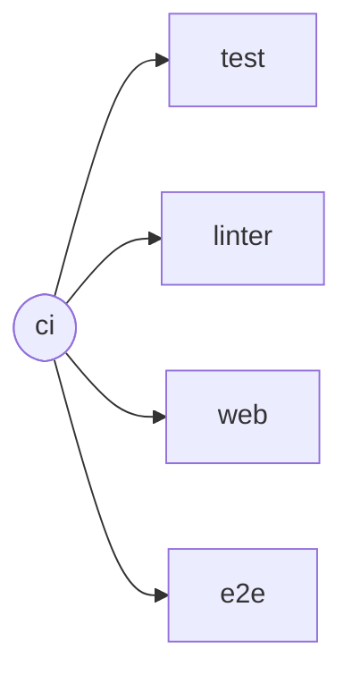

<!-- generated-by: bin/wiki-gen -->

# Continuous Integration

_The CircleCI jobs, what each runs, and the order the workflow runs them in._

**Up:** [Development](Development.md)

______________________________________________________________________

## Workflows

### `ci`

## Jobs

### `linter`

Runs on executor `ruby`.

1. `checkout`
1. `install_packages`
1. `bundle_deps`
1. Lint with Rubocop

### `test`

Runs on `cimg/ruby:4.0.6`, `cimg/redis:7.4`.

1. `checkout`
1. `install_packages`
1. `bundle_deps`
1. Wait for Redis
1. Run tests
1. Coverage of changed files
1. No retired names

### `web`

Runs on `cimg/node:22.21`.

1. `checkout`
1. `restore_cache`: \`\`
1. Install web dependencies
1. `save_cache`: \`\`
1. Lint and type-check
1. Unit tests with coverage
1. Coverage of changed files
1. Build
1. `store_artifacts`: \`\`

### `e2e`

Runs on `cimg/ruby:4.0.6-browsers`, `cimg/redis:7.4`.

1. `checkout`
1. `install_packages`
1. Install Node and Cypress's system libraries
1. `bundle_deps`
1. `restore_cache`: \`\`
1. Install web dependencies and the Cypress binary
1. `save_cache`: \`\`
1. Build the page
1. Package the gem with the page
1. Wait for Redis
1. Integration specs
1. Cypress against two demo servers
1. Keep Cypress's videos and screenshots
1. `store_artifacts`: \`\`

Read from [`.circleci/config.yml`](https://github.com/kigster/openlanes/blob/main/.circleci/config.yml).

______________________________________________________________________

## Sources

Generated by [`bin/wiki-gen`](https://github.com/kigster/openlanes/blob/main/bin/wiki-gen) v2.0.0 at the commit of 2026-11-07, from:

- [`.circleci/config.yml`](https://github.com/kigster/openlanes/blob/main/.circleci/config.yml)
