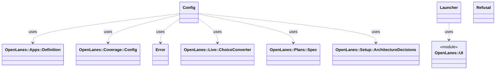

<!-- generated-by: bin/wiki-gen -->

# Namespace Map

_Every OpenLanes namespace and how many references each one makes to the others._

**Up:** [Architecture](Architecture.md)

______________________________________________________________________

Every arrow is a dependency, labelled with the number of references one namespace makes to the other. The diagram is regenerated from `lib/` by `just update-architecture`; this page reads it from [`docs/architecture/README.md`](https://github.com/kigster/openlanes/blob/main/docs/architecture/README.md).

```mermaid
classDiagram
  class OpenLanes["OpenLanes"]
  class OpenLanes__Adapters["OpenLanes::Adapters"]
  class OpenLanes__Agents["OpenLanes::Agents"]
  class OpenLanes__Apps["OpenLanes::Apps"]
  class OpenLanes__Arbitration["OpenLanes::Arbitration"]
  class OpenLanes__CLI["OpenLanes::CLI"]
  class OpenLanes__Clock["OpenLanes::Clock"]
  class OpenLanes__Container["OpenLanes::Container"]
  class OpenLanes__Coverage["OpenLanes::Coverage"]
  class OpenLanes__Engine["OpenLanes::Engine"]
  class OpenLanes__Evals["OpenLanes::Evals"]
  class OpenLanes__Events["OpenLanes::Events"]
  class OpenLanes__Execution["OpenLanes::Execution"]
  class OpenLanes__Lifecycle["OpenLanes::Lifecycle"]
  class OpenLanes__Linear["OpenLanes::Linear"]
  class OpenLanes__Live["OpenLanes::Live"]
  class OpenLanes__Log["OpenLanes::Log"]
  class OpenLanes__Plans["OpenLanes::Plans"]
  class OpenLanes__Presentation["OpenLanes::Presentation"]
  class OpenLanes__Setup["OpenLanes::Setup"]
  class OpenLanes__Skills["OpenLanes::Skills"]
  class OpenLanes__Spawner["OpenLanes::Spawner"]
  class OpenLanes__Supervision["OpenLanes::Supervision"]
  class OpenLanes__UI["OpenLanes::UI"]
  class OpenLanes__Uml["OpenLanes::Uml"]
  class OpenLanes__Vcs["OpenLanes::Vcs"]
  class OpenLanes__Web["OpenLanes::Web"]
  OpenLanes ..> OpenLanes__Adapters : 1
  OpenLanes ..> OpenLanes__Agents : 1
  OpenLanes ..> OpenLanes__Apps : 1
  OpenLanes ..> OpenLanes__CLI : 1
  OpenLanes ..> OpenLanes__Container : 1
  OpenLanes ..> OpenLanes__Coverage : 1
  OpenLanes ..> OpenLanes__Live : 1
  OpenLanes ..> OpenLanes__Plans : 3
  OpenLanes ..> OpenLanes__Setup : 1
  OpenLanes ..> OpenLanes__UI : 1
  OpenLanes__Adapters ..> OpenLanes : 1
  OpenLanes__Adapters ..> OpenLanes__Execution : 2
  OpenLanes__Adapters ..> OpenLanes__Live : 1
  OpenLanes__Adapters ..> OpenLanes__Log : 1
  OpenLanes__Adapters ..> OpenLanes__Plans : 1
  OpenLanes__Adapters ..> OpenLanes__UI : 1
  OpenLanes__Agents ..> OpenLanes : 4
  OpenLanes__Agents ..> OpenLanes__Adapters : 4
  OpenLanes__Agents ..> OpenLanes__Engine : 2
  OpenLanes__Agents ..> OpenLanes__Plans : 5
  OpenLanes__Agents ..> OpenLanes__UI : 1
  OpenLanes__Apps ..> OpenLanes : 6
  OpenLanes__Apps ..> OpenLanes__Execution : 1
  OpenLanes__Apps ..> OpenLanes__Live : 2
  OpenLanes__Apps ..> OpenLanes__UI : 1
  OpenLanes__Arbitration ..> OpenLanes : 5
  OpenLanes__Arbitration ..> OpenLanes__Agents : 3
  OpenLanes__Arbitration ..> OpenLanes__Plans : 10
  OpenLanes__Arbitration ..> OpenLanes__Vcs : 2
  OpenLanes__CLI ..> OpenLanes : 32
  OpenLanes__CLI ..> OpenLanes__Adapters : 3
  OpenLanes__CLI ..> OpenLanes__Agents : 10
  OpenLanes__CLI ..> OpenLanes__Apps : 5
  OpenLanes__CLI ..> OpenLanes__Coverage : 3
  OpenLanes__CLI ..> OpenLanes__Engine : 7
  OpenLanes__CLI ..> OpenLanes__Evals : 4
  OpenLanes__CLI ..> OpenLanes__Events : 1
  OpenLanes__CLI ..> OpenLanes__Execution : 1
  OpenLanes__CLI ..> OpenLanes__Lifecycle : 7
  OpenLanes__CLI ..> OpenLanes__Linear : 6
  OpenLanes__CLI ..> OpenLanes__Live : 13
  OpenLanes__CLI ..> OpenLanes__Log : 7
  OpenLanes__CLI ..> OpenLanes__Plans : 26
  OpenLanes__CLI ..> OpenLanes__Presentation : 8
  OpenLanes__CLI ..> OpenLanes__Setup : 8
  OpenLanes__CLI ..> OpenLanes__Skills : 1
  OpenLanes__CLI ..> OpenLanes__Supervision : 9
  OpenLanes__CLI ..> OpenLanes__UI : 19
  OpenLanes__CLI ..> OpenLanes__Uml : 2
  OpenLanes__CLI ..> OpenLanes__Vcs : 7
  OpenLanes__CLI ..> OpenLanes__Web : 14
  OpenLanes__Coverage ..> OpenLanes : 5
  OpenLanes__Coverage ..> OpenLanes__UI : 1
  OpenLanes__Engine ..> OpenLanes : 34
  OpenLanes__Engine ..> OpenLanes__Agents : 18
  OpenLanes__Engine ..> OpenLanes__Apps : 4
  OpenLanes__Engine ..> OpenLanes__Arbitration : 5
  OpenLanes__Engine ..> OpenLanes__Clock : 10
  OpenLanes__Engine ..> OpenLanes__Container : 1
  OpenLanes__Engine ..> OpenLanes__Coverage : 4
  OpenLanes__Engine ..> OpenLanes__Events : 5
  OpenLanes__Engine ..> OpenLanes__Execution : 12
  OpenLanes__Engine ..> OpenLanes__Lifecycle : 10
  OpenLanes__Engine ..> OpenLanes__Live : 11
  OpenLanes__Engine ..> OpenLanes__Log : 3
  OpenLanes__Engine ..> OpenLanes__Plans : 81
  OpenLanes__Engine ..> OpenLanes__Supervision : 2
  OpenLanes__Engine ..> OpenLanes__UI : 25
  OpenLanes__Engine ..> OpenLanes__Vcs : 10
  OpenLanes__Engine ..> OpenLanes__Web : 2
  OpenLanes__Evals ..> OpenLanes : 6
  OpenLanes__Evals ..> OpenLanes__Agents : 3
  OpenLanes__Evals ..> OpenLanes__Execution : 1
  OpenLanes__Evals ..> OpenLanes__Lifecycle : 1
  OpenLanes__Evals ..> OpenLanes__Plans : 11
  OpenLanes__Events ..> OpenLanes : 1
  OpenLanes__Events ..> OpenLanes__Adapters : 1
  OpenLanes__Events ..> OpenLanes__Live : 1
  OpenLanes__Execution ..> OpenLanes : 2
  OpenLanes__Execution ..> OpenLanes__Adapters : 1
  OpenLanes__Execution ..> OpenLanes__Agents : 3
  OpenLanes__Execution ..> OpenLanes__Lifecycle : 1
  OpenLanes__Execution ..> OpenLanes__Plans : 5
  OpenLanes__Execution ..> OpenLanes__Spawner : 2
  OpenLanes__Execution ..> OpenLanes__Supervision : 1
  OpenLanes__Execution ..> OpenLanes__UI : 3
  OpenLanes__Lifecycle ..> OpenLanes : 22
  OpenLanes__Lifecycle ..> OpenLanes__Adapters : 1
  OpenLanes__Lifecycle ..> OpenLanes__Agents : 5
  OpenLanes__Lifecycle ..> OpenLanes__Events : 1
  OpenLanes__Lifecycle ..> OpenLanes__Execution : 3
  OpenLanes__Lifecycle ..> OpenLanes__Plans : 37
  OpenLanes__Lifecycle ..> OpenLanes__UI : 8
  OpenLanes__Lifecycle ..> OpenLanes__Vcs : 5
  OpenLanes__Linear ..> OpenLanes : 6
  OpenLanes__Linear ..> OpenLanes__Plans : 1
  OpenLanes__Live ..> OpenLanes : 23
  OpenLanes__Live ..> OpenLanes__Adapters : 5
  OpenLanes__Live ..> OpenLanes__Agents : 5
  OpenLanes__Live ..> OpenLanes__Arbitration : 1
  OpenLanes__Live ..> OpenLanes__Engine : 4
  OpenLanes__Live ..> OpenLanes__Execution : 4
  OpenLanes__Live ..> OpenLanes__Lifecycle : 6
  OpenLanes__Live ..> OpenLanes__Plans : 22
  OpenLanes__Live ..> OpenLanes__UI : 7
  OpenLanes__Plans ..> OpenLanes : 19
  OpenLanes__Plans ..> OpenLanes__Adapters : 1
  OpenLanes__Plans ..> OpenLanes__Agents : 3
  OpenLanes__Plans ..> OpenLanes__UI : 2
  OpenLanes__Presentation ..> OpenLanes : 4
  OpenLanes__Presentation ..> OpenLanes__Agents : 2
  OpenLanes__Presentation ..> OpenLanes__Engine : 1
  OpenLanes__Presentation ..> OpenLanes__Lifecycle : 2
  OpenLanes__Presentation ..> OpenLanes__Plans : 12
  OpenLanes__Presentation ..> OpenLanes__UI : 3
  OpenLanes__Setup ..> OpenLanes : 7
  OpenLanes__Setup ..> OpenLanes__Adapters : 2
  OpenLanes__Setup ..> OpenLanes__Live : 2
  OpenLanes__Setup ..> OpenLanes__UI : 2
  OpenLanes__Skills ..> OpenLanes : 1
  OpenLanes__Supervision ..> OpenLanes : 2
  OpenLanes__Supervision ..> OpenLanes__Clock : 2
  OpenLanes__Supervision ..> OpenLanes__Execution : 7
  OpenLanes__Supervision ..> OpenLanes__Log : 1
  OpenLanes__Supervision ..> OpenLanes__Spawner : 1
  OpenLanes__Supervision ..> OpenLanes__Web : 1
  OpenLanes__UI ..> OpenLanes__Log : 1
  OpenLanes__Vcs ..> OpenLanes : 5
  OpenLanes__Vcs ..> OpenLanes__Events : 1
  OpenLanes__Vcs ..> OpenLanes__Execution : 1
  OpenLanes__Vcs ..> OpenLanes__Lifecycle : 1
  OpenLanes__Vcs ..> OpenLanes__Plans : 7
  OpenLanes__Vcs ..> OpenLanes__Spawner : 1
  OpenLanes__Vcs ..> OpenLanes__UI : 4
  OpenLanes__Web ..> OpenLanes : 10
  OpenLanes__Web ..> OpenLanes__Adapters : 1
  OpenLanes__Web ..> OpenLanes__Agents : 2
  OpenLanes__Web ..> OpenLanes__Apps : 3
  OpenLanes__Web ..> OpenLanes__Engine : 1
  OpenLanes__Web ..> OpenLanes__Live : 28
  OpenLanes__Web ..> OpenLanes__Log : 2
  OpenLanes__Web ..> OpenLanes__Plans : 4
  OpenLanes__Web ..> OpenLanes__Spawner : 1
  OpenLanes__Web ..> OpenLanes__UI : 2
```

## Namespaces by area

| Area                                            | Namespace                                              | Summary                                                                                                                                                                                                   |
| ----------------------------------------------- | ------------------------------------------------------ | --------------------------------------------------------------------------------------------------------------------------------------------------------------------------------------------------------- |
| [Plan Model](Plan-Model.md)                     | [`OpenLanes::Plans`](OpenLanes-Plans.md)               | The plan model: what a `.plans` folder is, which state it claims, and which transitions it may take.                                                                                                      |
| [Plan Model](Plan-Model.md)                     | [`OpenLanes::Lifecycle`](OpenLanes-Lifecycle.md)       | Operations that change which plans exist or what they are called: minting a folder, drafting its brief, adopting an orphan pull request, reconciling names with contents, draining answered questions, a… |
| [Agents and Execution](Agents-and-Execution.md) | [`OpenLanes::Agents`](OpenLanes-Agents.md)             | The specialists: their definitions in `agents/*.md`, the registry that loads and filters them, and the roster that reports on them.                                                                       |
| [Agents and Execution](Agents-and-Execution.md) | [`OpenLanes::Adapters`](OpenLanes-Adapters.md)         | The coding agents a plan can be handed to: `claude`, `codex`, `pi`, `grok` and `gemini`.                                                                                                                  |
| [Agents and Execution](Agents-and-Execution.md) | [`OpenLanes::Execution`](OpenLanes-Execution.md)       | One agent invocation: the child process, its clock, the control file it polls, and the transcript it streams back.                                                                                        |
| [Agents and Execution](Agents-and-Execution.md) | [`OpenLanes::Spawner`](OpenLanes-Spawner.md)           | The one place a child process is started, so a spec can start none.                                                                                                                                       |
| [Agents and Execution](Agents-and-Execution.md) | [`OpenLanes::Supervision`](OpenLanes-Supervision.md)   | The factory's processes (S1–S5 in docs/decisions/decisions-on-factory-start-stop.md): a supervisor that keeps the engine and the web up, the PID file and title each process gives itself, and the check… |
| [Agents and Execution](Agents-and-Execution.md) | [`OpenLanes::Arbitration`](OpenLanes-Arbitration.md)   | `arbitrator` (M7, M8, M9): a read-only agent that rules on the rejection cap, appeals, backend-coder-versus-frontend-coder disputes and `review-passed` verdicts at `mvp`.                                |
| [Agents and Execution](Agents-and-Execution.md) | [`OpenLanes::Clock`](OpenLanes-Clock.md)               | A time source, so a spec can move time instead of waiting for it.                                                                                                                                         |
| [Engine and Runtime](Engine-and-Runtime.md)     | [`OpenLanes::Engine`](OpenLanes-Engine.md)             | The run loop: which agent works which plan, in what order, until a round changes nothing.                                                                                                                 |
| [Engine and Runtime](Engine-and-Runtime.md)     | [`OpenLanes::Events`](OpenLanes-Events.md)             | The durable record of runs (plan 020.01): an opt-in, append-only JSONL log of run, agent, block/answer and PR events, kept outside the repo and outside Redis, and the aggregates read back from it.      |
| [Engine and Runtime](Engine-and-Runtime.md)     | [`OpenLanes::Live`](OpenLanes-Live.md)                 | The live run in Redis (plan 004): the engine publishes its board there and reads the page's commands from there, and machines sharing one Redis see each other's boards and never take each other's plan… |
| [Engine and Runtime](Engine-and-Runtime.md)     | [`OpenLanes::Log`](OpenLanes-Log.md)                   | The one place a process sets SemanticLogger up, so the engine and the control room's server write the same file the same way.                                                                             |
| [Engine and Runtime](Engine-and-Runtime.md)     | [`OpenLanes::Container`](OpenLanes-Container.md)       | The application's components, and the outside world they reach (A1).                                                                                                                                      |
| [Integrations](Integrations.md)                 | [`OpenLanes::Vcs`](OpenLanes-Vcs.md)                   | Git and GitHub: a checkout per plan, pushing a branch, and reading pull requests.                                                                                                                         |
| [Integrations](Integrations.md)                 | [`OpenLanes::Linear`](OpenLanes-Linear.md)             | `.plans` as Linear projects and issues. The folders already are a tracker: a number, a state, a set of pull requests and a document saying why.                                                           |
| [Integrations](Integrations.md)                 | [`OpenLanes::Web`](OpenLanes-Web.md)                   | The control room's API server (plan 004, W3, W7): Sinatra on a threaded Puma, bound to 127.0.0.1.                                                                                                         |
| [Integrations](Integrations.md)                 | [`OpenLanes::Apps`](OpenLanes-Apps.md)                 | The app a plan builds, run on this machine (plan 012, M12, M13): the processes `.openlanes.yml` declares under `app:`, started in order on ports from 11100, kept ready, restarted when their files chan… |
| [Integrations](Integrations.md)                 | [`OpenLanes::Setup`](OpenLanes-Setup.md)               | Gets a machine ready to run the factory (plan 035): the tools in the gem's `Brewfile`, then what brew cannot install.                                                                                     |
| [Integrations](Integrations.md)                 | [`OpenLanes::Skills`](OpenLanes-Skills.md)             | The agent skills that ship inside the gem, under `skills/`, and the copy that puts them where a coding agent looks for them.                                                                              |
| [Developer Tooling](Developer-Tooling.md)       | [`OpenLanes::CLI`](OpenLanes-CLI.md)                   | The command line. Every command is a thin shell over one library class: it parses flags, calls one object, and prints the result.                                                                         |
| [Developer Tooling](Developer-Tooling.md)       | [`OpenLanes::UI`](OpenLanes-UI.md)                     | Everything the user sees that is not the deliverable itself.                                                                                                                                              |
| [Developer Tooling](Developer-Tooling.md)       | [`OpenLanes::Presentation`](OpenLanes-Presentation.md) | Everything a person reads: the live dashboard, the status table, the generated conventions and the state diagram.                                                                                         |
| [Developer Tooling](Developer-Tooling.md)       | [`OpenLanes::Uml`](OpenLanes-Uml.md)                   | Class diagrams drawn from Ruby source read statically with Prism: the project being built, or OpenLanes itself.                                                                                           |
| [Developer Tooling](Developer-Tooling.md)       | [`OpenLanes::Evals`](OpenLanes-Evals.md)               | Per-agent evals: did the agent finish the task, and did it work at the depth it was asked for? A case (`evals/cases/<agent>/<id>.yml`) describes a fixture plan, the depth requested and the determinist… |
| [Developer Tooling](Developer-Tooling.md)       | [`OpenLanes::Coverage`](OpenLanes-Coverage.md)         | A project's declared test coverage (decision M15), the `coverage:` section of its `.openlanes.yml`: which command runs the suite, where the line figure comes from, and the lowest one that may merge.    |

## The root namespace

`OpenLanes` itself: the Zeitwerk loader and the few helpers every namespace shares.

______________________________________________________________________

## Sources

Generated by [`bin/wiki-gen`](https://github.com/kigster/openlanes/blob/main/bin/wiki-gen) v2.0.0 at the commit of 2026-11-07, from:

- [`docs/architecture/README.md`](https://github.com/kigster/openlanes/blob/main/docs/architecture/README.md)
- [`docs/architecture/openlanes.md`](https://github.com/kigster/openlanes/blob/main/docs/architecture/openlanes.md)
