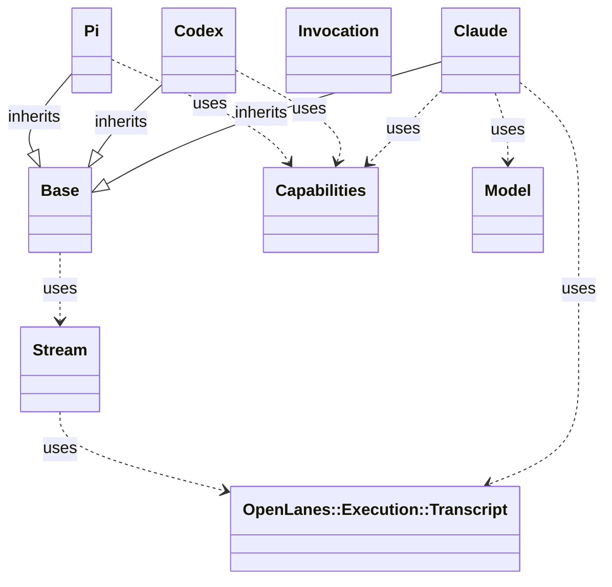

<!-- generated-by: bin/wiki-gen -->

# OpenLanes::Adapters

_The coding agents a plan can be handed to: `claude`, `codex`, `pi`, `grok` and `gemini`._

**Up:** [Agents and Execution](Agents-and-Execution.md)

______________________________________________________________________

## What the namespace says about itself

> The coding agents a plan can be handed to: `claude`, `codex`, `pi`,
> `grok` and `gemini`.
>
> The harness decides who works which plan and checks what they did; an
> adapter only knows how to start one particular CLI and how to read what
> it prints. That is the whole seam, and it is what lets an agent
> definition say `adapter: codex` without the run loop noticing.

The doc comment on `OpenLanes::Adapters` in [`lib/openlanes/adapters.rb`](https://github.com/kigster/openlanes/blob/main/lib/openlanes/adapters.rb).

## Class diagram

Generated by `openlanes uml self` (`just update-architecture`) into [`docs/architecture/openlanes-adapters.md`](https://github.com/kigster/openlanes/blob/main/docs/architecture/openlanes-adapters.md). Dotted arrows are `uses`; classes from other namespaces are shown where this one depends on them.

```mermaid
classDiagram
  class OpenLanes__Adapters__Availability["Availability"]
  class OpenLanes__Adapters__Base["Base"]
  class OpenLanes__Adapters__Capabilities["Capabilities"]
  class OpenLanes__Adapters__Claude["Claude"]
  class OpenLanes__Adapters__Codex["Codex"]
  class OpenLanes__Adapters__Gemini["Gemini"]
  class OpenLanes__Adapters__Gemini__Policy["Gemini::Policy"]
  class OpenLanes__Adapters__Gemini__Stream["Gemini::Stream"]
  class OpenLanes__Adapters__Grok["Grok"]
  class OpenLanes__Adapters__Grok__Stream["Grok::Stream"]
  class OpenLanes__Adapters__Invocation["Invocation"]
  class OpenLanes__Adapters__Model["Model"]
  class OpenLanes__Adapters__Pi["Pi"]
  class OpenLanes__Adapters__ProbeRunner["ProbeRunner"]
  class OpenLanes__Adapters__Probes["Probes"]
  class OpenLanes__Adapters__Report["Report"]
  class OpenLanes__Adapters__Stream["Stream"]
  class OpenLanes__Execution__Transcript["OpenLanes::Execution::Transcript"]
  class OpenLanes__Live__Unavailable["OpenLanes::Live::Unavailable"]
  class OpenLanes__UI["OpenLanes::UI"]
  <<module>> OpenLanes__UI
  OpenLanes__Adapters__Base ..> OpenLanes__Adapters__Availability : uses
  OpenLanes__Adapters__Base ..> OpenLanes__Adapters__Stream : uses
  OpenLanes__Adapters__Claude ..> OpenLanes__Adapters__Availability : uses
  OpenLanes__Adapters__Claude --|> OpenLanes__Adapters__Base : inherits
  OpenLanes__Adapters__Claude ..> OpenLanes__Adapters__Capabilities : uses
  OpenLanes__Adapters__Claude ..> OpenLanes__Adapters__Model : uses
  OpenLanes__Adapters__Claude ..> OpenLanes__Execution__Transcript : uses
  OpenLanes__Adapters__Codex ..> OpenLanes__Adapters__Availability : uses
  OpenLanes__Adapters__Codex --|> OpenLanes__Adapters__Base : inherits
  OpenLanes__Adapters__Codex ..> OpenLanes__Adapters__Capabilities : uses
  OpenLanes__Adapters__Codex ..> OpenLanes__Adapters__Model : uses
  OpenLanes__Adapters__Gemini ..> OpenLanes__Adapters__Availability : uses
  OpenLanes__Adapters__Gemini --|> OpenLanes__Adapters__Base : inherits
  OpenLanes__Adapters__Gemini ..> OpenLanes__Adapters__Capabilities : uses
  OpenLanes__Adapters__Gemini ..> OpenLanes__Adapters__Gemini__Policy : uses
  OpenLanes__Adapters__Gemini ..> OpenLanes__Adapters__Gemini__Stream : uses
  OpenLanes__Adapters__Gemini ..> OpenLanes__Adapters__Model : uses
  OpenLanes__Adapters__Gemini ..> OpenLanes__Adapters__Stream : uses
  OpenLanes__Adapters__Gemini__Stream --|> OpenLanes__Adapters__Stream : inherits
  OpenLanes__Adapters__Grok ..> OpenLanes__Adapters__Availability : uses
  OpenLanes__Adapters__Grok --|> OpenLanes__Adapters__Base : inherits
  OpenLanes__Adapters__Grok ..> OpenLanes__Adapters__Capabilities : uses
  OpenLanes__Adapters__Grok ..> OpenLanes__Adapters__Grok__Stream : uses
  OpenLanes__Adapters__Grok ..> OpenLanes__Adapters__Model : uses
  OpenLanes__Adapters__Grok ..> OpenLanes__Adapters__Stream : uses
  OpenLanes__Adapters__Grok__Stream --|> OpenLanes__Adapters__Stream : inherits
  OpenLanes__Adapters__Pi ..> OpenLanes__Adapters__Availability : uses
  OpenLanes__Adapters__Pi --|> OpenLanes__Adapters__Base : inherits
  OpenLanes__Adapters__Pi ..> OpenLanes__Adapters__Capabilities : uses
  OpenLanes__Adapters__Pi ..> OpenLanes__Adapters__Model : uses
  OpenLanes__Adapters__Probes ..> OpenLanes__Adapters__Availability : uses
  OpenLanes__Adapters__Probes ..> OpenLanes__Live__Unavailable : uses
  OpenLanes__Adapters__Report ..> OpenLanes__UI : uses
  OpenLanes__Adapters__Stream ..> OpenLanes__Execution__Transcript : uses
```

Before the 4.0 refactor

Frozen in [`docs/architecture/before/openlanes-adapters.md`](https://github.com/kigster/openlanes/blob/main/docs/architecture/before/openlanes-adapters.md), generated once from main at a80651d.

## Source files

- [`lib/openlanes/adapters/availability.rb`](https://github.com/kigster/openlanes/blob/main/lib/openlanes/adapters/availability.rb)
- [`lib/openlanes/adapters/base.rb`](https://github.com/kigster/openlanes/blob/main/lib/openlanes/adapters/base.rb)
- [`lib/openlanes/adapters/capabilities.rb`](https://github.com/kigster/openlanes/blob/main/lib/openlanes/adapters/capabilities.rb)
- [`lib/openlanes/adapters/claude.rb`](https://github.com/kigster/openlanes/blob/main/lib/openlanes/adapters/claude.rb)
- [`lib/openlanes/adapters/codex.rb`](https://github.com/kigster/openlanes/blob/main/lib/openlanes/adapters/codex.rb)
- [`lib/openlanes/adapters/gemini.rb`](https://github.com/kigster/openlanes/blob/main/lib/openlanes/adapters/gemini.rb)
- [`lib/openlanes/adapters/gemini/policy.rb`](https://github.com/kigster/openlanes/blob/main/lib/openlanes/adapters/gemini/policy.rb)
- [`lib/openlanes/adapters/gemini/stream.rb`](https://github.com/kigster/openlanes/blob/main/lib/openlanes/adapters/gemini/stream.rb)
- [`lib/openlanes/adapters/grok.rb`](https://github.com/kigster/openlanes/blob/main/lib/openlanes/adapters/grok.rb)
- [`lib/openlanes/adapters/grok/stream.rb`](https://github.com/kigster/openlanes/blob/main/lib/openlanes/adapters/grok/stream.rb)
- [`lib/openlanes/adapters/model.rb`](https://github.com/kigster/openlanes/blob/main/lib/openlanes/adapters/model.rb)
- [`lib/openlanes/adapters/pi.rb`](https://github.com/kigster/openlanes/blob/main/lib/openlanes/adapters/pi.rb)
- [`lib/openlanes/adapters/probe_runner.rb`](https://github.com/kigster/openlanes/blob/main/lib/openlanes/adapters/probe_runner.rb)
- [`lib/openlanes/adapters/probes.rb`](https://github.com/kigster/openlanes/blob/main/lib/openlanes/adapters/probes.rb)
- [`lib/openlanes/adapters/report.rb`](https://github.com/kigster/openlanes/blob/main/lib/openlanes/adapters/report.rb)
- [`lib/openlanes/adapters/stream.rb`](https://github.com/kigster/openlanes/blob/main/lib/openlanes/adapters/stream.rb)

______________________________________________________________________

## Sources

Generated by [`bin/wiki-gen`](https://github.com/kigster/openlanes/blob/main/bin/wiki-gen) v2.0.0 at the commit of 2026-11-07, from:

- [`lib/openlanes/adapters.rb`](https://github.com/kigster/openlanes/blob/main/lib/openlanes/adapters.rb)
- [`docs/architecture/openlanes-adapters.md`](https://github.com/kigster/openlanes/blob/main/docs/architecture/openlanes-adapters.md)
- [`docs/architecture/before/openlanes-adapters.md`](https://github.com/kigster/openlanes/blob/main/docs/architecture/before/openlanes-adapters.md)
