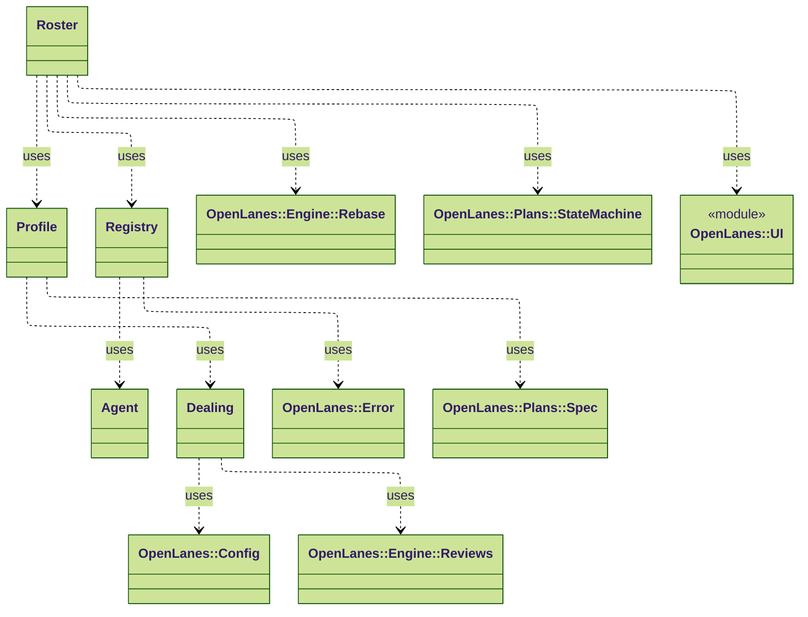
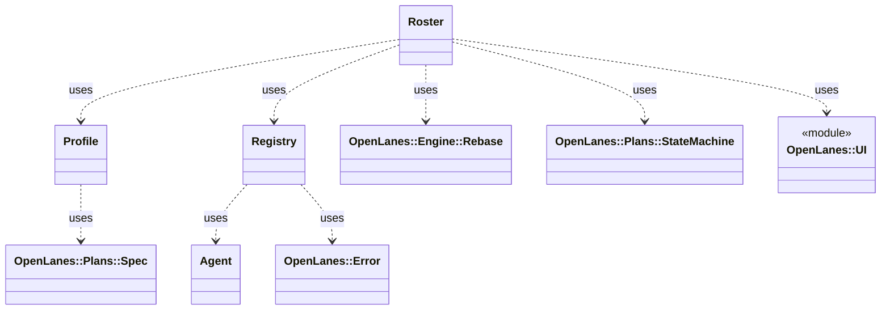

<!-- generated-by: bin/wiki-gen -->

# OpenLanes::Agents

_The specialists: their definitions in `agents/*.md`, the registry that loads and filters them, and the roster that reports on them._

**Up:** [Agents and Execution](Agents-and-Execution.md)

______________________________________________________________________

## What the namespace says about itself

> The specialists: their definitions in `agents/*.md`, the registry that
> loads and filters them, and the roster that reports on them.

The doc comment on `OpenLanes::Agents` in [`lib/openlanes/agents.rb`](https://github.com/kigster/openlanes/blob/main/lib/openlanes/agents.rb).

## Class diagram

Generated by `openlanes uml self` (`just update-architecture`) into [`docs/architecture/openlanes-agents.md`](https://github.com/kigster/openlanes/blob/main/docs/architecture/openlanes-agents.md). Dotted arrows are `uses`; classes from other namespaces are shown where this one depends on them.

Before the 4.0 refactor

Frozen in [`docs/architecture/before/openlanes-agents.md`](https://github.com/kigster/openlanes/blob/main/docs/architecture/before/openlanes-agents.md), generated once from main at a80651d.

## Source files

- [`lib/openlanes/agents/agent.rb`](https://github.com/kigster/openlanes/blob/main/lib/openlanes/agents/agent.rb)
- [`lib/openlanes/agents/dealing.rb`](https://github.com/kigster/openlanes/blob/main/lib/openlanes/agents/dealing.rb)
- [`lib/openlanes/agents/names.rb`](https://github.com/kigster/openlanes/blob/main/lib/openlanes/agents/names.rb)
- [`lib/openlanes/agents/profile.rb`](https://github.com/kigster/openlanes/blob/main/lib/openlanes/agents/profile.rb)
- [`lib/openlanes/agents/registry.rb`](https://github.com/kigster/openlanes/blob/main/lib/openlanes/agents/registry.rb)
- [`lib/openlanes/agents/roster.rb`](https://github.com/kigster/openlanes/blob/main/lib/openlanes/agents/roster.rb)
- [`lib/openlanes/agents/routing.rb`](https://github.com/kigster/openlanes/blob/main/lib/openlanes/agents/routing.rb)

______________________________________________________________________

## Sources

Generated by [`bin/wiki-gen`](https://github.com/kigster/openlanes/blob/main/bin/wiki-gen) v2.0.0 at the commit of 2026-11-07, from:

- [`lib/openlanes/agents.rb`](https://github.com/kigster/openlanes/blob/main/lib/openlanes/agents.rb)
- [`docs/architecture/openlanes-agents.md`](https://github.com/kigster/openlanes/blob/main/docs/architecture/openlanes-agents.md)
- [`docs/architecture/before/openlanes-agents.md`](https://github.com/kigster/openlanes/blob/main/docs/architecture/before/openlanes-agents.md)
