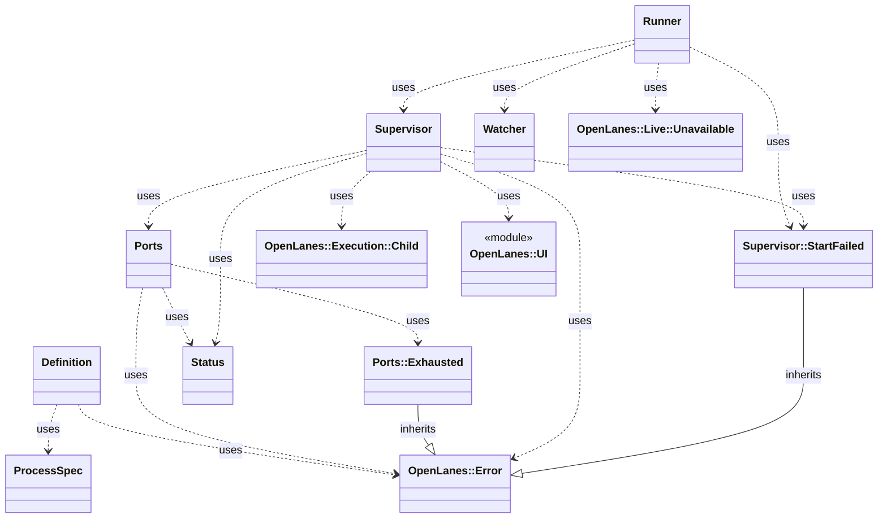

<!-- generated-by: bin/wiki-gen -->

# OpenLanes::Apps

_The app a plan builds, run on this machine (plan 012, M12, M13): the processes `.openlanes.yml` declares under `app:`, started in order on ports from 11100, kept ready, restarted when their files chan…_

**Up:** [Integrations](Integrations.md)

______________________________________________________________________

## What the namespace says about itself

> The app a plan builds, run on this machine (plan 012, M12, M13): the
> processes `.openlanes.yml` declares under `app:`, started in order on
> ports from 11100, kept ready, restarted when their files change, and
> shown in the control room's Preview tab.
>
> Plural, like `Agents` and `Adapters`, so it never reads as `Web::App`,
> the control room's own Sinatra application.

The doc comment on `OpenLanes::Apps` in [`lib/openlanes/apps.rb`](https://github.com/kigster/openlanes/blob/main/lib/openlanes/apps.rb).

## Class diagram

Generated by `openlanes uml self` (`just update-architecture`) into [`docs/architecture/openlanes-apps.md`](https://github.com/kigster/openlanes/blob/main/docs/architecture/openlanes-apps.md). Dotted arrows are `uses`; classes from other namespaces are shown where this one depends on them.

Before the 4.0 refactor

Frozen in [`docs/architecture/before/openlanes-apps.md`](https://github.com/kigster/openlanes/blob/main/docs/architecture/before/openlanes-apps.md), generated once from main at a80651d.

## Source files

- [`lib/openlanes/apps/definition.rb`](https://github.com/kigster/openlanes/blob/main/lib/openlanes/apps/definition.rb)
- [`lib/openlanes/apps/framing.rb`](https://github.com/kigster/openlanes/blob/main/lib/openlanes/apps/framing.rb)
- [`lib/openlanes/apps/listing.rb`](https://github.com/kigster/openlanes/blob/main/lib/openlanes/apps/listing.rb)
- [`lib/openlanes/apps/ports.rb`](https://github.com/kigster/openlanes/blob/main/lib/openlanes/apps/ports.rb)
- [`lib/openlanes/apps/probe.rb`](https://github.com/kigster/openlanes/blob/main/lib/openlanes/apps/probe.rb)
- [`lib/openlanes/apps/process_spec.rb`](https://github.com/kigster/openlanes/blob/main/lib/openlanes/apps/process_spec.rb)
- [`lib/openlanes/apps/runner.rb`](https://github.com/kigster/openlanes/blob/main/lib/openlanes/apps/runner.rb)
- [`lib/openlanes/apps/status.rb`](https://github.com/kigster/openlanes/blob/main/lib/openlanes/apps/status.rb)
- [`lib/openlanes/apps/supervisor.rb`](https://github.com/kigster/openlanes/blob/main/lib/openlanes/apps/supervisor.rb)
- [`lib/openlanes/apps/watcher.rb`](https://github.com/kigster/openlanes/blob/main/lib/openlanes/apps/watcher.rb)

______________________________________________________________________

## Sources

Generated by [`bin/wiki-gen`](https://github.com/kigster/openlanes/blob/main/bin/wiki-gen) v2.0.0 at the commit of 2026-11-07, from:

- [`lib/openlanes/apps.rb`](https://github.com/kigster/openlanes/blob/main/lib/openlanes/apps.rb)
- [`docs/architecture/openlanes-apps.md`](https://github.com/kigster/openlanes/blob/main/docs/architecture/openlanes-apps.md)
- [`docs/architecture/before/openlanes-apps.md`](https://github.com/kigster/openlanes/blob/main/docs/architecture/before/openlanes-apps.md)
