<!-- generated-by: bin/wiki-gen -->

# OpenLanes::Arbitration

_`arbitrator` (M7, M8, M9): a read-only agent that rules on the rejection cap, appeals, backend-coder-versus-frontend-coder disputes and `review-passed` verdicts at `mvp`._

**Up:** [Agents and Execution](Agents-and-Execution.md)

______________________________________________________________________

## What the namespace says about itself

> `arbitrator` (M7, M8, M9): a read-only agent that rules on
> the rejection cap, appeals, backend-coder-versus-frontend-coder disputes and
> `review-passed` verdicts at `mvp`. The agent only answers with a
> `ruling` block; reading that block, counting rejections and acting on a
> ruling live here, so the agent never needs a write tool.

The doc comment on `OpenLanes::Arbitration` in [`lib/openlanes/arbitration.rb`](https://github.com/kigster/openlanes/blob/main/lib/openlanes/arbitration.rb).

## Class diagram

Generated by `openlanes uml self` (`just update-architecture`) into [`docs/architecture/openlanes-arbitration.md`](https://github.com/kigster/openlanes/blob/main/docs/architecture/openlanes-arbitration.md). Dotted arrows are `uses`; classes from other namespaces are shown where this one depends on them.

```mermaid
classDiagram
  class OpenLanes__Arbitration__Appeal["Appeal"]
  class OpenLanes__Arbitration__Counter["Counter"]
  class OpenLanes__Arbitration__Effects["Effects"]
  class OpenLanes__Arbitration__Ruling["Ruling"]
  class OpenLanes__Arbitration__Ruling__Ambiguous["Ruling::Ambiguous"]
  class OpenLanes__Arbitration__Ruling__IllegalOutcome["Ruling::IllegalOutcome"]
  class OpenLanes__Arbitration__Ruling__Missing["Ruling::Missing"]
  class OpenLanes__Error["OpenLanes::Error"]
  class OpenLanes__Plans__Mailbox["OpenLanes::Plans::Mailbox"]
  class OpenLanes__Plans__PlanState["OpenLanes::Plans::PlanState"]
  class OpenLanes__Plans__ReviewLabel["OpenLanes::Plans::ReviewLabel"]
  class OpenLanes__Plans__StateMachine["OpenLanes::Plans::StateMachine"]
  class OpenLanes__Plans__StateMachine__Refused["OpenLanes::Plans::StateMachine::Refused"]
  class OpenLanes__Plans__Tree["OpenLanes::Plans::Tree"]
  class OpenLanes__Vcs__GitHub["OpenLanes::Vcs::GitHub"]
  class OpenLanes__Vcs__Review["OpenLanes::Vcs::Review"]
  OpenLanes__Arbitration__Counter ..> OpenLanes__Plans__PlanState : uses
  OpenLanes__Arbitration__Effects ..> OpenLanes__Error : uses
  OpenLanes__Arbitration__Effects ..> OpenLanes__Plans__Mailbox : uses
  OpenLanes__Arbitration__Effects ..> OpenLanes__Plans__PlanState : uses
  OpenLanes__Arbitration__Effects ..> OpenLanes__Plans__ReviewLabel : uses
  OpenLanes__Arbitration__Effects ..> OpenLanes__Plans__StateMachine : uses
  OpenLanes__Arbitration__Effects ..> OpenLanes__Plans__StateMachine__Refused : uses
  OpenLanes__Arbitration__Effects ..> OpenLanes__Plans__Tree : uses
  OpenLanes__Arbitration__Effects ..> OpenLanes__Vcs__GitHub : uses
  OpenLanes__Arbitration__Effects ..> OpenLanes__Vcs__Review : uses
  OpenLanes__Arbitration__Ruling ..> OpenLanes__Arbitration__Ruling__Ambiguous : uses
  OpenLanes__Arbitration__Ruling ..> OpenLanes__Arbitration__Ruling__IllegalOutcome : uses
  OpenLanes__Arbitration__Ruling ..> OpenLanes__Arbitration__Ruling__Missing : uses
  OpenLanes__Arbitration__Ruling ..> OpenLanes__Error : uses
  OpenLanes__Arbitration__Ruling__Ambiguous --|> OpenLanes__Error : inherits
  OpenLanes__Arbitration__Ruling__IllegalOutcome --|> OpenLanes__Error : inherits
  OpenLanes__Arbitration__Ruling__Missing --|> OpenLanes__Error : inherits
```

Before the 4.0 refactor

Frozen in [`docs/architecture/before/openlanes-arbitration.md`](https://github.com/kigster/openlanes/blob/main/docs/architecture/before/openlanes-arbitration.md), generated once from main at a80651d.

```mermaid
classDiagram
  class OpenLanes__Arbitration__Appeal["Appeal"]
  class OpenLanes__Arbitration__Counter["Counter"]
  class OpenLanes__Arbitration__Effects["Effects"]
  class OpenLanes__Arbitration__Ruling["Ruling"]
  class OpenLanes__Arbitration__Ruling__Ambiguous["Ruling::Ambiguous"]
  class OpenLanes__Arbitration__Ruling__IllegalOutcome["Ruling::IllegalOutcome"]
  class OpenLanes__Arbitration__Ruling__Missing["Ruling::Missing"]
  class OpenLanes__Error["OpenLanes::Error"]
  class OpenLanes__Plans__Mailbox["OpenLanes::Plans::Mailbox"]
  class OpenLanes__Plans__PlanState["OpenLanes::Plans::PlanState"]
  class OpenLanes__Plans__ReviewLabel["OpenLanes::Plans::ReviewLabel"]
  class OpenLanes__Plans__StateMachine["OpenLanes::Plans::StateMachine"]
  class OpenLanes__Plans__StateMachine__Refused["OpenLanes::Plans::StateMachine::Refused"]
  class OpenLanes__Plans__Tree["OpenLanes::Plans::Tree"]
  class OpenLanes__Vcs__GitHub["OpenLanes::Vcs::GitHub"]
  class OpenLanes__Vcs__Review["OpenLanes::Vcs::Review"]
  OpenLanes__Arbitration__Counter ..> OpenLanes__Plans__PlanState : uses
  OpenLanes__Arbitration__Effects ..> OpenLanes__Error : uses
  OpenLanes__Arbitration__Effects ..> OpenLanes__Plans__Mailbox : uses
  OpenLanes__Arbitration__Effects ..> OpenLanes__Plans__PlanState : uses
  OpenLanes__Arbitration__Effects ..> OpenLanes__Plans__ReviewLabel : uses
  OpenLanes__Arbitration__Effects ..> OpenLanes__Plans__StateMachine : uses
  OpenLanes__Arbitration__Effects ..> OpenLanes__Plans__StateMachine__Refused : uses
  OpenLanes__Arbitration__Effects ..> OpenLanes__Plans__Tree : uses
  OpenLanes__Arbitration__Effects ..> OpenLanes__Vcs__GitHub : uses
  OpenLanes__Arbitration__Effects ..> OpenLanes__Vcs__Review : uses
  OpenLanes__Arbitration__Ruling ..> OpenLanes__Arbitration__Ruling__Ambiguous : uses
  OpenLanes__Arbitration__Ruling ..> OpenLanes__Arbitration__Ruling__IllegalOutcome : uses
  OpenLanes__Arbitration__Ruling ..> OpenLanes__Arbitration__Ruling__Missing : uses
  OpenLanes__Arbitration__Ruling ..> OpenLanes__Error : uses
  OpenLanes__Arbitration__Ruling__Ambiguous --|> OpenLanes__Error : inherits
  OpenLanes__Arbitration__Ruling__IllegalOutcome --|> OpenLanes__Error : inherits
  OpenLanes__Arbitration__Ruling__Missing --|> OpenLanes__Error : inherits
```

## Source files

- [`lib/openlanes/arbitration/appeal.rb`](https://github.com/kigster/openlanes/blob/main/lib/openlanes/arbitration/appeal.rb)
- [`lib/openlanes/arbitration/counter.rb`](https://github.com/kigster/openlanes/blob/main/lib/openlanes/arbitration/counter.rb)
- [`lib/openlanes/arbitration/effects.rb`](https://github.com/kigster/openlanes/blob/main/lib/openlanes/arbitration/effects.rb)
- [`lib/openlanes/arbitration/ruling.rb`](https://github.com/kigster/openlanes/blob/main/lib/openlanes/arbitration/ruling.rb)

______________________________________________________________________

## Sources

Generated by [`bin/wiki-gen`](https://github.com/kigster/openlanes/blob/main/bin/wiki-gen) v2.0.0 at the commit of 2026-11-07, from:

- [`lib/openlanes/arbitration.rb`](https://github.com/kigster/openlanes/blob/main/lib/openlanes/arbitration.rb)
- [`docs/architecture/openlanes-arbitration.md`](https://github.com/kigster/openlanes/blob/main/docs/architecture/openlanes-arbitration.md)
- [`docs/architecture/before/openlanes-arbitration.md`](https://github.com/kigster/openlanes/blob/main/docs/architecture/before/openlanes-arbitration.md)
